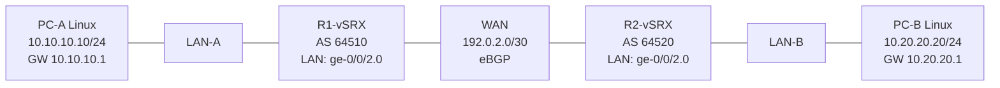

# ARCHIWUM — pierwotny wariant labu 8.14 R1–R2 BGP

**ARCHIVE ONLY — nie stosuj w nowym kursie jako topologii.** Historyczny dwurouterowy scenariusz eBGP jest przechowany do rewizji przykładów, a aktualny rozdział 8 korzysta z kanonicznego DIAMOND (4×vSRX + 2×VPCS).

## 8.14. Laboratorium — jedna sieć, cztery kontrolowane awarie [LAB]

To jest miejsce, w którym teoria ma przestać być teorią. Nie będziesz kopiować konfiguracji po to, żeby na końcu zobaczyć zielony ping. Najpierw sprawdzisz, **jaki wynik przewidujesz**, następnie sam wywołasz błąd, rozpoznasz go w CLI i naprawisz, nie usuwając przy okazji mechanizmów bezpieczeństwa.

**Status laboratorium: PLANNED / NOT RUNTIME VALIDATED.** Poniższa procedura jest kompletnym scenariuszem do uruchomienia w izolowanym EVE-NG, ale nie była wykonana na konkretnej wersji vSRX. Nie deklarujemy testów runtime PASS. Przed startem sprawdź dostępne zasoby hosta, wersję vSRX, mapowanie wirtualnych NIC, licencje/funkcje i aktualną konfigurację. Nie używaj sieci firmowej, Internet/cloud bridge ani istniejących segmentów innego laboratorium. Nie modyfikuj obecnych labów Cisco. W konfiguracjach poniżej adresy 192.0.2.0/30 i 198.51.100.0/24 są wyłącznie dokumentacyjnymi, izolowanymi przykładami.

### Co budujemy?

Potrzebujemy tylko dwóch vSRX i dwóch hostów Linux. Trzy wirtualne segmenty Ethernet: LAN-A, WAN oraz LAN-B. R1 i R2 łączą się przez eBGP. Każda strona ma własny LAN i komputer. Do końca pierwszej fazy chcemy doprowadzić do prawidłowej komunikacji PC-A ↔ PC-B; dopiero potem będziemy świadomie ją psuć.

*Rysunek 8.9. Tekst alternatywny: PC-A poprzez LAN-A do R1, połączenie WAN między R1 i R2, następnie LAN-B do PC-B. Obie jednostki vSRX rozgłaszają swoje LAN przez eBGP. Oryginalny diagram labu.*

| Węzeł | Interfejs po weryfikacji mapping | Adres | Rola |
|---|---|---|---|
| R1-vSRX | `ge-0/0/1.0` | 192.0.2.1/30 | BGP/WAN |
| R1-vSRX | `ge-0/0/2.0` | 10.10.10.1/24 | Brama LAN-A |
| R2-vSRX | `ge-0/0/1.0` | 192.0.2.2/30 | BGP/WAN |
| R2-vSRX | `ge-0/0/2.0` | 10.20.20.1/24 | Brama LAN-B |
| PC-A Linux | `eth0` lub faktyczny NIC | 10.10.10.10/24 | Klient |
| PC-B Linux | `eth0` lub faktyczny NIC | 10.20.20.20/24 | Serwer testowy |

**Zasada przed pierwszym poleceniem:** interfejsy są przykładami. Rzeczywista numeracja vSRX w EVE-NG zależy od obrazu, template i kolejności podłączenia NIC. Management może być oddzielony jako `fxp0`. Najpierw obejrzyj system, potem **podstaw prawidłowe interfejsy we wszystkich komendach**. Niczego nie „naprawiaj” przez factory reset, a tym bardziej przez skasowanie działającego management.

### Faza 0 — discovery: zanim zbudujemy sieć

Uruchom oba vSRX i dwa hosty. Zobacz, czy wolne interfejsy są rzeczywiście tymi, których chcemy użyć. Jeżeli Junos zawiera fabryczne albo odziedziczone security zones, uwzględnij je: logiczny interfejs nie może należeć do dwóch sprzecznych stref jednocześnie.

**R1-vSRX — Operational Mode**

~~~junos
show version
show interfaces terse
show chassis hardware
show configuration interfaces | display set
show configuration security zones | display set
show configuration security policies | display set
show configuration protocols bgp | display set
show route
~~~

**R2-vSRX — Operational Mode**

~~~junos
show version
show interfaces terse
show chassis hardware
show configuration interfaces | display set
show configuration security zones | display set
show configuration security policies | display set
show route
~~~

Wynik nie jest jeszcze „PASS”. Chcemy uzyskać trzy konkretne informacje: mapowanie interfejsów do LAN/WAN, rzeczywistą wersję Junos i zgodność adresacji/stref z dalszym planem. Jeśli coś nie pasuje, popraw **plan konfiguracji**, nie przypadkowy interfejs w EVE. Zapisz bezpieczny baseline poza publicznym repo; nie commituj sekretów, kluczy ani historii konsoli.

### Faza 1 — adresujemy routery i świadomie dopuszczamy ruch

Dlaczego zaczynamy od security zones, skoro uczymy się routing policy? Ponieważ na vSRX możesz doskonale skonfigurować BGP i wciąż nie przepuszczać ruchu hostów. W tej fazie tymczasowo dopuszczamy legalny ruch pomiędzy LAN i WAN na obu urządzeniach, żeby móc izolować problemy routingu. To **wyłącznie konfiguracja odseparowanego laboratorium**, nie wzorzec firewall dla produkcji.

**R1-vSRX — Operational Mode, wejście do konfiguracji**

~~~junos
configure private
~~~

**R1-vSRX — Configuration Mode, po sprawdzeniu interfejsów i konfliktów konfiguracji**

~~~junos
set interfaces ge-0/0/1 unit 0 family inet address 192.0.2.1/30
set interfaces ge-0/0/2 unit 0 family inet address 10.10.10.1/24
set security zones security-zone WAN interfaces ge-0/0/1.0 host-inbound-traffic protocols bgp
set security zones security-zone WAN interfaces ge-0/0/1.0 host-inbound-traffic system-services ping
set security zones security-zone LAN interfaces ge-0/0/2.0 host-inbound-traffic system-services ping
set security policies from-zone LAN to-zone WAN policy LAB-LAN-OUT match source-address any
set security policies from-zone LAN to-zone WAN policy LAB-LAN-OUT match destination-address any
set security policies from-zone LAN to-zone WAN policy LAB-LAN-OUT match application any
set security policies from-zone LAN to-zone WAN policy LAB-LAN-OUT then permit
set security policies from-zone WAN to-zone LAN policy LAB-WAN-IN match source-address any
set security policies from-zone WAN to-zone LAN policy LAB-WAN-IN match destination-address any
set security policies from-zone WAN to-zone LAN policy LAB-WAN-IN match application any
set security policies from-zone WAN to-zone LAN policy LAB-WAN-IN then permit
show | compare
commit check
commit confirmed 10
~~~

**R2-vSRX — Operational Mode, wejście do konfiguracji**

~~~junos
configure private
~~~

**R2-vSRX — Configuration Mode, odpowiednia adresacja drugiej strony**

~~~junos
set interfaces ge-0/0/1 unit 0 family inet address 192.0.2.2/30
set interfaces ge-0/0/2 unit 0 family inet address 10.20.20.1/24
set security zones security-zone WAN interfaces ge-0/0/1.0 host-inbound-traffic protocols bgp
set security zones security-zone WAN interfaces ge-0/0/1.0 host-inbound-traffic system-services ping
set security zones security-zone LAN interfaces ge-0/0/2.0 host-inbound-traffic system-services ping
set security policies from-zone LAN to-zone WAN policy LAB-LAN-OUT match source-address any
set security policies from-zone LAN to-zone WAN policy LAB-LAN-OUT match destination-address any
set security policies from-zone LAN to-zone WAN policy LAB-LAN-OUT match application any
set security policies from-zone LAN to-zone WAN policy LAB-LAN-OUT then permit
set security policies from-zone WAN to-zone LAN policy LAB-WAN-IN match source-address any
set security policies from-zone WAN to-zone LAN policy LAB-WAN-IN match destination-address any
set security policies from-zone WAN to-zone LAN policy LAB-WAN-IN match application any
set security policies from-zone WAN to-zone LAN policy LAB-WAN-IN then permit
show | compare
commit check
commit confirmed 10
~~~

Jeżeli commit zgłasza konflikt istniejącej security configuration, nie ignoruj go. Usuń konflikt **świadomie w odseparowanym labie**, zgodnie z rzeczywistym baseline; nie używaj masowego `delete security` ani `load override` z niepełnym fragmentem. Interfejsy w poszczególnych strefach wymagają też odpowiedniego typu adresacji i konfiguracji, więc samo zapisanie policy nie zastępuje poprawnego przypisania.

**PC-A — Linux shell, po sprawdzeniu istniejącej adresacji hosta**

~~~bash
ip addr show dev eth0
ip addr add 10.10.10.10/24 dev eth0
ip route replace default via 10.10.10.1
ping -c 3 10.10.10.1
~~~

**PC-B — Linux shell, po sprawdzeniu istniejącej adresacji hosta**

~~~bash
ip addr show dev eth0
ip addr add 10.20.20.20/24 dev eth0
ip route replace default via 10.20.20.1
ping -c 3 10.20.20.1
~~~

Nie dodawaj adresu ponownie, jeśli już jest skonfigurowany, i nie zakładaj, że Linux używa `eth0` — niektóre obrazy stosują nazwy typu `ens3`. Jeśli adresowanie LAN działa, przejdź do testu WAN. W tej fazie brak host-to-host komunikacji przez dwa routery jest **oczekiwany**: jeszcze nie skonfigurowaliśmy wymiany tras LAN między nimi.

**R1-vSRX — Operational Mode**

~~~junos
ping 192.0.2.2 source 192.0.2.1 count 3
show route 10.10.10.0/24 exact
show route 192.0.2.0/30 exact
show security zones
~~~

**R2-vSRX — Operational Mode**

~~~junos
ping 192.0.2.1 source 192.0.2.2 count 3
show route 10.20.20.0/24 exact
show route 192.0.2.0/30 exact
show security zones
~~~

Jeśli testy kończą się sukcesem, potwierdź zmianę **z sesji Configuration Mode**, zanim upłynie okres rollback. Jeżeli test nie przejdzie, pozostaw cofnięcie lub wycofaj konfigurację zgodnie z bezpiecznym planem. Nie uruchamiaj dodatkowego `commit check` w czasie oczekiwania.

**R1-vSRX — Configuration Mode, wyłącznie po PASS**

~~~junos
commit
~~~

**R2-vSRX — Configuration Mode, wyłącznie po PASS**

~~~junos
commit
~~~

### Faza 2 — BGP ma się zestawić, ale nie wolno mu reklamować wszystkiego

Mamy routing connected po WAN i po jednym LAN. Uruchamiamy dwie sesje eBGP, osobno na każdym routerze. Zanim wprowadzimy export policy, warto zatrzymać się na chwilę i przewidzieć, że samo `Established` nie rozwiąże kwestii reklamowania tras direct.

**R1-vSRX — Configuration Mode, eBGP i whitelist eksportu**

~~~junos
set routing-options autonomous-system 64510
set protocols bgp group TO-R2 type external
set protocols bgp group TO-R2 peer-as 64520
set protocols bgp group TO-R2 family inet unicast
set protocols bgp group TO-R2 neighbor 192.0.2.2
set policy-options policy-statement EXPORT-R1 term LAN-A from protocol direct
set policy-options policy-statement EXPORT-R1 term LAN-A from route-filter 10.10.10.0/24 exact
set policy-options policy-statement EXPORT-R1 term LAN-A then accept
set policy-options policy-statement EXPORT-R1 term REST then reject
set protocols bgp group TO-R2 export EXPORT-R1
show | compare
commit check
commit confirmed 10
~~~

**R2-vSRX — Configuration Mode, eBGP i własna whitelist**

~~~junos
set routing-options autonomous-system 64520
set protocols bgp group TO-R1 type external
set protocols bgp group TO-R1 peer-as 64510
set protocols bgp group TO-R1 family inet unicast
set protocols bgp group TO-R1 neighbor 192.0.2.1
set policy-options policy-statement EXPORT-R2 term LAN-B from protocol direct
set policy-options policy-statement EXPORT-R2 term LAN-B from route-filter 10.20.20.0/24 exact
set policy-options policy-statement EXPORT-R2 term LAN-B then accept
set policy-options policy-statement EXPORT-R2 term REST then reject
set protocols bgp group TO-R1 export EXPORT-R2
show | compare
commit check
commit confirmed 10
~~~

Nie sprawdzaj wyłącznie `show bgp summary`. Po zestawieniu sesji trzeba jeszcze zobaczyć, że R1 wysyła LAN-A, R2 wysyła LAN-B i każda strona **ma aktywną trasę do obcego LAN**. Jeśli route nie jest aktywna, diagnoza musi wrócić do import, preferencji i next-hop resolution.

**R1-vSRX — Operational Mode, weryfikacja BGP i forwarding**

~~~junos
show bgp summary
show route advertising-protocol bgp 192.0.2.2
show route 10.20.20.0/24 exact extensive
show route forwarding-table destination 10.20.20.20
~~~

**R2-vSRX — Operational Mode, druga strona ogłoszenia**

~~~junos
show bgp summary
show route receive-protocol bgp 192.0.2.1
show route advertising-protocol bgp 192.0.2.1
show route 10.10.10.0/24 exact extensive
~~~

**Wynik oczekiwany, SYMULOWANY:** BGP `Established` na obu routerach; R1 ogłasza 10.10.10.0/24, R2 ogłasza 10.20.20.0/24; `inet.0` na obu urządzeniach zawiera aktywny route BGP do drugiego LAN, a lokalna sieć każdego routera nadal jest `Direct`. Nigdzie nie twierdzimy, że te wyniki zostały rzeczywiście zmierzone.

**PC-A — Linux shell, test end-to-end**

~~~bash
ping -c 3 10.20.20.20
traceroute -n 10.20.20.20
~~~

**PC-B — Linux shell, test return path**

~~~bash
ping -c 3 10.10.10.10
~~~

`traceroute` może nie być zainstalowany w minimalnym obrazie Linux; użyj dostępnego odpowiednika w tym samym labie, zamiast wprowadzać zależność od Internetu. Jeśli pakiety nie przechodzą, rozdziel diagnozę na routing i SRX flow. Sprawdź, czy adresy Linux są poprawne i czy lokalne firewalle hostów nie odrzucają ICMP. Dopiero po pełnym PASS potwierdź oba `commit confirmed`.

**R1-vSRX — Configuration Mode, potwierdzenie po PASS**

~~~junos
commit
~~~

**R2-vSRX — Configuration Mode, potwierdzenie po PASS**

~~~junos
commit
~~~

Teraz mamy działający **stan odniesienia**. To bardzo ważne: bez sprawdzonego baseline dalsze fault injection nie dowodzi niczego. Jeżeli labu jeszcze nie uruchomiłeś, masz wyłącznie projekt, a nie prawo do wpisania „PASS” do notatek.

### Faza 3 — pierwsza awaria: sąsiad BGP jest zielony, ale zniknęła sieć

Wyobraź sobie, że ktoś w change window omyłkowo zmienił dopasowywany prefiks. Zamiast 10.10.10.0/24 wpisuje 10.10.10.0/25. Reszta konfiguracji pozostaje poprawna, a BGP nadal jest `Established`.

Zanim cokolwiek zmienisz, przewidź, co się stanie. R1 nie utraci swojego interfejsu LAN. Trasa `Direct` 10.10.10.0/24 nadal będzie aktywna. Ale export policy nie dopasuje jej przy `exact`, więc zakończy się na `REST reject`. R2 przestanie otrzymywać tę reklamę i po aktualizacji BGP może utracić aktywną drogę powrotną.

Nie potrzebujemy nowych protokołów ani resetu sesji; to czysty problem **policy match**.

**R1-vSRX — Configuration Mode, KONTROLOWANA AWARIA: błędny prefix exact**

~~~junos
delete policy-options policy-statement EXPORT-R1 term LAN-A from route-filter 10.10.10.0/24 exact
set policy-options policy-statement EXPORT-R1 term LAN-A from route-filter 10.10.10.0/25 exact
show | compare
commit check
commit confirmed 10
~~~

**R1-vSRX — Operational Mode, obserwacja po wadliwej zmianie**

~~~junos
show bgp summary
show route 10.10.10.0/24 exact
show route advertising-protocol bgp 192.0.2.2
show configuration policy-options policy-statement EXPORT-R1
~~~

**R2-vSRX — Operational Mode, skutek po stronie odbiorcy**

~~~junos
show bgp summary
show route 10.10.10.0/24 exact
show route receive-protocol bgp 192.0.2.1
~~~

**Oczekiwany wynik (SYMULACJA):** BGP pozostaje Established, route direct na R1 wciąż istnieje, ale R1 nie ogłasza 10.10.10.0/24. R2 nie utrzymuje już drogi do LAN-A otrzymanej z tej reklamy. Ping PC-B → PC-A nie może zostać poprawnie dostarczony tylko na podstawie brakującej trasy BGP.

To cenna lekcja: prawidłowy stan sąsiedztwa BGP nie mówi, że **konkretny prefix jest reklamowany**. A obecność route w RIB R1 nie mówi, że **export ją przepuścił**.

Teraz napraw jedną rzecz, która spowodowała błąd, zamiast usuwać końcowe `reject` i otwierać wszystkie trasy.

**R1-vSRX — Configuration Mode, naprawa dopasowania**

~~~junos
delete policy-options policy-statement EXPORT-R1 term LAN-A from route-filter 10.10.10.0/25 exact
set policy-options policy-statement EXPORT-R1 term LAN-A from route-filter 10.10.10.0/24 exact
show | compare
commit check
commit confirmed 10
~~~

Po poprawce ponownie sprawdź `advertising-protocol` na R1, odbiór i RIB na R2 oraz end-to-end. Dopiero potem zatwierdź `commit` na R1. Jeśli celowo polegałeś na automatycznym rollback z wadliwej zmiany, upewnij się, że operujesz na aktualnej candidate i nie potwierdzisz przypadkiem błędnego stanu.

**R1-vSRX — Configuration Mode, potwierdzenie naprawy po PASS**

~~~junos
commit
~~~

### Faza 4 — druga awaria: R1 wysyła trasę, ale R2 nie zamierza jej używać

W pierwszym przypadku trasa została zatrzymana **przed wysłaniem**. Teraz chcemy odwrotnej sytuacji: R1 będzie wysyłał testowy prefix, lecz R2 jawnie go odrzuci w **import policy**.

Najpierw dodamy na R2 bezpieczną whitelistę. Dopuszczamy wyłącznie 10.10.10.0/24 i odrzucamy resztę. To zabezpieczy lab zanim specjalnie rozszerzymy eksport po stronie R1.

**R2-vSRX — Configuration Mode, import whitelist przed wprowadzeniem testowego ogłoszenia**

~~~junos
set policy-options policy-statement IMPORT-R1 term LAN-A from route-filter 10.10.10.0/24 exact
set policy-options policy-statement IMPORT-R1 term LAN-A then accept
set policy-options policy-statement IMPORT-R1 term REST then reject
set protocols bgp group TO-R1 import IMPORT-R1
show | compare
commit check
commit confirmed 10
~~~

W tym momencie R2 nadal powinien akceptować legalną sieć LAN-A. Potwierdź to komendą `show route 10.10.10.0/24 exact` i po PASS zakończ warunkowy commit. Gdyby whitelist miała zły prefix, nie kontynuuj ćwiczenia: najpierw napraw ochronę.

**R2-vSRX — Configuration Mode, potwierdzenie import policy po PASS**

~~~junos
commit
~~~

Teraz na R1 dodajemy testową trasę 198.51.100.0/24 jako `static discard`. Nie odpowiada ona żadnemu prawdziwemu segmentowi w laboratorium i nie powinna służyć do testowania host-to-host. Najpierw sprawdzamy, że mimo aktywnej trasy whitelist `EXPORT-R1` jej nie reklamuje.

**R1-vSRX — Configuration Mode, testowa trasa bez prawa eksportu**

~~~junos
set routing-options static route 198.51.100.0/24 discard
show | compare
commit check
commit confirmed 10
~~~

**R1-vSRX — Operational Mode, sprawdzamy dwa fakty**

~~~junos
show route 198.51.100.0/24 exact
show route advertising-protocol bgp 192.0.2.2
~~~

**Oczekiwany wynik (SYMULACJA):** testowa trasa static jest aktywna lokalnie, lecz w wyjściowej reklamie BGP jej nie ma. A więc `EXPORT-R1` zachowuje się jak whitelist. Potwierdź etap z `commit` przed następną modyfikacją albo używaj wyraźnie świadomego, spójnego planu commit confirmed.

**R1-vSRX — Configuration Mode, po pozytywnej weryfikacji**

~~~junos
commit
~~~

Następnie celowo rozszerzamy eksport o **jeden** prefix testowy. Zwróć uwagę na `insert` — jeśli nowy term trafi za końcowy `REST reject`, nie będzie miał szansy zadziałać. Dlatego po zmianie sprawdzamy kolejność termów.

**R1-vSRX — Configuration Mode, kontrolowane dodanie drugiej reklamy**

~~~junos
set policy-options policy-statement EXPORT-R1 term TEST-NET from protocol static
set policy-options policy-statement EXPORT-R1 term TEST-NET from route-filter 198.51.100.0/24 exact
set policy-options policy-statement EXPORT-R1 term TEST-NET then accept
insert policy-options policy-statement EXPORT-R1 term TEST-NET before term REST
show policy-options policy-statement EXPORT-R1
show | compare
commit check
commit confirmed 10
~~~

Teraz najważniejszy moment. Na **R1** powinniśmy zobaczyć oba ogłaszane prefiksy. Na **R2** legalne LAN-A powinno pozostać zaakceptowane, a testowe 198.51.100.0/24 powinno zostać odrzucone przez import. W typowej konfiguracji Junos BGP może zachować je jako **hidden** do celów diagnostycznych.

**R1-vSRX — Operational Mode, dowód eksportu**

~~~junos
show route advertising-protocol bgp 192.0.2.2
~~~

**R2-vSRX — Operational Mode, dowód odrzuconej trasy**

~~~junos
show route receive-protocol bgp 192.0.2.1
show route receive-protocol bgp 192.0.2.1 hidden
show route 198.51.100.0/24 exact extensive
show configuration policy-options policy-statement IMPORT-R1
~~~

**Oczekiwany wynik (SYMULACJA):** R1 reklamuje 10.10.10.0/24 oraz 198.51.100.0/24. R2 nadal posiada aktywną drogę do LAN-A, ale testowa trasa nie staje się aktywna dzięki końcowemu `reject`. W widoku hidden może być widoczna jako odrzucona, zależnie od aktualnej retencji BGP oraz wersji Junos. Nie myl statusu hidden z „nie dotarło po kablu”. Nie myl też „otrzymałem” z „wybrałem do FIB”.

To dokładnie taki przypadek, przy którym jeden inżynier powiedziałby „BGP działa, przecież peer to wysyła”, a drugi „BGP nie działa, bo trasy nie ma w route table”. Obaj patrzyliby na inny etap. Naszym zadaniem jest nazwać etap precyzyjnie.

Następnie usuwamy z eksportu wyłącznie term testowy. To przywraca zasadę „tylko LAN-A” i nie wymaga znoszenia całej polityki.

**R1-vSRX — Configuration Mode, naprawa przez usunięcie kontrolowanej reklamy**

~~~junos
delete policy-options policy-statement EXPORT-R1 term TEST-NET
show | compare
commit check
commit confirmed 10
~~~

**R1-vSRX — Operational Mode, post-check**

~~~junos
show route advertising-protocol bgp 192.0.2.2
show route 198.51.100.0/24 exact
~~~

**Oczekiwany wynik:** R1 przestał reklamować 198.51.100.0/24, ale lokalna trasa static wciąż istnieje. To kolejny dowód różnicy między zawartością RIB a eksportem. Po PASS zakończ `commit`. R2 może już nie utrzymywać wcześniejszej hidden route, bo została wycofana przez nadawcę; to normalne.

**R1-vSRX — Configuration Mode, potwierdzenie naprawy**

~~~junos
commit
~~~

### Faza 5 — trzecia awaria: routing jest dobry, ale filtr pakietów działa zgodnie z planem

Teraz nie dotykamy BGP. Chcemy na R1 rozpoznać niepoprawne źródło w ruchu wchodzącym od LAN-A i zobaczyć, że stateless filter potrafi zatrzymać pakiet niezależnie od istniejącej trasy.

Najpierw instalujemy filtr z dwoma termami: `BLOCK-SPOOF` odrzuca 203.0.113.0/24, `ALLOW-REMAINDER` przepuszcza resztę. To dokładnie ten przykład, który budowaliśmy podczas lekcji, teraz w miejscu jego rzeczywistego zastosowania.

**R1-vSRX — Configuration Mode, filtr na LAN input**

~~~junos
set firewall family inet filter LAN-IN term BLOCK-SPOOF from source-address 203.0.113.0/24
set firewall family inet filter LAN-IN term BLOCK-SPOOF then count SPOOFED
set firewall family inet filter LAN-IN term BLOCK-SPOOF then discard
set firewall family inet filter LAN-IN term ALLOW-REMAINDER then count OTHER-PACKETS
set firewall family inet filter LAN-IN term ALLOW-REMAINDER then accept
set interfaces ge-0/0/2 unit 0 family inet filter input LAN-IN
show | compare
commit check
commit confirmed 10
~~~

Pierwszy test to nie atak, tylko normalny ping z PC-A. Ma przechodzić przez filtr, a licznik `OTHER-PACKETS` ma odnotowywać ten ruch, jeśli platforma wystawia liczniki w oczekiwanej formie. Zwróć uwagę, że ping przechodzi jeszcze przez security policies obu vSRX oraz lokalny system PC-B.

**PC-A — Linux shell, prawidłowe źródło**

~~~bash
ping -c 3 -I 10.10.10.10 10.20.20.20
~~~

**R1-vSRX — Operational Mode, licznik i przypięcie filtra**

~~~junos
show configuration interfaces ge-0/0/2 | display set
show firewall filter LAN-IN
show security flow session source-prefix 10.10.10.10
~~~

Po poprawnym teście potwierdź `commit` na R1. Dopiero teraz przejdź do pakietu, który powinien zostać zatrzymany.

**R1-vSRX — Configuration Mode, potwierdzenie PASS**

~~~junos
commit
~~~

Na Linux PC-A dodajemy **tymczasowy drugi adres źródłowy** z dokumentacyjnej sieci 203.0.113.0/24. Test wykonujemy tylko w izolowanym segmencie bez dostępu do zewnętrznej sieci. Nie powinien on niczego spoofować w produkcji.

**PC-A — Linux shell, tymczasowy dodatkowy adres do testu negatywnego**

~~~bash
ip addr add 203.0.113.10/32 dev eth0
ping -c 3 -I 203.0.113.10 10.20.20.20
~~~

**R1-vSRX — Operational Mode, odczyt po teście negatywnym**

~~~junos
show firewall filter LAN-IN
show configuration firewall family inet filter LAN-IN
show route 10.20.20.0/24 exact
~~~

**Oczekiwany wynik (SYMULACJA):** ping ze źródłem 203.0.113.10 nie dostaje odpowiedzi, a licznik `SPOOFED` wzrasta w czasie tych prób. Trasa do 10.20.20.0/24 nie znika, ponieważ firewall filter nie usuwa jej z RIB. To jest odrzucenie pakietu, nie odrzucenie informacji BGP. Jeśli licznik nie rośnie, nie deklaruj sukcesu — sprawdź faktyczną trasę pakietu, adres źródłowy Linux, interfejs, family i konfigurację input filter.

Teraz usuń tylko adres, który dołożyliśmy do testu. Nie resetuj sieci Linux, nie kasuj jego stałej bramy.

**PC-A — Linux shell, usunięcie źródła testowego**

~~~bash
ip addr del 203.0.113.10/32 dev eth0
ping -c 3 10.20.20.20
~~~

Spostrzeżenie dla osoby przyzwyczajonej do Cisco: jeśli rośnie licznik ACL na interfejsie, nie oznacza to jeszcze, że znasz los każdej sesji aplikacyjnej. Trzeba upewnić się, *który pakiet* został policzony i co stało się z następnymi etapami.

### Faza 6 — czwarta awaria: filtr akceptuje, ale SRX nie pozwala na nową sesję

Na końcu chcę, żebyś zobaczył problem typowy dla osób uczących się Junos na vSRX, a wcześniej pracujących głównie z routerami i switchami. Na R1 zostawiamy stateless `LAN-IN` bez zmian. Zwykły pakiet z PC-A nie pasuje do `BLOCK-SPOOF`, więc powinien być akceptowany przez ostatni term. Mimo to celowo ustawimy **security policy** tak, aby nowe inicjowane połączenia z LAN do WAN zostały odrzucone.

Nie zmieniamy routingu, BGP ani `firewall family inet`. Zmieniamy wyłącznie stateful decyzję SRX. Najpierw weryfikujemy, że bazowa reguła `LAB-LAN-OUT` rzeczywiście należy do właściwych stref i nie została nadpisana innym obiektem.

**R1-vSRX — Operational Mode, pre-check security policy**

~~~junos
show security zones
show security policies from-zone LAN to-zone WAN
show security flow session summary
show firewall filter LAN-IN
~~~

**R1-vSRX — Configuration Mode, KONTROLOWANA AWARIA: odmowa nowych połączeń**

~~~junos
delete security policies from-zone LAN to-zone WAN policy LAB-LAN-OUT then permit
set security policies from-zone LAN to-zone WAN policy LAB-LAN-OUT then deny
show | compare
commit check
commit confirmed 10
~~~

Teraz wykonaj **nową** próbę połączenia PC-A → PC-B. Stare sesje stateful mogą nadal istnieć przez jakiś czas i nie zawsze są dobrym testem efektu zmiany; używaj nowego flow i obserwuj rzeczywiste sesje, bez globalnego czyszczenia wszystkich sesji, które mogłoby zakłócić inne testy. W odizolowanym labie można też poczekać na wygaśnięcie testowych sesji albo użyć kierowanego czyszczenia tylko konkretnych labowych flow, o ile funkcja jest obsługiwana na danym release.

**PC-A — Linux shell, nowa próba po zmianie**

~~~bash
ping -c 3 10.20.20.20
~~~

**R1-vSRX — Operational Mode, oddzielamy routing od security**

~~~junos
show route 10.20.20.0/24 exact
show firewall filter LAN-IN
show security policies from-zone LAN to-zone WAN
show security flow session source-prefix 10.10.10.10
~~~

**Oczekiwany wynik (SYMULACJA):** aktywna trasa i filtr LAN-IN pozostają poprawne; test nowego ruchu jest blokowany przez `LAB-LAN-OUT` ustawione na deny. Brak nowo utworzonej dozwolonej sesji pomaga potwierdzić hipotezę, ale wymaga interpretacji razem z policy counters/logging i faktycznym kierunkiem przepływu. Nie naprawiaj tego przez zmianę BGP import/export ani przez usunięcie filtra anty-spoof.

Naprawa jest równie prosta jak awaria: przywracamy wcześniejsze `then permit` w wyłącznie laboratoryjnej regule. Następnie ponawiamy test nowego flow. Pamiętaj, że w produkcji zezwolenie `any` nie byłoby właściwym rozwiązaniem takiego incydentu — tutaj jest tylko zaplanowanym stanem odniesienia odizolowanego ćwiczenia.

**R1-vSRX — Configuration Mode, naprawa stateful security policy**

~~~junos
delete security policies from-zone LAN to-zone WAN policy LAB-LAN-OUT then deny
set security policies from-zone LAN to-zone WAN policy LAB-LAN-OUT then permit
show | compare
commit check
commit confirmed 10
~~~

**PC-A — Linux shell, test po naprawie**

~~~bash
ping -c 3 10.20.20.20
~~~

**R1-vSRX — Operational Mode, post-check po naprawie**

~~~junos
show security policies from-zone LAN to-zone WAN
show security flow session source-prefix 10.10.10.10
show firewall filter LAN-IN
show route 10.20.20.0/24 exact
~~~

**R1-vSRX — Configuration Mode, potwierdzenie wyłącznie po PASS**

~~~junos
commit
~~~

Widzisz już, dlaczego w pierwszej lekcji rozdzieliliśmy routing policy, stateless firewall filter i SRX security policy. W czwartym fault injection BGP w ogóle nie było powodem niedostępności. Właśnie taka diagnostyka chroni cię przed zmianami, które wyglądają aktywnie, ale nie dotykają miejsca prawdziwej awarii.

### Faza 7 — zamykamy laboratorium bez zostawiania przypadkowych zmian

Zanim zakończymy ćwiczenie, spójrz na R1 i R2 jak na urządzenia, które przejmiesz po innym inżynierze. Chcesz dostać informację, co zmieniono, co działa, jakie testowe obiekty pozostały i jak wrócić do stanu początkowego. Nie zostawiaj na R1 sztucznej trasy `static discard` tylko dlatego, że „już nam nie przeszkadza”. Nie zostawiaj filtra próbnego na porcie, jeśli nie miał być częścią docelowego baseline labu.

Najbezpieczniej użyć **izolowanego snapshotu środowiska sprzed ćwiczenia**, jeśli EVE-NG i twoja metoda zarządzania wirtualnymi dyskami rzeczywiście pozwalają odtworzyć właściwy stan. Nie utożsamiaj jednak „restart labu” z automatycznym rollback Junos — konfiguracja może zostać zachowana na dysku maszyny.

Jeżeli nie masz snapshotu, wykonaj selektywny cleanup. Poniższe polecenia są przeznaczone **wyłącznie do węzłów, na których sam utworzyłeś te obiekty w tym labie**. Nie kasuj istniejących stref, interfejsów ani innych referencji o identycznych nazwach w cudzym środowisku. Najpierw porównaj configuration i zweryfikuj, czy obiekt nie jest używany gdzie indziej.

**R1-vSRX — Configuration Mode, usunięcie testowych obiektów filtrujących i BGP**

~~~junos
delete routing-options static route 198.51.100.0/24
delete interfaces ge-0/0/2 unit 0 family inet filter input LAN-IN
delete firewall family inet filter LAN-IN
delete protocols bgp group TO-R2
delete policy-options policy-statement EXPORT-R1
show | compare
commit check
commit confirmed 10
~~~

**R2-vSRX — Configuration Mode, usunięcie ćwiczeniowej polityki import i BGP**

~~~junos
delete protocols bgp group TO-R1
delete policy-options policy-statement IMPORT-R1
delete policy-options policy-statement EXPORT-R2
show | compare
commit check
commit confirmed 10
~~~

Jeśli chcesz przywrócić również stan **sprzed Fazy 1**, a obie maszyny są rzeczywiście świeżymi, odrębnymi instancjami bez współdzielonych obiektów, możesz następnie **po osobnym review** usuwać dodane adresy interfejsów, ASN, reguły `LAB-LAN-OUT` / `LAB-WAN-IN` oraz strefy LAN/WAN. Nie podaję tutaj jednego masowego `delete security`, ponieważ takie polecenie byłoby zbyt łatwe do niewłaściwego użycia na urządzeniu z niepustym baseline. Jeśli w labie istniały inne obiekty, poprawnym sposobem powrotu jest precyzyjny rollback do zapisanego stanu, a nie zgadywanie.

Po cleanup sprawdź różnice, pozostałe konfiguracje i testy adekwatne do docelowego stanu. Pamiętaj, że po usunięciu BGP **end-to-end PC-A ↔ PC-B nie powinien już działać z powodu tego eBGP**; test końcowy musi uwzględniać, *jaki stan chcieliśmy przywrócić*. Po pozytywnym post-check potwierdź oczekujące commity.

**R1-vSRX — Configuration Mode, potwierdzenie cleanup po PASS**

~~~junos
commit
~~~

**R2-vSRX — Configuration Mode, potwierdzenie cleanup po PASS**

~~~junos
commit
~~~

### Co właściwie udowodniliśmy?

W pierwszej awarii usunęliśmy tylko reklamę BGP, nie lokalną trasę direct. W drugiej dopuściliśmy eksport po jednej stronie, ale odrzuciliśmy import po drugiej. W trzeciej routing był dobry, lecz pakiet dostał `discard` w stateless filter. W czwartej nawet przy dobrym routingu i dopuszczającym stateless filter stanowa polityka SRX zabroniła nowej sesji.

Cztery awarie, cztery miejsca, cztery różne naprawy. Właśnie dlatego nie warto myśleć o całym rozdziale jak o katalogu filtrów.

Jeśli wykonasz lab na prawdziwym obrazie vSRX, uzupełnij plik laboratorium o wersję Junos, mapowanie NIC, wyniki `show route`, `advertising-protocol`, `receive-protocol hidden`, liczniki filtra i stan sesji. Dopiero na podstawie tych dowodów można oznaczyć konkretne testy **RUNTIME VALIDATED**. Dziś status pozostaje **PLANNED**.

---

