# Rozdział 2. Junos OS Fundamentals — od pierwszego pakietu do architektury RE/PFE

**Podręcznik:** JUNOS Enterprise Routing & Switching — JNCIA-Junos → JNCIS-ENT → JNCIP-ENT (JN0-650)  
**Wersja redakcyjna:** 2.0 — lekcja prowadzona, 15 listopada 2026  
**Oficjalny zakres w naszym Unified Blueprint:** 2.1–2.6 [A]  
**Dla kogo:** inżynier Cisco IOS/IOS XE, który chce zrozumieć Junos, a nie tylko nauczyć się kolejnej listy komend  
**Platforma praktyczna:** vSRX; uwagi o routerach MX i switchach EX/QFX podane tam, gdzie mają znaczenie  
**Zasada:** najpierw „dlaczego?” i „co się stanie?”, dopiero później CLI, skrócona ściąga i pytania kontrolne.

> **Umowa na ten rozdział:** nie będę Cię zasypywać tabelami z definicjami. Zaczniemy od problemu, pokażemy, co naprawdę robi urządzenie, następnie przewidzisz wynik, sprawdzisz go w Junos i wreszcie sam wywołasz kontrolowaną awarię. Gdy pojawi się termin egzaminacyjny, od razu dowiesz się, czy trzeba go **znać na pamięć**, **rozumieć**, czy **umieć sprawdzić**.

## Zanim zaczniemy — pewien incydent o 02:17

Wyobraź sobie nocną zmianę w NOC. Na ekranie monitoringu wszystko wygląda spokojnie: Twój router w oddziale odpowiada na ping, SSH działa, a w tablicy routingu widzisz prawidłową trasę do centrum danych. W tym samym czasie użytkownicy krzyczą, że aplikacja ERP nie działa.

— „Przecież router żyje!” — mówi kolega.

To prawda. Ale co tak naprawdę udowodnił? Jedynie to, że **jakiś rodzaj ruchu do routera** dotarł i otrzymał odpowiedź. Nie udowodnił, że router potrafi przepuścić **ruch przez siebie**.

Godzinę później spotykasz odwrotną sytuację: klienci pracują normalnie, ale ping do bramy nie odpowiada. Czy router jest zepsuty? Niekoniecznie. Mógł przestać przyjmować ping do własnego adresu, a jednocześnie bezbłędnie przekazywać pakiety klientów.

Te dwie pozornie sprzeczne sytuacje są drzwiami do architektury Junos. Przez cały rozdział będziemy szukać odpowiedzi na trzy pytania:

1. **Kto wymyśla drogę dla pakietu?**
2. **Kto naprawdę przekazuje pakiet?**
3. **Co się dzieje, gdy pakiet chce rozmawiać z samym routerem, zamiast przejść przez router?**

Jeśli po rozdziale będziesz umiał rozdzielić te trzy pytania w czasie awarii, podstawowa architektura Junos przestanie być teorią egzaminacyjną — zacznie działać w Twojej głowie jak mapa diagnostyczna.

### Jak będziemy pracować

W tym rozdziale zachowujemy dokładnie sześć podpunktów blueprintu:

- **2.1.** Architektura oprogramowania Junos OS.
- **2.2.** Rozdzielenie control plane i forwarding plane.
- **2.3.** Routing Engine (RE) — rola i funkcje.
- **2.4.** Packet Forwarding Engine (PFE) — rola i funkcje.
- **2.5.** Przetwarzanie ruchu tranzytowego (transit traffic).
- **2.6.** Exception traffic i relacja do control plane.

Po nich przejdziesz większe laboratorium **4 × vSRX + 2 × VPCS**, przewidziane specjalnie po to, by można było obserwować ścieżkę podstawową, zapasową i skutki różnych usterek. Dodatkowe sekcje LAB, TROUBLESHOOTING i TEST są autorskimi rozszerzeniami dydaktycznymi, a nie osobnymi oficjalnymi objectives.

### Trzy rodzaje wiedzy, których będę od Ciebie wymagać

**Na pamięć:** co oznaczają RE, PFE, RIB i FIB; funkcje rpd oraz mgd; rozróżnienie transit, host-bound i locally originated.

**Musisz zrozumieć:** jak informacja od protokołu routingu trafia do mechanizmu forwarding; dlaczego prawidłowa trasa nie gwarantuje sukcesu aplikacji; dlaczego ICMP nie jest automatycznie „exception traffic”.

**Musisz umieć wykonać:** znaleźć wersję systemu, sprawdzić procesy, interfejsy, trasę, forwarding table i — na SRX — sesję bezpieczeństwa; opisać, na którym etapie pakiet przestał iść dalej.

---

## Wspólna topologia szkoleniowa DIAMOND — obowiązująca adresacja

**Źródło prawdy:** [DIAMOND — Mermaid + pełne adresy obu końców każdego łącza](../../labs/reference-diamond-4vsrx-2vpcs/DIAMOND_TOPOLOGY.md) oraz [tabela interfejsów i loopbacków](../../labs/reference-diamond-4vsrx-2vpcs/README.md). Diagram poniżej jest ten sam we wszystkich rozdziałach — **4×vSRX + 2×VPCS, sześć segmentów**.

```mermaid
flowchart LR
  PCA["PC-A / VPC1<br/>VPCS<br/>Gateway: 192.0.2.1"]
  R1["R1-vSRX<br/>lo0.0: 10.255.255.1/32"]
  R2["R2-vSRX<br/>lo0.0: 10.255.255.2/32"]
  R3["R3-vSRX<br/>lo0.0: 10.255.255.3/32"]
  R4["R4-vSRX<br/>lo0.0: 10.255.255.4/32"]
  PCB["PC-B / VPC2<br/>VPCS<br/>Gateway: 198.51.100.1"]

  PCA ---|"LAN-A · 192.0.2.0/24<br/>PC-A eth0: 192.0.2.10/24<br/>R1 ge-0/0/2.0: 192.0.2.1/24"| R1
  R1 ---|"P2P-12 · 10.12.0.0/30<br/>R1 ge-0/0/0.0: 10.12.0.1/30<br/>R2 ge-0/0/0.0: 10.12.0.2/30"| R2
  R1 ---|"P2P-13 · 10.13.0.0/30<br/>R1 ge-0/0/1.0: 10.13.0.1/30<br/>R3 ge-0/0/0.0: 10.13.0.2/30"| R3
  R2 ---|"P2P-24 · 10.24.0.0/30<br/>R2 ge-0/0/1.0: 10.24.0.1/30<br/>R4 ge-0/0/0.0: 10.24.0.2/30"| R4
  R3 ---|"P2P-34 · 10.34.0.0/30<br/>R3 ge-0/0/1.0: 10.34.0.1/30<br/>R4 ge-0/0/1.0: 10.34.0.2/30"| R4
  R4 ---|"LAN-B · 198.51.100.0/24<br/>R4 ge-0/0/2.0: 198.51.100.1/24<br/>PC-B eth0: 198.51.100.10/24"| PCB

  classDef vsrx fill:#e6f1fc,stroke:#1565a6,stroke-width:2px,color:#13344f;
  classDef vpcs fill:#e8f5e9,stroke:#2f7d4a,stroke-width:1.5px,color:#17422a;
  class R1,R2,R3,R4 vsrx;
  class PCA,PCB vpcs;
```

W tym rozdziale sprawdzamy na tych samych czterech routerach granice RE, forwarding, ARP i SRX security. Trasa domyślna na R1→R2→R4 jest tylko jedną możliwością; **statyczna pojedyncza awaria R1–R2 nie zapewnia jeszcze spójnej drogi powrotnej z R4**. Dla udanego testu failover odłącz oba łącza górnego korytarza. Adresy loopback są tożsamością routerów, ale zdalne /32 wymagają routingu.

---

## 2.1. Architektura oprogramowania Junos OS [A]

### 2.1.1. Problem sprzed rozdzielenia ról: nie każ każdemu samochodowi dzwonić do dyspozytora

Wyobraź sobie ogromną firmę kurierską. Z sortowni wyjeżdżają tysiące paczek na minutę. Mamy dwa zadania:

- Ustalić plan: gdzie są miasta, jakie drogi istnieją i która trasa będzie najlepsza.
- Dla każdej paczki błyskawicznie odczytać etykietę i skierować ją na właściwy taśmociąg.

Gdyby sorter musiał za każdym razem zadzwonić do centralnego biura i zapytać „czy paczka do Łodzi ma dziś jechać przez Poznań?”, firma natychmiast by się zatkała. Przy tysiącach paczek na sekundę nawet świetny dyspozytor nie nadąży.

**Sieci mają dokładnie ten sam problem.** Routing dynamiczny, konfiguracja, sąsiedztwa OSPF i BGP to działalność inteligentna, ale stosunkowo kosztowna obliczeniowo. Przekazanie kolejnego pakietu na znaną już trasę powinno być szybkie i przewidywalne.

Stąd logiczny podział Junos:

- **Routing Engine (RE)** — dyspozytornia. Poznaje sieć, przelicza trasy, utrzymuje konfigurację i odpowiada na polecenia operatora.
- **Packet Forwarding Engine (PFE)** — automatyczna sortownia. Patrzy na pakiet i realizuje wcześniej przygotowaną decyzję przekazywania.

To bardzo dobra analogia, ale pamiętaj o jej granicach: na fizycznym MX lub EX/QFX wiele operacji danych wykonują wyspecjalizowane układy, a na vSRX funkcje forwarding i kontroli sesji realizuje programowe środowisko wirtualne. Nie zawsze są to dwa oddzielne fizyczne procesory.

**Zatrzymaj się na dziesięć sekund.** Jeśli do routera wpadnie milion podobnych pakietów w ciągu sekundy, czy milion razy trzeba uruchomić OSPF, żeby znaleźć drogę? Nie. OSPF pomaga przygotować tablice, a forwarding korzysta z przygotowanego wyniku.

### 2.1.2. Podróż informacji: od BGP do kabla

Załóżmy, że R1 otrzymał od sąsiada BGP informację: sieć 10.50.0.0/16 jest osiągalna przez 10.12.0.2.

~~~text
  R2 informuje R1: "znam drogę do 10.50.0.0/16"
                 |
                 v
         rpd analizuje BGP
                 |
                 v
         RIB — tablica tras
          (np. inet.0)
                 |
                 v
       wybór aktywnej ścieżki
                 |
                 v
    master forwarding table na RE
                 |
                 v
     instalacja/synchronizacja
      tablicy forwarding do PFE
                 |
                 v
          PAKIET PRZYCHODZI
   destination IP = 10.50.8.17
                 |
                 v
       PFE wybiera next hop
        i interfejs wyjściowy
                 |
                 v
       Pakiet wychodzi z R1
~~~

Kiedy później na tym samym routerze zrobisz **show route**, sprawdzasz perspektywę routingu. Kiedy wykonasz **show route forwarding-table**, przyglądasz się master forwarding table po stronie RE. To nie jest automatycznie bezpośredni zrzut sprzętowej tablicy z PFE.

I właśnie tu rodzi się pierwszy egzaminacyjny haczyk: **informacja o istnieniu trasy to nie to samo co dowód, że pakiet został poprawnie wysłany**.

### Most z Cisco #1 — Routing Processor, QFP i ASIC: tę architekturę już znasz

Na Cisco Catalyst 9300/9500 czy ASR nie wyobrażasz sobie przecież, że **każdy pakiet 10 Gb/s** przechodzi przez proces OSPF uruchomiony na głównym CPU. Wiesz, że routing tworzy wiedzę o drodze, a **CEF oraz odpowiedni sprzętowy forwarding** realizują ruch. W Junos nazwy są inne, lecz rozwiązujemy ten sam problem.

**Znasz z Cisco:** control plane / Routing Processor (RP), routing protocols, RIB; szybki dataplane przez ASIC lub — na właściwych platformach — QFP. **Teraz przenieś to do Junos:** Routing Engine (RE), proces \`rpd\`, RIB \`inet.0\`, Packet Forwarding Engine (PFE).

Uwaga na pułapkę analogii: **QFP nie jest uniwersalnym odpowiednikiem PFE na każdej platformie**. Nie każdy Cisco ma QFP i nie każdy Juniper ma sprzętowy ASIC. Rola jest podobna, implementacja zależy od urządzenia.

~~~mermaid
flowchart LR
  subgraph C["Cisco IOS XE — znany model"]
    direction TB
    C1["OSPF / BGP, RP"] --> C2["RIB: show ip route"]
    C2 --> C3["CEF FIB: show ip cef"]
    C3 --> C4["ASIC / QFP — według platformy"]
  end
  subgraph J["Juniper Junos — model do opanowania"]
    direction TB
    J1["OSPF / BGP: rpd na RE"] --> J2["RIB: show route inet.0"]
    J2 --> J3["Master FIB: show route forwarding-table"]
    J3 --> J4["PFE — zainstalowany forwarding"]
  end
  C1 -. "ta sama funkcja" .-> J1
  C3 -. "podobna rola" .-> J3
  C4 -. "przetwarzanie danych" .-> J4
~~~

**Zapamiętaj jedną rzecz:** na Cisco intuicyjnie rozdzielasz \`show ip route\` od \`show ip cef\`; w Junos robisz dokładnie to samo z \`show route\` i \`show route forwarding-table\`. Dopiero potem pytasz, czy faktyczne przetwarzanie PFE działa.

Źródła techniczne: [Cisco CEF](https://www.cisco.com/c/en/us/td/docs/ios/ipswitch/configuration/guide/convert/ips_cef/cef_basic_config.html) oraz [Juniper forwarding table](https://www.juniper.net/documentation/us/en/software/junos/cli-reference/topics/ref/command/show-route-forwarding-table.html).

#### Pytanie z prawdziwego webcastu JNCIA: czym właściwie różnią się RE i PFE?

Podczas oficjalnego [webcastu JNCIA-Junos, którego pytania opublikowano w społeczności Junipera](https://community.juniper.net/discussion/do-you-have-questions-about-the-jncia-junos-exam), jeden z uczestników zapytał właśnie o różnicę między Routing Engine i Packet Forwarding Engine. Zamiast podawać dwa hasła ze słownika, przeanalizujmy awarię.

Na Cisco Catalyst 9500, gdy OSPF przelicza topologię, **nie uruchamiasz procesu OSPF oddzielnie dla każdego pakietu**. Control plane przygotowuje trasę, a dataplane/Cisco CEF i ASIC wykorzystują gotowe informacje. W Junos jest podobnie: **RE utrzymuje protokoły, RIB i główną tablicę forwarding, a PFE posiada własną zainstalowaną tablicę do przekazywania zwykłego transit**.

Wyobraź sobie, że proces routingu na RE nie może chwilowo aktualizować tras. Część już zaprogramowanego forwardingu może jeszcze działać, mimo że nowe zmiany topologii nie są prawidłowo obsługiwane. Teraz odwrotnie: CPU i SSH na RE są dostępne, ale dataplane ma usterkę. Użytkownicy nadal mogą stracić połączenia. To **dwie różne awarie**, których nie rozwiążesz jednym „ping działa”.

Uwaga na pułapkę w swobodnych odpowiedziach z forów: stwierdzenie, że „PFE jest podzbiorem RE”, bywa używane jako skrót opisujący pochodzenie tablic. **Nie jest to poprawny uniwersalny opis struktury sprzętowej** — RE i PFE mają odrębne role, a na wielu platformach również odrębne elementy wykonawcze.

Wniosek do zapamiętania: RE przygotowuje i aktualizuje wiedzę sterującą; PFE korzysta z niej podczas przekazywania ruchu. Tak właśnie możesz przełożyć swoje rozumienie Cisco RP/CEF na Junos.

### 2.1.3. Junos to nie jeden ogromny proces

W Cisco spotkałeś różne procesy i podsystemy IOS XE. Junos również składa się z wyspecjalizowanych usług, często określanych jako **daemons**. Nie musisz znać wszystkich. Na początku poznaj cztery postacie naszej historii.

**rpd (routing protocol daemon)** jest analitykiem transportu. Utrzymuje informacje protokołów takich jak OSPF, BGP czy IS-IS i uczestniczy w budowaniu tablic routingu. Kiedy tracisz sąsiedztwo BGP, rpd należy do pierwszych elementów, których stan chcesz rozumieć.

**mgd (management daemon)** jest kierownikiem przyjmującym zmiany. Kiedy wpisujesz polecenia konfiguracyjne i wykonujesz commit, zarządzanie konfiguracją wiąże się z mgd. Jeśli występuje problem z zatwierdzaniem zmian, nie oznacza to automatycznie, że forwarding przestał działać.

**chassisd** dogląda platformy. Zależnie od modelu zna stan kart, modułów, alarmów i komponentów chassis.

**Komponenty obsługi interfejsów, np. dcd**, dbają o odpowiednie aspekty konfiguracji i stanu interfejsów. Dokładny zestaw procesów oraz ich nazwy mogą zależeć od rodziny Junos i wydania.

A gdzie w tym wszystkim kernel? To fundament systemu operacyjnego, zapewniający procesom i mechanizmom systemowym wspólne usługi. Nie jest „piątym protokołem routingu”. W dużym uproszczeniu procesy i kernel współpracują w aktualizacji stanu potrzebnego do forwarding.

### 2.1.4. Co się stanie, jeśli jeden z tych procesów będzie mieć problem?

Wyobraź sobie, że na chwilę zabrakło analityka tras. Sortownia wciąż ma wydrukowaną ostatnią mapę dróg, więc **część ruchu może przez pewien czas działać**. Jednak gdy zamkną autostradę, nie ma komu przeliczyć poprawnej drogi.

To tłumaczy, dlaczego:
- problem z rpd może uderzyć w sąsiedztwa lub aktualizację tras, choć część istniejących ścieżek nadal przekazuje pakiety;
- problem z mgd może przeszkodzić operatorowi w konfiguracji, lecz nie dowodzi natychmiastowej utraty forwarding;
- awaria krytycznego komponentu lub synchronizacji może jednak dotknąć obu płaszczyzn.

Nie wyciągaj z analogii zbyt daleko idącej gwarancji. **RE/PFE separation nie zastępuje mechanizmów HA** — GRES, NSR czy redundantne RE mają osobne wymagania.

### 2.1.5. Sprawdźmy, z czym naprawdę rozmawiamy

Nie zakładamy, że wirtualny SRX zachowuje się identycznie jak MX czy EX. Najpierw identyfikujemy platformę i wersję.

**Urządzenie: R1-vSRX — tryb operational**

~~~junos
show version
show system uptime
show chassis hardware
show system alarms
show chassis alarms
~~~

Co chcesz zobaczyć? Model i wersję, czas od ostatniego startu, wykryte elementy platformy i aktualne alarmy.

Potem zajrzyjmy „na zaplecze” i sprawdźmy procesy.

**Urządzenie: R1-vSRX — tryb operational**

~~~junos
show system processes extensive
show system processes extensive | match "rpd|mgd|chassisd|dcd"
~~~

Pierwsza komenda pokazuje pełny kontekst. Druga jest tylko ułatwiającym filtrem tekstowym. **Brak danej nazwy w przefiltrowanym wyjściu nie dowodzi automatycznie awarii**. Proces może nie występować w danej postaci, nie mieścić się w wyświetlanym fragmencie albo być inaczej opisany.

**Przewidź wynik, zanim sprawdzisz:** gdy SSH działa, ale operator nie może zatwierdzić żadnej zmiany, który obszar obejrzysz najpierw? Management/configuration — mgd, logi, stan config, zasoby. Nie zaczynasz od wyłączania interfejsów.

### 2.1.6. Klasyczny Junos, Junos OS Evolved i vSRX

Junos OS to wspólna rodzina systemowa, ale **nie wszystkie urządzenia mają identyczne wnętrze**. Klasyczny Junos wywodzi się z FreeBSD. Junos OS Evolved używa jądra Linux i ma odmienną architekturę wdrożeniową. vSRX to wirtualna platforma security, na której dodatkowo istotna jest obsługa **flow-based**.

Dla poziomu Associate zapamiętaj logikę RE/PFE. Dla poziomów Specialist i Professional dodaj nawyk pytania: „**na jakiej platformie i wersji działa ten przykład?**”.

Jeśli kiedyś zobaczysz komendę działającą na MX, a niedostępną na vSRX, nie zakładaj błędu ucznia. Możesz po prostu mierzyć inną implementację.

### Mała powtórka po 2.1

Wyjaśnij własnymi słowami: dlaczego zwykły pakiet tranzytowy nie powinien pytać procesu rpd o trasę? Jeśli odpowiadasz „bo rpd przygotował informacje wcześniej, a forwarding korzysta z gotowej tablicy”, możemy iść dalej.

---

## 2.2. Control plane i forwarding plane — dwa różne światy [A]

### Obraz: wiele możliwych dróg, jedna wybrana ścieżka

Zanim przejdziemy dalej, spójrz na poniższy schemat sieci. **Niebieskie strzałki** pokazują jedną wybraną drogę pakietu spośród kilku możliwych. Sam fakt, że topologia ma więcej niż jeden kabel, nie oznacza, że forwarding automatycznie używa wszystkich.

*Grafika ogólna, nie topologia naszego labu ani architektura Junos. Autor: Jan Bellon, [Wikimedia Commons](https://commons.wikimedia.org/wiki/File:Network_Routing_Illustration_Diagram.jpg), licencja [CC BY-SA 4.0](https://creativecommons.org/licenses/by-sa/4.0/), bez zmian.*

**Powiąż z Cisco:** na C9500 możesz znać wiele tras w RIB, ale Cisco CEF wybiera odpowiednią ścieżkę forwarding. **Powiąż z Junos:** \`show route\` daje wiedzę routingu, a \`show route forwarding-table\` pokazuje master forwarding. **Zadanie po obejrzeniu:** wskaż, które urządzenia na obrazku faktycznie przetworzą pakiet wybraną drogą, a które tylko stanowią możliwe alternatywy.

### 2.2.1. Dlaczego router może być jednocześnie „żywy” i „martwy”?

Wracamy do nocnego incydentu. Router odpowiada na ping, ale aplikacja nie działa. To brzmi jak sprzeczność tylko wtedy, gdy w głowie mamy model „router to jedno pudełko, które albo działa, albo nie działa”.

Spróbujmy innego modelu. Na lotnisku jest **wieża kontroli lotów** oraz **pasy startowe z systemami obsługi ruchu**. Wieża może rozmawiać z pilotami, podczas gdy konkretny pas jest zamknięty. Samoloty mogą też wykonywać zaplanowane wcześniej operacje, choć wieża ma chwilowy problem z aktualizacjami harmonogramu. Mamy jeden port lotniczy, ale różne funkcje.

W Junos rozdzielamy:

**Control plane** — „skąd urządzenie wie, którędy prowadzi droga?”. Tutaj rodzą się relacje OSPF, sesje BGP, obliczenia tras i informacje dla routing table.

**Forwarding plane / data plane** — „co urządzenie robi z konkretnym pakietem?”. Tutaj pracują mechanizmy przełączania i routingu pakietu, kolejkowanie oraz funkcje właściwe platformie.

**Management plane** — „jak operator rozmawia z urządzeniem?”. SSH, CLI, NETCONF, logowanie i monitoring. Na klasycznych urządzeniach zarządzanie jest w znacznym stopniu związane z RE. Nie oznacza to automatycznie trzeciego fizycznego układu.

**Do zapamiętania na pamięć:** control plane przygotowuje decyzję; forwarding plane ją stosuje; management plane pozwala zarządzać i obserwować.

### 2.2.2. Co naprawdę dowodzi ping?

Nie mówmy „ping działa”. Zawsze dopytujmy: **skąd, dokąd, przez co?**

Wyobraź sobie trzy testy:

**Test A.** Laptop operatora ping → adres interfejsu R1. Pakiet chce dotrzeć do R1. To **host-bound**, a nie dowód tranzytu.

**Test B.** Operator uruchamia ping z CLI R1 → serwer w innym VLAN-ie. To **locally originated**: pakiet powstaje na urządzeniu, które testujesz.

**Test C.** PC-A ping → PC-B, przy czym ruch przechodzi przez R1. To **transit**: R1 ma go przepuścić dalej.

Wszystkie trzy wykorzystują ICMP. **Sam protokół ICMP nie mówi, z którą płaszczyzną masz do czynienia.** Decyduje przede wszystkim rola urządzenia w ścieżce pakietu oraz jego lokalne przeznaczenie.

Prawidłowa odpowiedź w troubleshootingu nie brzmi „ping przechodzi”, lecz np. „PC-A osiąga IP R1, ale nie osiąga PC-B; host-bound działa, transit nie został jeszcze potwierdzony”.

### Most z Cisco #2 — CoPP i „ping do SVI działa, ale VLAN nie routuje”

Wyobraź sobie znajomą awarię na **Catalyst 9500**. Pingujesz adres SVI i masz odpowiedź. Następnie host z VLAN-u A nie dociera do hosta w VLAN-ie B. Na Cisco rozdzieliłbyś test **ruchu do samego przełącznika** od **ruchu routowanego przez SVI**. Potem sprawdziłbyś ACL, CEF, interfejsy, tablicę MAC/ARP i drogę powrotną.

W Junos ta sama dyscyplina jest jeszcze ważniejsza, ponieważ na **SRX** osobno kontrolujesz **host-inbound** i **security policy transit**. Później omówimy, dlaczego założenie „ping działa, więc router routuje” bywa kosztowne.

Znasz też **Control Plane Policing (CoPP)** na Cisco, np. \`show policy-map control-plane\` na odpowiednich Catalyst/IOS XE. Juniper stosuje m.in. ochronę control plane, filtry \`lo0\` na wspieranych platformach i kontrolę usług host-inbound na SRX. **Cel podobny, ale mechanizmy nie są zamiennikami 1:1.**

**Urządzenie: Cisco-C9500 — tryb privileged EXEC; przykład kontrolny**

~~~cisco
show ip route
show ip cef
show policy-map control-plane
~~~

**Urządzenie: R1-vSRX — tryb operational; porównywalne pytania**

~~~junos
show route table inet.0
show route forwarding-table
show configuration security zones | display set
~~~

Zadaj sobie pytanie: **które z powyższych komend dowodzą, że PC-A rozmawia z PC-B?** Żadna samodzielnie. Właśnie dlatego po nich następuje test end-to-end.

Źródła: [Cisco CoPP na Catalyst](https://www.cisco.com/c/en/us/td/docs/switches/lan/c9000/qos/quality-of-service-configuration-guide/control-plane-policing.html), [Juniper Junos RE forwarding table](https://www.juniper.net/documentation/us/en/software/junos/cli-reference/topics/ref/command/show-route-forwarding-table.html).

#### Dlaczego dwie płaszczyzny, a nie jeden „superprocesor”?

W rzeczywistym [wątku Juniper Elevate o RE i forwarding engine](https://community.juniper.net/discussion/routing-engine-and-forwarding-engine) zadano między innymi pytanie o powód tego podziału oraz o to, co dzieje się, gdy w forwarding table brak wpisu do sieci docelowej.

Powód jest inżynierski: gdyby pakiety klienta musiały za każdym razem korzystać z tego samego CPU, które obsługuje OSPF, BGP, SSH i konfigurację, gwałtowny wzrost obciążenia użytkowników mógłby zatrzymać aktualizację tras. Rozdzielenie pracy umożliwia szybki forwarding, a control plane zachowuje przestrzeń na zarządzanie topologią. Znasz podobną zasadę z Cisco CEF i ASIC.

Druga część pytania to pułapka. **Jeśli pakiet nie ma użytecznej trasy, nie oznacza to automatycznie, że PFE pośle go do rpd, który wymyśli odpowiedź.** W zależności od platformy, konfiguracji i istniejących wpisów forwarding może nastąpić odrzucenie lub specjalna obsługa. Nie wolno utożsamiać „no route” z „exception to RE”.

Kiedy na Cisco widzisz niekompletną adjacency, nie mówisz: „skoro OSPF działa, to wszystko dobrze”. W Junos stosuj dokładnie ten sam rygor: czy istnieje RIB entry, czy jest właściwy next-hop i czy forwarding może rzeczywiście z niego skorzystać?

### 2.2.3. Wspólna historia jednego pakietu

Zróbmy z tego krótki film.

**Godzina 10:00.** R1 ma trasę do 198.51.100.0/24 przez R2. Informacja pojawiła się w routing table, a odpowiednie struktury forwarding zostały przygotowane.

**Godzina 10:01.** Z PC-A przychodzi pierwszy pakiet do 198.51.100.10.

**W control plane:** nie ma potrzeby od nowa negocjować OSPF dla tego pakietu.

**W data plane:** router rozpoznaje interfejs wejściowy, poszukuje pasującej trasy w strukturach forwarding, rozwiązuje sąsiedztwo L2/next-hop i przekazuje dalej. Na SRX dodatkowo sprawdzany jest odpowiedni stan sesji i security policy.

**Godzina 10:02.** R2 znika. Jeśli protokół routingu lub inny mechanizm wykryje zmianę, control plane musi przeliczyć wybór, a forwarding może otrzymać nowe wpisy. Jeśli użyłeś zwykłej trasy statycznej do next-hopu, który wciąż wydaje się dostępny, sam odległy zanik łącza nie musi uruchomić zmiany.

Widzisz związek przyczynowo-skutkowy? **To nie pakiety wymagają osobnego „odpytywania” RE, lecz RE aktualizuje ich wspólną instrukcję, kiedy sieć się zmienia.**

### 2.2.4. Trzy warstwy dowodów, nie trzy magiczne komendy

W czasie awarii zbierasz dowody stopniowo, zamiast wykonać jedną komendę i ogłosić zwycięstwo.

Najpierw pytanie: czy urządzenie **zna** trasę?

**Urządzenie: R1-vSRX — tryb operational**

~~~junos
show route table inet.0
show route 198.51.100.10
~~~

Jeśli widzisz poprawny prefiks, to dopiero początek. Teraz pytasz: czy przygotowano wpis forwarding?

**Urządzenie: R1-vSRX — tryb operational**

~~~junos
show route forwarding-table family inet
show route forwarding-table destination 198.51.100.10
~~~

Następnie pytasz o realną drogę i ewentualne zatrzymanie ruchu.

**Urządzenie: R1-vSRX — tryb operational**

~~~junos
show interfaces terse
show interfaces ge-0/0/0 extensive
show arp
show security flow status
show security flow session summary
~~~

Tutaj interfejs i ARP wskazują, czy ścieżka do sąsiada ma sens. Komendy security flow dotyczą SRX, ponieważ nawet perfekcyjny routing na firewallu nie stanowi gwarancji zezwolenia na sesję.

**Pamiętaj:** forwarding table RE nie jest zawsze bezpośrednim odczytem PFE. Komenda **show pfe route** może udostępniać taką perspektywę na wspieranych platformach, ale na vSRX może jej nie być. Do diagnostyki dodaj obserwację faktycznych sesji i liczników.

### 2.2.5. Miniscenariusz: wysoki CPU RE

Na monitoringu widzisz 90% CPU Routing Engine. Jaki wniosek?

Kuszący: „Router nie da rady przekazywać ruchu”. To zbyt szybkie. Przyczyna może leżeć w rpd, licznych zmianach routingu, burzy ruchu host-bound lub innym procesie. Forwarding może w tym samym czasie nadal działać, choć sytuacja jest niepokojąca.

Odwrotność też jest możliwa: CPU RE jest niewielki, lecz port wyjściowy ma błędy lub security policy blokuje sesje.

**Urządzenie: R1-vSRX — tryb operational**

~~~junos
show chassis routing-engine
show system processes extensive
show log messages | last 40
show interfaces terse
~~~

Szukaj zależności w czasie: kiedy wzrosło CPU, jaki proces obciąża system, czy zmieniły się sąsiedztwa, czy pojawiły się alarmy lub dropy? Nie restartuj rpd tylko dlatego, że „routing jest podejrzany”.

### Zrób pauzę i przewidź odpowiedź

Na R1 działa SSH. Nie działa TCP z PC-A do PC-B. Czy SSH potwierdziło kontrolę nad urządzeniem? Tak. Czy potwierdziło forwarding PC-A → PC-B? Nie. Pierwszy test użył management/host-bound, drugi wymagał przejścia przez data plane i — na vSRX — zaakceptowania sesji.

To rozróżnienie jest **wymagane do rozumienia JNCIA** i pozostaje ważne przez cały JNCIP.

---

## 2.3. Routing Engine — „mózg”, ale nie operator każdej paczki [A]

### 2.3.1. Po co w ogóle RE?

Przypomnij sobie GPS. Urządzenie może mieć mapę i potrafić obliczyć trasę. Jednak samochód nie przesyła każdej decyzji o skręcie do centralnego serwera. Kierowca korzysta ze wskazówek już wyliczonych. Kiedy zamknięta zostanie droga, mapa i trasa wymagają aktualizacji.

RE wykonuje tę inteligentną pracę: uruchamia i nadzoruje odpowiednie procesy, przechowuje konfigurację, buduje relacje protokołów, utrzymuje routing table, przygotowuje dane przekazywania i przyjmuje ruch skierowany do samego urządzenia.

W modelu egzaminacyjnym potraktuj RE jako **control + znaczną część management plane**, a PFE jako głównego wykonawcę forwarding.

### Haczyk Cisco → Junos: ten sam prefiks, OSPF kontra eBGP. Kto wygra?

Wyobraź sobie, że do R1 przychodzą **dwie trasy do dokładnie tej samej sieci 203.0.113.0/24**: jedna z OSPF, druga z eBGP. Nie zmieniaj prefiksu i nie stosuj LPM — obie drogi są równie szczegółowe. Zatrzymaj się i przewidź wynik.

Jeżeli od lat konfigurujesz Cisco, Twoja pierwsza intuicja może brzmieć: „eBGP wygra, bo administrative distance 20 jest lepsze niż 110 dla OSPF”. I na typowym Cisco IOS/IOS XE miałbyś rację. **W Junos domyślne wartości są inne: wewnętrzny OSPF ma preference 10, zewnętrzny OSPF 150, a BGP 170. Przy porównaniu różnych protokołów do tego samego prefiksu Junos domyślnie wybierze OSPF, nie eBGP.**

Właśnie tego rodzaju nieoczywistość jest groźna podczas migracji sieci: ten sam routing, podobna topologia, ale **inna aktywna ścieżka**. Nie dlatego, że Junos „gorzej obsługuje BGP”, tylko dlatego, że producent przyjął inne wartości preferencji.

**Urządzenie: Cisco-R1 — privileged EXEC**

~~~cisco
show ip route 203.0.113.0
~~~

**Urządzenie: R1-vSRX — operational mode**

~~~junos
show route 203.0.113.0/24 exact
show route 203.0.113.0/24 detail
~~~

**Co trzeba znać na pamięć?** Kierunek porównania: **mniejsza route preference wygrywa**. Dla tego konkretnego haczyka zapamiętaj **OSPF internal 10, OSPF external 150, BGP 170** i odpowiednik Cisco **eBGP 20, OSPF 110**. Nie myl Junos *route preference* z atrybutem BGP *LOCAL_PREF*: to różne etapy wyboru.

Juniper sam opisuje tę różnicę między dostawcami w [oficjalnym przykładzie wyboru OSPF kontra eBGP](https://www.juniper.net/documentation/us/en/software/junos/bgp/topics/topic-map/local-preference.html). **To rzeczywista różnica implementacyjna, nie domysł o pytaniu egzaminacyjnym.**

### 2.3.2. RIB, active route, FIB — wytłumaczę to na trzech nawigacjach

Załóżmy, że masz trzy aplikacje do planowania trasy z Łodzi do Gdańska. Pierwsza proponuje autostradę, druga drogę krajową, trzecia przejazd przez Toruń. Lista dostępnych kandydatów nie oznacza, że wszystkie są jednocześnie realizowane.

- **RIB (Routing Information Base)** — zbiór tras znanych routerowi. W Junos najczęściej zaczynasz od IPv4 **inet.0** albo IPv6 **inet6.0**. Różne protokoły mogą dostarczać kandydatów dla tego samego prefiksu.
- **Active route** — kandydat wybrany do użytku zgodnie z zasadami selekcji i preferencji.
- **FIB (Forwarding Information Base)** — struktura potrzebna do przekazywania ruchu na podstawie wyników selekcji, odpowiednich next-hopów i interfejsów.

Nie myl dwóch różnych pytań: „którą z kandydackich tras wybrano do danego **prefiksu**?” i „który **prefiks** pasuje najlepiej do adresu docelowego?”. Pierwsze dotyczy selekcji trasy; drugie to **longest prefix match** w lookup forwarding.

Spróbujmy przykładu. R1 zna 198.51.100.0/24 przez R2, ale ma także default route 0.0.0.0/0 przez ISP. Pakiet do 198.51.100.10 pasuje do obu; wygra /24, bo jest bardziej szczegółowy. Jeśli istnieją dwie alternatywne trasy **do tego samego /24**, wtedy porównywane są odpowiednie preferencje/protokół i atrybuty.

### Haczyk: inactive i hidden nie są synonimami

Jeden z bardziej podchwytliwych przypadków na dyżurze: BGP dostarcza trasę, ale nie widzisz jej w normalnym \`show route\`. Czy peer niczego nie ogłosił? Nie tak szybko.

**Inactive** oznacza w praktyce, że kandydat do prefiksu nie wygrał selekcji — na przykład lepszy okazał się OSPF albo inna trasa BGP. **Hidden** oznacza trasę, której Junos **nie może użyć**, m.in. z powodu błędnego next-hopu albo działania polityki routingu. A niektóre całkowicie nieprawidłowe informacje mogą w ogóle nie zostać umieszczone w RIB, nawet jako hidden.

Wyobraź sobie konkurs kierowców. Kierowca A ma sprawną ciężarówkę, ale przegrał ofertę cenową — jest kandydatem, lecz nieaktywnym. Kierowca B ma samochód bez kół — nie chodzi o to, że jest drugi w rankingu. **Nie może w ogóle wykonać kursu.** Tak właśnie chcesz rozumieć różnicę inactive kontra hidden.

**Urządzenie: R1-vSRX — operational mode**

~~~junos
show route 203.0.113.0/24 detail
show route hidden detail
show route resolution unresolved detail
~~~

Nie patrz wyłącznie na liczbę tras w nagłówku. Szukaj **Inactive reason**, **Hidden** i przyczyn niemożliwości rozwiązania next-hopu. Komendy do szczegółowej analizy zależą od protokołu i wydania, ale ten tok rozumowania jest trwały.

**Porównanie Cisco:** \`show bgp ipv4 unicast\` potrafi ujawnić ścieżki, których nie ma w aktywnym \`show ip route\`. W Junos również patrzymy głębiej niż jedynie aktywny wpis.

Źródło: [Juniper: Troubleshooting BGP Sessions — Understanding Hidden Routes](https://www.juniper.net/documentation/us/en/software/junos/bgp/topics/topic-map/troubleshooting-bgp-sessions.html) oraz [show route hidden](https://www.juniper.net/documentation/us/en/software/junos/cli-reference/topics/ref/command/show-route-hidden.html).

### 2.3.3. Czytamy prawdziwy typ wyniku, a nie uczymy się kolumn

Zobaczmy uproszczony, **ilustracyjny**, niepochodzący z działającego laba, fragment outputu.

**Urządzenie: R1-vSRX — przykładowy output (illustrative)**

~~~text
user@R1> show route 198.51.100.10

inet.0: 12 destinations, 14 routes (12 active, 0 holddown, 0 hidden)
+ = Active Route, - = Last Active, * = Both

198.51.100.0/24  *[Static/5] 00:01:22
                   > to 10.12.0.2 via ge-0/0/0.0
~~~

Nie próbuj zapamiętywać całego wyniku. Wypatrz **cztery rzeczy**, które opowiadają historię:

1. **inet.0** — jesteś w tabeli routingu IPv4.
2. **198.51.100.0/24** — do jakiej sieci odnosi się wpis.
3. **Static/5** — źródło trasy i jej preferencja.
4. **to 10.12.0.2 via ge-0/0/0.0** — plan wyjścia do następnego urządzenia.

Gwiazdka oznacza aktywną trasę według legendy. Ale odpowiedz teraz na pytanie: czy to dowodzi, że PC-B odbiera ping? **Nie!** Nie widzieliśmy jeszcze ARP, portu, security zones, security policies ani ruchu powrotnego.

**Urządzenie: R1-vSRX — tryb operational**

~~~junos
show route 198.51.100.10
show route 198.51.100.0/24 detail
show route forwarding-table family inet
~~~

Pierwsza komenda znajduje pasującą trasę, druga pomaga przyjrzeć się prefiksowi, trzecia pokazuje master forwarding table po stronie RE. Na platformach obsługujących **show pfe route** można dodatkowo sprawdzić perspektywę PFE. Na vSRX nie opieramy całego laboratorium na tej komendzie.

**Pułapka egzaminacyjna:** obecność wpisu w RIB nie dowodzi ani poprawnej instalacji forwarding, ani zgodności polityk bezpieczeństwa, ani sprawności odległego hosta.

### Most z Cisco #3 — \`show ip route\` kontra \`show ip cef\`: teraz dodaj trzeci krok

Załóżmy, że na Cisco ISR widzisz poprawny wpis w \`show ip route 198.51.100.0\`, ale użytkownik nadal nie ma połączenia. Co robisz? Sprawdzasz **CEF** oraz adjacency. Tego samego oczekuję, gdy spojrzysz na Junos.

**Urządzenie: Cisco-ISR — tryb privileged EXEC**

~~~cisco
show ip route 198.51.100.0
show ip cef 198.51.100.10 detail
show adjacency detail
show ip arp
~~~

**Urządzenie: R1-vSRX — tryb operational**

~~~junos
show route 198.51.100.10
show route forwarding-table destination 198.51.100.10
show arp
show interfaces terse
~~~

Gdy pakiet nadal nie dochodzi, na SRX dochodzą **strefy, reguły i sesje flow**. Nie próbuj mechanicznie zamienić \`show adjacency detail\` na identyczną komendę Junos. **CEF adjacency** i next-hop/ARP w Junos opisują spokrewniony problem (jak zbudować lokalne przekazanie L2), ale struktury i CLI nie są takie same.

To porównanie potwierdza oficjalny [przewodnik Cisco CEF](https://www.cisco.com/c/en/us/td/docs/ios/ipswitch/configuration/guide/convert/ips_cef/cef_basic_config.html) i [opis Juniper show route forwarding-table](https://www.juniper.net/documentation/us/en/software/junos/cli-reference/topics/ref/command/show-route-forwarding-table.html).

### 2.3.4. Czy Routing Engine także zajmuje się konfiguracją?

Tak. To drugi powód, dla którego RE jest ważny poza samym routingiem.

W Junos typowo przygotowujesz **candidate configuration**, sprawdzasz zmiany i dopiero poleceniem **commit** aktywujesz konfigurację. Przykład w IOS XE to bardziej bezpośrednie wprowadzanie zmian w running configuration, chociaż konkretne platformy Cisco również oferują mechanizmy transakcyjne.

**Zanim wykonasz zmianę**, odpowiadasz na dwa pytania: co dokładnie zmieniam i jak wrócę do stanu wcześniejszego?

**Urządzenie: R1-vSRX — tryb operational → configuration, tylko LAB**

~~~junos
configure
set system host-name R1-vSRX
set interfaces lo0 unit 0 family inet address 10.255.255.1/32
set routing-options router-id 10.255.255.1
show | compare
commit check
commit confirmed 5
~~~

**show | compare** pokazuje różnicę candidate względem aktywnej konfiguracji; **commit check** sprawdza poprawność konfiguracji, ale nie działanie aplikacji; **commit confirmed 5** aktywuje zmianę ze zwrotem po czasie, jeżeli nie potwierdzisz jej ponownie.

Gdy zmiana jest dobra:

**Urządzenie: R1-vSRX — tryb configuration, tylko LAB**

~~~junos
commit
exit
~~~

W razie błędu w konfiguracji — jeśli nie potwierdzisz — działa mechanizm wycofania; nie traktuj go jako zastępstwa testów. Na produkcji uwzględnij też równoległych operatorów i zasady change management. Mechanikę candidate/commit/rollback nauczymy się szerzej w rozdziale 3.

### Most z Cisco #4 — Różnica w pracy z konfiguracją: „wpisuję” kontra „proponuję i zatwierdzam”

Na klasycznym Cisco IOS XE w trybie \`configure terminal\` zmiana \`interface description\` zwykle wpływa na **running-config od razu**. Dlatego przy zdalnej zmianie IP lub ACL potrafisz stracić sesję w momencie zatwierdzenia samej komendy.

W Junos podstawowy odruch wygląda inaczej: tworzysz **candidate configuration**, oglądasz różnicę poleceniem \`show | compare\`, robisz \`commit check\`, a dopiero potem \`commit confirmed 5\`. Jeśli odetniesz sobie SSH, system może automatycznie wrócić do poprzedniej konfiguracji po upływie czasu — oczywiście tylko wtedy, gdy zmiana została wykonana z użyciem tego mechanizmu.

Cisco również ma mechanizmy **configuration replace/rollback confirmed** na obsługiwanych wersjach/platformach — nie wolno twierdzić, że rollback jest wyłącznie wynalazkiem Junos. Różnica polega na tym, że **candidate + commit to centralny, codzienny sposób pracy w Junos**, a nie osobny dodatek do typowego \`conf t\`.

Przykład życiowy: w nocy zmieniasz port uplink zarządzanego zdalnie urządzenia. Na Junos **najpierw zadajesz pytanie o możliwość powrotu**, zanim wykonasz operację. To nawyk, który chcę, abyś przejął od pierwszej lekcji.

Źródło: [Cisco configuration rollback confirmed](https://www.cisco.com/c/en/us/td/docs/routers/ios-xe/system-management/system-management/m_cm-config-rollback-confirmed-change.html).

### 2.3.5. Kiedy RE pracuje ciężko i co wtedy robisz?

Wyobraź sobie, że dyspozytor dostaje co sekundę tysiące zgłoszeń o zamykanych drogach. Ciągle przelicza mapę. Tak może wyglądać niestabilny routing albo burza update'ów.

Możliwe przyczyny wysokiego CPU RE: flapping sąsiedztwa, ogromne zmiany RIB, intensywne logowanie, ruch wyjątkowy do control plane, problem usług zarządzania, awaria procesu.

**Urządzenie: R1-vSRX — tryb operational**

~~~junos
show chassis routing-engine
show system processes extensive
show system uptime
show log messages | match "rpd|mgd|chassisd|dcd"
~~~

Zadaj sobie pytania: jaki proces najbardziej obciąża CPU? Czy problem narasta? Czy usterka rozpoczęła się po zmianie konfiguracji? Czy sąsiedztwa dynamiczne się zrywają? Czy forwarding host-host naprawdę ma straty?

**Nie restartuj procesu bez diagnozy.** Reset rpd na produkcyjnym routerze może być znacznie groźniejszy niż sam alarm CPU.

### 2.3.6. Dwa RE to nie to samo co dwa sprawne połączenia

Na większych platformach możesz mieć primary i backup Routing Engine. Brzmi pięknie: „mam drugą dyspozytornię”. Ale czy masz też drugi pas startowy? Czy dane routingowe są synchronizowane? Czy protokoły przetrwają failover bez restartu sąsiedztw?

Do tego służą dodatkowe technologie HA, np. GRES/NSR, nie samo fizyczne istnienie dwóch RE. Szczegóły będą w rozdziale 17.

### Ćwiczenie bez kabla: diagnoza w trzech zdaniach

**Objaw:** show route pokazuje trasę, SSH działa, aplikacja nie odpowiada.

Odpowiedź: „Znamy co najmniej prawidłowy dostęp administracyjny i istnienie wpisu w RIB. Nie potwierdziliśmy forwarding end-to-end. Następny etap: interfejsy, forwarding table, next-hop/ARP, security policy i sesje SRX oraz droga powrotna”.

Jeśli potrafisz to powiedzieć bez patrzenia w notatki, rozumiesz sens RE. Nie tylko jego rozwinięcie z trzech liter.

---

#### Pytanie z Juniper FAQ: po co GRES, skoro urządzenie ma zapasowy RE?

W [FAQ Juniper dotyczącym Graceful Routing Engine Switchover](https://supportportal.juniper.net/s/article/EOE-EOL-GRES-FAQ-for-EX-Virtual-Chassis) pojawia się pytanie o powód używania GRES. To odpowiednik sytuacji dobrze znanej z Cisco SSO: **drugi moduł kontrolny w obudowie nie dowodzi jeszcze, że zachowasz forwarding i sesje protokołów**.

Wyobraź sobie dwie dyspozytornie. Druga ma komputery i ludzi, ale jeśli nie ma aktualnej mapy dróg i informacji o pracujących zwrotnicach, samo przeniesienie dyspozytora nie wystarczy. **GRES** na wspieranych urządzeniach Junos służy m.in. do utrzymania informacji kernel/interfejsów i ciągłości forwardingu podczas przełączenia RE; nie oznacza samodzielnie pełnej ciągłości control plane. Do zachowania stanu protokołów na odpowiednich platformach stosuje się wymagane mechanizmy, np. GR lub NSR.

To rozszerzenie pod przyszły rozdział o HA, nie dodatkowa pozycja egzaminu JNCIA. Potwierdza je [dokumentacja Juniper dotycząca GRES](https://www.juniper.net/documentation/us/en/software/junos/high-availability/topics/topic-map/gres-understanding.html). Najważniejsze, byś nie stawiał znaku równości między **backup RE**, **forwarding continuity** i **protocol continuity**.

## 2.4. Packet Forwarding Engine — co się dzieje z pakietem po podjęciu decyzji? [A]

### 2.4.1. Kierowca nie musi dzwonić do nawigacji przy każdym skrzyżowaniu

Wiesz już, że RE pomaga urządzeniu zdecydować, dokąd wysłać ruch. Teraz wróćmy na chwilę do sortowni paczek. W budynku wisi kompletna mapa połączeń, ale sam plan nie przesunie ani jednej paczki. Potrzeba pasów, skanerów, zwrotnic i obsługi wyjazdu.

**PFE to właśnie ta wykonawcza część Junos.**

Na wybranych routerach i switchach Junipera wiele czynności wykonują układy ASIC i sprzętowe mechanizmy forwarding. Na vSRX wirtualne przetwarzanie pakietów działa programowo i jest powiązane ze stanową analizą bezpieczeństwa. Dlatego słowo „PFE” opisuje **funkcję logiczną**, nie zawsze jeden identyczny fizyczny moduł.

Kiedy pakiet przychodzi na interfejs, urządzenie musi ustalić:
- jaki to interfejs i do jakiego kontekstu należy;
- czy pakiet jest do lokalnego urządzenia, czy ma zostać przekazany dalej;
- jaka droga i next-hop są właściwe;
- jakie reguły filtering, QoS lub security mają zastosowanie;
- jak przygotować wyjściową ramkę i na który interfejs ją wysłać.

Jeżeli przyjrzysz się temu uważnie, zobaczysz ważny szczegół: PFE nie „zna świata” w sposób, w jaki znają go OSPF lub BGP. **PFE stosuje przygotowane instrukcje forwarding.**

### 2.4.2. Jeszcze jeden problem: „routing działa”, a firewall odmawia

Tu pojawia się ważna różnica między typowym routerem a **vSRX**, którego użyjemy do ćwiczeń.

Wyobraź sobie most prowadzący do miasta. Inżynier drogowy narysował mapę i jest pewien, że most istnieje. Jednak na moście stoi punkt kontroli bezpieczeństwa. Sam fakt, że **droga istnieje**, nie znaczy, że każdy samochód **dostanie pozwolenie na przejazd**.

Na SRX tym punktem kontrolnym są m.in. security zones, policies, NAT i **stateful flow processing**.

Gdy pojawia się pierwszy pakiet nowego strumienia, SRX musi ustalić, czy ruch jest dozwolony, jakie działania zastosować i czy utworzyć sesję. Kolejne pakiety tej samej sesji mogą korzystać z już zapisanego stanu. Mechanika jest bogatsza niż samo lookup w FIB.

**Nie myl dwóch rodzajów pracy:**
- rpd **nie** jest po prostu procesem analizującym każdy nowy strumień;
- analiza sesji security odbywa się w odpowiednim datapath SRX, a nie dlatego, że każdy pakiet trzeba wysłać do routingu na RE.

**Urządzenie: R1-vSRX — tryb operational**

~~~junos
show security flow status
show security flow session summary
show security flow session
show security flow statistics
~~~

Gdy zobaczysz tryb **flow based**, spodziewaj się konieczności badania sesji, stref i polityk. Jeśli rzeczywisty system działa inaczej, nie zmieniaj globalnego trybu forwarding „żeby zgadzał się z podręcznikiem”. Zidentyfikuj wersję i zamierzony sposób działania labu.

### Haczyk: \`reject\` i \`discard\` — dwa różne sposoby powiedzenia „nie”

Wyobraź sobie dwa budynki z zamkniętym wejściem. Przy pierwszym recepcjonista mówi: „Nie wejdziesz, wejście zamknięte”. Przy drugim nie ma nikogo; dzwonisz i nikt nie odpowiada. W obu przypadkach nie wejdziesz, ale dla odwiedzającego rezultat **diagnostycznie wygląda inaczej**.

W Junos trasa z akcją **\`reject\`** odrzuca ruch i może wygenerować odpowiedni komunikat ICMP unreachable. Trasa z **\`discard\`** odrzuca ruch **bez takiej odpowiedzi**. To nie tylko kwestia nazwy: przy \`discard\` klient może obserwować timeout, a przy \`reject\` może otrzymać wyraźniejszy sygnał nieosiągalności (zależnie od filtrów, limitów i platformy).

**Urządzenie: R1-vSRX — configuration mode; wyłącznie demonstracja w izolowanym LAB, nie wykonuj obu na tej samej sieci**

~~~junos
set routing-options static route 203.0.113.0/24 reject
~~~

**Urządzenie: R1-vSRX — wariant alternatywny, nie równocześnie z powyższą trasą**

~~~junos
set routing-options static route 203.0.113.0/24 discard
~~~

**Urządzenie: R1-vSRX — operational mode**

~~~junos
show route 203.0.113.0/24 exact
show route forwarding-table destination 203.0.113.1
~~~

Nie stosuj tego do istniejących tras firmowych — takie polecenia celowo niszczą osiągalność prefiksu! **Na pamięć:** \`reject\` = drop z sygnalizacją, \`discard\` = cichy drop. **Do zrozumienia:** wynik ping lub traceroute zależy od rodzaju nieosiągalności, nie tylko od samego routingu.

Cisco-pomost: pamiętasz **Null0 / black-hole route**? W Junos domyślny mechanizm cichego odrzucenia odróżnia się od jawnego reject, a szczegóły generowania ICMP należy interpretować osobno.

[Juniper CLI Reference — static route: reject/discard](https://www.juniper.net/documentation/us/en/software/junos/cli-reference/topics/ref/statement/static-edit-routing-options.html).

### 2.4.3. Najdłuższy prefiks — dlaczego 140 nie pojedzie „dowolną drogą”

Ustalmy sytuację.

Router ma takie wpisy forwarding:

- default 0.0.0.0/0 przez ISP;
- 198.51.100.0/24 przez R2;
- 198.51.100.128/25 przez R3.

Do routera przychodzi pakiet z docelowym IP **198.51.100.140**.

Wyobraź sobie adresowanie przesyłek:
- „Polska” to bardzo ogólna etykieta.
- „Województwo łódzkie” jest bardziej precyzyjne.
- „Łódź, konkretny rejon” wskazuje jeszcze węższy obszar.

Dopasowanie do **/25** jest najdokładniejsze. Mimo istnienia /24 i /0 router wybiera /25. W skrócie to **Longest Prefix Match (LPM)**.

Teraz uważaj na typowy haczyk: jeśli masz **dwie trasy do tego samego 198.51.100.128/25**, nie „wygrywa dłuższy prefiks”, bo obie są równie długie. Musisz rozpatrzyć selekcję tras i stosowne preferencje. LPM służy do dopasowania docelowego adresu do prefiksu, a nie do wybierania między kandydatami do identycznej sieci.

**Pytanie kontrolne:** pakiet do 198.51.100.50 — którą drogą? Przez R2, ponieważ 50 nie należy do 198.51.100.128/25, ale należy do /24.

### Most z Cisco #5 — CEF adjacency to Twój znajomy ze świata MAC rewrite

Pracowałeś z \`show adjacency detail\` i wiesz, że route lookup nie wystarcza do fizycznego wysłania ramki. Router potrzebuje informacji, **jak opakować pakiet IP w Ethernet do następnego hopu**.

Na Cisco CEF rolę odgrywają FIB i adjacency: pierwsza pomaga wybrać drogę, druga dostarcza informacje do lokalnej enkapsulacji/rewritingu. W Junos też musisz rozdzielić **wybór next-hopu**, **ARP/ND** oraz **obsługę przekazania przez PFE**, lecz struktury oraz nazwy poleceń są inne.

Posłuż się prostą próbą: masz aktywną trasę przez \`10.12.0.2\`, ale nie możesz rozwiązać adresu MAC tego next-hopu. Co stanie się z ruchem? Sam wpis w RIB nie dostarczy pakietu do R2.

**Urządzenie: Cisco-ISR — tryb privileged EXEC**

~~~cisco
show ip cef 198.51.100.10 detail
show adjacency detail
show ip arp
~~~

**Urządzenie: R1-vSRX — tryb operational**

~~~junos
show route forwarding-table destination 198.51.100.10
show arp
show interfaces ge-0/0/0 extensive
~~~

Kiedy będziesz oglądał ARP, przypomnij sobie, że **MAC dotyczy lokalnego next-hopu**, nie docelowego serwera oddalonego o trzy routery. Szczegółowa [dokumentacja Cisco CEF adjacency](https://www.cisco.com/c/en/us/support/docs/ip/express-forwarding-cef/17812-cef-incomp.html) opisuje tę zależność.

### Haczyk: „sent to PFE” to nie to samo co „pakiet dotarł”

Załóżmy, że pokazujesz koledze \`show route forwarding-table extensive\`. W polu flag widzisz **sent to PFE**. Kolega ogłasza: „Gotowe! PFE forwarduje”. A Ty zadajesz jedno pytanie: **jakim poleceniem sprawdziłeś, że docelowy host naprawdę otrzymał pakiet?**

Flaga mówi o stanie przekazania informacji w mechanizmie programowania tablicy, a nie o sukcesie konkretnej transmisji od PC-A do PC-B. **Master FIB po stronie RE i zainstalowana tablica PFE to nie zawsze ta sama perspektywa**, a nawet poprawny PFE route lookup nie gwarantuje poprawnego ARP/ND, VLAN-u, MTU czy policy.

**Urządzenie: R1-vSRX — operational mode**

~~~junos
show route forwarding-table extensive
show arp
show interfaces ge-0/0/0 extensive
show security flow session summary
~~~

Na wspieranych platformach można sięgnąć również do \`show pfe route\`, lecz jego dostępność trzeba potwierdzić dla wydania i modelu. Na vSRX nie zakładaj, że diagnostyka sprzętowego ASIC z QFX ma dokładny odpowiednik.

**Cisco-moment:** \`show ip cef\` i \`show adjacency\` mogą być całkowicie sensowne, a interfejs nadal mieć dropy. **Oprogramowanie zaprogramowało drogę** nie znaczy **aplikacja działa**.

Weryfikacja: [Juniper CLI Reference — show route forwarding-table](https://www.juniper.net/documentation/us/en/software/junos/cli-reference/topics/ref/command/show-route-forwarding-table.html).

### 2.4.4. Co naprawdę mówią „route”, „forwarding table” i „PFE”?

To temat, przy którym nietrudno nauczyć się złej diagnozy. Dlatego zamiast tabeli wyobraź sobie trzy kartki trzymane przez trzy osoby:

**Kartka dyspozytora:** „znam dwie drogi, wybrałem tę przez R2” — tak myślisz o RIB.

**Kartka przy sorterze:** „dla prefiksu 198.51.100.0/24 użyj next-hop R2” — to master forwarding table przygotowana po stronie RE.

**Kartka w maszynie wykonawczej:** lokalnie zainstalowane informacje przekazywania, których faktycznie używa PFE.

Jeśli te kartki się rozjadą, możesz zobaczyć trasę w RIB, ale nadal mieć problem z forwarding. A nawet jeśli kartki są identyczne, pakiet może utknąć na wyjściu przez problem z ARP, interfejsem, MTU, filtrem albo policy.

**Urządzenie: R1-vSRX — tryb operational**

~~~junos
show route table inet.0
show route forwarding-table family inet
show route forwarding-table destination 198.51.100.10
~~~

Na sprzętowych platformach, które to wspierają, polecenie **show pfe route** może dać bezpośrednią perspektywę PFE. Na vSRX sprawdź jego dostępność, zanim zbudujesz na nim cały proces troubleshootingu.

**Urządzenie: wybrana platforma Junos obsługująca polecenie — tryb operational**

~~~junos
show pfe route
~~~

**Najważniejsze do zapamiętania:** **show route forwarding-table przedstawia master forwarding table na RE, nie gwarantuje pełnego odczytu hardware PFE.** Gdy jesteś na vSRX, realny przesył pakietów potwierdzają również testy end-to-end i **show security flow session**.

#### Prawdziwe pytanie z Juniper Community: dlaczego next-hop ma typ \`hold\`?

Inżynier w [dyskusji o \`hold\` w \`show route forwarding-table\`](https://community.juniper.net/discussion/hold-entry-in-show-route-forwarding-table) trafił na wpis, który nie nadawał się jeszcze do normalnego forwarding, i zapytał o rozwiązanie next-hopu. To znacznie lepszy punkt wyjścia do nauki niż definicja słowa „adjacency”.

Wyobraź sobie, że R1 zna trasę do sieci za R2 i next-hop \`10.12.0.2\`, ale nie zna poprawnego **adresu MAC sąsiedniego R2 na właściwym interfejsie**. Prawidłowy wynik routingu nadal nie daje możliwości przygotowania ramki Ethernet. Na Cisco szukałbyś problemu w CEF adjacency i ARP. W Junos sprawdzisz next-hop type oraz stan ARP/portu.

W dokumentacji Junos typ \`hold\` oznacza oczekiwanie na rozwiązanie next-hopu do odpowiedniego typu, np. unicast. W przykładzie z dyskusji wpis stał się użyteczny po poprawnej odpowiedzi ARP. Nie zakładaj jednak, że każda platforma Junos i każdy vSRX wyświetlają taki stan identycznie.

**Urządzenie: R1-vSRX — tryb operational, przy wspieranej składni**

~~~junos
show route forwarding-table extensive
show arp
show interfaces ge-0/0/0 extensive
~~~

Szukasz nie „magicznej” komendy, lecz odpowiedzi: który **next-hop** nie został rozwiązany, na jakim VLAN-ie/porcie i co przeszkadza w zdobyciu prawidłowego MAC? Oficjalna [referencja forwarding table Junos](https://www.juniper.net/documentation/us/en/software/junos/cli-reference/topics/ref/command/show-route-forwarding-table.html) opisuje te typy.

### Haczyk: default route w forwarding table nie musi być Twoim \`0.0.0.0/0\` do Internetu

Otwierasz \`show route forwarding-table\` i widzisz wpis **default**. Czy to dowodzi, że router ma skonfigurowaną trasę domyślną do ISP? **Nie.**

Junos może prezentować **permanentny wpis default** o działaniu typu *reject* nawet wtedy, gdy w RIB nie masz użytkowej trasy \`0.0.0.0/0\` prowadzącej do next-hopu. To mechanizm, który pomaga prawidłowo reagować na brak użytecznej drogi, a nie gwarancja dostępu do Internetu.

Przykład z oficjalnej książki [*Day One: Beginner's Guide to Learning Junos*](https://www.juniper.net/documentation/en_US/day-one-books/junos-beginners-guide.pdf) pokazuje obok siebie **default user** z next-hopem oraz **default perm** z typem \`reject\`. Jeśli spojrzysz tylko na słowo „default”, możesz błędnie uznać, że skonfigurowano wyjście poza sieć.

**Urządzenie: R1-vSRX — operational mode**

~~~junos
show route 0.0.0.0/0 exact
show route forwarding-table
~~~

**Przewidywanie:** jeśli nie ma trasy użytkowej do zewnętrznego celu, sam permanentny wpis w forwarding table nie zapewni reachability. Ostatnie rozstrzygnięcie to rzeczywisty test forwarding i znalezienie poprawnego next-hopu.

**Cisco-analogia:** wpis *drop* lub *glean* w strukturach CEF to nie to samo co gotowa droga do zdalnego hosta.

### 2.4.5. Gdy dataplane ma problem, nie musi umrzeć cały router

Przypadek z produkcji, który może się zdarzyć na platformie sprzętowej: dostęp do RE jest normalny, sąsiedztwa routingu są stabilne, a ruch przez porty określonego modułu nie przechodzi. Nie ma sensu udawać, że sam fakt działającego SSH wyklucza problem z kartą forwarding.

**Urządzenie: fizyczny MX/EX/QFX (jeśli polecenia dostępne) — tryb operational**

~~~junos
show chassis fpc
show chassis fpc pic-status
show interfaces terse
show interfaces extensive
show chassis alarms
show log messages | match "fpc|pfe|chassisd"
~~~

Na vSRX zamiast szukać nieistniejącego ASIC analizuj **wirtualne interfejsy, route/FIB, stan sesji i statystyki flow**.

**Urządzenie: R1-vSRX — tryb operational**

~~~junos
show interfaces terse
show interfaces ge-0/0/0 extensive
show route forwarding-table family inet
show security flow session summary
show security flow statistics
~~~

**Rzecz do zrozumienia:** dostęp administracyjny, protokół routingu, forwarding i stateful security to różne etapy. Diagnoza jest dobra wtedy, gdy umiesz wskazać, **który etap masz udowodniony, a którego jeszcze nie**.

---

#### Historia z Day One: dwie równe trasy w RIB, jedna używana przez forwarding?

W [*Day One: Beginner’s Guide to Learning Junos*, rozdział o routing policy](https://www.juniper.net/documentation/en_US/day-one-books/junos-beginners-guide.pdf) pokazano pouczający przykład: router może znać dwa next-hopy o porównywalnym koszcie, a sposób instalowania i używania tych ścieżek w forwarding zależy od konkretnego zachowania Junos, platformy i ustawień.

Znasz to z Cisco ECMP. Sam fakt, że OSPF zna dwóch sąsiadów, nie dowodzi, jak będą rozłożone **konkretne strumienie**. W Cisco sprawdzisz \`show ip cef\`; w Junos — routing table, forwarding table oraz realną ścieżkę ruchu.

W starszym przykładzie książki autorzy używają **forwarding-table export policy**, aby zmienić mechanizm load balancing. Nie traktuj jednak przykładu ze starszego wydania jako uniwersalnego domyślnego zachowania każdego nowoczesnego EX, MX, QFX i vSRX. **Na egzaminie rozdziału 2 masz zrozumieć różnicę RIB/FIB; konfigurację load balancing rozpracujemy później.**

Wyobraź sobie pytanie instruktora: „R1 zna dwie drogi przez R2 i R3. Czy możesz wskazać, którędy przejdzie rzeczywista sesja PC-A → PC-B, patrząc wyłącznie na listę sąsiadów OSPF?” Nie — musisz sprawdzić informacje forwarding i potwierdzić je testem.

## 2.5. Transit traffic — idziemy z pakietem od źródła do celu [A]

### 2.5.1. Kiedy pakiet jest tranzytem?

Załóżmy, że stoi przed Tobą nasz DIAMOND: PC-A `192.0.2.10/24` jest za R1 (`192.0.2.1/24`), PC-B `198.51.100.10/24` jest za R4 (`198.51.100.1/24`), a pomiędzy nimi są dwie drogi: **R1–R2–R4** i **R1–R3–R4**. R1 nie jest bezpośrednią bramą obu LAN-ów.

PC-A chce porozmawiać z PC-B. Adres docelowy **nie należy do R1**. Router powinien przeprowadzić pakiet przez siebie — to **transit traffic**.

To brzmi prosto, ale teraz prześledzimy dokładnie, **co musi się zgadzać**, zanim ping zadziała. W ten sposób zrozumiesz, dlaczego w rzeczywistej awarii „routingu” wina często leży w zupełnie innym miejscu.

### 2.5.2. Film w siedmiu scenach: jedna wiadomość ICMP

**Scena 1 — PC-A wybiera bramę.** Host widzi, że adres 198.51.100.10 nie jest w jego /24. Nie szuka MAC docelowego PC-B w swojej sieci. Wysyła pakiet do **default gateway**.

**Scena 2 — ARP.** PC-A potrzebuje MAC interfejsu R1 w swojej sieci. Jeśli wpisu jeszcze nie ma, wykonuje ARP. Dopóki nie zna odpowiedniego MAC, nie potrafi poprawnie zaadresować wyjściowej ramki Ethernet.

**Scena 3 — R1 odbiera ramkę.** Docelowy MAC to MAC interfejsu R1. Ale **destination IP** pakietu to 198.51.100.10 — host za routerem.

**Scena 4 — decyzja forwarding.** R1 odnajduje odpowiedni wpis w tablicy forwarding i określa next-hop oraz interfejs wyjściowy. Na vSRX do tej ścieżki dochodzą mechanizmy session/security.

**Scena 5 — kontrola bezpieczeństwa.** Jeżeli nie ma odpowiedniego zezwolenia w security policy, pakiet może zostać odrzucony nawet przy idealnym route lookup.

**Scena 6 — zmiana ramki.** W routingu L3 przejście do kolejnego segmentu zwykle oznacza zmianę **źródłowego i docelowego MAC**. Adresy IP nadawcy i odbiorcy na ogół pozostają takie same, o ile nie ma NAT lub innej transformacji. IPv4 TTL zostaje zmniejszony, a w IPv6 zmniejsza się Hop Limit.

**Scena 7 — odpowiedź.** PC-B musi mieć **drogę powrotną** do PC-A. Jeśli request dotarł, ale reply nie potrafi wrócić, ping również się nie powiedzie.

Możesz to zilustrować tak:

~~~text
PC-A (192.0.2.10/24)  →  R1 (192.0.2.1/24)
                               ge-0/0/0.0: 10.12.0.1/30
                                        ↓  next-hop 10.12.0.2
                                   R2 (10.12.0.2/30)
                               ge-0/0/1.0: 10.24.0.1/30
                                        ↓  next-hop 10.24.0.2
                                   R4 (10.24.0.2/30)
                               ge-0/0/2.0: 198.51.100.1/24
                                        ↓
                               PC-B (198.51.100.10/24)
W KAŻDYM hopie zmienia się Ethernet L2 i maleje TTL, ale IP source/dest
pozostają 192.0.2.10 → 198.51.100.10 (jeśli nie ma NAT).
Powrót preferowaną ścieżką: PC-B → R4 → R2 → R1 → PC-A.
~~~

Nawet prosty ping PC-A → PC-B jest więc małym łańcuchem zależności. **Powód i skutek** są ważniejsze niż mechaniczne wpisywanie komend.

### Obraz: host musi rozstrzygnąć „lokalnie czy przez bramę?”

Masz już w głowie kolejność: **decyzja o lokalnej/zdalnej sieci → wybór next-hopu → znalezienie jego MAC**. Tę zależność pokazuje starszy, ale wartościowy schemat ARP i routingu. Jest po niemiecku; terminy są proste: *Routingtabelle* to tabela routingu, *ARP-Tabelle* to ARP table, *Schnittstelle* to interfejs.

*Źródło: Hubi, [Wikimedia Commons](https://commons.wikimedia.org/wiki/File:ARP_und_Routing.png), licencja [CC BY-SA 3.0](https://creativecommons.org/licenses/by-sa/3.0/), grafika bez zmian; ogólna mechanika host/ARP, nie specyficzna implementacja Junos.*

**Co tu trzeba zauważyć?** Host najpierw decyduje, czy destination IP jest lokalny czy zdalny. Dopiero potem rozwiązuje **MAC adresu lokalnego odbiorcy L2**, który dla zdalnego IP będzie MAC bramy. Na Cisco sprawdzisz to przez \`show ip arp\` i \`show adjacency\`. W Junos punktem wyjścia jest \`show arp\`, a dalej route/FIB i interfejs.

### 2.5.3. Dlaczego Ethernet się zmienia, a IP często nie?

Wyobraź sobie przesyłkę wysyłaną przez kilka sortowni. Na paczce nadal widnieje ostateczny adres odbiorcy. Zmienia się jednak etykieta lokalnego transportu: z którego magazynu do której następnej sortowni ma trafić.

W Ethernet taką **lokalną etykietą** są adresy MAC na danym hopie. W IP adresem docelowym paczki jest IP końcowego hosta.

Na wejściu R1:

- L2 destination MAC — interfejs R1 od strony PC-A;
- IP source — 192.0.2.10;
- IP destination — 198.51.100.10.

Na wyjściu z R1 w stronę R2 (`ge-0/0/0.0` → `10.12.0.2`):

- L2 source MAC — wyjściowy interfejs R1;
- L2 destination MAC — MAC interfejsu R2 `10.12.0.2`; dopiero R4 ustali na ostatnim odcinku MAC PC-B;
- IP source — nadal 192.0.2.10;
- IP destination — nadal 198.51.100.10.

Jest istotny wyjątek: **NAT** może zmienić IP, dlatego mówimy „zwykle”, a nie „zawsze”.

### Most z Cisco #6 — Pakiet zmienia MAC dokładnie tak samo na IOS XE i Junos

To mechanika, którą znasz z Cisco doskonale, ale tutaj warto ją zobaczyć. PC-A wysyła pakiet IP do PC-B przez R1 i R4. Na **każdym routowanym hopie** zmienia się nagłówek Ethernet, natomiast końcowe adresy IP zwykle pozostają te same.

~~~mermaid
flowchart LR
  A["PC-A\nIP 192.0.2.10"] -->|"L2: MAC PC-A → MAC R1\nIP: 192.0.2.10 → 198.51.100.10"| R1["R1-vSRX"]
  R1 -->|"L2: MAC R1 → MAC R2\nIP: bez zmiany"| R2["R2-vSRX"]
  R2 -->|"Nowy lokalny L2 rewrite"| R4["R4-vSRX"]
  R4 -->|"L2: MAC R4 → MAC PC-B\nIP: bez zmiany"| B["PC-B\nIP 198.51.100.10"]
~~~

**W Cisco:** \`show ip cef\` + \`show adjacency\` pomagają wyjaśnić tę drogę. **W Junos:** \`show route\` + \`show route forwarding-table\` + \`show arp\` + test na portach i — dla SRX — \`show security flow session\`.

Gdy ARP nie działa na **R1 ↔ R2**, powrót do \`show route\` i ponowne wczytanie teorii OSPF nie naprawi problemu. Trzeba znaleźć konkretny brak w lokalnym rozwiązywaniu next-hopu.

#### Jeden SSH, różna kategoria pakietu na kolejnych routerach

W [*Day One: Beginner’s Guide to Learning Junos*, rycina 1.12](https://www.juniper.net/documentation/en_US/day-one-books/junos-beginners-guide.pdf) autorzy przedstawiają przypadek połączenia do zdalnego routera, które po drodze przechodzi przez inne routery. Wykorzystajmy tę sytuację jak pytanie zadane podczas korepetycji.

PC-A otwiera SSH do **adresu R4** przez R1 i R2. Czy jest to „ruch do control plane” na wszystkich trzech routerach, skoro aplikacją jest SSH? **Nie.** Dla R1 i R2 adres docelowy nie jest lokalny — to **transit**. Dopiero R4 musi obsłużyć lokalną usługę SSH — **host-bound/exception**.

~~~mermaid
flowchart LR
  A["PC-A — SSH do IP R4"] --> B["R1 — transit"]
  B --> C["R2 — transit"]
  C --> D["R4 — host-bound"]
~~~

To samo już znasz z Cisco: SSH do loopback ostatniego ISR jest zwykłym ruchem routowanym na wcześniejszych hopach. **Klasa ruchu nie zależy od portu TCP 22, tylko od roli danego urządzenia w ścieżce.** Na SRX będzie to też decydować, czy analizujesz security policy tranzytową, czy zezwolenie na usługę lokalną.

### Haczyk SRX: „ten sam security zone” nie gwarantuje automatycznego permit

Pracując z Cisco C9500, łatwo pomyśleć: „Jeśli oba interfejsy są w tej samej zaufanej grupie, ruch po prostu przejdzie”. **Na SRX tego nie zakładaj.**

Dla ruchu przekazywanego między interfejsami SRX **również w obrębie tej samej strefy** obowiązuje polityka bezpieczeństwa. W naszym labie cztery routery używają strefy \`LAB\`, ale potrzebujemy świadomie skonfigurowanej reguły **from-zone LAB to-zone LAB**.

Jest jednak haczyk w drugą stronę. **Fabryczny SRX300 z domyślną konfiguracją \`trust\`/\`untrust\` może już mieć zainstalowane reguły zezwalające \`trust → untrust\` oraz określony ruch w \`trust\`.** To nie jest dowód, że każdy SRX i każdy vSRX ma globalną zasadę *permit by default*. To efekt konkretnej fabrycznej konfiguracji, której obecność sprawdzamy, a nie zakładamy.

**Urządzenie: R1-vSRX — operational mode**

~~~junos
show configuration security policies | display set
show security policies
show security zones
~~~

**Zapamiętaj:** *brak jawnej polityki w Twoim przykładzie* oraz *istnienie fabrycznej polityki w urządzeniu* to dwie różne sytuacje. Nie ucz się ani reguły „intra-zone zawsze pozwala”, ani „każdy SRX zawsze blokuje trust-to-untrust”.

**Cisco-pomost:** na Catalyst inter-VLAN routing bez ACL może po prostu działać, a na ASA/FTD stanowe reguły określają przepływy. SRX porównuj więc do stateful firewalla, nie tylko do SVI.

Źródła: [Juniper Security Policies Overview](https://www.juniper.net/documentation/us/en/software/junos/security-policies/topics/concept/policy-overview.html) i [fabryczne zasady SRX300](https://www.juniper.net/documentation/us/en/guided-setup/branch-srx-gs/topics/topic-map/step-1-p1-verify_defaults.html).

### 2.5.4. Transit na SRX: jeszcze jeden warunek

Pamiętasz kontrolę na moście z sekcji 2.4? Właśnie tu ona działa.

Na vSRX możesz mieć:
- poprawne adresowanie obu interfejsów;
- prawidłową trasę connected;
- aktywne porty;
- a mimo to brak pingu PC-A → PC-B.

Dlaczego? Bo **security policy nie zezwala na sesję między odpowiednimi strefami**.

W tym miejscu myślenie wyłącznie kategoriami routera potrafi wprowadzić inżyniera Cisco w błąd. SRX to nie tylko „Junos jako router”; jego stateful security jest pełnoprawną częścią datapath.

**Urządzenie: R1-vSRX — tryb operational**

~~~junos
show security zones
show security policies
show security flow status
show security flow session source-prefix 192.0.2.10/32
show security flow statistics
~~~

Co mówi wynik? **Zone** wskazuje logiczny kontekst wejścia i wyjścia. **Policy** decyduje, czy nowy ruch jest dopuszczony. **Session** mówi, czy dla obserwowanego ruchu powstał stan; liczniki mogą pomóc ustalić, czy pakiety rzeczywiście wędrują.

Jeżeli sesji nie ma, nie wyciągaj od razu wniosku „policy deny”. Pakiet mógł jeszcze nie dotrzeć do SRX, trafić do złej sieci, mieć zły gateway lub zostać odrzucony wcześniej.

### Most z Cisco #7 — „to przecież router”, ale SRX jest też firewallem

Kiedy pracujesz z Catalyst 9300/9500, VLAN-y i SVI z włączonym \`ip routing\` nie wymagają **domyślnej stanowej polityki zezwalającej między strefami**. Oczywiście możesz mieć ACL lub inne mechanizmy blokady, ale samo routowanie na przełączniku i stateful firewall to dwie różne rzeczy.

SRX zachowuje się inaczej. **Security zones i policies są centralnym elementem przetwarzania transit.** To porównuj raczej do **Cisco ASA/FTD lub IOS XE Zone-Based Firewall**, nie do zwykłego Catalyst SVI.

Analogicznie:
- ACL na SVI Cisco może blokować pakiety stateless, według konkretnych pól.
- Stateful SRX podejmuje decyzje dla sesji w kontekście stref i policy.
- Działające \`show route\` na obu platformach **nie dowodzi**, że polityka dopuściła ruch użytkownika.

**Pytanie:** jeśli Twoje Cisco 9500 bez ACL routuje między VLAN 10 i 20, czy po przepisaniu tych VLAN-ów do dwóch stref SRX wystarczą same adresy i trasy? **Nie.** Trzeba przeanalizować security policies i ewentualnie NAT.

### 2.5.5. Dlaczego routing z R1 może działać, a PC-A → PC-B nie?

Przykładowo wykonujesz ping **z CLI R1** do PC-B. Wynik jest poprawny. Następnie PC-A próbuje tego samego i nie ma odpowiedzi.

Czy R1 oszukuje? Nie. Te próby sprawdzają inne ścieżki:

- ping z R1 jest generowany lokalnie i może używać innego adresu źródłowego, interfejsu oraz ścieżki przetwarzania;
- ping z PC-A jest ruchem tranzytowym, wymaga poprawnego gateway, routingu, stref, policy, sesji i drogi zwrotnej.

**Urządzenie: R1-vSRX — tryb operational**

~~~junos
ping 198.51.100.10 source 198.51.100.1 count 5
~~~

**Urządzenie: PC-A — konsola VPCS**

~~~text
ping 198.51.100.10
~~~

Nie zastępuj drugim wynikiem pierwszego ani odwrotnie. Dobre testy nie tylko mówią, że „działa” — mówią, **co zostało przetestowane**.

### 2.5.6. Wnioski, które zapamiętasz bez tabeli

Jeżeli test H1 → H2 nie działa, przejdź kolejno: IP/maska/gateway H1 → ARP do bramy → ingress na R1 → routing/next-hop → zone/policy/session SRX → egress → host H2 → droga powrotna.

To jest praktyczny model przyczyna → skutek, który przyda Ci się w każdej technologii od VLAN po BGP.

---

## 2.6. Exception traffic — kiedy pakiet puka do drzwi routera? [A]

### 2.6.1. Dwa podobne auta, dwa zupełnie różne zadania

Wracamy do lotniska. Jeden samochód jedzie **przez teren lotniska** na drugą stronę miasta. Inny dojeżdża **pod wieżę kontroli**, bo ma dokumenty dla personelu. Oba przejechały przez tę samą bramę. Ale jeden jest ruchem tranzytowym, drugi ma zostać obsłużony przez samą administrację lotniska.

W sieci podobnie:

- **Transit**: docelowy adres IP należy do innego hosta, urządzenie ma pakiet przesłać dalej.
- **Host-bound / local-destination**: docelowy adres IP należy do samego urządzenia albo pakiet jest przeznaczony dla jego usług, np. SSH, BGP, OSPF czy ping do interfejsu.
- **Locally originated**: urządzenie samo tworzy pakiet, np. z CLI uruchamiasz ping, protokół wysyła update lub system wysyła syslog.

**Exception traffic** to szersze określenie ruchu wymagającego specjalnej obsługi, często w związku z control plane. Może obejmować ruch host-bound, wybrane pakiety protokołów i sytuacje nietypowe dla normalnego forwarding, np. wyczerpanie TTL. Nie każdy wyjątek musi być realizowany identycznie na każdym PFE, a część reakcji może być obsługiwana specjalizowanymi mechanizmami platformy.

**Nie zapamiętuj błędnej reguły „ICMP = exception”.** ICMP Echo Request z PC-A do PC-B, przechodzący przez R1, to normalny ruch tranzytowy. ICMP Echo Request do adresu R1 jest natomiast ruchem do lokalnego urządzenia.

### Rysunek: dwie drogi od tego samego portu wejściowego

Zwróć uwagę: jeden fizyczny port może przyjmować zarówno ruch **do samego routera**, jak i **przez router**. Dla operatora pakiety mogą wyglądać podobnie, ale urządzenie musi je sklasyfikować inaczej.

~~~mermaid
flowchart TD
    IN["Pakiet na interfejsie R1"] --> Q{"Czy destination IP to lokalny adres R1 albo przypadek wymagający specjalnej obsługi?"}
    Q -->|"Tak, lokalna usługa"| RE["Local / control path\nSSH, BGP, ICMP do R1"]
    Q -->|"Nie, zwykły transit"| FWD["Forwarding path\nroute lookup, next-hop"]
    FWD --> SRX["Na SRX dodatkowo:\nsecurity flow / policy"]
    SRX --> OUT["Pakiet do następnego hopu"]
    RE --> RESULT["Obsługa lokalna lub odpowiedź"]
~~~

*Uproszczenie dydaktyczne: szczegółowa obsługa wyjątków i generowania odpowiedzi zależy od platformy oraz typu pakietu. Nie oznacza to, że każdy wyjątek jest zawsze puntowany bezpośrednio do CPU RE.*

**Cisco-punkt odniesienia:** myślisz o normalnym CEF forwarding oraz osobnej ścieżce **punt do CPU** i ochronie CoPP. **Junos:** rozdzielasz PFE, RE, wyjątki i właściwe mechanizmy platformy.

#### Oryginalna zagadka z Juniper Community: SCP przez router — transit czy exception?

W [dyskusji „Exception Traffic example”](https://community.juniper.net/discussion/exception-traffic-example) uczestnik porównywał różne przypadki ruchu SCP/SFTP, w tym ruch **przechodzący przez router** oraz ruch skierowany do **jego własnego interfejsu lub loopbacku**.

Wyobraź sobie dwa eksperymenty:
- PC-A wysyła plik SCP do serwera PC-B, a R1 przekazuje ruch. **R1 jest tranzytem**, choć to protokół z rodziny bezpiecznego zdalnego dostępu.
- PC-A wysyła plik na adres samego R1, np. \`lo0\`. **R1 jest odbiorcą lokalnym** i musi obsłużyć odpowiednią usługę oraz ograniczenia dostępu.

Sama nazwa „SCP” nie rozstrzyga sprawy. Dokładnie tak samo na Cisco ISR lub Catalyst z funkcjami L3: port TCP 22 nie sprawia, że ruch do dowolnego serwera za routerem magicznie staje się control plane traffic. **Patrz na destination IP i urządzenie, które analizujesz.**

To ćwiczenie uczy więcej niż pytanie „zaznacz definicję exception traffic”, bo pozwala przewidzieć zachowanie przy zmianie jednego parametru — **adresu docelowego**.

### 2.6.2. Skąd się bierze packet punt?

Wyobraź sobie zautomatyzowaną sortownię. Większość paczek idzie taśmociągiem. Ale raz na jakiś czas skaner zobaczy szczególny przypadek: paczkę, której system automatyczny nie może obsłużyć zwykłą regułą. Odkłada ją do stanowiska operatora.

W sieciach analogiczna operacja może nazywać się **punt** — skierowanie wybranego pakietu do specjalnej obsługi, często do control plane. To nie jest jednak obietnica, że **każdy** pakiet szczególnego typu w każdej wersji Junos zawsze trafia fizycznie do CPU RE.

Przykłady problemów i wyjątków:
- pakiet przeznaczony do lokalnej usługi SSH/BGP/OSPF;
- pakiet wymagający reakcji przy TTL/Hop Limit równym zero;
- niektóre zdarzenia kontroli lub obsługi sąsiedztwa, zależnie od platformy;
- pakiet, którego nie można przetworzyć zwykłą ścieżką forwarding, zależnie od sprzętu i funkcji.

Zadanie inżyniera: rozpoznać **dlaczego taki pakiet może trafić do innej ścieżki** i jaki będzie efekt dla działania sieci.

### Haczyk: zezwolenie na \`ping\` w strefie nie zawsze oznacza zezwolenie na konkretnym interfejsie

Wyobraź sobie, że administrator wstawił duży napis przy wejściu do kompleksu: „Można dzwonić domofonem”. Ale przy drzwiach do jednego budynku lokalna instrukcja mówi: „Tu tylko SSH”. Która zasada obowiązuje przy tych drzwiach?

Na SRX **host-inbound-traffic zdefiniowane na poziomie interfejsu ma pierwszeństwo przed ustawieniami na poziomie security zone**. Czyli włączenie \`system-services ping\` dla całej strefy nie musi sprawić, że każdy interfejs odpowie, jeśli istnieje własna definicja usług na konkretnym interfejsie.

**Urządzenie: R1-vSRX — operational mode**

~~~junos
show configuration security zones | display set
show security zones
~~~

Następny, często egzaminacyjnie podchwytliwy detal: **\`system-services\` i \`protocols\` w \`host-inbound-traffic\` nie są tą samą listą**. Ping/SSH to usługi; BGP/OSPF to protokoły sterujące. Jeżeli na SRX nie zestawia się BGP, samo dopuszczenie transit TCP/179 nie oznacza jeszcze, że zaakceptowano lokalny BGP.

**Urządzenie: R1-vSRX — configuration mode; przykład pojedynczego interfejsu LAB**

~~~junos
set security zones security-zone LAB interfaces ge-0/0/0.0 host-inbound-traffic protocols bgp
set security zones security-zone LAB interfaces ge-0/0/2.0 host-inbound-traffic system-services ping
~~~

**Uwaga:** przykład BGP nie konfiguruje samego peeringu ani nie jest potrzebny do laboratorium rozdziału 2. Nie uruchamiaj go bez przygotowania odpowiedniej konfiguracji protokołu.

**Do zapamiętania:** interfejsowa definicja host-inbound ma pierwszeństwo przed definicją dla strefy; \`protocols bgp\` nie jest synonimem \`system-services ping\`.

Źródła: [Juniper SRX Management Access — zone vs interface](https://supportportal.juniper.net/s/article/SRX-Getting-Started-Configure-Management-Access) oraz [Juniper BGP Overview — host-inbound protocols bgp](https://www.juniper.net/documentation/us/en/software/junos/bgp/topics/topic-map/bgp-overview.html).

### 2.6.3. Dlaczego ping do bramy może nie działać, choć router doskonale routuje

Pamiętasz dwa scenariusze z początku rozdziału? Teraz potrafisz je rozdzielić.

Na SRX możesz mieć politykę pozwalającą PC-A rozmawiać z PC-B, ale nie zezwolić PC-A na pingowanie **samego SRX**. SRX ma do tego osobne ustawienia **host-inbound-traffic**. Polityka transit **nie** jest automatycznie pozwoleniem na dostęp do usług routera.

To ma sens również z punktu widzenia bezpieczeństwa. Możesz chcieć, aby klienci mogli przejść przez sieć, ale nie skanowali interfejsów i usług zarządzania.

**Urządzenie: R1-vSRX — tryb operational**

~~~junos
show security zones
show configuration security zones | display set
show security policies
~~~

Szukasz dwustopniowej historii:
1. Czy interfejs wejściowy ma strefę i czy zezwolono na **host-inbound system-services ping** do samego SRX?
2. Czy osobna policy pozwala na **transit** do innej sieci?

Te dwie decyzje można zmienić niezależnie, co pokażemy w laboratorium.

### Most z Cisco #8 — CoPP kontra host-inbound i filtr lo0

Na Cisco widziałeś już przypadek, w którym przeciążony lub zbyt restrykcyjny CoPP powodował, że dostęp do CPU/control plane był ograniczany, choć zwykły forwarding przez ASIC działał. Takie rzeczy łatwiej zrozumieć, kiedy pytasz nie „czy ICMP jest zablokowany?”, lecz **„czy ten pakiet ma zostać obsłużony lokalnie przez urządzenie?”**.

Na Junos nie stosujemy bezmyślnie konfiguracji \`control-plane service-policy\` znanej z Cisco. W urządzeniach routing/switching występuje m.in. ochrona przez odpowiednie filtry na \`lo0\` i platformowe mechanizmy policerów, a na SRX osobno kontrolujesz **host-inbound-traffic** dla stref/interfejsów.

**Na pamięć:** transit policy SRX i host-inbound permissions SRX **nie są tym samym**. Zrozumienie tej jednej różnicy oszczędzi Ci mnóstwa fałszywych diagnoz.

### 2.6.4. BGP to też rozmowa z samym routerem

Masz kolegę, który skonfigurował adresy i IP connectivity, ale BGP nie przechodzi z Active do Established. Mówi:

— „Przecież transit policy pozwala na wszystko!”

Problem polega na tym, że BGP na adresie R1 nie jest zwykłym przekazywaniem pakietów host-host. To ruch do **lokalnego procesu routingu**. Na SRX trzeba sprawdzić obsługę protokołu w host-inbound oraz samą konfigurację BGP.

**Urządzenie: R1-vSRX — tryb operational**

~~~junos
show bgp summary
show configuration protocols bgp | display set
show configuration security zones | display set
show log messages | match "rpd|bgp"
~~~

Nie budujemy tutaj pełnego BGP. Chcę jedynie, abyś przestał utożsamiać security policy dla transit z możliwością komunikowania się z control plane SRX.

### 2.6.5. Traceroute pokazuje gwiazdki — czy to przerwa w sieci?

Wyobraź sobie, że traceroute pokazuje odpowiedzi z R1, potem kilka gwiazdek, a następnie docelowy serwer odpowiada prawidłowo.

Wzrok ciągnie Cię do gwiazdek. Ale **traceroute bada również zachowanie wyjątków**: TTL na danym hopie wygasa, a urządzenie może wygenerować lub ograniczyć odpowiedź ICMP Time Exceeded. Brak odpowiedzi z pośredniego routera nie dowodzi automatycznie, że normalny transit przez ten router nie działa.

Tak samo router może ograniczać pakiety do RE, ale przekazywać ruch użytkownika normalnie.

Zrób sobie małą zasadę diagnostyczną: **zawsze rozdziel odpowiedzi generowane przez router od pakietów, które router tylko przekazuje**.

#### Kto generuje ICMP, gdy TTL wygaśnie — RE czy PFE?

W [dyskusji o Routing Engine i Forwarding Engine](https://community.juniper.net/discussion/routing-engine-and-forwarding-engine) padło właśnie takie pytanie. Wyobraź sobie pakiet, który dociera do R2 z TTL=1. Po zmniejszeniu TTL router nie może przekazać pakietu dalej. Potrzebna jest specjalna reakcja, być może ICMP Time Exceeded.

Błędem byłoby zapamiętanie „każdy ICMP trafia do RE”. W starszych [materiałach szkoleniowych Junipera o Exception Traffic Processing](https://www.juniper.net/content/dam/www/assets/eguides/jp/ja/introduction-to-the-junos-operating-system.pdf) opisano, że pewne wyjątki, takie jak TTL expired, mogą być przetwarzane przez **PFE**. Dokładna ścieżka i generowanie odpowiedzi zależą od platformy i oprogramowania.

Dlaczego ma Cię to obchodzić? Bo **traceroute z gwiazdką na jednym hopie nie oznacza automatycznie, że dataplane nie przekazuje zwykłych pakietów**. Ograniczenie generowania ICMP Time Exceeded może współistnieć z prawidłowym routingiem host-host.

Na Cisco znasz podobny motyw: część wyjątków obsługiwana jest sprzętowo, a część trafia do procesora; dlatego CoPP i odpowiedzi ICMP musisz interpretować w kontekście modelu i wydania.

### 2.6.6. Jak oglądać ruch do RE bez udawania, że widzimy cały dataplane?

W Junos masz narzędzie **monitor traffic**, ale traktuj je rozsądnie. W typowych zastosowaniach obserwujesz pakiety widoczne z perspektywy RE/host stack. Nie jest to uniwersalny sniffer każdej ramki przechodzącej przez sprzętowy PFE.

**Urządzenie: R1-vSRX — tryb operational, tylko izolowany LAB**

~~~junos
monitor traffic interface ge-0/0/2 no-resolve matching "icmp" count 10
~~~

Uruchom tę komendę podczas pingowania **lokalnego IP R1** z PC-A. Potem uruchom ping PC-A → PC-B. Jeśli monitor traffic nie pokaże ruchu transit, a test end-to-end oraz sesja SRX pokazują pakiety, nie traktuj tego jako sprzeczności.

**Dobrze zapamiętaj:** brak pakietu w zrzucie z RE **nie jest dowodem**, że nie dotarł do urządzenia.

#### Prawdziwy problem z MX104: dlaczego \`monitor traffic\` nie widzi transit?

W [dyskusji Juniper o packet capture na MX104](https://community.juniper.net/discussion/is-it-possible-do-packet-capture-on-mx104-without-use-analyzer) inżynier chciał przechwycić ruch między portami na potrzeby diagnostyki MTU. Kluczem do odpowiedzi nie była nowa składnia, lecz **zrozumienie miejsca, w którym działa narzędzie**.

Oficjalna [referencja \`monitor traffic\`](https://www.juniper.net/documentation/us/en/software/junos/cli-reference/topics/ref/command/monitor-traffic.html) mówi, że wyświetla pakiety otrzymywane i wysyłane przez **Routing Engine**. Zatem brak pakietu w takim zrzucie **nie dowodzi**, że PFE go nie przekazuje. Znasz analogiczne ograniczenia debugowania CPU przy hardware-switched traffic na Cisco C9500.

Jeżeli na MX/QFX chcesz zbadać zwykły transit, dobierz odpowiednie dla modelu **port mirroring/analyzer, liczniki i narzędzia PFE**. W naszym vSRX przydatne będą dodatkowo **security flow sessions**. W obu przypadkach nie opieraj diagnozy na pojedynczym, nieobecnym pakiecie w capture po stronie RE.

Uwaga operatorska: dokumentacja Junipera ostrzega, że monitoring może wpływać na wydajność; eksperymentuj w izolowanym labie i ograniczaj \`count\`.

### Haczyk: \`fxp0\` jest interfejsem management, ale nie zawsze ma własną tablicę routingu

Masz intuicję z Cisco: **dedicated management port** albo \`Mgmt-vrf\` oddzielają ruch operatora od sieci użytkowników. W Junos fizyczny \`fxp0\` to zwykle interfejs zarządzający, ale **nie utożsamiaj samego dedykowanego portu z automatycznym istnieniem niezależnego VRF**.

Dokumentacja Junipera wyjaśnia, że bez dedykowanego management routing instance ruch management może korzystać z domyślnej instancji \`inet.0\`. Dopiero odpowiednia konfiguracja **\`management-instance\`** pozwala logicznie odseparować routing zarządzania, jeśli model i release ją obsługują.

Możesz więc mieć SSH dostępne przez \`fxp0\`, a mimo to doświadczyć problemu spowodowanego wyborem trasy w domyślnej tablicy. To nie jest sprzeczność: dedykowany port fizyczny i dedykowany routing instance to **dwa różne pojęcia**.

**Urządzenie: R1-vSRX — operational mode; sprawdź obsługę komend na swoim obrazie**

~~~junos
show interfaces terse | match fxp0
show configuration system management-instance
show route table inet.0
show route table mgmt_junos.inet.0
~~~

Nie zmieniaj globalnie \`management-instance\` w działającym środowisku bez planu odtworzenia dostępu — takie zmiany mogą odciąć SSH i monitoring.

**Cisco-pomost:** osobny port \`GigabitEthernet0/0\` na routerze nie jest automatycznie tym samym co umieszczenie go w \`Mgmt-vrf\`. Najpierw sprawdzasz model separacji, potem projektujesz routing.

Źródło: [Juniper — Management Interface in a Dedicated Instance](https://www.juniper.net/documentation/us/en/software/junos/junos-getting-started/topics/topic-map/management-interface-in-non-default-instance.html).

### 2.6.7. Jak chroni się control plane

Dlaczego w ogóle ograniczamy ping/SSH do interfejsów routera? Bo RE musi mieć zasoby na właściwe zadania — protokoły, zarządzanie i obsługę wyjątków. Nie chcesz, by tysiące losowych żądań odebrały mu zdolność aktualizacji tras.

Na wybranych platformach stosuje się filtry na interfejsie loopback (np. **lo0**), mechanizmy ochrony DDoS/policery control-plane. Na SRX dodatkowo istnieje **host-inbound-traffic** ograniczające lokalnie dostępne usługi i protokoły. To różne mechanizmy — nie przepisuj bez zastanowienia filtra MX na SRX.

**Urządzenie: R1-vSRX — tryb configuration, tylko izolowany LAB**

~~~junos
configure
set security zones security-zone LAB interfaces ge-0/0/2.0 host-inbound-traffic system-services ping
commit check
commit confirmed 5
~~~

Przykład dotyczy interfejsu **ge-0/0/2.0** dopiero po potwierdzeniu mapowania EVE-NG. Jeśli interfejs już należy do innej strefy, musisz świadomie dostosować przykład, a nie dopisywać go do dwóch stref.

### Tu sprawdzamy, czy naprawdę rozumiesz rozdział

PC-A może pingować PC-B przez R1, ale nie może pingować IP R1. Co musi być prawdą?

Nie wiemy jeszcze, **dlaczego** nie pingujesz R1. Wiemy natomiast, że **funkcja transit jest co najmniej w jakimś zakresie sprawna**, a host-bound wymaga osobnej diagnostyki. Na SRX sprawdzisz host-inbound ping i stan interfejsu. Na innych platformach możesz szukać np. filtrów control plane lub policerów.

Właśnie o to chodzi w dobrej analizie — oddzielić udowodnione fakty od przypuszczeń.

---

## 2.LAB. Laboratorium prowadzone — zbudujemy własną małą sieć [EXT]

### 2.LAB.1. Dlaczego aż cztery vSRX, skoro do rozdziału 2 wystarczy jeden?

Do pokazania różnicy między host-bound a transit **jeden SRX jest wystarczający**. Ale chcemy zbudować coś, co będzie towarzyszyło Ci również przy następnych rozdziałach. Dzięki czterem routerom zobaczysz nie tylko pakiet na jednym urządzeniu, lecz także **dwie alternatywne drogi przez sieć**.

Wyobraź sobie dwie autostrady łączące miasta. Jeśli autostrada północna zostanie zamknięta, chcesz wiedzieć, kiedy i dlaczego ruch pojedzie południową. To doskonała okazja do rozróżnienia wiedzy routingu, tablic forwarding i realnych pakietów.

~~~text
                 R2-vSRX
                /       \
               /         \
PC-A --- R1-vSRX         R4-vSRX --- PC-B
               \         /
                \       /
                 R3-vSRX

Podstawowa trasa: PC-A → R1 → R2 → R4 → PC-B
Alternatywna:     PC-A → R1 → R3 → R4 → PC-B
~~~

**Ważne:** cztery vSRX po 4 GiB RAM to orientacyjnie **16 GiB przydzielonej pamięci**, bez EVE-NG i systemu hosta. Nie uruchamiaj ich jednocześnie, jeśli Twój host nie ma wystarczających zasobów. Jeżeli jeszcze nie masz legalnie pobranego obrazu QCOW2, specyfikację można przygotować bez uruchamiania urządzeń. Rozdział nie udaje, że topologia została już przetestowana.

**Konfiguracja jest przykładem do LAB, nie gotowym szablonem produkcyjnym**. Używamy czytelnych adresów i szerokiej polityki allow w izolowanym środowisku wyłącznie po to, by badać działanie datapath. Nie kopiuj tego do firmowego SRX.

### Obraz topologii: cztery vSRX jako prawdziwe ćwiczenie ścieżek

W przeciwieństwie do powyższej ilustracji Wikimedia tutaj rysujemy już **nasz konkretny lab**. Zielona intuicyjnie „górna” trasa przez R2 jest podstawowa, a „dolna” przez R3 — zapasowa. Zastanów się, **jak zmieni się trasa w R1 po zniknięciu R1–R2 i dlaczego R4 może nadal odsyłać odpowiedzi przez R2**. Jeden zerwany link nie gwarantuje poprawnej konwergencji end-to-end przy statycznym routingu.

~~~mermaid
flowchart LR
  PCA["PC-A / VPC1 VPCS Gateway: 192.0.2.1"]
  R1["R1-vSRX lo0.0: 10.255.255.1/32"]
  R2["R2-vSRX lo0.0: 10.255.255.2/32"]
  R3["R3-vSRX lo0.0: 10.255.255.3/32"]
  R4["R4-vSRX lo0.0: 10.255.255.4/32"]
  PCB["PC-B / VPC2 VPCS Gateway: 198.51.100.1"]

  PCA ---|"LAN-A · 192.0.2.0/24 PC-A eth0: 192.0.2.10/24 R1 ge-0/0/2.0: 192.0.2.1/24"| R1
  R1 ---|"P2P-12 · 10.12.0.0/30 R1 ge-0/0/0.0: 10.12.0.1/30 R2 ge-0/0/0.0: 10.12.0.2/30"| R2
  R1 ---|"P2P-13 · 10.13.0.0/30 R1 ge-0/0/1.0: 10.13.0.1/30 R3 ge-0/0/0.0: 10.13.0.2/30"| R3
  R2 ---|"P2P-24 · 10.24.0.0/30 R2 ge-0/0/1.0: 10.24.0.1/30 R4 ge-0/0/0.0: 10.24.0.2/30"| R4
  R3 ---|"P2P-34 · 10.34.0.0/30 R3 ge-0/0/1.0: 10.34.0.1/30 R4 ge-0/0/1.0: 10.34.0.2/30"| R4
  R4 ---|"LAN-B · 198.51.100.0/24 R4 ge-0/0/2.0: 198.51.100.1/24 PC-B eth0: 198.51.100.10/24"| PCB

  classDef vsrx fill:#e6f1fc,stroke:#1565a6,stroke-width:2px,color:#13344f;
  classDef vpcs fill:#e8f5e9,stroke:#2f7d4a,stroke-width:1.5px,color:#17422a;
  class R1,R2,R3,R4 vsrx;
  class PCA,PCB vpcs;
~~~

**Cisco-punkt odniesienia:** myślisz o dwóch statycznych trasach, z których jedna ma wyższy administrative distance (*floating static route*). W Junos do podobnego celu użyjemy podstawowego next-hopu i **qualified-next-hop z inną route preference**. Pamiętaj, że **preferencja Cisco i preferencja Junos nie mają tych samych domyślnych wartości**, a statyczny routing sam nie wykrywa każdej awarii odległego łącza.

#### Pytanie z oficjalnego webcastu JNCIA: czy ćwiczenia na vSRX naprawdę są potrzebne?

Na [JNCIA-Junos webcast, którego pytania i odpowiedzi opublikowano w społeczności Junipera](https://community.juniper.net/discussion/do-you-have-questions-about-the-jncia-junos-exam), ktoś zapytał, czy warto ćwiczyć na **vSRX**. Instruktor zdecydowanie zachęcał do praktyki i wskazał Juniper vLabs.

Przełóż to na swoje doświadczenie Cisco: trudno dobrze rozumieć CEF adjacency, jeśli nigdy nie wywołałeś błędu ARP, którego nie naprawi ani jedna zmiana OSPF. Z Junos jest tak samo. **Nie wystarczy pamiętać, że RE i PFE mają oddzielne zadania. Trzeba na własne oczy zobaczyć, kiedy host-bound ping działa, a transit nie, i odwrotnie.**

Dlatego mamy cztery vSRX, nie tylko jeden: przećwiczysz błędny next-hop, stateful security i alternatywną drogę przez R3. Pamiętaj jednak, że vSRX nie odwzorowuje sprzętowego ASIC w EX/QFX/MX. Do tych aspektów wybierzemy później odpowiednią platformę laboratoryjną.

Dodatkowe sprawdzanie wiedzy możesz wykonać w [oficjalnym, bezpłatnym JNCIA-Junos Practice Exam](https://learningportal.juniper.net/juniper/user_activity_info.aspx?id=EXAM-JNCIA-JUNOS). Jego szczegółowe pytania są dostępne wewnątrz interaktywnego testu; **nie traktuj naszych ćwiczeń jako kopii tego banku pytań**.

### 2.LAB.2. Rozrysuj adresy, zanim wpiszesz pierwszą komendę

Najpierw opowiedzmy sobie trasę od PC-A do PC-B. PC-A ma sieć **192.0.2.0/24** i bramę 192.0.2.1 na R1. PC-B jest w **198.51.100.0/24** i ma bramę 198.51.100.1 na R4. R1 do R4 może dojść przez R2 albo R3.

Wybieramy następujące łącza:

- R1 ↔ R2: 10.12.0.0/30, R1 .1, R2 .2.
- R1 ↔ R3: 10.13.0.0/30, R1 .1, R3 .2.
- R2 ↔ R4: 10.24.0.0/30, R2 .1, R4 .2.
- R3 ↔ R4: 10.34.0.0/30, R3 .1, R4 .2.
- PC-A ↔ R1: 192.0.2.0/24.
- R4 ↔ PC-B: 198.51.100.0/24.

Adresy 192.0.2.0/24 i 198.51.100.0/24 należą do zakresów dokumentacyjnych RFC 5737. Świadomie izolujemy lab i **nie** projektujemy routingu tych sieci do publicznego Internetu.

Dopiero teraz krótka mapa portów, aby uniknąć zgadywania. **Dodatkowo** wszystkie routery mają `lo0.0`: R1 `10.255.255.1/32`, R2 `.2/32`, R3 `.3/32`, R4 `.4/32`, zgodnie z diagramem Mermaid. Zdalne loopbacki nie stają się automatycznie reachable w statycznym baseline:

| Urządzenie | Port 0 | Port 1 | Port 2 |
|---|---|---|---|
| R1 | ge-0/0/0 → R2 | ge-0/0/1 → R3 | ge-0/0/2 → PC-A |
| R2 | ge-0/0/0 → R1 | ge-0/0/1 → R4 | — |
| R3 | ge-0/0/0 → R1 | ge-0/0/1 → R4 | — |
| R4 | ge-0/0/0 → R2 | ge-0/0/1 → R3 | ge-0/0/2 → PC-B |

To **plan mapowania**, nie gwarancja dla konkretnego obrazu. vSRX bywa wyposażony w osobny interfejs zarządzający **fxp0**, a kolejność kart NIC w EVE może wpływać na widoczne porty. Przed wklejeniem konfiguracji **koniecznie** zweryfikuj:

**Urządzenia: R1-vSRX, R2-vSRX, R3-vSRX i R4-vSRX — każde osobno, tryb operational**

~~~junos
show version
show interfaces terse
show security flow status
show security zones
~~~

Jeśli portów brakuje albo mają inne nazwy, zatrzymujesz się i poprawiasz mapowanie. Nie „naprawiasz” problemu przypadkowym usunięciem fabrycznej konfiguracji management.

### 2.LAB.3. Najpierw plan działania, potem uruchomienie

Wykonaj ćwiczenia w następującej kolejności:

**Etap A:** skonfiguruj adresy interfejsów i sprawdź linki oraz ARP między sąsiadami.

**Etap B:** dodaj trasy statyczne tak, aby ścieżka przez R2 była podstawowa, a przez R3 alternatywna.

**Etap C:** skonfiguruj logiczne strefy bezpieczeństwa na vSRX i zezwól na laboratoryjny transit oraz konkretne host-inbound ping.

**Etap D:** sprawdź ruch host-host, trasę, sesje oraz jej powrót.

**Etap E:** kolejno zasymuluj: zablokowany host-inbound ping, zablokowany transit oraz awarię podstawowego łącza.

Dlaczego w tej kolejności? Bo inaczej bardzo łatwo pomylić trzy niezależne przyczyny awarii: brak route, brak policy oraz problem host-bound. Dobry lab powinien uczyć **izolowania zmiennej**, nie losowego zmieniania pięciu rzeczy naraz.

### 2.LAB.4. Konfigurujemy R1 — dwie autostrady, z czego jedna preferowana

Zacznijmy od serca naszego eksperymentu: R1. Chcemy, żeby pakiety do PC-B pojechały **najpierw przez R2**, ale miały alternatywną drogę przez R3.

O ile samo **show route** nie robi niczego skomplikowanego, o tyle próba realizacji failover przy złej konfiguracji szybko ujawnia różnicę między tym, co myśleliśmy, a tym, co router naprawdę wie.

W przykładzie wszystkie interfejsy danych umieszczamy w strefie **LAB**. Jedna jawna polityka zezwala na laboratoryjny ruch wewnątrz tej strefy. Zezwalamy również na ICMP do interfejsów SRX, żeby później móc niezależnie je wyłączać. Tego typu szerokie reguły **nie są wzorem bezpieczeństwa produkcyjnego**.

**Urządzenie: R1-vSRX — tryb configuration, wyłącznie w izolowanym LAB**

~~~junos
configure
set system host-name R1-vSRX

set interfaces ge-0/0/0 unit 0 family inet address 10.12.0.1/30
set interfaces ge-0/0/1 unit 0 family inet address 10.13.0.1/30
set interfaces ge-0/0/2 unit 0 family inet address 192.0.2.1/24

set routing-options static route 198.51.100.0/24 next-hop 10.12.0.2
set routing-options static route 198.51.100.0/24 qualified-next-hop 10.13.0.2 preference 15

set security zones security-zone LAB interfaces ge-0/0/0.0
set security zones security-zone LAB interfaces ge-0/0/1.0
set security zones security-zone LAB interfaces ge-0/0/2.0
set security zones security-zone LAB interfaces ge-0/0/0.0 host-inbound-traffic system-services ping
set security zones security-zone LAB interfaces ge-0/0/1.0 host-inbound-traffic system-services ping
set security zones security-zone LAB interfaces ge-0/0/2.0 host-inbound-traffic system-services ping

set security policies from-zone LAB to-zone LAB policy ALLOW-LAB match source-address any
set security policies from-zone LAB to-zone LAB policy ALLOW-LAB match destination-address any
set security policies from-zone LAB to-zone LAB policy ALLOW-LAB match application any
set security policies from-zone LAB to-zone LAB policy ALLOW-LAB then permit

show | compare
commit check
commit confirmed 5
~~~

**Dlaczego qualified-next-hop?** W zwykłej trasie statycznej preferencja wynosi typowo 5. Nadając drodze przez R3 preferencję 15, mówimy: „jeśli oba next-hopy są kwalifikowane jako użyteczne, wybierz R2”. Na tym etapie **nie** używamy dynamicznego protokołu, który śledziłby całe dwie trasy.

**Czego nie robimy?** Nie kasujemy globalnie istniejącej konfiguracji security. Jeśli obraz startuje z innymi strefami lub domyślnymi regułami, najpierw obejrzyj je i dostosuj przykład, zamiast bezrefleksyjnie dublować interfejsy w strefach.

Gdy konsola nadal działa i wyniki są zgodne z planem:

**Urządzenie: R1-vSRX — tryb configuration, potwierdzenie zmiany**

~~~junos
commit
exit
~~~

### 2.LAB.5. Konfigurujemy R2 — północna droga

R2 ma dwa łącza: jedno do R1, drugie do R4. Nie musi znać całego Internetu. Do naszego testu wystarczą trasy do obu hostowych LAN-ów.

**Urządzenie: R2-vSRX — tryb configuration, wyłącznie w izolowanym LAB**

~~~junos
configure
set system host-name R2-vSRX
set interfaces lo0 unit 0 family inet address 10.255.255.2/32
set routing-options router-id 10.255.255.2

set interfaces ge-0/0/0 unit 0 family inet address 10.12.0.2/30
set interfaces ge-0/0/1 unit 0 family inet address 10.24.0.1/30

set routing-options static route 192.0.2.0/24 next-hop 10.12.0.1
set routing-options static route 198.51.100.0/24 next-hop 10.24.0.2

set security zones security-zone LAB interfaces ge-0/0/0.0
set security zones security-zone LAB interfaces ge-0/0/1.0
set security zones security-zone LAB interfaces ge-0/0/0.0 host-inbound-traffic system-services ping
set security zones security-zone LAB interfaces ge-0/0/1.0 host-inbound-traffic system-services ping

set security policies from-zone LAB to-zone LAB policy ALLOW-LAB match source-address any
set security policies from-zone LAB to-zone LAB policy ALLOW-LAB match destination-address any
set security policies from-zone LAB to-zone LAB policy ALLOW-LAB match application any
set security policies from-zone LAB to-zone LAB policy ALLOW-LAB then permit

show | compare
commit check
commit confirmed 5
~~~

**Urządzenie: R2-vSRX — tryb configuration, potwierdzenie po sprawdzeniu**

~~~junos
commit
exit
~~~

Spróbuj przewidzieć: jeśli R2 nie miałby trasy do 192.0.2.0/24, co stałoby się z odpowiedzią PC-B → PC-A wracającą północną drogą? Mogłaby utknąć mimo poprawnego ruchu wychodzącego. **Dwukierunkowa komunikacja wymaga sprawnej drogi powrotnej**.

### 2.LAB.6. Konfigurujemy R3 — południowa droga

R3 z definicji ma być naszą trasą alternatywną, ale to nie oznacza, że w normalnym stanie ma siedzieć „wyłączony”. Powinien znać oba LAN-y i być zdolny przekazywać ruch od początku. Gdy pierwszy raz będziesz diagnozować failover, szybko docenisz fakt, że najpierw sprawdziłeś działanie całej ścieżki zapasowej.

**Urządzenie: R3-vSRX — tryb configuration, wyłącznie w izolowanym LAB**

~~~junos
configure
set system host-name R3-vSRX
set interfaces lo0 unit 0 family inet address 10.255.255.3/32
set routing-options router-id 10.255.255.3

set interfaces ge-0/0/0 unit 0 family inet address 10.13.0.2/30
set interfaces ge-0/0/1 unit 0 family inet address 10.34.0.1/30

set routing-options static route 192.0.2.0/24 next-hop 10.13.0.1
set routing-options static route 198.51.100.0/24 next-hop 10.34.0.2

set security zones security-zone LAB interfaces ge-0/0/0.0
set security zones security-zone LAB interfaces ge-0/0/1.0
set security zones security-zone LAB interfaces ge-0/0/0.0 host-inbound-traffic system-services ping
set security zones security-zone LAB interfaces ge-0/0/1.0 host-inbound-traffic system-services ping

set security policies from-zone LAB to-zone LAB policy ALLOW-LAB match source-address any
set security policies from-zone LAB to-zone LAB policy ALLOW-LAB match destination-address any
set security policies from-zone LAB to-zone LAB policy ALLOW-LAB match application any
set security policies from-zone LAB to-zone LAB policy ALLOW-LAB then permit

show | compare
commit check
commit confirmed 5
~~~

**Urządzenie: R3-vSRX — tryb configuration, potwierdzenie po sprawdzeniu**

~~~junos
commit
exit
~~~

### 2.LAB.7. Konfigurujemy R4 — musi wiedzieć, jak wrócić

Pomyśl o R4 jako o bramie do PC-B. Z jednej strony zna LAN-B, z drugiej dostaje dwie możliwości powrotu do LAN-A. W stanie początkowym również preferuje R2.

**Urządzenie: R4-vSRX — tryb configuration, wyłącznie w izolowanym LAB**

~~~junos
configure
set system host-name R4-vSRX
set interfaces lo0 unit 0 family inet address 10.255.255.4/32
set routing-options router-id 10.255.255.4

set interfaces ge-0/0/0 unit 0 family inet address 10.24.0.2/30
set interfaces ge-0/0/1 unit 0 family inet address 10.34.0.2/30
set interfaces ge-0/0/2 unit 0 family inet address 198.51.100.1/24

set routing-options static route 192.0.2.0/24 next-hop 10.24.0.1
set routing-options static route 192.0.2.0/24 qualified-next-hop 10.34.0.1 preference 15

set security zones security-zone LAB interfaces ge-0/0/0.0
set security zones security-zone LAB interfaces ge-0/0/1.0
set security zones security-zone LAB interfaces ge-0/0/2.0
set security zones security-zone LAB interfaces ge-0/0/0.0 host-inbound-traffic system-services ping
set security zones security-zone LAB interfaces ge-0/0/1.0 host-inbound-traffic system-services ping
set security zones security-zone LAB interfaces ge-0/0/2.0 host-inbound-traffic system-services ping

set security policies from-zone LAB to-zone LAB policy ALLOW-LAB match source-address any
set security policies from-zone LAB to-zone LAB policy ALLOW-LAB match destination-address any
set security policies from-zone LAB to-zone LAB policy ALLOW-LAB match application any
set security policies from-zone LAB to-zone LAB policy ALLOW-LAB then permit

show | compare
commit check
commit confirmed 5
~~~

**Urządzenie: R4-vSRX — tryb configuration, potwierdzenie po sprawdzeniu**

~~~junos
commit
exit
~~~

### 2.LAB.8. Hosty mają prostą rolę — dostarczyć dowód end-to-end

Na PC-A nie instalujemy zaawansowanego systemu. Wystarczy VPCS, bo potrzebujemy źródła prawdziwego ruchu **tranzytowego**.

**Urządzenie: PC-A — konsola VPCS**

~~~text
ip 192.0.2.10 255.255.255.0 192.0.2.1
show ip
~~~

**Urządzenie: PC-B — konsola VPCS**

~~~text
ip 198.51.100.10 255.255.255.0 198.51.100.1
show ip
~~~

Nie testuj jeszcze jedynie końcowego ping. Najpierw sprawdź „schodki”: czy host sięga gateway? Czy R1 sięga R2 i R3? Czy R2/R3 sięgają R4? Jeśli na pierwszym hopie masz błąd, żaden z kolejnych testów nie będzie uczciwym dowodem poprawności.

**Urządzenie: PC-A — konsola VPCS**

~~~text
ping 192.0.2.1
ping 198.51.100.10
trace 198.51.100.10
~~~

**Urządzenie: PC-B — konsola VPCS**

~~~text
ping 198.51.100.1
ping 192.0.2.10
trace 192.0.2.10
~~~

Jeśli oba pingi host-host działają, mamy dobry punkt wyjścia. Nie wyciągaj jeszcze wniosku, którędy przeszedł ruch. To sprawdzamy dalej.

### Most z Cisco #9 — Lab jak na CCNP: najpierw przewidź CEF, potem spójrz na Junos

Wyobraź sobie, że tę samą topologię skonfigurowałeś na Cisco ISR i dwóch hostach. Naturalna sekwencja troubleshootingu: \`show ip route\` → \`show ip cef\` → \`show adjacency\` → \`show ip arp\` → ping/traceroute end-to-end.

W Junos zachowaj dokładnie tę **kolejność pytań**, ale zmień narzędzia:
1. Czy R1 zna trasę do 198.51.100.0/24? \`show route\`.
2. Czy RE ma forwarding entry przez R2? \`show route forwarding-table\`.
3. Czy next-hop R2 jest widoczny na L2? \`show arp\` i interfejs.
4. Czy SRX dopuścił i śledzi sesję? \`show security flow session\`.
5. Czy PC-B odpowiedział i czy powrót jest symetryczny? Test na hostach i w R4.

**Nie ucz się teraz dwóch obcych list.** Znasz już workflow Cisco. Twoim zadaniem jest przenieść workflow do Junos i dołożyć świadomość stateful SRX.

### 2.LAB.9. Przyglądamy się pakietom, zamiast wierzyć diagramowi

**Urządzenie: R1-vSRX — tryb operational**

~~~junos
show route 198.51.100.0/24 exact
show route forwarding-table destination 198.51.100.10
show arp
show security flow session source-prefix 192.0.2.10/32
show security flow statistics
~~~

**Urządzenie: R4-vSRX — tryb operational**

~~~junos
show route 192.0.2.0/24 exact
show route forwarding-table destination 192.0.2.10
show security flow session source-prefix 192.0.2.10/32
~~~

Teraz opowiedz własnymi słowami drogę pakietu: R1 powinien widzieć podstawowy next-hop przez R2, R4 powinien widzieć podstawową drogę powrotną przez R2, a na urządzeniach tranzytowych powinieneś móc potwierdzić dozwolone przetwarzanie sesji.

**Nie traktuj traceroute jako absolutnej prawdy o każdej ramce.** Interfejsy mogą ograniczać ICMP Time Exceeded, a SRX może mieć własne zasady dla odpowiedzi. Dodatkowo istniejące sesje i asymetria ścieżek mogą wpływać na wyniki przy zmianach tras.

### 2.LAB.10. Symptom, który trzeba umieć czytać: session exists, packets do not increment

Zobaczyłeś sesję na R1. Czy to automatycznie koniec diagnozy? Nie.

Sesja może istnieć, ale liczniki pakietów w jednym kierunku mogą nie rosnąć. Może to oznaczać problem dalej na ścieżce, ruch bez odpowiedzi lub nieaktualną sesję. Wnioskuj z **kierunku** i **czasu**.

Przykładowy, **ilustracyjny** zapis (nie realny wynik tego laba):

**Urządzenie: R1-vSRX — przykładowy output, tylko do interpretacji**

~~~text
Session ID: 1234, Policy name: ALLOW-LAB/4, Valid
  In: 192.0.2.10/3 --> 198.51.100.10/0;icmp,
      If: ge-0/0/2.0, Pkts: 5, Bytes: 420
  Out: 198.51.100.10/0 --> 192.0.2.10/3;icmp,
      If: ge-0/0/0.0, Pkts: 0, Bytes: 0
~~~

Nie ucz się na pamięć kolejności pól, bo wersje się różnią. Zamiast tego zadaj pytanie: **czy widać ruch w obie strony?** Jeśli nie, dowiedz się, gdzie i dlaczego odpowiedź nie wraca. Nie zakładaj automatycznie winy security policy.

### 2.LAB.11. Kontrolowana awaria A — brak ping do samego R1

Teraz zrobimy coś pozornie dziwnego: chcemy, aby **PC-A nie mógł pingować bramy 192.0.2.1**, ale nadal mógł komunikować się z PC-B przez router.

Na R1 wyłączymy wyłącznie zezwolenie na lokalną usługę ping od strony PC-A.

**Urządzenie: R1-vSRX — tryb configuration, tylko LAB**

~~~junos
configure
delete security zones security-zone LAB interfaces ge-0/0/2.0 host-inbound-traffic system-services ping
show | compare
commit check
commit confirmed 5
~~~

**Urządzenie: PC-A — konsola VPCS**

~~~text
ping 192.0.2.1
ping 198.51.100.10
~~~

**Co przewidujesz?** Ping do samego R1 może przestać otrzymywać odpowiedzi, a prawidłowo skonfigurowany transit do PC-B nadal przechodzi. Jeśli zobaczysz inne zachowanie, sprawdź rzeczywiste security zones i policies, a nie dopasowuj faktów do teorii.

Po ćwiczeniu przywróć ustawienie.

**Urządzenie: R1-vSRX — tryb configuration, przywrócenie baseline**

~~~junos
set security zones security-zone LAB interfaces ge-0/0/2.0 host-inbound-traffic system-services ping
commit
exit
~~~

**Co właśnie udowodniłeś?** Ruch host-bound i transit nie są tym samym.

### Haczyk praktyczny: zmiana security policy nie zawsze działa na istniejące sesje tak samo

Znasz to z Cisco ASA/FTD: zmieniłeś ACL lub politykę, nowy ruch jest blokowany, ale stary flow potrafi zachowywać się inaczej. **Na Junos SRX ważne jest, jakiej dokładnie zmiany dokonałeś**, a nie tylko, że nacisnąłeś commit.

Juniper rozróżnia dwie sytuacje:

- **Zmiana warunków już istniejącej polityki:** funkcja \`policy-rematch\` jest **domyślnie wyłączona**, więc nie zakładaj automatycznej ponownej kontroli wszystkich istniejących sesji po każdej edycji. Nowa sesja i istniejąca sesja mogą mieć inny rezultat.
- **Usunięcie, dezaktywacja lub zmiana nazwy polityki, do której należy sesja:** dokumentacja podaje, że **domyślnie taka aktywna sesja jest zamykana**. Opcja \`policy-rematch extensive\`, jeśli jest obsługiwana i świadomie skonfigurowana, może przeanalizować istniejące sesje ponownie, aby sprawdzić, czy pozwala na nie inna polityka.

To ważne, ponieważ nasze ćwiczenie poniżej używa **\`deactivate policy ALLOW-LAB\`**, a nie jedynie zmiany jej adresów źródłowych. W tym eksperymencie nie oczekuj, że stary flow musi trwać aż do timeoutu — domyślnie może zostać usunięty natychmiast.

**Urządzenie: R1-vSRX — operational mode**

~~~junos
show configuration security policies | display set
show security flow session source-prefix 192.0.2.10/32
~~~

**Zapamiętaj metodę, nie samą flagę:** przed i po zmianie porównaj definicję policy, konfigurację \`policy-rematch\`, wynik \`show security flow session\` i zachowanie **nowego połączenia**. Nie czyść wszystkich sesji tylko po to, żeby „sprawdzić, co się stanie”, jeśli urządzenie nie jest izolowanym labem.

Źródło: [Juniper CLI Reference — policy-rematch](https://www.juniper.net/documentation/us/en/software/junos/cli-reference/topics/ref/statement/security-edit-policy-rematch.html). Nie kopiuj automatycznie \`policy-rematch extensive\` do produkcji: zmienia semantykę obsługi sesji, a dostępność zależy od wersji i platformy.

### 2.LAB.12. Kontrolowana awaria B — router odpowiada, ale nie przepuszcza hostów

Teraz odwrócimy sytuację. R1 ma nadal odpowiadać na ping do własnego interfejsu, ale nowy ruch tranzytowy PC-A → PC-B ma zostać zablokowany.

**Urządzenie: R1-vSRX — tryb configuration, tylko LAB**

~~~junos
configure
deactivate security policies from-zone LAB to-zone LAB policy ALLOW-LAB
show | compare
commit check
commit confirmed 5
~~~

**Urządzenie: PC-A — konsola VPCS**

~~~text
ping 192.0.2.1
ping 198.51.100.10
~~~

**Przewidywanie:** ping do R1 odpowie, ale nowa sesja PC-A → PC-B zostanie zablokowana przez brak pasującego permit. Przy **dezaktywacji polityki** Juniper opisuje domyślne **zamknięcie sesji związanych z tą polityką**; nie myl tego z edycją warunków aktywnej polityki, po której bez `policy-rematch` istniejące sesje mogą zachowywać dotychczasowy stan. Sprawdź stan sesji przed i po zmianie, zamiast opierać się na samym ping. Nie czyść wszystkich sesji produkcyjnego SRX.

**Urządzenie: R1-vSRX — tryb operational, kontrola laboratoryjna**

~~~junos
show security policies
show security flow session source-prefix 192.0.2.10/32
show security flow statistics
~~~

Przywrócenie:

**Urządzenie: R1-vSRX — tryb configuration, przywrócenie baseline**

~~~junos
activate security policies from-zone LAB to-zone LAB policy ALLOW-LAB
commit
exit
~~~

**Co właśnie udowodniłeś?** Działający host-bound ping do routera nie oznacza, że zezwolono na ruch przez router.

### 2.LAB.13. Kontrolowana awaria C — północna autostrada zamknięta

Przyszedł czas na prawdziwy eksperyment z trasą zapasową. Wyłączymy **lokalne łącze R1–R2**, a następnie sprawdzimy, czy dla docelowego LAN-u zostanie wybrana ścieżka przez R3.

Nie wyłączaj całego R2 „na ślepo”. Najpierw sprawdź, która karta sieciowa i który segment EVE odpowiadają za R1–R2. Następnie na izolowanym labie możesz użyć administracyjnego disable interfejsu R1.

**Urządzenie: R1-vSRX — tryb configuration, tylko LAB**

~~~junos
configure
set interfaces ge-0/0/0 disable
commit confirmed 5
~~~

**Urządzenie: R1-vSRX — tryb operational**

~~~junos
show interfaces terse
show route 198.51.100.0/24 exact
show route forwarding-table destination 198.51.100.10
show security flow session source-prefix 192.0.2.10/32
~~~

**Urządzenie: PC-A — konsola VPCS**

~~~text
ping 198.51.100.10
trace 198.51.100.10
~~~

Jeśli lokalny primary link R1–R2 zostanie wyłączony, R1 powinien utracić możliwość użycia next-hopu 10.12.0.2 w normalny sposób i może wybrać qualified-next-hop przez R3. **Jednocześnie przemyśl drogę odpowiedzi:** R4 nadal preferuje R2, co może doprowadzić do **asymetrycznego routingu** i problemów z stateful SRX. Sama zmiana tylko R1 **nie gwarantuje** prawidłowej sesji host-host.

Dlatego w pełnym eksperymencie trzeba **symetrycznie przełączyć ścieżkę powrotną**, np. również wyłączyć primary link R4–R2 w izolowanym labie albo użyć sterowania ruchem odpowiadającego mechanizmowi laboratorium.

**Urządzenie: R4-vSRX — tryb configuration, tylko LAB, jeżeli potrzebne do spójnego przełączenia**

~~~junos
configure
set interfaces ge-0/0/0 disable
commit confirmed 5
~~~

**Urządzenie: R4-vSRX — tryb operational**

~~~junos
show route 192.0.2.0/24 exact
show security flow session summary
~~~

Powtórz test PC-A → PC-B i sprawdź obie strony. W razie problemu nie lekceważ istniejących sesji ani asymetrii tras.

Przywrócenie baseline:

**Urządzenie: R1-vSRX — tryb configuration**

~~~junos
delete interfaces ge-0/0/0 disable
commit
exit
~~~

**Urządzenie: R4-vSRX — tryb configuration, jeśli ten interfejs również wyłączano**

~~~junos
delete interfaces ge-0/0/0 disable
commit
exit
~~~

**Bardzo istotne ograniczenie:** zwykła trasa statyczna nie wykryje zawsze awarii **odległego** łącza R2–R4, jeśli lokalny interfejs R1–R2 nadal jest up, a next-hop pozostaje osiągalny. Do tego przyda się routing dynamiczny, odpowiedni monitoring ścieżki albo inny mechanizm, które omówimy w następnych rozdziałach.

### 2.LAB.14. Co naprawdę oznacza „zaliczyłem”?

Nie wystarczy zielony ping na końcu. Przygotuj krótki raport w pliku VERIFY.md:

1. Wersja vSRX, przypisane porty i status interfejsów.
2. Routing table i forwarding table na R1 i R4 — dla ruchu w obie strony.
3. Sesje SRX i rzeczywiste liczniki dla komunikacji PC-A ↔ PC-B.
4. Wynik testu host-bound i transit przed każdą zmianą.
5. Wynik po zablokowaniu host-inbound ping: **jaki był skutek i co pozostało sprawne?**
6. Wynik po zablokowaniu transit policy: **jaki był skutek i co pozostało sprawne?**
7. Wynik failover i uzasadnienie, czy zachowano trasę powrotną.
8. Potwierdzenie usunięcia kontrolowanych usterek.

Jeśli udało Ci się tylko utworzyć plik **.unl**, ale vSRX jeszcze nie uruchomiono, to jest **GENERATED**, a nie **RUNTIME VALIDATED**. Jeśli XML jest poprawny, ale nie wykonano pingów, to najwyżej **STATIC VALIDATED**.

Gdy zrobisz to uczciwie, rozdział 2 nie będzie już materiałem do wkuwania. Będzie jednym z Twoich pierwszych własnych narzędzi diagnostycznych.

---

## 2.TS. Troubleshooting — uczymy się myśleć jak inżynier, nie jak wyszukiwarka komend [EXT]

### 2.TS.1. Telefon z NOC: „mamy routing, a nie mamy aplikacji”

Niedziela, 03:40. Operator wysyła Ci taki fragment:

— „W R1 jest trasa 198.51.100.0/24. Ping do samego R1 działa. Serwer odpowiada, gdy pinguję go z R4, ale PC-A nie może się połączyć”.

Niedoświadczony operator zacznie poprawiać static route albo restartować router. Ty zrobisz coś innego: **zbudujesz łańcuch hipotez i dowodów**.

**Hipoteza 1: PC-A nie potrafi dotrzeć do swojej bramy.** Sprawdź maskę, IP, gateway, ARP, VLAN/L2, stan interfejsu.

**Hipoteza 2: R1 nie zna aktywnej drogi do PC-B.** Sprawdź konkretny prefiks i next-hop, nie tylko „jakieś trasy są”.

**Hipoteza 3: R1 zna drogę, ale SRX nie zezwala na sesję.** Sprawdź ingress interface → zone → policy → egress, a następnie sesję i liczniki.

**Hipoteza 4: request wyszedł, reply nie wraca.** Sprawdź routing zwrotny, asymetrię, sesje na urządzeniach pośrednich i policy w przeciwnym kierunku dla nowych sesji.

**Hipoteza 5: łącze/kolejka/MTU lub problem platformy.** Jeśli inne elementy masz udowodnione, sprawdź błędy interfejsu, dropy, alarmy i ograniczenia sprzętowe.

Założenie „route exists, therefore data works” nie należy do poprawnych hipotez. To skrót myślowy, który nauczy Cię przegrywać incydenty.

### 2.TS.2. Pierwsza wizyta na urządzeniu — bezpieczny zestaw rozpoznawczy

**Urządzenie: R1-vSRX — tryb operational**

~~~junos
show version
show system uptime
show system alarms
show chassis alarms
show interfaces terse
show route table inet.0
show route 198.51.100.10
show route forwarding-table family inet
~~~

Dlaczego ta kolejność? Najpierw ustalamy **co to za system**, czy miał restart, jakie ma alarmy, które interfejsy żyją oraz jak wygląda jego decyzja routingu. Dopiero wtedy sensowne jest zgłębianie session/security.

### 2.TS.3. Druga wizyta — czy SRX w ogóle widzi potrzebny flow?

**Urządzenie: R1-vSRX — tryb operational**

~~~junos
show security zones
show security policies
show security flow status
show security flow session source-prefix 192.0.2.10/32
show security flow statistics
show arp
~~~

Czy sesja w ogóle powstaje? Czy wskazuje oczekiwany interfejs wejściowy i wyjściowy? Czy liczniki rosną? Nie ma sesji? Najpierw sprawdź, czy pakiet dotarł i czy polityka pozwala go utworzyć. Nie zakładaj przyczyny na podstawie jednej komendy.

### 2.TS.4. Trzecią wizytę składaj już z konkretnego podejrzenia

Załóżmy, że suspect to **interfejs R1–R2**. Nie ma sensu oglądać wszystkich 100 portów; czytaj licznik i status tego, który bierze udział w ścieżce.

**Urządzenie: R1-vSRX — tryb operational**

~~~junos
show interfaces ge-0/0/0 extensive
show interfaces ge-0/0/2 extensive
show log messages | last 50
~~~

Jeżeli suspect to **rpd lub control plane**:

**Urządzenie: R1-vSRX — tryb operational**

~~~junos
show chassis routing-engine
show system processes extensive
show log messages | match "rpd|mgd"
~~~

Jeżeli suspect to **północna droga**:

**Urządzenie: R2-vSRX — tryb operational**

~~~junos
show interfaces terse
show route 198.51.100.0/24 exact
show route 192.0.2.0/24 exact
show security flow session summary
~~~

**Sposób myślenia:** każde polecenie jest odpowiedzią na konkretne pytanie. Gdy nie masz pytania, nie jesteś jeszcze w diagnostyce — jesteś w kolekcjonowaniu tekstu.

### 2.TS.5. Case study — „BGP nie zestawia sesji, mimo że ping działa”

Przygotowanie do późniejszego JNCIS/JNCIP. Załóżmy, że z R1 pingujesz sąsiada BGP. Połączenie BGP jednak nie osiąga Established.

Mógłbyś powiedzieć: „Skoro jest IP connectivity, powinno działać”. Ale BGP nie używa ogólnego ruchu transit do hosta w innej podsieci, jeśli peerem jest **sam SRX**. Do gry wchodzi lokalna obsługa protokołu, parametry peeringu oraz **host-inbound traffic**.

**Urządzenie: R1-vSRX — tryb operational**

~~~junos
show bgp summary
show configuration protocols bgp | display set
show configuration security zones | display set
show log messages | match "bgp|rpd"
~~~

Pytania:
- Czy naprawdę wskazano właściwy local/peer address?
- Czy AS i konfiguracja grupy są prawidłowe?
- Czy odpowiednia strefa/interfejs zezwala na host-inbound BGP?
- Czy logi wskazują problem TCP, auth, policy lub kompatybilności parametrów?

Na rozdział 11 zostawiamy szczegóły BGP. Tu masz zapamiętać **dlaczego session do RE i transit mają różne ścieżki**.

### 2.TS.6. Case study — „traceroute nie pokazuje R3, ale aplikacja działa”

R1 przekazuje pakiety. PC-B otrzymuje dane. Traceroute ma gwiazdki w miejscu R3. Czy to dowód, że R3 nie działa?

Nie. Pakiety z wygasłym TTL/Hop Limit wymagają specjalnej reakcji routera, a ta może być filtrowana, rate-limitowana lub obsługiwana inną ścieżką niż zwykły forwarding. Traceroute jest użyteczną sondą, ale nie absolutną mapą wszystkich pakietów i nie dowodzi każdej awarii.

Porównaj:
- rzeczywisty ruch end-to-end;
- routing na urządzeniach;
- sesje i liczniki;
- odpowiedzi poszczególnych interfejsów;
- wyniki w różnych momentach i kierunkach.

Ważny zawodowy odruch: jeśli aplikacja działa, a hop pośredni nie odpowiada, nie otwieraj od razu incydentu „łącze down”.

### 2.TS.7. Case study — „rpd szaleje, a użytkownicy jeszcze pracują”

Monitoring pokazuje wzrost CPU RE. Routing dynamiczny przelicza topologię w pętli. Użytkownicy jednak jeszcze mogą wykonywać transakcje.

To możliwe, bo wcześniej zaprogramowane informacje forwarding i istniejące sesje mogą przez pewien czas obsługiwać ruch. Problem nie jest przez to „fałszywy”: przy kolejnej zmianie topologii mogą pojawić się problemy z aktualizacją informacji i konwergencją.

Sprawdź:
- konkretny proces;
- sąsiedztwa dynamiczne i historię zmian;
- logi;
- stan interfejsów;
- rzeczywiste straty użytkowników.

Nie myl braku natychmiastowego wpływu z brakiem ryzyka.

### 2.TS.8. Case study — „ping z routera działa, ping z hosta nie”

To jeden z najczęstszych błędów przy przejściu z IOS na SRX. Ping z routera to locally originated; ping host-host przez SRX wymaga transit security policy. Różnią się też źródło i potencjalnie droga powrotna.

Dlatego do weryfikacji sieci klientów używaj **testu wykonywanego z właściwego hosta lub odpowiedniego miejsca w topologii**. Test z samego routera traktuj jako narzędzie pomocnicze, a nie ostateczny dowód.

### 2.TS.9. Czego nie robić tylko dlatego, że nie znasz jeszcze przyczyny

W szkolnym laboratorium łatwo przyzwyczaić się do komendy „restart i zobaczymy”. W produkcji może to zamienić małą usterkę w incydent P1.

Zachowaj ostrożność przy:
- restartowaniu procesu routingu albo całego urządzenia;
- masowym czyszczeniu sesji SRX;
- wyłączaniu wszystkich security policies;
- globalnym przełączaniu SRX między flow-based i packet-based;
- uruchamianiu długiego nieograniczonego monitor traffic/traceoptions;
- szerokich zmianach filtrów control plane bez gwarantowanego powrotu do urządzenia.

To nie są „złe komendy”. Są **złe, jeśli wykonujesz je bez hipotezy, okna zmiany i planu odtworzenia**.

---

## 2.CLI. Krótka ściąga — dopiero teraz, gdy wiesz PO CO [EXT]

Zanim zobaczysz zestawienie, powtórz rozumowanie: **najpierw dowód routingu, potem dowód forwarding, potem dowód realnego ruchu i security**. Lista komend jest po to, by przyspieszyć działanie, nie zastępować diagnozy.

| Co próbuję udowodnić? | Polecenie | Uwaga |
|---|---|---|
| Na czym pracuję? | show version | Platforma i release zmieniają dostępne funkcje |
| Czy RE ma problemy? | show chassis routing-engine | Zależnie od modelu |
| Który proces obciąża system? | show system processes extensive | Czytaj wraz z czasem zdarzenia |
| Czy port istnieje i jest up? | show interfaces terse | Nazwy zależą od mapowania obrazu |
| Czy port ma błędy? | show interfaces ge-0/0/0 extensive | Podstaw rzeczywisty port |
| Czy RE zna trasę? | show route table inet.0 | RIB |
| Czy RE ma wpis forwarding? | show route forwarding-table | Master FIB na RE |
| Czy PFE ma wpis? | show pfe route | Tylko na obsługiwanej platformie |
| Czy są wpisy ARP? | show arp | Test lokalnego next-hopu |
| Czy SRX przepuszcza flow? | show security flow session | Stateful security |
| Jakie są strefy? | show security zones | Nie mylić z host-inbound |
| Co dopuszcza transit? | show security policies | From-zone/to-zone |
| Co dopuszcza ruch do SRX? | show configuration security zones | Host-inbound |
| Czy są alarmy? | show system alarms / show chassis alarms | Sprawdzaj zawsze z wersją/model |
| Czy RE widzi host-bound ICMP? | monitor traffic interface ... | RE capture ≠ pełny PFE sniffer |

**Rzeczy, które masz znać na pamięć:** RE, PFE, RIB, FIB, rpd, mgd, transit, host-bound, originated. **Rzeczy do przećwiczenia:** wykonywanie tych komend i rozumienie odpowiedzi. Nie ucz się na pamięć dziesięciu kolumn z wyjścia, jeśli nie wiesz, jaki problem rozwiązują.

---

## 2.TEST. Quiz w stylu korepetycji — przewiduj, nie zgaduj [EXT]

Rozwiąż bez patrzenia na odpowiedzi. To pytania autorskie o mechanizmy, a nie wyciek pytań egzaminacyjnych.

**1. Noc w NOC.** SSH do R1 działa, ale PC-A nie może pingować PC-B. Co zostało udowodnione, a czego jeszcze nie?

**2. Dwie kartki z trasą.** Dlaczego wpis w RIB nie gwarantuje, że pakiet dotrze do PC-B?

**3. Zaginiony ping.** PC-A nie pingnie 192.0.2.1, ale PC-A → PC-B działa. Jak to możliwe?

**4. Podchwytliwe ICMP.** Czy każdy ICMP pakiet jest exception traffic? Podaj kontrprzykład.

**5. Kto pracuje?** Proces rpd zajmuje się głównie: (A) forwarding każdej ramki (B) protokołami routingu i RIB (C) SSH logowaniem (D) kolejkowaniem na ASIC.

**6. Szybki automat.** W typowym modelu Junos, za przekazywanie zwykłego pakietu tranzytowego odpowiada głównie: RE czy PFE?

**7. LPM czy preference?** R1 zna 198.51.100.0/24 i 198.51.100.128/25. Pakiet ma IP docelowe 198.51.100.200. Która sieć jest lepszym dopasowaniem? A co, jeśli są dwie trasy do tego samego /25?

**8. Ścieżka zwrotna.** PC-A wysyła request, który dociera do PC-B, ale nie ma reply. Co sprawdzisz przed zmianą trasy na R1?

**9. Obserwacja.** monitor traffic na R1 nie pokazuje pakietów PC-A → PC-B, ale sesja SRX i liczniki rosną. Czy to dowód awarii?

**10. Wersje i platformy.** Dlaczego komenda dostępna na MX może nie występować na Twoim vSRX?

**11. Zmiana trasy.** Wyłączyłeś R1–R2, więc ruch ma przejść przez R3. Jakie problemy jeszcze mogą wystąpić na stateful SRX?

**12. Szybka naprawa?** NOC proponuje restart rpd, bo CPU jest wysokie. Jakie minimalne dowody powinny poprzedzić taką decyzję?

### Odpowiedzi i komentarz nauczyciela

**1.** Udowodniono dostęp do usługi zarządzania R1. Nie udowodniono pełnej ścieżki ingress/forwarding/security/egress/return PC-A → PC-B.

**2.** RIB pokazuje wiedzę i wybór routingu. Nadal mogą istnieć problemy z FIB/PFE, portem, ARP, MTU, filtrem, security policy, sesją, drogą powrotną i samym hostem.

**3.** Na SRX możesz zablokować host-inbound system-services ping, pozostawiając dozwoloną policy transit. Na innych platformach możliwy jest filtr lub limiter control plane.

**4.** Nie. ICMP Echo Request PC-A → PC-B przez R1 jest zwykłym transit. ICMP do lokalnego IP R1 to host-bound.

**5.** B. rpd utrzymuje informacje protokołów i routingu; nie przesyła każdego pakietu.

**6.** PFE — przy czym na vSRX jest to logiczny wirtualny datapath z mechanizmami security flow, a nie identyczny sprzętowy ASIC jak na QFX.

**7.** /25. Jeśli dwa kandydaty mają ten sam prefiks /25, decyzja między nimi jest związana z wyborem trasy/preferencją i atrybutami, nie z LPM.

**8.** Routing na R4/R2/R3, stateful sessions/policies, odpowiedni adres źródłowy/destynację, asymetrię i prawidłowość gateway PC-B.

**9.** Nie. RE capture zwykle nie pokazuje każdego zwykłego pakietu przekazywanego przez datapath. Test end-to-end, sesje i liczniki są bardziej właściwym dowodem dla transit na vSRX.

**10.** Junos działa na różnych rodzinach sprzętu i wersjach, a część komend jest specyficzna dla PFE lub platformy. Nie zakładaj identycznej implementacji na wszystkich urządzeniach.

**11.** Asymetria drogi powrotnej, stateful session pinning i brak detekcji części odległych awarii przez zwykłą trasę statyczną.

**12.** Potrzebne są dane o procesach/CPU, czasie, logach, stanie protokołów, obserwacji użytkowników i wpływie na forwarding. Restart usługi nie jest pierwszym krokiem.

### Egzaminacyjna samokontrola — bez presji na numer punktów

Jeśli potrafisz **bez zaglądania** opowiedzieć pakiet PC-A → PC-B, oddzielić trzy rodzaje ruchu i przeprowadzić podstawową diagnozę RIB → FIB → forwarding → security, jesteś gotowy przejść do kolejnego rozdziału.

Jeśli nie, nie próbuj zaklejać luk kolejnymi definicjami. Wykonaj ponownie awarię A lub B i opowiedz, **dlaczego dokładnie jeden rodzaj ruchu przestał działać**.

---

## 2.RECAP. Co zabierasz na egzamin i na dyżur

Wyobraź sobie, że ktoś pyta Cię w windzie: „Czym różni się RE od PFE?”. Nie potrzebujesz dwustronicowego wykładu. Powiedz:

**RE planuje i utrzymuje informacje sterujące, PFE wykonuje normalne przekazywanie ruchu na podstawie przygotowanych danych.**

Jeśli ktoś pyta: „W tablicy mam trasę, to czemu pakiet nie dochodzi?”, odpowiadasz:

**Bo trasa to tylko jeden element drogi. Trzeba sprawdzić forwarding, interfejs, next-hop, ARP/ND, filtry, na SRX również zone/policy/session, a na końcu drogę powrotną.**

Jeśli ktoś pyta: „Nie mogę pingować interfejsu routera, więc router padł?”, odpowiadasz:

**Niekoniecznie. Test ruchu do routera jest inny niż test ruchu przez router.**

To są trzy najważniejsze myśli tego rozdziału. Reszta pomaga je udowodnić.

### Gdzie idziemy dalej?

- **Rozdział 3:** CLI, candidate/active config, commit i rollback.
- **Rozdział 5:** monitoring, logi i weryfikacja.
- **Rozdział 6:** RIB/FIB, routing instances, static route, route preference i LPM.
- **Rozdział 8:** routing policies i firewall filters.
- **Rozdział 11:** BGP, communities, next-hop resolution i troubleshooting.
- **Rozdział 17:** HA, redundant RE, GRES/NSR i wpływ na dataplane.

Najlepszy moment na przejście dalej jest wtedy, gdy umiesz w praktyce rozwiązać przynajmniej dwa laboratoryjne problemy: **host-bound blocked, transit works** i **host-bound works, transit blocked**.

---

## Źródła i granice tego opracowania

**Podstawa numeracji:** [Unified Blueprint JNCIA + JNCIS + JNCIP](../JUNOS_JNCIA_JNCIS_JNCIP_unified_blueprint.md), dokładnie cele **2.1–2.6**. Zachowano tematykę oryginalnego rozdziału 2, lecz narrację, kolejność nauczania, przykłady i lab rozszerzono dla potrzeb korepetycji.

**Dokumentacja producenta do samodzielnego sprawdzenia szczegółów platformy i wersji:**

1. [JNCIA-Junos — official certification objectives](https://learningportal.juniper.net/juniper/user_activity_info.aspx?id=14354).
2. [Junos OS software architecture](https://www.juniper.net/documentation/us/en/software/junos/junos-overview/topics/concept/junos-software-architecture.html).
3. [Junos OS components and processes](https://www.juniper.net/documentation/us/en/software/junos/junos-overview/topics/concept/junos-software-components-and-processes.html).
4. [show route forwarding-table reference](https://www.juniper.net/documentation/us/en/software/junos/cli-reference/topics/ref/command/show-route-forwarding-table.html).
5. [Junos security policies overview](https://networkingdocs.hpe.com/documentation/us/en/software/junos/security-policies/topics/concept/policy-overview.html).
6. [Static routes: qualified next-hops and preference](https://www.juniper.net/documentation/us/en/software/junos/static-routing/topics/topic-map/static-route-prefer-qualified-next-hop.html).
7. [Day One: Beginner's Guide to Learning Junos](https://www.juniper.net/documentation/en_US/day-one-books/junos-beginners-guide.pdf).

Przykładowe adresy, wyniki komend i scenariusze są **edukacyjne i ilustracyjne**. Rzeczywista składnia, zachowanie stateful sessions, obsługa wyjątków i dostępność komend zależą od wersji Junos oraz platformy. W szczególności nie przenoś bez testu zachowania fizycznych MX/EX/QFX na vSRX.

**Koniec rozdziału 2.**
