# Rozdział 6 — Routing Fundamentals
## Od decyzji o trasie do faktycznego przekazania pakietu: RIB, FIB, preference, LPM, routing instances i static routing

**Ścieżka:** JNCIA-Junos [A] → JNCIS-ENT [S] → JNCIP-ENT [P].  
**Blueprint:** **6.1–6.9 [A]**, **6.10 [S]**, **6.11 [LAB]** — bez zmiany kolejności kanonicznego spisu treści.  
**Redakcja:** 18 listopada 2026. Baza: jawna dokumentacja Juniper/HPE i autorskie scenariusze.  
**Platformy:** EX/QFX/MX, SRX/vSRX; rozróżniamy sprzętowy forwarding i wirtualny stateful flow.  
**Status laboratorium:** **PLANNED / NOT RUNTIME VALIDATED.** Komendy pokazują zamierzoną konfigurację; nie są odczytami z rzeczywistego EVE-NG.

> **Cel:** nauczyć się przeprowadzać pakiet przez proces **wyboru RIB → aktywny next-hop → FIB → sąsiad L2 → egress** i umieć udowodnić, w którym miejscu przestaje działać. Jesteś inżynierem Cisco i znasz RIB oraz CEF — będziemy wykorzystywać tę wiedzę, a nie uczyć wszystkiego od zera.

---

## Prolog — dlaczego „mam trasę” nie oznacza „mam łączność”?

Jest 07:45, nowy site biurowy. Po dodaniu zapasowego WAN jedna aplikacja przestaje działać. Junior pokazuje w `show route` piękną statyczną trasę do sieci serwera. Senior sprawdza ping z samego SRX — działa. Klient z WLAN nadal nie łączy się po TCP/443.

Co jest źle? Może nie ma drogi zwrotnej. Może ruch użytkownika wchodzi inną routing instance. Może next-hop istnieje w RIB, lecz nie ma adjacency. A na SRX może brakować policy lub sesja jest zablokowana. **Wszystkie te sytuacje mogą wystąpić przy prawidłowym `show route`.**

~~~mermaid
flowchart LR
  USER["PC w biurze"] --> SRC["R1 — jaka instancja,\nsource i destination?"]
  SRC --> LPM["LPM + aktywna trasa"]
  LPM --> FIB["FIB / PFE"]
  FIB --> L2["ARP/ND i MAC rewrite"]
  L2 --> R2["R2 — kolejna\nniezależna decyzja"]
  R2 --> APP["Serwer aplikacji"]
  SRC -.-> SEC["SRX: flow/policy/NAT\nmogą zatrzymać pakiet"]
~~~

**Umowa dydaktyczna:** zaczynamy od jednej paczki, nie od tabel do wykucia. Potem przejdziemy do wyboru tras, instancji, static route i laboratorium. Każdy gotcha ma znaleźć się tam, gdzie rzeczywiście wyjaśniamy mechanizm, a nie w dodatku „20 pułapek”.

**Na pamięć:** `inet.0`, `inet6.0`, `show route`, `show route forwarding-table`, `preference`, `routing-instances`, `static route ... next-hop`.  
**Do zrozumienia:** różnica wybór **aktywnego route dla jednego prefiksu** vs **longest-prefix match dla adresu pakietu**.  
**Do przećwiczenia:** przewidywanie wyników z diagramów, analiza next-hop i dwóch kierunków ruchu, vSRX/EVE-NG z IPv4/IPv6.

---

## Kanoniczna topologia DIAMOND — nasze wspólne adresy w rozdziale 6

Wykorzystujemy stale [referencyjny diagram Mermaid](../../labs/reference-diamond-4vsrx-2vpcs/DIAMOND_TOPOLOGY.md): PC-A `192.0.2.10/24`, R1 `192.0.2.1/24`, dwa tranzyty R2 i R3, R4 `198.51.100.1/24`, PC-B `198.51.100.10/24`, cztery loopbacki `10.255.255.1–4/32`. **Nie zmieniamy tych subnetów w żadnym ćwiczeniu.** Dodatkowe, niepodłączone prefiksy w mini-przykładach LPM, VRF i agregacji to świadome przykłady *wpisów w tablicach routingu*, a nie dodatkowe połączenia EVE.

```mermaid
flowchart LR
  PCA["PC-A / VPC1<br/>VPCS<br/>Gateway: 192.0.2.1"]
  R1["R1-vSRX<br/>lo0.0: 10.255.255.1/32"]
  R2["R2-vSRX<br/>lo0.0: 10.255.255.2/32"]
  R3["R3-vSRX<br/>lo0.0: 10.255.255.3/32"]
  R4["R4-vSRX<br/>lo0.0: 10.255.255.4/32"]
  PCB["PC-B / VPC2<br/>VPCS<br/>Gateway: 198.51.100.1"]

  PCA ---|"LAN-A · 192.0.2.0/24<br/>PC-A eth0: 192.0.2.10/24<br/>R1 ge-0/0/2.0: 192.0.2.1/24"| R1
  R1 ---|"P2P-12 · 10.12.0.0/30<br/>R1 ge-0/0/0.0: 10.12.0.1/30<br/>R2 ge-0/0/0.0: 10.12.0.2/30"| R2
  R1 ---|"P2P-13 · 10.13.0.0/30<br/>R1 ge-0/0/1.0: 10.13.0.1/30<br/>R3 ge-0/0/0.0: 10.13.0.2/30"| R3
  R2 ---|"P2P-24 · 10.24.0.0/30<br/>R2 ge-0/0/1.0: 10.24.0.1/30<br/>R4 ge-0/0/0.0: 10.24.0.2/30"| R4
  R3 ---|"P2P-34 · 10.34.0.0/30<br/>R3 ge-0/0/1.0: 10.34.0.1/30<br/>R4 ge-0/0/1.0: 10.34.0.2/30"| R4
  R4 ---|"LAN-B · 198.51.100.0/24<br/>R4 ge-0/0/2.0: 198.51.100.1/24<br/>PC-B eth0: 198.51.100.10/24"| PCB

  classDef vsrx fill:#e6f1fc,stroke:#1565a6,stroke-width:2px,color:#13344f;
  classDef vpcs fill:#e8f5e9,stroke:#2f7d4a,stroke-width:1.5px,color:#17422a;
  class R1,R2,R3,R4 vsrx;
  class PCA,PCB vpcs;
```

---

## 6.1. Podstawowe pojęcia przekazywania pakietów IP [A]

### 6.1.1. Sortownia paczek — po co routerowi next-hop?

Wyobraź sobie sortownię kurierską. Pracownik pierwszego magazynu nie zna miejsca zamieszkania każdego adresata. Ma mapę regionów i informację: „do tej strefy pojedzie transport do magazynu pośredniego”. Następny magazyn podejmie nową decyzję.

Tak działa routing IP. Router analizuje **adres docelowy**, dopasowuje trasę w odpowiedniej tablicy, wybiera next-hop i interfejs wyjściowy. Drugi router nie „realizuje planu pierwszego”; wykonuje własny lookup. To dlatego problem z routingiem powrotnym może zepsuć aplikację, mimo że ruch wychodzący dociera do serwera.

**Gdzie analogia się kończy?** Router ponadto zmniejsza TTL/Hop Limit, w IPv4 aktualizuje checksum nagłówka, stosuje ARP/ND i tworzy nową ramkę L2. Firewall SRX może wykonać NAT i sprawdzić stan sesji.

### 6.1.2. PC-A → PC-B: jeden pakiet, cztery decyzje routingu

PC-A ma adres `192.0.2.10/24` i gateway R1 `192.0.2.1/24`. PC-B jest za R4: `198.51.100.10/24`, brama `198.51.100.1/24`. To nie jest dwurouterowy łańcuch: pomiędzy R1 a R4 stoją **R2 i R3**, tworzące dwie niezależne drogi.

**Krok 1:** PC-A widzi, że docelowa sieć jest zdalna; przez ARP ustala MAC R1 i wysyła do niego ramkę, zachowując IP destination `198.51.100.10`.

**Krok 2:** R1 ma aktywną trasę `198.51.100.0/24` z next-hopem `10.12.0.2` (R2), egress `ge-0/0/0.0` i lokalnym adresem `10.12.0.1/30`. Po ARP do R2 buduje nową ramkę L2.

**Krok 3:** R2 dostaje pakiet i kieruje go do R4 next-hop `10.24.0.2`; lokalny interfejs R2 to `10.24.0.1/30`. R2 **nie ma** LAN-B jako connected.

**Krok 4:** Dopiero R4 ma direct LAN-B `198.51.100.0/24`. Rozwiązuje ARP PC-B i dostarcza pakiet. PC-B odpowiada przez R4, a R4 w baseline wybiera powrót przez R2 do R1.

~~~mermaid
flowchart LR
  A["PC-A 192.0.2.10"] -->|"GW 192.0.2.1"| R1["R1-vSRX 10.12.0.1/30"]
  R1 -->|"10.12.0.2"| R2["R2-vSRX 10.24.0.1/30"]
  R2 -->|"10.24.0.2"| R4["R4-vSRX 198.51.100.1/24"]
  R4 --> B["PC-B 198.51.100.10"]
  R1 -.->|"backup 10.13.0.2"| R3["R3-vSRX"]
  R3 -.->|"10.34.0.0/30"| R4
~~~

**Co może pójść źle?** Samo zerwanie R1–R2 nie musi spowodować poprawnego end-to-end failoveru: R1 spróbuje R3, lecz R4 może nadal wybierać drogę zwrotną przez R2. Na vSRX do routingu dojdzie stateful session/security. **Most z Cisco:** analogicznie badałbyś RIB/CEF/ARP, ale SRX flow nie jest tym samym co zwykły forwarding Catalyst.

### 6.1.3. Host-bound vs transit — pułapka przy pingowaniu bramy

Ping do adresu samego SRX jest **host-bound** i może wymagać `host-inbound-traffic system-services ping`. Ping **przez** SRX do ERP jest ruchem **transit** i podlega między innymi security policy. **Działający ping bramy nie dowodzi routingu do aplikacji.**

**Urządzenie: R1-vSRX — Operational Mode, odczyt stanu**

~~~junos
show interfaces terse
show route 203.0.113.10
show arp
show security flow session summary
~~~

**Urządzenie: R2-vSRX — Operational Mode, odczyt zwrotnej ścieżki**

~~~junos
show route 192.0.2.10
show arp
show security flow session summary
~~~

Jeśli oba urządzenia znają trasy, ale klient nadal nie łączy się do ERP, dopiero wtedy przechodzisz do L2 adjacency, security policy, DNS/TCP i samej aplikacji. Napis „route exists” nie kończy diagnozy.

**Na pamięć:** forwarding jest **hop-by-hop**. **Do zrozumienia:** MAC są per-hop, IP destination pozostaje end-to-end bez NAT. **Do przećwiczenia:** narysuj MAC/IP przed i po R1, przewidź drogę odpowiedzi.

---

## 6.2. Routing tables i ich rola [A]

### 6.2.1. Jedna destynacja, wielu kandydatów

Router może znać drogę do tej samej sieci przez static, OSPF i BGP. Proces `rpd` przechowuje informacje, rozstrzyga, która trasa jest aktywna, i przekazuje wybraną do dalszego programowania forwardingu. Alternatyw nie musisz z miejsca wyrzucać: mogą przydać się po zmianie topologii.

**Most z Cisco:** znajomy podział pomiędzy RIB, bazami OSPF/BGP i FIB/CEF. Na Junos `show route` może pokazywać **kilka kandydatów dla jednego prefiksu** i oznaczać jedną aktywną gwiazdką `*`. Jeden prefiks to niekoniecznie jedna trasa. [Understanding Routing Tables](https://www.juniper.net/documentation/us/en/software/junos/junos-overview/topics/concept/junos-software-routing-forwarding-table-overview.html).

### 6.2.2. Co oznacza `inet.0`, `inet6.0` i `TENANT.inet.0`?

**`inet.0`** — główna IPv4 unicast RIB.  
**`inet6.0`** — główna IPv6 unicast RIB.  
**`TENANT-A.inet.0`** — oddzielna IPv4 tabela instancji o nazwie `TENANT-A`.  
**`TENANT-A.inet6.0`** — IPv6 w tym samym kontekście.  
**`mgmt_junos.inet.0`** — specjalna management instance, jeśli rzeczywiście została uruchomiona i wspierana.

Nie myl numeru po kropce z indeksem portu fizycznego. `inet.3` może służyć do rozwiązywania next-hopów przez LSP, ale MPLS nie jest tematem fundamentów i wrócimy do niego później.

**Urządzenie: R1-vSRX — Operational Mode, przegląd tablic**

~~~junos
show route summary
show route table inet.0
show route table inet6.0
show route protocol direct
show route protocol static
~~~

**Pytanie:** `show route summary` pokazuje 5 destinations i 7 routes. Czy dwie trasy zniknęły? Nie. Dla niektórych destinations istnieją **alternatywni kandydaci**. Nie używaj `show route | count` do liczenia prefiksów — liczy linie tekstu.

### 6.2.3. Active, inactive, hidden i holddown

**Active:** wybrana droga do prefiksu — zazwyczaj w `show route` oznaczona `*`.  
**Inactive:** znany kandydat, który przegrał z lepszym dla tego samego prefiksu; niekoniecznie błędny.  
**Hidden:** trasa niekwalifikująca się do normalnego wyboru, np. nieosiągalny next-hop lub import policy; ważne jest ustalenie *why hidden*.  
**Holddown:** szczególny stan przejściowy przy zmianach/wycofywaniu trasy, zależny od protokołu.

**Urządzenie: R1-vSRX — Operational Mode, szczegóły i ukryte trasy**

~~~junos
show route 203.0.113.0/24 detail
show route 203.0.113.0/24 extensive
show route hidden
show route summary
~~~

**Gotcha:** inactive ≠ hidden. Pierwsza może być pełnowartościowym standby candidate. Druga może mieć problem z kwalifikacją (np. unresolved next hop). Zanim wykonasz `delete` trasy, dowiedz się, dlaczego jej nie wybrano. [Junos show route](https://www.juniper.net/documentation/us/en/software/junos/cli-reference/topics/ref/command/show-route.html).

### 6.2.4. Wiele ścieżek w RIB ≠ automatyczny ECMP

Oficjalny materiał [Day One: Beginner's Guide to Learning Junos](https://www.juniper.net/documentation/en_US/day-one-books/junos-beginners-guide.pdf) zwraca uwagę na przypadki wielu równokosztowych next-hopów i ich wybór. **Dwie ścieżki w RIB nie gwarantują dwóch instalacji w FIB ani równomiernego per-flow load balancing.** To zależy od źródła route, sposobu budowania next-hopów, forwarding policy i platformy; pełny ECMP rozwiniemy w rozdziale 7.

Na razie zapamiętaj pytanie: „Czy różne next-hopy są tylko znane, czy także aktywne i zainstalowane do forwardingu?”.

### 6.2.5. Routing instances to nie foldery wizualne

Jeśli routing instance `IoT` ma tablicę `IoT.inet.0`, nie oznacza to, że jej trasy są automatycznie w `inet.0`. To **izolacja decyzji routingu**, podobna do Cisco VRF-Lite. Aby traffic między instancjami działał, potrzebna jest jawna architektura route leaking/interconnect/policies — nie wystarczy nazwać dwie tabele.

**Urządzenie: EX-DIST-01 — Operational Mode, wyłącznie jeśli taka instance istnieje**

~~~junos
show route table IoT.inet.0
show configuration routing-instances IoT | display set
~~~

**Do zrozumienia:** kilka routing tables może istnieć na jednym fizycznym urządzeniu, a ruch z danego interfejsu wykorzystuje konkretny routing context.

---

## 6.3. Routing Information Base (RIB) vs forwarding table / FIB [A]

### 6.3.1. Dyspozytor planuje — magazyn realizuje

W firmie logistycznej planista oblicza możliwe trasy i wybiera dostawcę. Magazynowi wystarczy **konkretna instrukcja wysyłkowa**. Planista nie musi konsultować każdej paczki od nowa.

W Junos `rpd` zbiera trasy i utrzymuje RIB na **Routing Engine**. Informacje o wybranych, aktywnych trasach trafiają przez mechanizmy kernel/KRT do struktur **forwarding** i dalej do **PFE**. Hardware EX/QFX/MX ma inną implementację niż wirtualny dataplane vSRX, ale podział logiczny działa podobnie. [Routing and Forwarding Tables](https://www.juniper.net/documentation/us/en/software/junos/junos-overview/topics/concept/junos-software-routing-forwarding-table-overview.html).

~~~mermaid
flowchart TB
  I["Connected / Static / OSPF / BGP"] --> R["RE: rpd i RIB"]
  R --> A["Wybór aktywnej trasy"]
  A --> K["KRT / kernel forwarding data"]
  K --> P["PFE / forwarding table"]
  PKT["Pakiet IP"] --> P
  P --> N["L2 adjacency / next-hop / egress"]
~~~

**RIB pyta:** „Jakie drogi znam, która jest preferowana i dlaczego?”.  
**FIB pyta:** „Który next-hop i egress dla tego adresu?”.  
**ARP/ND pyta:** „Jaki MAC ma następny sąsiad?”.  
**SRX flow pyta:** „Czy ruch odpowiada dozwolonej polityce i stanie sesji?”.

### 6.3.2. Gotcha: `show route` jest prawidłowe, ale ARP nie istnieje

R1 ma aktywną static route przez `198.51.100.2`. Interfejs do R2 jest `up` i connected `198.51.100.0/30` pozostaje w RIB. R2 jednak nie odpowiada na ARP. Co się stanie?

**Routingowa osiągalność next-hopa** nie jest tym samym co **rozwiązanie MAC na L2**. Static może pozostać active, choć brak sąsiada uniemożliwia realny forwarding. Zatem brak ARP **nie musi** automatycznie tworzyć hidden route.

**Urządzenie: R1-vSRX — Operational Mode, rozdzielenie czterech dowodów**

~~~junos
show route 203.0.113.0/24 detail
show route forwarding-table destination 203.0.113.10
show interfaces ge-0/0/0 terse
show arp
ping 198.51.100.2 count 5
~~~

**Interpretuj w kolejności:** active RIB → forwarding entry → interfejs fizyczny → ARP/ND → SRX security session. To różne mechanizmy, mimo wspólnego symptomu „ping failed”.

### 6.3.3. Gotcha: `show route forwarding-table` to nie zawsze surowa zawartość hardware ASIC

Juniper [Day One Troubleshooting](https://www.juniper.net/documentation/en_US/day-one-books/topics/concept/troubleshooting.html) określa `show route forwarding-table destination` jako widok **wersji tablicy z perspektywy RE**. To cenna informacja, ale nie dowodzi bezwzględnie, że na każdym chipsetcie ASIC/TCAM wszystkie wpisy są identyczne.

**Most z Cisco:** `show ip route` vs `show ip cef` vs platformowe `show platform hardware ...`. Na Junos przy problemie KRT→PFE może być potrzebna diagnostyka specyficzna dla EX/QFX/MX i wsparcie JTAC.

### 6.3.4. Cztery rodzaje dowodu, których nie mieszamy

| Obserwacja | Co udowadnia | Czego nie udowadnia |
|---|---|---|
| `show configuration ... static` | Zamierzony statement w active | Że route wygrała i ma next-hop |
| `show route` z `*[Static/5]` | Wybrana active route | Że ARP i security policy przepuszczą traffic |
| `show route forwarding-table` | Widok forwarding instruction | Pełnego rzeczywistego stanu ASIC na każdej platformie |
| Ping z routera | Reachability ICMP z wybranego source/VRF | TCP aplikacji klienta i return path z innej sieci |

**Do przećwiczenia:** w labie 6.11 oddziel trzy awarie: brak static route, brak ARP po stronie next-hopa i security policy deny. Wszystkie mogą dać ping timeout, ale nie mają tej samej przyczyny.

---

## 6.4. Route preference — dlaczego Junos wybrał tę trasę, chociaż druga ma lepszy koszt? [A]

### 6.4.1. Dwie drogi do tego samego prefiksu — tu działa preference

Wyobraź sobie, że R1 zna `198.51.100.0/24` z dwóch źródeł:
- **Static/5** przez `10.12.0.2`;
- **OSPF/10** przez `10.13.0.2`.

Dla **tego samego prefiksu w tej samej tablicy** Junos musi zdecydować, którego kandydata uznać za aktywnego. Domyślnie niższa **route preference** oznacza większe pierwszeństwo. Static z wartością 5 wygrywa więc z OSPF internal 10, zakładając że obie trasy są poprawne i kwalifikowane.

Dobrze znasz pojęcie **Administrative Distance** w Cisco. Ale nie popełnij błędu „skoro liczby wyglądają podobnie, to wszystkie domyślne wartości są takie same”. Nie są.

### 6.4.2. Prawdziwe wartości z dokumentacji producenta

Tabelę warto znać dlatego, że wynika z niej codzienne zachowanie, np. sytuacja, w której OSPF external może przegrać z BGP, ale static ma jeszcze lepsze pierwszeństwo.

| Route source | Domyślna preference Junos | Praktyczna interpretacja |
|---|---:|---|
| Directly connected | 0 | Połączony prefiks jest wysoko preferowany |
| Local / connected host address | zwykle 0 | Host route do własnego adresu urządzenia |
| Static | 5 | Często wygrywa z trasami dynamicznymi dla *tego samego prefixu* |
| OSPF internal | 10 | OSPF intra/inter-area, w obrębie mechaniki protokołu |
| IS-IS level 1 internal | 15 | Niżej niż OSPF internal przy porównywalnym prefixie |
| IS-IS level 2 internal | 18 | Drugi poziom IS-IS |
| RIP | 100 | Zwykle niżej niż OSPF/IS-IS |
| Aggregate | 130 | Preferencja agregacji, nie automatycznie forwarding do konkretnego nexthopa |
| OSPF external | 150 | Różna od OSPF internal |
| BGP | 170 | **Junos ma domyślnie 170 dla BGP**, bez prostego podziału AD 20/200 Cisco |

W tabeli podaję najbardziej użyteczne wartości dla Enterprise; **pełna tabela producenta** obejmuje także LSP, RSVP, LDP, system, router discovery i inne źródła. Źródło: [Understanding Route Preference Values](https://www.juniper.net/documentation/us/en/software/junos/routing-overview/bgp/topics/concept/routing-protocols-default-route-preference-values.html).

**Most z Cisco:**
- Cisco connected = 0, static = 1, OSPF = 110, eBGP = 20, iBGP = 200 (typowe wartości IOS XE).
- Junos direct = 0, static = 5, OSPF internal = 10, BGP = 170.

**Najważniejszy gotcha:** **Junos BGP/170 nie oznacza, że eBGP jest gorszy od iBGP w wewnętrznym procesie wyboru ścieżek BGP**. To porównanie *route source* do innych protokołów przy instalacji w RIB, a nie cała logika BGP best-path. BGP nadal ma własne atrybuty (Local Preference, AS_PATH, MED itd.), które rozwiążemy w rozdziale o BGP.

### 6.4.3. Preference to nie metric ani local-preference

Mamy trzy różne pojęcia:
- **Route preference** porównuje kandydatów do *tego samego prefiksu* w Junos RIB.
- **OSPF metric/cost** wybiera drogę *wewnątrz OSPF*, zanim wynik zostanie porównany z innym source route.
- **BGP Local Preference** jest atrybutem BGP, nie synonymem Junos route preference. Junos w szczegółowym outputcie może używać również pola `Preference2` dla tiebreakerów, a nie do tego samego celu co główna preference.

Praktyczny eksperyment myślowy: do `198.51.100.0/24` dociera OSPF route cost 2 i BGP route LocalPref 500. Która wygra? **Bez dodatkowych zmian polityki globalnej preference Junos porównuje OSPF/10 z BGP/170 i zwykle aktywna będzie OSPF**, nawet jeśli BGP LocalPref jest bardzo wysoki. BGP LocalPref rozstrzyga między drogami *BGP*, nie automatycznie między BGP i OSPF.

Dodatkowo dopuszczalność route ma znaczenie: nawet z preferencją 5 static route nie wygra, jeśli nie może zostać zakwalifikowana do active. **Niższa preference to nie immunitet na unresolved next-hop**.

Źródło: [Route Preferences Overview](https://www.juniper.net/documentation/us/en/software/junos/routing-overview/topics/concept/routing-protocols-route-preferences-overview.html).

### 6.4.4. Weryfikacja rzeczywistego wyboru, nie tylko tabelki

**Urządzenie: R1-vSRX — Operational Mode**

~~~junos
show route 198.51.100.0/24 extensive
show route protocol static
show route protocol ospf
show route hidden
~~~

W laboratorium ze statycznymi trasami bez uruchomionego OSPF polecenie `show route protocol ospf` może być puste — **to prawidłowy wynik**, a nie błąd konfiguracji. Dla przykładu z konkurencją OSPF potrzebny jest oddzielny lab lub wcześniej skonfigurowane sąsiedztwo.

**Ilustracja formatu, NIE rzeczywisty output:**

~~~text
198.51.100.0/24   *[Static/5]  ...
                    > to 10.12.0.2 via ge-0/0/0.0
                  [OSPF/10]   ...
                    > to 10.13.0.2 ...
~~~

W rzeczywistym Junos output zależy od platformy i wersji. Sprawdź, gdzie znajduje się **gwiazdka** i jaki jest next-hop aktywnego route. Jeśli widzisz tylko jedną drogę, nie twórz w głowie nieistniejącej alternatywy.

### 6.4.5. Floating static — kontrolowana droga zapasowa

W Cisco używasz statycznej trasy z podwyższonym Administrative Distance, żeby pozostawała nieaktywna, gdy lepsze źródło działa. W Junos robisz to przez **`preference`**.

Załóżmy, że OSPF dostarcza `198.51.100.0/24` z default preference 10. Chcesz static jako backup, aktywny dopiero gdy OSPF route zniknie.

**Urządzenie: R1-vSRX — Configuration Mode [edit], ilustracyjna dodatkowa route backupowa w LAB z istniejącym alternatywnym next-hopem**

~~~junos
set routing-options static route 198.51.100.0/24 next-hop 10.12.0.2
set routing-options static route 198.51.100.0/24 preference 200
show | compare
~~~

To nie tworzy OSPF i nie gwarantuje fizycznie drugiego uplinku. Aby scenariusz miał sens, OSPF route i obydwa next-hopy muszą **naprawdę istnieć**, a statyczna trasa mieć poprawny source i return path.

**Gotcha:** floating static z wyższą preference nie zapewnia automatycznego **end-to-end failover**, jeśli primary gateway jest osiągalny L2, ale upstream blackholuje ruch. Do tego potrzebujesz świadomego mechanizmu wykrywania awarii: BFD, routing protocol, RPM/IP monitoring lub SLA tracking zależnie od platformy/release. Omówimy to dokładniej w punkcie 6.10 i rozdziale 7.

### 6.4.6. Tiebreaker nie jest uniwersalnym „najniższy metric dla wszystkiego”

Jeśli dwie trasy do tej samej sieci mają tę samą preference, wynik może zależeć od porządku tiebreakerów i protokołu. BGP ma własną procedurę best-path. Static route z wieloma next-hopami wymaga osobnego rozumienia `qualified-next-hop`.

Dlatego **nie ucz się fałszywej reguły**: „w Junos zawsze niższy metric wygrywa po niższej preference”. To uproszczenie nie uwzględnia oddzielnych procesów routingu i właściwości kandydatów.

**Na pamięć:** Static 5, OSPF internal 10, OSPF external 150, BGP 170; niższa preference wygrywa *dla tego samego prefiksu*.  
**Do zrozumienia:** preference, metric i BGP Local Preference to różne mechanizmy.  
**Do przećwiczenia:** przewiduj zmianę active route po zwiększeniu static preference, a następnie porównaj `show route` z FIB.

---

## 6.5. Longest Prefix Match — najważniejszy wyjątek od intuicji „niższa preference wygrywa” [A]

### 6.5.1. Adres 203.0.113.74, trzy trasy, jedna odpowiedź

Wyobraź sobie, że R1 zna:
- `0.0.0.0/0`, static preference 5, next-hop ISP-A;
- `203.0.113.0/24`, static preference 5, next-hop WAN-B;
- `203.0.113.64/26`, BGP preference 170, next-hop WAN-C.

Pakiet ma destination **`203.0.113.74`**. Która droga wygra?

Częsta odpowiedź: „static/5, więc WAN-B”. **Błędna**, bo porównujesz prefiksy o różnej długości.

Najpierw **dla każdego prefiksu** wybrano aktywną trasę. Teraz podczas forwarding FIB znajduje **najbardziej szczegółowy pasujący prefix**. `203.0.113.74` należy do `203.0.113.64/26`; jeśli trasa jest aktywna i zainstalowana, pakiet wybierze **WAN-C**, mimo route preference BGP 170. Preference nie porównuje /26 i /24 jako konkurentów „do tego samego prefiksu”.

### 6.5.2. Narysujmy dwa etapy, zamiast uczyć się dwóch haseł

~~~mermaid
flowchart TD
  C["Baza kandydatów RIB"] --> P0["0.0.0.0/0\nwybór active dla /0"]
  C --> P24["203.0.113.0/24\nwybór active dla /24"]
  C --> P26["203.0.113.64/26\nwybór active dla /26"]
  P0 --> F["FIB z aktywnymi prefixami"]
  P24 --> F
  P26 --> F
  D["Pakiet dest 203.0.113.74"] --> F
  F --> LPM["Longest Prefix Match = /26"]
  LPM --> NH["Next-hop / egress odpowiadający /26"]
~~~

**Etap A — RIB route selection:** jeśli dla **`203.0.113.0/24`** masz OSPF/10 i Static/5, wygrywa Static/5 dla /24.

**Etap B — FIB LPM:** dla pakietu `203.0.113.74` /26 wygrywa nad /24, niezależnie od preference, bo **nie są to te same prefiksy**.

W ten sposób możesz nauczyć się bardzo ważnej reguły bez zapamiętywania skomplikowanych algorytmów.

### 6.5.3. Przypadki sprawdzające

| Destination IP | Najdłuższy pasujący prefiks z przykładu | Forwarding |
|---|---|---|
| `203.0.113.74` | `203.0.113.64/26` | WAN-C |
| `203.0.113.120` | `203.0.113.64/26` | WAN-C |
| `203.0.113.130` | `203.0.113.0/24` | WAN-B |
| `198.18.1.10` | `0.0.0.0/0` | ISP-A |

`203.0.113.64/26` obejmuje adresy `203.0.113.64`–`203.0.113.127` (włącznie). To dlatego `.120` pasuje, a `.130` nie.

**Gotcha:** **`0.0.0.0/0` jest również route**. Nie jest magiczną rezerwacją pierwszeństwa. To po prostu najmniej szczegółowy prefix pasujący do każdego IPv4 destination, jeżeli nie ma bardziej szczegółowego aktywnego route.

### 6.5.4. Gotcha: bardziej szczegółowy discard/reject route może zablokować traffic pomimo poprawnego default

Wyobraź sobie, że masz domyślną trasę do Internetu, ale również:

**Urządzenie: R1-vSRX — Configuration Mode [edit], tylko izolowany lab/test, świadomy drop do dokumentacyjnej podsieci**

~~~junos
set routing-options static route 203.0.113.64/26 discard
show | compare
~~~

Co zrobi Junos z `203.0.113.74`? Wybierze /26 przez LPM i **odrzuci ruch**. Nie „spadnie” automatycznie do default `0.0.0.0/0`, bo specjalny route jest bardziej szczegółowy i aktywny.

**Most z Cisco:** `ip route 203.0.113.64 255.255.255.192 Null0` wygrywa nad default w CEF. W Junos `discard` odrzuca bez standardowej odpowiedzi ICMP unreachable, podczas gdy `reject` generuje odpowiednią informację zwrotną zgodnie z implementacją. Czyli różnica semantyki discard vs reject jest **ważna operacyjnie**, nie tylko składniowo. Źródła: [Junos static route discard](https://www.juniper.net/documentation/us/en/software/junos/cli-reference/topics/ref/statement/discard-edit-routing-options.html), [static route statements](https://www.juniper.net/documentation/us/en/software/junos/cli-reference/topics/ref/statement/static-edit-routing-options.html).

Jeśli `discard` służy np. ochronie przed routing loop w agregacji, trzeba to zaprojektować świadomie. Zbyt szeroki discard może spowodować blackhole całego site'u.

### 6.5.5. Jak sprawdzić LPM na realnym Junos?

**Urządzenie: R1-vSRX — Operational Mode, odczyt bez modyfikowania ruchu**

~~~junos
show route 203.0.113.74
show route 203.0.113.64/26
show route 203.0.113.0/24
show route 0.0.0.0/0
show route forwarding-table destination 203.0.113.74
~~~

Używaj zarówno polecenia wyszukującego destination, jak i odczytu konkretnych prefiksów. Wynik `show route` dla **host IP** bywa interpretowany inaczej niż dla **prefiksu**, zależnie od opcji `exact`, `longer` lub `all`. Jeśli nie jesteś pewien, odczytaj tablicę `inet.0` i sprawdź active prefix oraz FIB.

**Eksperyment do przećwiczenia:** zacznij od default; dodaj /24 i zaobserwuj nowy forwarding; dodaj /26 i zaobserwuj zmianę tylko dla adresów z tej podsieci; następnie usuń /26 i sprawdź powrót do /24. W kolejnych ćwiczeniach pokażemy to na R1 i R2 bez niszczenia management.

### 6.5.6. LPM i IPv6 działają analogicznie, lecz z inną rodziną tabel

Dla IPv6 możesz mieć:
- `::/0`;
- `2001:db8::/32`;
- `2001:db8:20::/64`;
- `2001:db8:20::10/128`.

Pakiet do `2001:db8:20::10` dopasuje /128, jeśli jest aktywny. Pamiętaj jednak, że IPv6 korzysta z ND, a nie ARP, i może wymagać innych security policies/ICMPv6.

**Urządzenie: R1-vSRX — Operational Mode, read-only IPv6**

~~~junos
show route table inet6.0
show route 2001:db8:20::10
show route forwarding-table family inet6 destination 2001:db8:20::10
show ipv6 neighbors
~~~

Jeśli dany release nie wspiera wariantu `family inet6` w tej dokładnej pozycji, użyj `show route forwarding-table ?` i dokumentacji modelu, zamiast powtarzać błędny wiersz. Nie nazywaj IPv6 testu PASS, jeśli host nie ma właściwej default route lub ND zawodzi.

**Najważniejsza reguła całego rozdziału:**
1. **Preference** wybiera active candidate do konkretnego prefiksu.
2. **LPM** wybiera prefiks o największej długości dla adresu destination.
3. **Resolved next-hop + forwarding + polityka** decydują, czy pakiet naprawdę dotrze.

---

## 6.6. Routing instances — dlaczego jeden switch może mieć kilka niezależnych map drogowych? [A]

### 6.6.1. Jedno urządzenie, dwóch klientów, ten sam zakres IP

Wyobraź sobie kampus obsługujący dwie firmy połączone wspólną infrastrukturą dystrybucyjną. Obie używają podsieci `10.10.10.0/24`. Jak jedna tablica miałaby wiedzieć, czy pakiet `10.10.10.40` należy wysłać do biura klienta A, czy do OT klienta B?

Jedna globalna `inet.0` nie rozwiąże tego bez dodatkowego kontekstu. Junos pozwala utworzyć kilka **routing instances**, które utrzymują osobne tablice i niezależne decyzje.

**Analogia:** masz dwa identyczne adresy ulicy, ale w dwóch miastach. Sam napis „ulica Leśna 10” nie wystarczy — musisz znać miasto. Routing instance jest właśnie takim *kontekstem miasta*.

**Most z Cisco:** najbliżej jest Ci do **VRF-Lite** na Catalyst 9500 lub ISR oraz do `ip vrf forwarding`. Jednak w Junos pojęcie **routing instance** jest szersze niż jeden typ VRF: może mieć typ `virtual-router`, `vrf` (w kontekście usług VPN), `forwarding`, `virtual-switch`, `evpn` i inne zależnie od platformy. Nie zakładaj, że każdy typ wymaga tego samego zestawu parametrów.

### 6.6.2. `virtual-router` to rozsądny przykład do nauki podstaw

W prostym enterprise VRF-Lite możemy użyć `instance-type virtual-router` i przypisać do niej logiczny interfejs. Nie jest to jeszcze MPLS L3VPN; tutaj nie potrzebujemy automatycznie `route-distinguisher` ani `vrf-target`.

W labie dodatkowym mamy osobny port `ge-0/0/2.0` i sieć `198.18.30.0/24`, **nieużywaną w podstawowej topologii 6.11**. Jest to przykład osobny, którego nie należy doklejać do aktywnej konfiguracji produkcyjnej.

**Urządzenie: LAB-R3-vSRX — Configuration Mode [edit private], dodatkowy izolowany eksperyment virtual-router**

~~~junos
set interfaces ge-0/0/2 unit 0 family inet address 198.18.30.1/24
set routing-instances LAB-IOT instance-type virtual-router
set routing-instances LAB-IOT interface ge-0/0/2.0
show | compare
commit check
~~~

**Co chcemy osiągnąć?** Po commit połączona sieć `198.18.30.0/24` powinna znaleźć się w **`LAB-IOT.inet.0`**, a nie w globalnej `inet.0`. Jeżeli urządzenie jest SRX, przypisanie interfejsu do instancji routingu nie zastępuje konfiguracji **security zone**, policy i host-inbound. Na EX/QFX interfejs może być IRB z odpowiednim VLAN.

**Urządzenie: LAB-R3-vSRX — Operational Mode, po świadomym zatwierdzeniu osobnego LAB**

~~~junos
show route table LAB-IOT.inet.0
show route table inet.0
show configuration routing-instances LAB-IOT | display set
show interfaces ge-0/0/2 terse
~~~

**Podchwytliwe pytanie:** czy samo `set routing-instances LAB-IOT instance-type virtual-router` wystarczy, by pojawiły się trasy do konkretnych interfejsów? **Nie** — trzeba przypisać interfejsy/protokoły/trasy w odpowiednim kontekście. Podobnie jak w Cisco tworzenie pustej VRF nie przenosi do niej wszystkich portów.

Źródło: [Virtual Routing Instances on EX](https://www.juniper.net/documentation/us/en/software/junos/multicast-l2/topics/topic-map/virtual-routing-instances.html), [Routing Instances Overview](https://www.juniper.net/documentation/us/en/software/junos/routing-overview/topics/concept/routing-instances-overview.html).

### 6.6.3. Static route w virtual-router nie powinna „przypadkiem” trafić do global

Załóżmy, że LAB-IOT ma własną bramę `198.18.30.254`. Chcemy default **tylko w tej instancji**, bez dotykania globalnej `inet.0`.

**Urządzenie: LAB-R3-vSRX — Configuration Mode [edit private], wyłącznie gdy next-hop 198.18.30.254 faktycznie istnieje**

~~~junos
set routing-instances LAB-IOT routing-options static route 0.0.0.0/0 next-hop 198.18.30.254
show | compare
commit check
~~~

**Urządzenie: LAB-R3-vSRX — Operational Mode, test właściwej tabeli**

~~~junos
show route table LAB-IOT.inet.0
show route table inet.0
ping 198.18.30.254 routing-instance LAB-IOT count 5
~~~

Jeżeli w labie nie ma hosta/bramy `198.18.30.254`, **nie zaliczaj ping jako PASS**. Co więcej, sama aktywna default route w instancji nie daje automatycznie łączności z globalną siecią — do tego potrzebujesz jawnej drogi i odpowiedniego routingu po stronie następnego urządzenia.

**Gotcha:** w Cisco łatwo zapomnieć `vrf` w extended ping. W Junos równie łatwo wykonać `ping` w niewłaściwej instancji. Błędna próba z `inet.0` nie dowodzi awarii VRF.

### 6.6.4. `virtual-router` vs `vrf` vs `forwarding` — nie są synonimami

**Virtual-router** daje niezależny kontekst routingu, odpowiedni np. dla prostej izolacji Enterprise.

**VRF** w terminologii Junos jest również **konkretnym instance-type** często związanym z usługami VPN i wymaganiami RD/import/export, a nie jedynie potocznym synonimem każdej izolowanej tablicy.

**Forwarding instance** ma zastosowania specjalne, m.in. Filter-Based Forwarding. Nie budujemy tu standardowej tablicy klienta jak przy `virtual-router`.

**No-forwarding** może służyć do utrzymywania informacji routingu bez klasycznego przekazywania transit w danej instancji — znów inny model.

**Most z Cisco:** VRF-Lite, MPLS L3VPN i PBR/route-map mogą dotyczyć izolacji i kierowania ruchu, ale na Junos realizuje się je **różnymi konstrukcjami**. Złożone route leaking, RIB groups, FBF i VPN omawiamy w rozdziale 7 oraz kolejnych.

### 6.6.5. Dlaczego niezależna instancja nie oznacza automatycznego firewall segmentation?

Dwie routing instances mogą odizolować **wybór tras**, ale nie zastępują security policy/NAC/firewall rules. Na SRX przepływ jest rozstrzygany również przez strefy i sesje. Na EX instancje nie zapewniają samoczynnie tego samego zestawu zabezpieczeń co firewall.

Przy projektowaniu sieci produkcyjnej rozdziel:
1. Routing table separation.
2. Inter-VRF communication / route leaking.
3. Security enforcement.
4. Management access / observability.

**Szczególnie ważny gotcha:** `system management-instance` i `mgmt_junos` są **specjalnym mechanizmem zarządzania**. Nie traktuj `mgmt_junos` jak dowolnej virtual-router, którą przeniesiesz do innego context jednym poleceniem. Zmiana management routing może jednocześnie odciąć SSH, TACACS+, NTP i syslog — w rozdziale 4 opisaliśmy dlaczego.

~~~mermaid
flowchart TB
  R["Jedno urządzenie Junos"] --> G["Global: inet.0 / inet6.0"]
  R --> A["LAB-IOT: LAB-IOT.inet.0"]
  R --> B["CUSTOMER-B: CUSTOMER-B.inet.0"]
  R --> M["Opcjonalne OOB: mgmt_junos.inet.0"]
  A -. "Brak automatycznego leaking" .-> G
  B -. "Brak automatycznego leaking" .-> A
~~~

**Na pamięć:** `routing-instances NAME instance-type virtual-router`, `interface`, `routing-options`, `show route table NAME.inet.0`.  
**Do zrozumienia:** routing instance jest kontekstem decyzji, a nie samym ACL.  
**Do przećwiczenia:** utwórz osobną tabelę na dodatkowym portcie w odseparowanym labie i pokaż, że jej trasy nie pojawiły się automatycznie w `inet.0`.

---

## 6.7. Connected, static i default routes — trzy rodzaje wiedzy o drodze [A]

### 6.7.1. Connected route nie jest poleceniem `ip route`

Na Cisco, gdy przypisujesz `10.10.10.1/24` do interfejsu L3, system tworzy connected `10.10.10.0/24` i local host route `10.10.10.1/32`. Junos ma analogiczny mechanizm, lecz konfigurujesz **`interfaces ... unit ... family inet address`**.

**Urządzenie: R1-vSRX — Configuration Mode [edit private], izolowany LAB IPv4**

~~~junos
set interfaces ge-0/0/2 unit 0 family inet address 192.0.2.1/24
show | compare
commit check
~~~

Po prawidłowym commit, gdy logical interface spełnia warunki aktywności, powinna pojawić się:
- trasa bezpośredniej sieci `192.0.2.0/24` z source `Direct/0`;
- trasa lokalnego adresu interfejsu `192.0.2.1/32` z `Local/0`.

**Gotcha:** `192.0.2.1/32` local nie jest dynamiczną trasą, którą Junos „otrzymał z sieci”. To lokalny adres hosta routera. Za to destination do `192.0.2.10` może pasować do connected /24 i wymagać ARP.

**Urządzenie: R1-vSRX — Operational Mode, po commit i aktywacji portu**

~~~junos
show interfaces ge-0/0/2 terse
show route protocol direct
show route protocol local
show route 192.0.2.0/24
show route 192.0.2.1/32
show arp
~~~

Zwróć uwagę, że **interfejs administracyjnie down** może uniemożliwić pojawienie się normalnej aktywnej connected route. Sam adres zapisany w config nie gwarantuje działania.

### 6.7.2. Static route: wybierz next-hop z diamentu

W naszym labie R1 chce osiągnąć LAN-B `198.51.100.0/24`. Ten LAN jest connected dopiero na R4. Sąsiad górny R1 to R2 `10.12.0.2`; dolny to R3 `10.13.0.2`.

**R1-vSRX — Configuration Mode [edit private], LAB**

~~~junos
set routing-options static route 198.51.100.0/24 next-hop 10.12.0.2
set routing-options static route 198.51.100.0/24 qualified-next-hop 10.13.0.2 preference 15
show | compare
commit check
~~~

**CISCO-R1 — IOS XE, analogiczna intencja primary**

~~~cisco
ip route 198.51.100.0 255.255.255.0 10.12.0.2
~~~

Na R2 musi istnieć droga do R4 `via 10.24.0.2`, a na R4 droga powrotna do PC-A. Sama static na R1 nie wyczaruje routingu w środku sieci.

### 6.7.3. Default route nie zastępuje bardziej szczegółowego /24

Możemy na R1 **tymczasowo** dodać default przez R3, jednocześnie pozostawiając właściwy route do PC-B przez R2. To eksperyment Longest Prefix Match, nie nowa topologia i nie konfiguracja Internetu.

**R1-vSRX — Configuration Mode [edit private], test LAB**

~~~junos
set routing-options static route 0.0.0.0/0 next-hop 10.13.0.2
show | compare
commit check
~~~

Nie zmieniaj globalnego default na produkcji. R1 nadal wybierze specyficzne `198.51.100.0/24` do PC-B, jeżeli jest aktywne. Default służy celom bez lepszego match; nie robi NAT i nie tworzy security policy.

### 6.7.4. LPM na diamentowej ścieżce

Dla adresu `198.51.100.10` R1 porównuje `0.0.0.0/0` via R3 i `198.51.100.0/24` via R2. Wybierany jest **dłuższy /24**, nawet jeśli default ma bardzo korzystną preference. Oddzielne routery R2 i R4 nadal muszą wykonać własne lookup i przygotować drogę zwrotną.

**R1-vSRX — Operational Mode**

~~~junos
show route 0.0.0.0/0 exact
show route 198.51.100.0/24 exact
show route forwarding-table destination 198.51.100.10
~~~

### 6.7.5. Dual-stack: static IPv6 to nie dodatkowa opcja na IPv4 route

Na Junos IPv6 unicast static route konfigurujesz w odpowiedniej RIB, typowo przez **`routing-options rib inet6.0 static`**. To jest ważna różnica składni względem zwykłego IPv4 `routing-options static`.

**Urządzenie: R1-vSRX — Configuration Mode [edit private], interfejs i IPv6 static do sieci R2**

~~~junos
set interfaces ge-0/0/0 unit 0 family inet6 address 2001:db8:12::1/64
set routing-options rib inet6.0 static route 2001:db8:20::/64 next-hop 2001:db8:12::2
show | compare
commit check
~~~

**Urządzenie: R2-vSRX — Configuration Mode [edit private], interfejs i IPv6 default do R1**

~~~junos
set interfaces ge-0/0/0 unit 0 family inet6 address 2001:db8:12::2/64
set routing-options rib inet6.0 static route ::/0 next-hop 2001:db8:12::1
show | compare
commit check
~~~

**Most z Cisco:** `ipv6 route 2001:db8:20::/64 2001:db8:12::2` działa na podobnej zasadzie; w Junos jawnie wskazujesz `rib inet6.0`. [Juniper official IPv4/IPv6 static examples](https://www.juniper.net/documentation/us/en/software/junos/static-routing/topics/topic-map/config_static-routes.html).

**Gotcha:** ruch IPv6 wymaga także poprawnej **ND (Neighbor Discovery)** i IPv6 security policy. Nie zakładaj, że działający IPv4 ARP/ping dowodzi IPv6 connectivity.

**Urządzenie: R1-vSRX — Operational Mode, po konfiguracji IPv6**

~~~junos
show route table inet6.0
show ipv6 neighbors
ping 2001:db8:12::2 count 5
~~~

### 6.7.6. Weryfikacja static route — co dokładnie sprawdzać?

**Urządzenie: R1-vSRX — Operational Mode, po commit**

~~~junos
show configuration routing-options | display set
show route protocol static
show route 203.0.113.0/24 detail
show route forwarding-table destination 203.0.113.10
show interfaces ge-0/0/0 terse
show arp
~~~

**Przewidywanie wyniku:** jeśli interfejs transit działa i next-hop jest prawidłowy, powinna pojawić się active static route. Ale nie oznacza to jeszcze, że SRX security policy przepuszcza PC-A → PC-B. Stąd dodatkowe `show security flow session` i test z klienta w labie 6.11.

**Na pamięć:** IPv4 static `routing-options static route`, IPv6 static `routing-options rib inet6.0 static route`; default `0.0.0.0/0` i `::/0`.  
**Do zrozumienia:** connected/local są skutkiem aktywnego adresu interfejsu, static — intencją administratora, default — najkrótszym dopasowaniem.  
**Do przećwiczenia:** wyłącz port tranzytowy i porównaj status connected, static, FIB oraz sąsiadów.

---

## 6.8. Dynamic routing — dlaczego przy trzecim routerze zaczyna się rachunek kosztów administracyjnych? [A]

### 6.8.1. Jedna trasa statyczna jest prosta. Trzysta tras statycznych to projekt utrzymaniowy.

W małym biurze masz R1, R2 i dwie sieci. Statyczne `set routing-options static route` jest przejrzyste, bez wymiany protokołów i bez dodatkowej infrastruktury.

Wyobraź sobie teraz firmę z 24 lokalizacjami. Każda dodaje VLAN, zmienia adresację albo dostaje drugi uplink WAN. W którym momencie administracja statycznymi trasami zamienia się w ryzyko?

Za każdym razem, gdy nowy prefiks pojawi się w oddziale, trzeba zapewnić **jego rozpoznawalność w odpowiednich tablicach, poprawne trasy zwrotne i reakcję na awarie**. Bez automatycznej wymiany informacji możesz mieć dziesiątki zmian do wykonania w różnych miejscach, a jedna zapomniana trasa zwrotna popsuje usługę.

Właśnie dlatego istnieją dynamiczne protokoły routingu. **Nie podejmują decyzji o trasie dla każdego pakietu**, lecz wymieniają informacje służące do budowania RIB.

### 6.8.2. OSPF, IS-IS i BGP nie są trzema zamiennymi nazwami „dynamic route”

**OSPF** to protokół link-state, popularny wewnątrz Enterprise. Routery budują wspólne wyobrażenie topologii w ramach odpowiednich obszarów, liczą SPF i instalują trasy. W Junos zobaczysz `show ospf neighbor`, `show ospf database` i wynik w `show route protocol ospf`. Konfiguracja i detale LSA/area type stanowią rozdział 9.

**IS-IS** jest również link-state i ważny w bardziej rozbudowanych sieciach, częściej SP/core. Ma Level 1 i Level 2 oraz własny model LSDB. Szczegółowy kurs jest w rozdziale 10.

**BGP** to path-vector, przydatny do wymiany prefiksów pomiędzy systemami autonomicznymi, ale również w dużych sieciach Enterprise, data center i WAN. BGP wybiera ścieżki przez atrybuty i policy, a wynik jest porównywany z innymi route sources. Rozdziały BGP rozwiną Local Preference, AS_PATH, MED, communities i route reflection.

**Most z Cisco:** protokoły IP nie zmieniają podstaw dlatego, że pojawia się Junos. Natomiast **hierarchia konfiguracji, default preferences i routing-policy import/export** są inne.

### 6.8.3. IGP kontra EGP — kontekst, nie tylko rozwinięcie skrótów

**IGP** (Interior Gateway Protocol) służy do wymiany wiedzy w granicach kontrolowanej domeny routingu — zwykle OSPF lub IS-IS. **EGP** w praktyce nowoczesnych Enterprise to przede wszystkim BGP do sąsiedniej domeny/AS, chociaż iBGP działa również wewnątrz AS.

Na przykład:
- wewnątrz kampusu: OSPF dla core/distribution;
- z dostawcą Internetu: BGP na WAN edge, jeśli jest odpowiednia potrzeba;
- mały, pojedynczy branch: statyczna default route do SRX;
- duży SD-WAN/cloud: mechanizmy dystrybucji tras zależne od konkretnej architektury i platformy.

Nie wyprowadzaj jednak reguły „każdy kampus musi mieć OSPF”, bo nowoczesne EVPN-VXLAN i routed access zmieniają projekty, a niektóre biura świetnie działają na static routing.

### 6.8.4. Dynamika nie oznacza natychmiastowej konwergencji

Wyobraź sobie awarię primary link w sieci OSPF. Najpierw trzeba wykryć zmianę, zaktualizować relacje/topologię, obliczyć najlepszą drogę i zaprogramować forwarding. To zajmuje czas zależny od platformy, timerów i mechanizmów szybkiego wykrywania awarii.

Statyczna trasa też nie jest „niezniszczalna”: przy fizycznym link down związany connected next-hop może stać się niekwalifikowany i route może zniknąć z FIB. Ale jeśli link do lokalnego routera ISP działa, a problem występuje **dalej** w jego sieci, sama statyczna trasa może wciąż być aktywna i prowadzić do blackhole.

**Gotcha:** „link up” + „static active” nie dowodzi **end-to-end reachability**. To samo dotyczy dynamicznych protokołów, jeżeli błędnie ogłaszają osiągalność lub istnieje problem na warstwie aplikacji.

### 6.8.5. Protokół dynamiczny dodaje własny rodzaj awarii

Zamiast utrzymywania setek statycznych wpisów musisz utrzymywać:
- sąsiedztwa i stany sesji;
- timers i authentication;
- polityki import/export;
- filtrowanie prefiksów;
- LSDB lub BGP Adj-RIB-In/Out;
- zgodność route preference i redistribucji;
- monitoring konwergencji oraz skalowalności RE/PFE.

To jest **trade-off**, nie darmowy bonus. Jeśli nie umiesz przewidzieć zachowania statycznej route i jej next-hopa, konfiguracja BGP nie rozwiąże problemu, tylko go ukryje.

### 6.8.6. Od statycznego labu do protokołów

**Urządzenie: R1-vSRX — Operational Mode, odczyty przydatne także przy routingu dynamicznym**

~~~junos
show route summary
show route protocol static
show route protocol ospf
show route protocol bgp
show interfaces terse
show system processes extensive
~~~

Jeżeli nie skonfigurowaliśmy OSPF i BGP, odpowiednie outputy mogą być puste — **jest to zamierzone**. W tym rozdziale **nie uruchamiamy protokołów dynamicznych tylko po to, by zobaczyć sąsiadów**, bo najpierw trzeba umieć odróżnić route selection, LPM i next-hop resolution.

**Na pamięć:** OSPF/IS-IS to IGP link-state; BGP to path-vector.  
**Do zrozumienia:** protokół wymienia informacje budujące RIB; nie zastępuje PFE ani polityk security.  
**Do przećwiczenia:** wskaż w swoim HLD, gdzie static jest uzasadniona, gdzie dynamic routing ma sens i jaką awarię musi wykrywać.

---

## 6.9. Konfiguracja i monitorowanie podstawowych funkcji routingu [A]

### 6.9.1. Nie zaczynaj od komendy — zacznij od opisu ruchu

Zadanie od architekta: „Z biura A ma działać dostęp do sieci ERP `203.0.113.0/24` przez R2, a sieć serwerowa ma wiedzieć, jak odpowiedzieć do `192.0.2.0/24`. Dodatkowo sprawdź IPv6”.

Jak dobry inżynier odpowiesz? Nie „ustawię route”, tylko rozbijesz wymaganie na siedem warunków:

1. Czy interfejsy R1/R2 są w odpowiednim L3 kontekście?
2. Czy connected route do transit jest aktywna?
3. Czy R1 zna destination ERP?
4. Czy R2 zna return path PC-A (lub ma właściwą default)?
5. Czy next-hop IP jest poprawny?
6. Czy ARP/ND działa w obu kierunkach?
7. Czy ruch aplikacyjny jest dozwolony na SRX (security policy), a host firewall go przyjmuje?

To jest jeden z najważniejszych wzorców troubleshootingu, który przeniesiesz na OSPF i BGP.

### 6.9.2. Komendy weryfikacyjne ułożone jako łańcuch przyczynowy

**Urządzenie: R1-vSRX — Operational Mode, pierwsza warstwa: interfejsy i RIB**

~~~junos
show version
show interfaces terse
show configuration interfaces | display set
show route protocol direct
show route protocol local
show route protocol static
show route 203.0.113.0/24 detail
~~~

**Urządzenie: R1-vSRX — Operational Mode, druga warstwa: forwarding i sąsiad**

~~~junos
show route forwarding-table destination 203.0.113.10
show arp
show ipv6 neighbors
show route table inet6.0
~~~

**Urządzenie: R1-vSRX — Operational Mode, trzecia warstwa: ruch kontrolowany i SRX flow**

~~~junos
ping 198.51.100.2 source 198.51.100.1 count 5
ping 203.0.113.10 source 192.0.2.1 count 5
show security flow session
show security policies
~~~

Jeżeli ping ze `source 192.0.2.1` się nie powiedzie, nie ignoruj go tylko dlatego, że ping z `198.51.100.1` działa. Pierwszy symuluje **inną sieć źródłową i return path**, chociaż nadal nie jest identyczny z ruchem z PC-A: jest generowany przez RE, z innym kontekstem security. **Test końcowy musi pochodzić z klienta.**

### 6.9.3. Niektóre polecenia nie dają tego samego dowodu, choć wyglądają podobnie

**`show configuration routing-options`** odpowiada „co zostało zapisane?”.  
**`show route protocol static`** odpowiada „co rpd zna z static?”.  
**`show route ... detail`** odpowiada „czy to active i jaki next-hop?”.  
**`show route forwarding-table`** odpowiada „jaką forwarding instruction reprezentuje ten host/prefix?”.  
**`show arp`** odpowiada „czy znam MAC sąsiada IPv4?”.  
**`show security flow session`** odpowiada „co SRX wie o flows?”.  
**`ping z PC`** odpowiada „czy klient widzi odpowiedź ICMP?”.  
**`Test-NetConnection -Port 443`** odpowiada „czy klient otwiera TCP do aplikacji?”.

Nie zastępuj ostatnich dwóch pojedynczym `show route`.

### 6.9.4. Typowy błąd: zmiana jest w candidate, a operator diagnozuje active

W Junos `set routing-options static ...` nie działa natychmiast. Jeśli w trybie `configure private` wprowadziłeś nową trasę, ale nie zatwierdziłeś jej, **operational `show route` nie musi nic o niej wiedzieć**. To osobna kategoria problemu niż brak next-hopa.

**Urządzenie: R1-vSRX — Configuration Mode [edit private], przed zmianą**

~~~junos
show | compare
commit check
~~~

Jeżeli diff pokazuje nowe `static route`, a `show route` nie, najpierw ustal, **czy commit rzeczywiście nastąpił**. Nie włączaj BGP, żeby „nauczyć” router trasy, która wciąż leży w candidate.

### 6.9.5. Odczytaj szczegóły, zamiast zakładać, że `show route` zawsze wyświetla tylko active

**Urządzenie: R1-vSRX — Operational Mode, weryfikacja wyboru**

~~~junos
show route table inet.0
show route 203.0.113.0/24 extensive
show route hidden
show route summary
show system commit
~~~

**Wniosek:** destination count może różnić się od routes count; zwracaj uwagę na `active`, `hidden`, next-hop, protocol source, preference i preference2. Podczas incydentu spróbuj odtworzyć **przyczynę decyzji**, a nie tylko stwierdzić „route jest”.

### 6.9.6. Podstawowy runbook RIB/FIB/ARP — objaw „brak łączności”

~~~mermaid
flowchart TD
  FAIL["PC-A nie dociera do ERP"] --> LINK{"Interfejsy up?\nConnected route obecne?"}
  LINK -->|Nie| PHY["L1/L2/port, cabling, VLAN, unit"]
  LINK -->|Tak| RIB{"Active route i właściwa tabela?"}
  RIB -->|Nie| ROUTE["Static/default/instance,\nnext-hop resolve"]
  RIB -->|Tak| FIB{"Forwarding-table i ARP/ND?"}
  FIB -->|Nie| NBR["Link/peer/neighbor adjacency"]
  FIB -->|Tak| FW{"SRX flow/policy i return path?"}
  FW -->|Nie| SEC["Zones/policy/NAT/serwer"]
  FW -->|Tak| APP["End-to-end klient TCP/aplikacja"]
  PHY --> RIB
  ROUTE --> FIB
  NBR --> FW
  SEC --> APP
~~~

**Most z Cisco:** operacyjny przebieg jest podobny do diagnostyki `show ip interface brief` → `show ip route` → `show ip cef` → `show arp` → ACL/CoPP/Firewall. W Junos trzeba jednak pamiętać o `routing-instances` i oddzielnej warstwie SRX flow.

### 6.9.7. Przyporządkowanie wiedzy do ścieżki certyfikacji

**JNCIA [A]**: rozumiesz connected, static, default, preference, LPM, RIB/FIB, polecenia `show` i podstawowe `routing-instances`.

**JNCIS-ENT [S]**: samodzielnie konfigurujesz i troubleshootujesz floating/qualified static, trasy specjalne, next-hop resolve; przygotowujesz się do protocol-independent routing, policies i OSPF/IS-IS/BGP.

**JNCIP-ENT [P]**: wykrywasz skutki konfiguracji w dużej topologii, analizujesz interplay RIB groups/FBF, policies, ECMP, BGP best-path, OSPF external i FIB; sprawdzasz rzeczywisty dataplane oraz projekt failover end-to-end.

Nie twierdzimy, że szczegółowe warianty JNCIP już pojawiają się dosłownie jako pytania w JNCIA. Zamiast tego budujemy **jedną spójną drogę uczenia się**.

---

## 6.10. Static routes — warianty i troubleshooting [S]

Ta część to **pomost do JNCIS-ENT**. Zwykłe `set routing-options static route ... next-hop ...` już znasz. Teraz odpowiemy na trudniejsze pytanie: **co stanie się z trasą, kiedy główny link przestanie działać, ktoś doda bardziej szczegółowy prefiks albo upstream blackholuje ruch?**

### 6.10.1. Dwa next-hopy R1 — dlaczego nie są to dwie losowe sieci ISP?

W diamentowym labie WAN-A ma konkretnego sąsiada **R2 `10.12.0.2`**, WAN-B — **R3 `10.13.0.2`**. Obie drogi kończą się na R4 z LAN-B `198.51.100.0/24`.

~~~mermaid
flowchart LR
  R1["R1-vSRX"] -->|"R1 10.12.0.1/30 R2 10.12.0.2/30"| R2["R2-vSRX"]
  R1 -->|"R1 10.13.0.1/30 R3 10.13.0.2/30"| R3["R3-vSRX"]
  R2 -->|"10.24.0.0/30"| R4["R4-vSRX PC-B: 198.51.100.10"]
  R3 -->|"10.34.0.0/30"| R4
~~~

Dwa next-hopy nie stają się automatycznie deterministycznym primary/backup. [Juniper — qualified next-hop](https://www.juniper.net/documentation/us/en/software/junos/static-routing/topics/topic-map/static-route-prefer-qualified-next-hop.html) pozwala nadać zapasowi osobną preference.

### 6.10.2. `qualified-next-hop` w tej samej sieci

**R1-vSRX — Configuration Mode [edit private], izolowany LAB**

~~~junos
set routing-options static route 198.51.100.0/24 next-hop 10.12.0.2
set routing-options static route 198.51.100.0/24 qualified-next-hop 10.13.0.2 preference 15
show | compare
commit check
~~~

**R1-vSRX — Operational Mode**

~~~junos
show route 198.51.100.0/24 exact extensive
show route forwarding-table destination 198.51.100.10
show interfaces terse
show arp
~~~

Zobacz, co się dzieje przy local link failure — R1 może przełączyć się na R3. **To nie zapewnia jednak poprawnej drogi zwrotnej R4**, jeśli R4 nadal używa R2. Dla testu działania failover obu kierunków odłącz oba łącza R2 lub przejdź na świadomą detekcję end-to-end; na SRX uwzględnij sesje stateful.

### 6.10.3. Czy static route potrafi rozpoznać awarię poza bezpośrednim sąsiadem?

Odpowiedź brzmi: nie zawsze. Wyobraź sobie:
- R1 → ISP-A działa fizycznie;
- ISP-A potrafi odpowiedzieć na ARP i ping swojego next-hopa;
- ale za ISP-A uszkodzony jest dalszy odcinek do ERP.

Z punktu widzenia R1 **next-hop nadal jest osiągalny**, więc prosta static route może pozostać aktywna i blackholować traffic.

To dlatego w realnym redundantnym WAN często łączysz static routing z mechanizmami detekcji:
- **BFD** do odpowiedniego peer, jeśli obie platformy i usługa wspierają;
- **RPM/IP monitoring** do testu odleglejszego punktu — ostrożnie, by nie zbudować błędnego failover na podstawie jednego ICMP;
- **SLA tracking**, jeśli wspierany na konkretnym modelu/wydaniu;
- dynamiczny routing (OSPF/BGP) z odpowiednimi timerami lub BFD.

**Gotcha:** BFD do bezpośredniego next-hopa też nie wykrywa magicznie awarii serwera aplikacji 200 km dalej. Każdy mechanizm mierzy **określony zakres** dostępności. Źródło: [BFD for Static Routes](https://www.juniper.net/documentation/us/en/software/junos/static-routing/topics/topic-map/bfd-static-routes.html).

### 6.10.4. `resolve` — rekursywny next-hop nie jest domyślnie tym samym co w Cisco

Znasz z Cisco static route, której next-hop nie leży w directly connected subnet, ale router może ją rozwiązać dzięki innym wpisom w RIB. W Junos standardowa static route typowo oczekuje bezpośrednio rozwiązywalnego next-hopa. Gdy wskazujesz **indirect next-hop**, może być potrzebne jawne `resolve`.

Przykład: R1 ma trasę IGP do `198.51.100.200/32` i chce użyć tego adresu jako pośredniego next-hopa dla `203.0.113.0/24`.

**Urządzenie: R1-EDGE — Configuration Mode [edit private], przykład KONCEPCYJNY wymagający istniejącej drogi do 198.51.100.200**

~~~junos
set routing-options static route 203.0.113.0/24 next-hop 198.51.100.200
set routing-options static route 203.0.113.0/24 resolve
show | compare
~~~

Bez prawidłowej ścieżki do indirect next-hop przykład nie tworzy działającego forwardingu. To nie jest komenda do podstawowego labu 6.11, gdzie `198.51.100.2` jest bezpośrednim sąsiadem.

**Niewygodny gotcha:** `resolve` pozwala rozstrzygnąć next-hop przez inne wpisy RIB; jeśli rozwiązywanie bazuje na nieodpowiednim default albo tworzy nieoczekiwany łańcuch zależności, routing może być błędny. Po wdrożeniu zawsze badaj **resolved next-hop i egress**, nie tylko samą obecność statycznej route.

Kolejny oficjalny wyjątek: **`resolve` i `retain` nie mogą być skonfigurowane równocześnie na tej samej static route**. Wynika to z natury resolved next-hop: nie można obiecać zachowania bez rekalkulacji stanu, którego podstawą jest inna trasa. [resolve CLI Reference](https://www.juniper.net/documentation/us/en/software/junos/cli-reference/topics/ref/statement/resolve-edit-routing-options.html), [retain](https://www.juniper.net/documentation/us/en/software/junos/cli-reference/topics/ref/statement/retain-edit-routing-options.html).

### 6.10.5. `discard` i `reject` — czy nadawca ma się dowiedzieć o odrzuceniu?

Czasem potrzebujemy specjalnej trasy, która **świadomie nie kieruje ruchu dalej** — na przykład bezpieczny aggregate blackhole do ochrony przed pętlami.

**Urządzenie: R1-EDGE — Configuration Mode [edit private], izolowany lab, świadomy blackhole**

~~~junos
set routing-options static route 198.18.0.0/15 discard
show | compare
~~~

**`discard`** — pakiety pasujące do trasy są odrzucane bez typowego ICMP unreachable.  
**`reject`** — pakiety są odrzucane, a system wysyła odpowiedni komunikat ICMP/ICMPv6 unreachable, z zastrzeżeniem ograniczeń platformy i filtrowania.

**Urządzenie: R1-EDGE — Configuration Mode [edit private], alternatywa do osobnego eksperymentu, NIE łącz równocześnie z discard dla tego samego prefiksu**

~~~junos
delete routing-options static route 198.18.0.0/15 discard
set routing-options static route 198.18.0.0/15 reject
show | compare
~~~

**Most z Cisco:** droga Null0 przypomina discard (bez analogicznej gwarancji sposobu generowania ICMP na wszystkich platformach). W Junos odróżnij **routing-options static reject** od **routing policy action reject**, ponieważ to dwa zupełnie różne zastosowania słowa „reject”: pierwsze odrzuca **pakiety dopasowane do route**, drugie odrzuca **kandydata na trasę** w procesie polityki.

**Gotcha w praktyce:** bardziej szczegółowy `discard /26` wygra przez LPM z default /0, nawet jeśli default ma świetną preference. Wyjaśniliśmy to w 6.5; wróć tam, jeśli intuicja mówi „ale static powinien przejść defaultem”.

Źródła: [discard statement](https://www.juniper.net/documentation/us/en/software/junos/cli-reference/topics/ref/statement/discard-edit-routing-options.html), [Static Route Reference](https://www.juniper.net/documentation/us/en/software/junos/cli-reference/topics/ref/statement/static-edit-routing-options.html).

### 6.10.6. `no-readvertise` — czego **nie** zrobi sama static route?

Wyobraź sobie sieć z OSPF, która eksportuje wybrane trasy statyczne. Chcesz zachować techniczną trasę lokalnie, ale **nigdy nie rozgłaszać jej do innych routerów**.

**Urządzenie: R1-EDGE — Configuration Mode [edit private], tylko przy świadomym projekcie redystrybucji**

~~~junos
set routing-options static route 198.18.0.0/15 discard
set routing-options static route 198.18.0.0/15 no-readvertise
show | compare
~~~

**Gotcha:** standardowe trasy statyczne **nie zaczynają same z siebie rozgłaszać się przez OSPF lub BGP**. Do tego zwykle potrzebna jest odpowiednia eksportowa routing policy. `no-readvertise` wpływa na kwalifikację tej statycznej trasy do readvertisement; **nie jest poleceniem „wyłącz cały BGP”**. To częsty błąd przy migracji Cisco route-map/redistribution do Junos.

Z drugiej strony `no-readvertise` nie oznacza, że route zostanie usunięta z lokalnej RIB/FIB. Nadal może działać lokalnie.

Źródło: [readvertise/no-readvertise](https://www.juniper.net/documentation/us/en/software/junos/cli-reference/topics/ref/statement/readvertise-edit-routing-options.html).

### 6.10.7. `retain` — czy trasa może przeżyć restart `rpd`?

W niektórych szczególnych sytuacjach chcesz zachować static route w forwarding table, nawet gdy proces routingu `rpd` zostaje zatrzymany. Junos posiada **`retain`**. Nie należy jednak interpretować tego jako „gwarantowanego dostępu po awarii zasilania”.

**Urządzenie: R1-EDGE — Configuration Mode [edit private], pokaz mechanizmu, NIE stosować bez analizy platformy**

~~~junos
set routing-options static route 198.18.0.0/15 discard
set routing-options static route 198.18.0.0/15 retain
show | compare
~~~

Według dokumentacji `retain` dotyczy zachowania informacji w forwarding table podczas pewnych zdarzeń restartu `rpd`/routingu. To **nie** jest mechanizm, który utrzyma fizyczny port up po odłączeniu światłowodu ani nie zastępuje GRES/NSR. Jego dokładna semantyka zależy od platformy, a użycie jest eksperckie.

**Uwaga bezpieczeństwa:** wpis `discard` to trasa blackhole do dokumentacyjnego zakresu; w produkcji z innymi prefiksami mógłby spowodować nieplanowany outage. Pozostaw go wyłącznie w odizolowanym ćwiczeniu.

### 6.10.8. `passive` — pozwól trasie pozostać nawet, gdy next-hop jest nieosiągalny?

Dokumentacja Junos opisuje także `passive` dla statycznych tras. Może utrzymywać wpis route w RIB nawet wtedy, gdy next-hop jest niedostępny, a skutkiem może być **odrzucanie ruchu** do celu.

To zachowanie stoi w sprzeczności z intuicją „trasa jest active, więc na pewno zadziała”. Używaj tego typu ustawień wyłącznie do konkretnych, zrozumianych scenariuszy. Nie dodajemy `passive` do produkcyjnego runbooka „żeby trasa nie znikała”, bo możesz maskować rzeczywisty problem reachability.

**Urządzenie: R1-EDGE — Configuration Mode [edit private], koncepcyjny przykład, nie stosuj na produkcji**

~~~junos
set routing-options static route 203.0.113.0/24 next-hop 198.51.100.2
set routing-options static route 203.0.113.0/24 passive
show | compare
~~~

**Pytanie:** czy po utracie `198.51.100.2` klient ERP na pewno odzyska łączność, bo trasa nadal widnieje w table? **Nie.** Route visibility i realne forwarding reachability są odrębne.

### 6.10.9. `next-table` — kiedy forwarding wchodzi do kolejnej tablicy

Junos wspiera specjalny next-hop typu **`next-table`**. Taki route może kierować lookup do innej tablicy routingu. To już nie jest zwykła static route do adresu sąsiada.

**Gotcha:** przy źle zaprojektowanym `next-table` możesz zbudować nieoczekiwane forwarding loop między tablicami albo przekierować ruch do niewłaściwego tenant context. Nie uczę tutaj gotowej konfiguracji inter-VRF leaking bez pełnego projektu, security enforcement i testów — szczegóły należą do rozdziału 7 o RIB groups i FBF.

Dla JNCIS zapamiętaj tylko, że **next-hop nie musi zawsze oznaczać adresu IPv4**, może być także specjalnym działaniem (`discard`, `reject`, `next-table` itd.), ale **każdy ma inne skutki**.

### 6.10.10. Static route troubleshooting — pięć pytań, zanim użyjesz `delete`

**Scenariusz:** static `203.0.113.0/24` nie pojawia się jako active. Zacznij od pięciu pytań:

1. Czy konfiguruje się ją w `inet.0`, `inet6.0` czy `NAME.inet.0`?
2. Czy istnieje i jest aktywna **connected route do next-hopa** albo poprawna recursive resolution?
3. Czy dla tego samego prefiksu istnieje lepsza route preference?
4. Czy route jest hidden i jaki jest jej **reason**?
5. Czy nawet aktywna route ma prawidłowy ARP/ND i allowed SRX flow?

**Urządzenie: R1-vSRX — Operational Mode, diagnostyka static**

~~~junos
show configuration routing-options static | display set
show route 203.0.113.0/24 extensive
show route hidden
show route forwarding-table destination 203.0.113.10
show route 198.51.100.2
show arp
show security flow session
~~~

**Czego nie robisz:** nie dodajesz losowych statycznych tras do Internetu, nie wykonujesz `clear route` ani `restart routing` bez wskazania problemu, nie zmieniasz całej preference łącząc od razu z backup path.

### 6.10.11. Jedna tabela, pięć wariantów static route — po wykładzie ma już sens

| Wariant | Co zmienia | Najczęstszy błąd |
|---|---|---|
| `next-hop` | Wskazuje sąsiada | Adres niedostępny w kontekście RIB |
| `preference` | Pierwszeństwo route dla danego prefixu | Mylenie z LPM lub OSPF cost |
| `qualified-next-hop` | Parametry indywidualnych next-hopów | Zakładanie niezawodnego failover poza peer |
| `resolve` | Umożliwia indirect next-hop resolution | Nieoczekiwane powiązanie z inną route |
| `discard/reject` | Specjalne działania forwarding | Przypadkowy blackhole przez LPM |
| `no-readvertise` | Ogranicza kwalifikację do eksportu | Przekonanie, że statyczne route domyślnie same się ogłaszają |
| `retain/passive` | Specjalne zachowania retencji/osiągalności | Używanie jako substytutu zdrowego routingu |

**Na pamięć:** qualified preference, `resolve`, `discard`, `reject`, `no-readvertise` i ograniczenie resolve+retain.  
**Do zrozumienia:** wymiana jednej trasy na drugą jest tylko wtedy poprawna, gdy spełnione są warunki routing, next-hop, L2 i end-to-end service.  
**Do przećwiczenia:** osobno test `qualified-next-hop` w rozszerzonym labie, `discard` w izolacji oraz celowo niekwalifikowany next-hop. Żaden z tych eksperymentów nie wymaga dotykania produkcyjnego WAN.

---

## 6.11. [LAB] IPv4/IPv6 i routing statyczny na referencyjnym DIAMOND

### 6.11.1. Dlaczego ten lab ma cztery vSRX i dwa VPCS?

Pod koniec rozdziału nie chcę budować trzeciej sieci, której nie rozpoznamy w kolejnym rozdziale. Pracujemy na tym samym **R1–R2–R4 / R1–R3–R4**. R1 jest bramą PC-A, R4 bramą PC-B, a R2/R3 są transit. To pozwala równocześnie ćwiczyć next-hop, statyczne trasy, preference, LPM, RIB/FIB i drogę powrotną. Poprzedni dwurouterowy wariant IPv6 zachowano wyłącznie w [archiwum](../archive/CH06_ROUTING_FUNDAMENTALS_LEGACY_TWO_ROUTER_LAB.md).

**Status PLANNED / NOT RUNTIME VALIDATED.** Bez sprawdzenia rzeczywistego obrazu EVE i mapowania NIC nie można deklarować PASS.

~~~mermaid
flowchart LR
  PCA["PC-A / VPC1 VPCS Gateway: 192.0.2.1"]
  R1["R1-vSRX lo0.0: 10.255.255.1/32"]
  R2["R2-vSRX lo0.0: 10.255.255.2/32"]
  R3["R3-vSRX lo0.0: 10.255.255.3/32"]
  R4["R4-vSRX lo0.0: 10.255.255.4/32"]
  PCB["PC-B / VPC2 VPCS Gateway: 198.51.100.1"]

  PCA ---|"LAN-A · 192.0.2.0/24 PC-A eth0: 192.0.2.10/24 R1 ge-0/0/2.0: 192.0.2.1/24"| R1
  R1 ---|"P2P-12 · 10.12.0.0/30 R1 ge-0/0/0.0: 10.12.0.1/30 R2 ge-0/0/0.0: 10.12.0.2/30"| R2
  R1 ---|"P2P-13 · 10.13.0.0/30 R1 ge-0/0/1.0: 10.13.0.1/30 R3 ge-0/0/0.0: 10.13.0.2/30"| R3
  R2 ---|"P2P-24 · 10.24.0.0/30 R2 ge-0/0/1.0: 10.24.0.1/30 R4 ge-0/0/0.0: 10.24.0.2/30"| R4
  R3 ---|"P2P-34 · 10.34.0.0/30 R3 ge-0/0/1.0: 10.34.0.1/30 R4 ge-0/0/1.0: 10.34.0.2/30"| R4
  R4 ---|"LAN-B · 198.51.100.0/24 R4 ge-0/0/2.0: 198.51.100.1/24 PC-B eth0: 198.51.100.10/24"| PCB

  classDef vsrx fill:#e6f1fc,stroke:#1565a6,stroke-width:2px,color:#13344f;
  classDef vpcs fill:#e8f5e9,stroke:#2f7d4a,stroke-width:1.5px,color:#17422a;
  class R1,R2,R3,R4 vsrx;
  class PCA,PCB vpcs;
~~~

### 6.11.2. Plan adresacji: IPv4 to stała umowa wszystkich rozdziałów

| Segment | Network | Pierwszy koniec | Drugi koniec |
|---|---|---|---|
| LAN-A | 192.0.2.0/24 | PC-A eth0 = 192.0.2.10/24 | R1 ge-0/0/2.0 = 192.0.2.1/24 |
| P2P-12 | 10.12.0.0/30 | R1 ge-0/0/0.0 = 10.12.0.1/30 | R2 ge-0/0/0.0 = 10.12.0.2/30 |
| P2P-13 | 10.13.0.0/30 | R1 ge-0/0/1.0 = 10.13.0.1/30 | R3 ge-0/0/0.0 = 10.13.0.2/30 |
| P2P-24 | 10.24.0.0/30 | R2 ge-0/0/1.0 = 10.24.0.1/30 | R4 ge-0/0/0.0 = 10.24.0.2/30 |
| P2P-34 | 10.34.0.0/30 | R3 ge-0/0/1.0 = 10.34.0.1/30 | R4 ge-0/0/1.0 = 10.34.0.2/30 |
| LAN-B | 198.51.100.0/24 | R4 ge-0/0/2.0 = 198.51.100.1/24 | PC-B eth0 = 198.51.100.10/24 |

Każdy vSRX ma ponadto `lo0.0` z `10.255.255.X/32`, gdzie X jest numerem routera. Router ID jest równy loopbackowi. Zdalny ping do tych /32 **nie zadziała automatycznie** bez dodatkowych tras.

### 6.11.3. IPv6 jako świadomy wariant dual-stack — nie zmieniaj IPv4

Adresacja IPv6 jest *dodatkową warstwą* (RFC 3849), której nie było na podstawowym diagramie IPv4: LAN-A `2001:db8:1::/64` (R1 ::1, PC-A ::10), P2P-12 `2001:db8:12::/64` (R1 ::1, R2 ::2), P2P-13 `2001:db8:13::/64` (R1 ::1, R3 ::2), P2P-24 `2001:db8:24::/64` (R2 ::1, R4 ::2), P2P-34 `2001:db8:34::/64` (R3 ::1, R4 ::2), LAN-B `2001:db8:4::/64` (R4 ::1, PC-B ::10).

Te ::1/::2 odnoszą się do prefiksu w tym samym segmencie, a nie do jednej wspólnej podsieci. VPCS zależnie od builda może nie obsługiwać wygodnie ręcznego IPv6 default/ND. Wtedy użyj **oddzielnego wariantu hostów Linux w miejsce obu VPCS**, z tą samą topologią L3 i IPv4. Nie nazywaj wariantu Linux kanonicznym 4×vSRX+2×VPCS i nie deklaruj testów IPv6, których VPCS nie może wykonać.

### 6.11.4. Preflight: before any change

**R1-vSRX, R2-vSRX, R3-vSRX i R4-vSRX — każde urządzenie oddzielnie, Operational Mode**

~~~junos
show version
show interfaces terse
show configuration interfaces | display set
show configuration routing-options | display set
show configuration security zones | display set
show configuration security nat | display set
show system commit
~~~

Nie używaj odziedziczonych stref, NAT ani przypadkowego factory reset. Potwierdź, że data-plane EVE odpowiada interfejsom `ge-0/0/x` z tabeli, nie `fxp0`. Kopia laba i niezależna konsola są obowiązkowe.

### 6.11.5. Konfiguracja fizycznych odcinków i tras statycznych

Na R1 wymagamy konkretnego next-hopu do LAN-B przez R2 i zapasu przez R3; na R4 odwrotnie. R2 i R3 nie posiadają sieci PC-B jako connected. Przed wklejeniem sprawdź, czy adresy nie są już skonfigurowane w kopii diamentu.

**R1-vSRX — Configuration Mode [edit private], izolowany LAB**

~~~junos
set system host-name R1-vSRX
set interfaces lo0 unit 0 family inet address 10.255.255.1/32
set routing-options router-id 10.255.255.1
set interfaces ge-0/0/0 unit 0 family inet address 10.12.0.1/30
set interfaces ge-0/0/1 unit 0 family inet address 10.13.0.1/30
set interfaces ge-0/0/2 unit 0 family inet address 192.0.2.1/24
set routing-options static route 198.51.100.0/24 next-hop 10.12.0.2
set routing-options static route 198.51.100.0/24 qualified-next-hop 10.13.0.2 preference 15
show | compare
commit check
~~~

**R2-vSRX — Configuration Mode [edit private], izolowany LAB**

~~~junos
set system host-name R2-vSRX
set interfaces lo0 unit 0 family inet address 10.255.255.2/32
set routing-options router-id 10.255.255.2
set interfaces ge-0/0/0 unit 0 family inet address 10.12.0.2/30
set interfaces ge-0/0/1 unit 0 family inet address 10.24.0.1/30
set routing-options static route 192.0.2.0/24 next-hop 10.12.0.1
set routing-options static route 198.51.100.0/24 next-hop 10.24.0.2
show | compare
commit check
~~~

**R3-vSRX — Configuration Mode [edit private], izolowany LAB**

~~~junos
set system host-name R3-vSRX
set interfaces lo0 unit 0 family inet address 10.255.255.3/32
set routing-options router-id 10.255.255.3
set interfaces ge-0/0/0 unit 0 family inet address 10.13.0.2/30
set interfaces ge-0/0/1 unit 0 family inet address 10.34.0.1/30
set routing-options static route 192.0.2.0/24 next-hop 10.13.0.1
set routing-options static route 198.51.100.0/24 next-hop 10.34.0.2
show | compare
commit check
~~~

**R4-vSRX — Configuration Mode [edit private], izolowany LAB**

~~~junos
set system host-name R4-vSRX
set interfaces lo0 unit 0 family inet address 10.255.255.4/32
set routing-options router-id 10.255.255.4
set interfaces ge-0/0/0 unit 0 family inet address 10.24.0.2/30
set interfaces ge-0/0/1 unit 0 family inet address 10.34.0.2/30
set interfaces ge-0/0/2 unit 0 family inet address 198.51.100.1/24
set routing-options static route 192.0.2.0/24 next-hop 10.24.0.1
set routing-options static route 192.0.2.0/24 qualified-next-hop 10.34.0.1 preference 15
show | compare
commit check
~~~

Po udanym `commit check` wykonaj na każdej instancji ostrożny `commit confirmed 5` z dostępem przez konsolę i potwierdź `commit` tylko po testach. **Nie wykonuj kolejnego commit check w trakcie pending commit confirmed**, ponieważ może on potwierdzić zmianę.

### 6.11.6. Opcjonalne IPv6 na tych samych sześciu odcinkach

**R1-vSRX — Configuration Mode [edit private], tylko wariant dual-stack**

~~~junos
set interfaces ge-0/0/0 unit 0 family inet6 address 2001:db8:12::1/64
set interfaces ge-0/0/1 unit 0 family inet6 address 2001:db8:13::1/64
set interfaces ge-0/0/2 unit 0 family inet6 address 2001:db8:1::1/64
set routing-options rib inet6.0 static route 2001:db8:4::/64 next-hop 2001:db8:12::2
~~~

**R2-vSRX — Configuration Mode [edit private], tylko wariant dual-stack**

~~~junos
set interfaces ge-0/0/0 unit 0 family inet6 address 2001:db8:12::2/64
set interfaces ge-0/0/1 unit 0 family inet6 address 2001:db8:24::1/64
set routing-options rib inet6.0 static route 2001:db8:1::/64 next-hop 2001:db8:12::1
set routing-options rib inet6.0 static route 2001:db8:4::/64 next-hop 2001:db8:24::2
~~~

**R3-vSRX — Configuration Mode [edit private], tylko wariant dual-stack**

~~~junos
set interfaces ge-0/0/0 unit 0 family inet6 address 2001:db8:13::2/64
set interfaces ge-0/0/1 unit 0 family inet6 address 2001:db8:34::1/64
set routing-options rib inet6.0 static route 2001:db8:1::/64 next-hop 2001:db8:13::1
set routing-options rib inet6.0 static route 2001:db8:4::/64 next-hop 2001:db8:34::2
~~~

**R4-vSRX — Configuration Mode [edit private], tylko wariant dual-stack**

~~~junos
set interfaces ge-0/0/0 unit 0 family inet6 address 2001:db8:24::2/64
set interfaces ge-0/0/1 unit 0 family inet6 address 2001:db8:34::2/64
set interfaces ge-0/0/2 unit 0 family inet6 address 2001:db8:4::1/64
set routing-options rib inet6.0 static route 2001:db8:1::/64 next-hop 2001:db8:24::1
~~~

To jest **osobny RIB `inet6.0`**. Górna droga ma być preferowana; te przykładowe static IPv6 nie zawierają automatycznego failoveru do R3. Nie wyciągaj więc błędnego wniosku z sukcesu IPv4, że IPv6 potrafi już się przełączyć.

### 6.11.7. Security policy na SRX — route nie oznacza zgody na sesję

W nowej kopii laba możemy umieścić data-plane interfaces w jednej strefie `LAB` i jawnie dopuścić `junos-ping`. Konkretny image może mieć inne factory defaults — nie kasuj istniejącej security config na działającym środowisku. IPv6 ICMPv6/ND wymaga dodatkowego sprawdzenia odpowiednich aplikacji, filtrów i host-inbound, nie jest automatycznie objęte samym `junos-ping`.

**R1-vSRX i R4-vSRX — na każdym z osobna, Configuration Mode [edit private]**

~~~junos
set security zones security-zone LAB interfaces ge-0/0/0.0 host-inbound-traffic system-services ping
set security zones security-zone LAB interfaces ge-0/0/1.0 host-inbound-traffic system-services ping
set security zones security-zone LAB interfaces ge-0/0/2.0 host-inbound-traffic system-services ping
set security policies from-zone LAB to-zone LAB policy ALLOW-LAB match source-address any
set security policies from-zone LAB to-zone LAB policy ALLOW-LAB match destination-address any
set security policies from-zone LAB to-zone LAB policy ALLOW-LAB match application junos-ping
set security policies from-zone LAB to-zone LAB policy ALLOW-LAB then permit
~~~

**R2-vSRX i R3-vSRX — na każdym z osobna, Configuration Mode [edit private]**

~~~junos
set security zones security-zone LAB interfaces ge-0/0/0.0 host-inbound-traffic system-services ping
set security zones security-zone LAB interfaces ge-0/0/1.0 host-inbound-traffic system-services ping
set security policies from-zone LAB to-zone LAB policy ALLOW-LAB match source-address any
set security policies from-zone LAB to-zone LAB policy ALLOW-LAB match destination-address any
set security policies from-zone LAB to-zone LAB policy ALLOW-LAB match application junos-ping
set security policies from-zone LAB to-zone LAB policy ALLOW-LAB then permit
~~~

Przed commit sprawdź `show | compare`, `commit check`, a następnie z niezależną konsolą kontroluj pending `commit confirmed`. Jeżeli obraz wymaga innego mechanizmu dopuszczenia ICMP, zapisz różnicę w VERIFY.md; nie używaj bezwarunkowego global permit.

### 6.11.8. VPCS — dowód w obie strony

**PC-A — VPCS console**

~~~text
ip 192.0.2.10/24 192.0.2.1
save
ping 192.0.2.1
ping 198.51.100.10
trace 198.51.100.10
~~~

**PC-B — VPCS console**

~~~text
ip 198.51.100.10/24 198.51.100.1
save
ping 198.51.100.1
ping 192.0.2.10
trace 192.0.2.10
~~~

W baseline ścieżka powinna prowadzić przez R2. Gwiazdka w traceroute może oznaczać brak ICMP response (host-inbound, TTL exceeded, rate limiting), a nie brak tranzytu. Gdy testy nie przechodzą, zacznij od ARP, RIB/FIB, portów, security policies i sesji na każdym vSRX.

### 6.11.9. RIB kontra FIB — pokaż prawdziwy next-hop

**R1-vSRX — Operational Mode**

~~~junos
show route 198.51.100.0/24 exact extensive
show route forwarding-table destination 198.51.100.10
show arp
show security flow session
~~~

**R4-vSRX — Operational Mode**

~~~junos
show route 192.0.2.0/24 exact extensive
show route forwarding-table destination 192.0.2.10
show arp
show security flow session
~~~

Samo `show route` nie dowodzi, że forwarding i security dopuściły pakiet; `show arp` do next-hopu mówi o lokalnym L2, a nie o całym łańcuchu R1→R4.

### 6.11.10. LAB-FAULT A — tracimy route, nie port

**R1-vSRX — Configuration Mode [edit private], tylko kopia LAB**

~~~junos
delete routing-options static route 198.51.100.0/24
show | compare
commit check
commit confirmed 2
~~~

**R1-vSRX — Operational Mode przez konsolę**

~~~junos
show interfaces terse
show route 198.51.100.0/24 exact
show route forwarding-table destination 198.51.100.10
show system commit
~~~

Usunięcie całego obiektu usuwa również backup qualified-next-hop. Łącza nadal up/up, a pakiet może nie mieć ścieżki. Nie potwierdzaj zmiany: obserwuj auto-rollback i sprawdź PC-A→PC-B po odzyskaniu.

### 6.11.11. LAB-FAULT B — zły next-hop, dobry parser

**R1-vSRX — Configuration Mode [edit private], tylko kopia LAB**

~~~junos
delete routing-options static route 198.51.100.0/24
set routing-options static route 198.51.100.0/24 next-hop 10.12.99.2
show | compare
commit check
commit confirmed 2
~~~

**R1-vSRX — Operational Mode**

~~~junos
show route 198.51.100.0/24 exact extensive
show route hidden
show route forwarding-table destination 198.51.100.10
~~~

`10.12.99.2` nie jest sąsiadem na żadnym z odcinków diamentu. Błędny next-hop nie musi dawać error składniowego — to mechanika route qualification i resolution. Pozwól na rollback.

### 6.11.12. LAB-FAULT C — dobra droga do PC-B, brak odpowiedzi z R4

**R4-vSRX — Configuration Mode [edit private], tylko kopia LAB**

~~~junos
delete routing-options static route 192.0.2.0/24
show | compare
commit check
commit confirmed 2
~~~

**R4-vSRX — Operational Mode**

~~~junos
show route 192.0.2.0/24 exact
show route forwarding-table destination 192.0.2.10
show security flow session
~~~

R1 może wysłać request przez R2 aż do PC-B, ale reply wymaga R4→R2→R1. Zanim stwierdzisz błąd routingu, zweryfikuj powrotny RIB i SRX flow/state. Nie potwierdzaj zmiany.

### 6.11.13. LAB-FAULT D — bardziej szczegółowa trasa wygrywa z default

**R1-vSRX — Configuration Mode [edit private], tylko kopia LAB**

~~~junos
set routing-options static route 0.0.0.0/0 next-hop 10.13.0.2
show | compare
commit check
commit confirmed 2
~~~

**R1-vSRX — Operational Mode**

~~~junos
show route 0.0.0.0/0 exact
show route 198.51.100.0/24 exact
show route forwarding-table destination 198.51.100.10
~~~

Dla PC-B adres `198.51.100.10` pasuje do /24 via R2 i /0 via R3, więc wybiera dłuższy **/24** niezależnie od preferencji route sources. Nie pozostawiaj defaultu w bazowym labie.

### 6.11.14. LAB-FAULT E — IPv6 nie odziedziczy drogi z IPv4

Wariant tylko z Linux/IPv6 lub wspieranym VPCS dual-stack: wyłącz na R1 *wyłącznie* static IPv6 do LAN-B. IPv4 powinien pozostawać w swoim RIB.

**R1-vSRX — Configuration Mode [edit private], dual-stack-only**

~~~junos
delete routing-options rib inet6.0 static route 2001:db8:4::/64
show | compare
commit check
commit confirmed 2
~~~

**R1-vSRX — Operational Mode, dual-stack-only**

~~~junos
show route table inet6.0
show route 2001:db8:4::/64 exact
show route 198.51.100.0/24 exact
~~~

Nie mów PASS IPv6, jeśli nie masz rzeczywistych IPv6 hostów, ND i dopuszczonego ICMPv6. To osobne od bazowego diamentu.

### 6.11.15. LAB-FAULT F — dokładny discard /32 wobec zwykłego /24

**R1-vSRX — Configuration Mode [edit private], tylko kopia LAB**

~~~junos
set routing-options static route 198.51.100.10/32 discard
show | compare
commit check
commit confirmed 2
~~~

**R1-vSRX — Operational Mode**

~~~junos
show route 198.51.100.10/32 exact
show route 198.51.100.0/24 exact
show route forwarding-table destination 198.51.100.10
~~~

Dłuższa /32 odrzuca konkretny host PC-B, nawet gdy /24 nadal jest w RIB. To klasyczny przykład LPM. Cofnij przez auto-rollback.

### 6.11.16. LAB-FAULT G — port, ARP i IPv6 ND to nie ta sama rzecz co trasa

**R1-vSRX — Operational Mode**

~~~junos
show interfaces ge-0/0/0 extensive
show arp
ping 10.12.0.2 source 10.12.0.1 count 5
show route 10.12.0.0/30 exact
~~~

Przerwanie segmentu R1–R2 w EVE zmienia L2 reachability, ale nie usuwa samego tekstu static route. W IPv6 sprawdź ND i link-local sąsiadów; samo istnienie `inet6.0` route nie wystarcza.

### 6.11.17. Jedna awaria linku to nie automatyczny failover end-to-end

R1 po utracie R1–R2 może wybrać kwalifikowaną trasę przez R3. Ale **R4 nadal preferuje R2**, więc odpowiedź PC-B może pójść R4→R2 i utknąć. Ponadto SRX jest stateful. To ważniejsza lekcja od samego ping do next-hopa. Dla pełnego testu redundancji wyłącz **R1–R2 i R2–R4**, tak by oba końce wybrały R3. Najpierw sprawdź stan i zakończ stare sesje kontrolowanym sposobem w izolowanym labie, bez destrukcyjnego global clear w sieci produkcyjnej.

### 6.11.18. Default a routing instance — dłuższy prefix musi znajdować się we właściwej tabeli

`inet.0` i `TENANT.inet.0` są oddzielnymi mapami. Jeśli pakiet zostanie przekierowany do drugiej instancji, nie korzysta automatycznie z tras globalnych. Na DIAMOND eksperyment FBF przygotujemy w rozdziale 7, **bez tworzenia nowych podsieci**. Nie modyfikuj tutaj fizycznych interfejsów diamentu na ślepo.

### 6.11.19. Co rzeczywiście udowadnia jedna sesja ICMP?

Może dowieść reachability w konkretnym kierunku, ale nie udowodnić ECMP czy odporności na zanik *odległego* połączenia. Weryfikuj obie strony, trasę zwrotną, RIB/FIB na R1/R4 i security sessions na przechodzonych SRX. Gdy traceroute pokazuje gwiazdki przy działającym PC-A↔PC-B, zacznij od host-inbound/ICMP, nie od zmiany trasy.

### 6.11.20. Macierz przewidywanych skutków

| Zmiana | Oczekiwana przyczyna | Co sprawdzić |
|---|---|---|
| Brak /24 na R1 | brak RIB do PC-B | show route i FIB |
| Zły next-hop | unresolved/hidden | show route extensive |
| Brak /24 na R4 | brak drogi zwrotnej | route i session |
| Dodatkowy default /0 | /24 nadal wygrywa LPM | forwarding-table |
| Brak IPv6 route | osobny inet6.0 | ND + ping -6 |
| /32 discard do PC-B | dłuższy prefix | route + FIB |
| Link R1–R2 down | możliwa niespójna droga zwrotna | R4 route + oba kierunki |

### 6.11.21. Cleanup — odbuduj dokładnie DIAMOND

Po każdym `commit confirmed 2` nie wykonuj przed końcem timera nowego `commit check`. Potwierdź, że R1 ma trasę do `198.51.100.0/24` via R2 + backup R3, a R4 do `192.0.2.0/24` via R2 + backup R3. Usuń testowy /0 i /32 discard, sprawdź, czy oba górne linki działają.

**R1-vSRX i R4-vSRX — każde oddzielnie, Operational Mode**

~~~junos
show system commit
show interfaces terse
show route
show security flow session summary
~~~

**PC-A — VPCS console**

~~~text
ping 198.51.100.10
~~~

**PC-B — VPCS console**

~~~text
ping 192.0.2.10
~~~

### 6.11.22. Evidence package i status walidacji

Zapisz wersję QEMU/vSRX, realne port mapping, obie RIB/FIB, sesje, wyniki obu VPCS i wyniki fault→naprawa. Pokaż różnicę między `PLANNED`, `STATIC VALIDATED` i `RUNTIME VALIDATED`. Zdalne lo0 /32 bez tras to nie błąd topologii. Nie publikuj sekretów i nie „zgaduj” outputów.

## 6.CASE. [EXT] Ćwiczenia operatorskie — siedem błędnych intuicji, które trzeba wyeliminować

Nie chcę kończyć wykładu testem polegającym na odtwarzaniu definicji. Lepiej przećwiczyć **prawdziwy tok diagnozy**: ktoś poda Ci symptom, Ty masz zaproponować minimalny test i przewidzieć, w której warstwie leży problem. Poniższe sytuacje są autorskimi rekonstrukcjami typowych incydentów Enterprise, a nie rzeczywistymi pytaniami egzaminacyjnymi ani ujawnionymi przypadkami klientów.

### 6.CASE.1. „BGP/170 przegrywa ze static/5 — więc dlaczego pakiet idzie BGP?”

R1 ma:
- `0.0.0.0/0` via ISP-A — static/5;
- `198.18.0.0/15` via ISP-B — BGP/170;
- pakiet do `198.18.20.10`.

Operator wskazuje static/5 jako drogę preferowaną. **Co jest błędne?** Porównał preference tras do **różnych prefiksów**. Najdłuższy matching prefix to `198.18.0.0/15`, więc jeśli jest aktywny i zainstalowany, wygrywa nad default. Preference/AD **nie porównuje** dwóch różnych długości prefixu jako tego samego kandydata.

**Urządzenie: R1-EDGE — Operational Mode, odczyt na urządzeniu z taką konfiguracją**

~~~junos
show route 198.18.0.0/15
show route 0.0.0.0/0
show route forwarding-table destination 198.18.20.10
~~~

**Most z Cisco:** tak samo zadziała CEF LPM pomiędzy `B 198.18.0.0/15` a `S* 0.0.0.0/0`. Najpierw LPM, a nie najwyższy/niski AD „globalnie”.

### 6.CASE.2. „Trasa jest aktywna, ale ARP do ISP nie istnieje”

R1 ma connected uplink i static route via ISP-A. `show route` jest poprawny. Ping ERP timeoutuje. Engineer proponuje `delete routing-options static route` i ponowne `set`.

**Jaka jest lepsza hipoteza?** Pakiet może nie otrzymać lokalnej informacji **MAC do next-hopa**, choć route jest aktywna na poziomie RIB. Trzeba potwierdzić stan uplinku, ARP i peer. Usunięcie/re-add static nic nie da, jeśli fizyczny peer lub VLAN jest niedostępny.

**Urządzenie: R1-EDGE — Operational Mode, minimalny dowód**

~~~junos
show interfaces ge-0/0/0 extensive
show arp
show route forwarding-table destination 203.0.113.10
ping 198.51.100.2 source 198.51.100.1 count 5
~~~

**Most z Cisco:** analogy `show ip cef adjacency` i `show arp` przy `show ip route`. Pamiętaj, że brak ARP nie musi od razu usunąć RIB entry.

### 6.CASE.3. „W tabeli mam /24, ale pojedynczy host nie działa”

Wszystkie hosty `203.0.113.0/24` są dostępne, oprócz `203.0.113.10`. Administrator widzi aktywną /24 i prosi o reset application server.

**Co może być przyczyną?** Bardziej szczegółowa **/32 route do `discard`**, oddzielna polityka, problem ARP jednego hosta, ACL na serwerze. Nie trzeba od razu wymieniać całego WAN.

**Urządzenie: R1-EDGE — Operational Mode**

~~~junos
show route 203.0.113.10/32 exact
show route 203.0.113.0/24
show route forwarding-table destination 203.0.113.10
show arp
~~~

**Pytanie:** czy `show route 203.0.113.0/24` potwierdza, że pod tą siecią nie istnieją bardziej szczegółowe prefiksy? **Nie.** Właśnie dlatego odczytujesz także route do hosta i FIB. W razie wątpliwości o dokładny wariant `exact` potwierdź składnię przez CLI `?` lub źródło producenta.

### 6.CASE.4. „Zmieniłem preference static na 200, ale ruch wciąż tędy idzie”

Masz tylko static do `203.0.113.0/24`. Zmieniasz preference z 5 na 200, licząc na to, że Junos zacznie korzystać z ISP-B.

**Dlaczego tak się nie stało?** Preference nie tworzy alternatywnej drogi. Jeśli nie istnieje **kwalifikowany route do tego samego prefiksu z niższą preference**, static/200 może nadal być aktywny. Stworzenie backup route wymaga rzeczywistego alternatywnego next-hopa, zwykle także odpowiednich mechanizmów failover.

**Urządzenie: R1-EDGE — Operational Mode**

~~~junos
show route 203.0.113.0/24 extensive
show route hidden
show route forwarding-table destination 203.0.113.10
~~~

**Wniosek:** preference to **ranking dostępnych kandydatów**, a nie interfejsowy przełącznik primary/secondary.

### 6.CASE.5. „Trasa jest w `CAMPUS-IOT.inet.0`, a z global WAN nie widzę urządzenia”

Inżynier sprawdza `show route table CAMPUS-IOT.inet.0` — jest `10.10.10.0/24`. Z global `inet.0` próbuje ping hosta i dostaje timeout.

**Prawidłowa diagnoza:** nie zakładaj automatycznego route leaking z routing instance do global. Sprawdź, do jakiej instance należy ingress interface, jak wykonano ping, czy istnieje interconnect/route leaking i czy firewall przepuszcza ruch.

**Urządzenie: EX-DIST-01 — Operational Mode, jeśli instancja `CAMPUS-IOT` rzeczywiście istnieje**

~~~junos
show route table CAMPUS-IOT.inet.0
show route table inet.0
show configuration routing-instances CAMPUS-IOT | display set
ping 10.10.10.10 routing-instance CAMPUS-IOT count 5
~~~

**Most z Cisco:** `ping vrf CAMPUS-IOT ...` vs ping z global routing table. Jeden test nie zastępuje drugiego.

### 6.CASE.6. „Odpowiedź z serwera wychodzi innym routerem, a SRX gubi TCP”

W środowisku redundantnym R1 obsługuje request klienta, ale serwer odsyła reply przez R3. Routing wygląda „poprawnie” na każdym urządzeniu osobno, a stan sesji SRX nie zgadza się.

**Hipoteza:** asymetryczny routing + stateful firewall flow processing. Nie naprawisz tego przez zmianę preference na chybił trafił. Narysuj **obie strony pięciokrotki sesji**, wskaż ingress/egress i miejsce NAT. Potem rozważ, czy projekt wymaga symetrii lub odpowiednio wspieranego mechanizmu pracy w HA.

**Urządzenie: R1-vSRX — Operational Mode, stan SRX**

~~~junos
show route 203.0.113.10
show security flow session
show security policies
show route forwarding-table destination 203.0.113.10
~~~

**Most z Cisco:** HSRP/VRRP i redundantne trasy nie rozwiązują automatycznie problemu asymetrii przez firewall stateful.

### 6.CASE.7. „Po zmianie source dla ping problem nagle się pojawił”

Ping R1 → ERP bez `source` działa. Ping z `source 192.0.2.1` nie działa, a z PC-A tym bardziej. Czy wyciągasz wniosek „Junos źle rozwiązuje routing”?

Nie. Zmienione **source IP** może powodować brak return route, inny ACL albo security policy. Z samego R1 możesz wykazać problem, ale nadal nie udowodniłeś identycznego zachowania jak dla PC-A. Wykonaj test end-to-end z rzeczywistego hosta.

**Urządzenie: R1-vSRX — Operational Mode, różne source IP**

~~~junos
ping 203.0.113.10 count 5
ping 203.0.113.10 source 192.0.2.1 count 5
show route 203.0.113.10
~~~

**Urządzenie: PC-A-LINUX — Linux shell, test z prawdziwej sieci źródłowej**

~~~bash
ip route get 203.0.113.10
ping -c 5 203.0.113.10
~~~

Pamiętaj o rozróżnieniu **ruchu z RE** i **transit PC-A** w procesie SRX.

---

## 6.CHEATSHEET. Mapa diagnostyczna dopiero po nauce mechanizmów [EXT]

Nie musisz zapamiętać całych outputów. Zapamiętaj **pytanie i najkrótszy dowód**.

| Co chcesz ustalić? | Komenda Junos | Co może zmylić? |
|---|---|---|
| Jaka jest główna RIB IPv4? | `show route table inet.0` | Route dla hosta może być w innej instance |
| Jak wygląda IPv6? | `show route table inet6.0` | Brak ND albo host IPv6 default |
| Ile destinations/routes? | `show route summary` | Liczba routes ≠ prefixes |
| Która trasa jest aktywna? | `show route PREFIX detail` | Inactive ≠ hidden |
| Czy route jest ukryta? | `show route hidden` | Nie wszystkie protokoły reprezentują niepoprawne candidates identycznie |
| Co wie forwarding? | `show route forwarding-table destination IP` | Widok RE ≠ pełny raw ASIC |
| Czy znam MAC next-hopa? | `show arp` | Nie dotyczy IPv6 |
| Czy znam sąsiada IPv6? | `show ipv6 neighbors` | Nie dowodzi poprawności policy |
| Czy istnieje właściwa instance? | `show route table NAME.inet.0` | Trasy nie przechodzą global bez leaking |
| Skąd pochodzi trasa? | `show route protocol static/ospf/bgp` | Protokoły mogą nie działać w labie |
| Czy candidate ma niezatwierdzony static? | `show | compare` w config mode | Active operational state nie zna candidate |
| Czy ping używa dobrego źródła? | `ping IP source SOURCE` | Test z RE to nie test user transit |
| Czy na SRX jest flow? | `show security flow session` | Brak sesji ma wiele możliwych przyczyn |

**Konsekwencja dla realnego change:** żadna komenda z tej tabeli nie zwalnia z weryfikacji **klienta, aplikacji i return path**.

---

## 6.SOURCES. Bibliografia techniczna i pochodzenie przypadków

### Źródła Juniper/HPE, na których oparto mechanizmy

- [Junos Routing and Forwarding Tables](https://www.juniper.net/documentation/us/en/software/junos/junos-overview/topics/concept/junos-software-routing-forwarding-table-overview.html) — RIB, kernel, PFE.
- [Routing Databases Overview](https://www.juniper.net/documentation/us/en/software/junos/routing-overview/topics/concept/routing-protocols-routing-databases-overview.html) — active routes i forwarding.
- [Understanding Route Preference Values](https://www.juniper.net/documentation/us/en/software/junos/routing-overview/bgp/topics/concept/routing-protocols-default-route-preference-values.html) — domyślne values.
- [Route Preferences Overview](https://www.juniper.net/documentation/us/en/software/junos/routing-overview/topics/concept/routing-protocols-route-preferences-overview.html) — porównanie kandydatów i tiebreakers.
- [Configure Static Routes](https://www.juniper.net/documentation/us/en/software/junos/static-routing/topics/topic-map/config_static-routes.html) — zweryfikowane przykłady IPv4 i IPv6.
- [Static Route Preferences and Qualified Next Hops](https://www.juniper.net/documentation/us/en/software/junos/static-routing/topics/topic-map/static-route-prefer-qualified-next-hop.html) — multi-next-hop, fallback.
- [Static Route Statements](https://www.juniper.net/documentation/us/en/software/junos/cli-reference/topics/ref/statement/static-edit-routing-options.html) — `reject`, `discard`, `next-table`, `resolve`, `retain`, `passive`.
- [resolve statement](https://www.juniper.net/documentation/us/en/software/junos/cli-reference/topics/ref/statement/resolve-edit-routing-options.html) i [retain statement](https://www.juniper.net/documentation/us/en/software/junos/cli-reference/topics/ref/statement/retain-edit-routing-options.html) — incompatibility `resolve+retain`.
- [BFD for Static Routes](https://www.juniper.net/documentation/us/en/software/junos/static-routing/topics/topic-map/bfd-static-routes.html) — ograniczenia detekcji.
- [Routing Instances Overview](https://www.juniper.net/documentation/us/en/software/junos/routing-overview/topics/concept/routing-instances-overview.html) i [Virtual Routing Instances on EX](https://www.juniper.net/documentation/us/en/software/junos/multicast-l2/topics/topic-map/virtual-routing-instances.html).
- [show route CLI Reference](https://www.juniper.net/documentation/us/en/software/junos/cli-reference/topics/ref/command/show-route.html) — active/inactive/hidden.
- [show route forwarding-table](https://www.juniper.net/documentation/us/en/software/junos/cli-reference/topics/ref/command/show-route-forwarding-table.html).
- [show ipv6 neighbors](https://www.juniper.net/documentation/us/en/software/junos/cli-reference/topics/ref/command/show-ipv6-neighbors.html) — ND/neighbor cache.
- [Junos SRX Security Policies](https://www.juniper.net/documentation/us/en/software/junos/security-policies/topics/topic-map/security-policy-configuration.html) — rozróżnienie routing i stateful policy.
- [SRX Flow Processing](https://www.juniper.net/documentation/us/en/software/junos/flow-packet-processing/topics/topic-map/security-srx-devices-processing-overview.html) — flow/session i routing.
- [Day One: Beginner's Guide to Learning Junos](https://www.juniper.net/documentation/en_US/day-one-books/junos-beginners-guide.pdf) — oficjalny materiał szkoleniowy z przykładami routingu.
- [Juniper Day One: Troubleshooting](https://www.juniper.net/documentation/en_US/day-one-books/topics/concept/troubleshooting.html) — rozróżnienie perspektyw RIB/FIB.
- [VPCS manual (GNS3)](https://github.com/GNS3/vpcs/blob/master/man/vpcs.1) — ograniczenia i warianty IPv6 w laboratoriach VPCS (dlatego preferujemy Linux do statycznego IPv6).

### Jak traktujemy pytania i gotchas

Wykład zawiera **autorskie pytania problemowe** wyprowadzone z jawnych mechanizmów dokumentacji; nie twierdzimy, że zostały dosłownie skopiowane z oficjalnego egzaminu JNCIA/JNCIS/JNCIP. Nie korzystamy z exam dumps. Źródłowe przykłady producenta były inspiracją dla niezależnych sytuacji z Enterprise.

Wyszukiwanie ujawniło kilkanaście ważnych gotchas, które zostały wyjaśnione **we właściwych sekcjach**, m.in. LPM vs preference, route hidden vs inactive, source route vs VRF, routing/ARP/flow separation, Junos BGP 170 vs Cisco AD, recursive next-hop, `resolve` vs `retain`, discard/reject, `no-readvertise` i floating static bez detekcji upstream.

### Co jest zweryfikowane, a co pozostaje do sprawdzenia?

**Zweryfikowano dokumentacyjnie:** semantykę RIB/FIB, wartości preference, interfejsowe Direct/Local, składnię podstawowych static IPv4/IPv6, kontekst virtual-router, kwalifikowane next-hopy, `discard/reject`, rozdzielenie ARP/ND oraz SRX security policies. Nie każdy wariant CLI jest identyczny na każdej generacji EX/QFX/MX/SRX.

**Nie zweryfikowano runtime:** wersji vSRX i mapowania NIC, predefiniowanych aplikacji SRX w Twoim obrazie, polityk przepuszczających IPv6, host Linux firewall, EVE segmentów i rzeczywistego działania fault injections. Tylko rzeczywiste testy mogą przyznać status RUNTIME VALIDATED.

Wszystkie diagramy Mermaid są autorskie i narysowane na potrzeby konkretnych mechanizmów. Nie dodawano dekoracyjnych zdjęć urządzeń, ponieważ do zrozumienia **lookup/next-hop/route preference** diagram procesu ma większą wartość niż fotografia chassis.

---

## 6.END. Epilog — wracamy do nowego site'u z dwoma uplinkami

Na początku junior pokazał active static route, ale użytkownik ERP nadal nie działał. Teraz wiesz, że nie wystarczy powiedzieć „Junos wybrał Static/5”.

Musisz zadać pytania:
1. **Który routing context** używa pakiet z tego interfejsu?
2. **Który najdłuższy prefix** w FIB pasuje do destination?
3. **Która active route** została wybrana *dla tego prefixu* i jaka jest preference?
4. **Jaki next-hop i egress** wskazuje FIB i czy ARP/ND go rozwiązuje?
5. **Czy na SRX policy, flow i NAT** dopuszczają tę komunikację?
6. **Czy droga powrotna** istnieje i czy aplikacja rzeczywiście działa od strony klienta?

Jeżeli potrafisz odpowiedzieć na wszystkie sześć, masz fundament routingu, na którym można później zbudować OSPF, BGP, ECMP, route policies, filter-based forwarding i troubleshooting JNCIP-ENT.

**Powiązanie z blueprintem:** 6.1–6.9 [A] → 6.10 [S] → 6.11 [LAB]. W rozdziale 7 rozwiniemy protocol-independent routing, RIB groups, FBF i zaawansowaną dystrybucję tras.  
**Status materiału:** gotowy redakcyjnie do nauki i przeglądu. **LAB PLANNED / NOT RUNTIME VALIDATED.**

