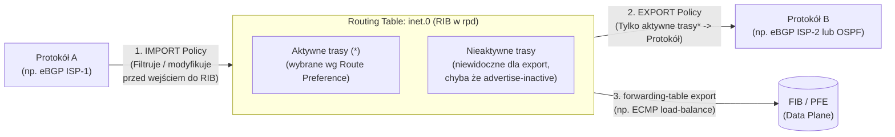
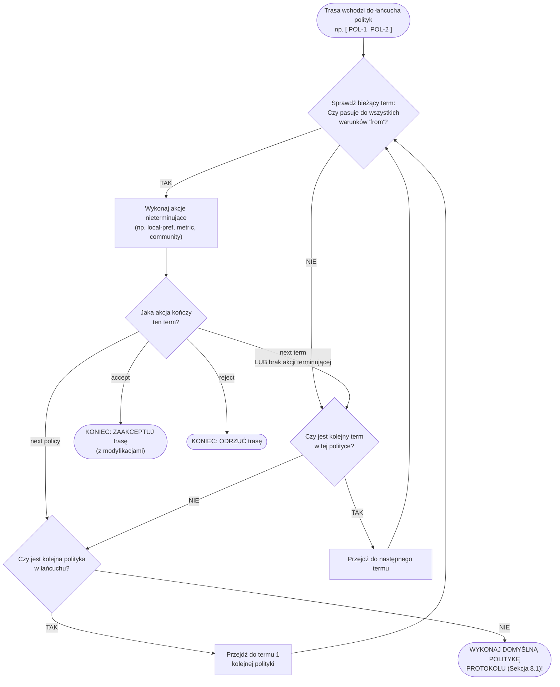
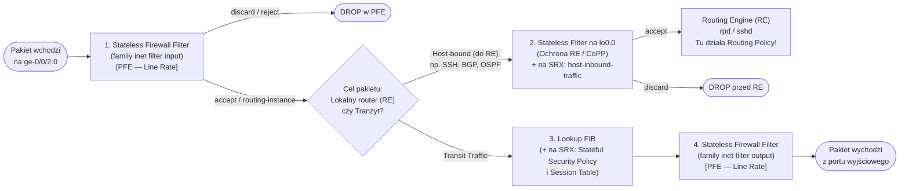
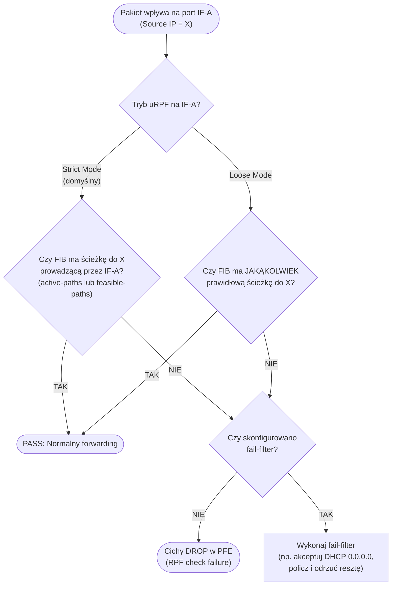

# Rozdział 8. Routing Policy and Firewall Filters — polityki i filtrowanie [A → S → P]

**JUNOS Enterprise Routing & Switching · JNCIA-Junos → JNCIS-ENT → JNCIP-ENT**

**Podstawa redakcyjna:** załączony rozdział 8 wskazany przez czytelnika. Zachowano kolejność wyjaśnień, analogie Cisco ↔ Junos oraz praktyczne przykłady; scenariusze laboratoryjne przeniesiono na **[DIAMOND-6R](../../labs/reference-diamond-6vsrx/README.md)**. **Status: PLANNED / NOT RUNTIME VALIDATED** — polecenia i przewidywane wyniki nie są potwierdzone przez EVE-NG.

## Prolog. Dwie pomyłki, które wyglądają podobnie, ale mają przeciwne skutki

Jest 01:40, trwa nocna zmiana na brzegu sieci. R1 utrzymuje peering eBGP z R5 (CE-A) i dwoma routerami rdzenia, R2 oraz R3. Po drugiej stronie diamentu R4 łączy oba korytarze z R6 (CE-B). Chcemy, aby R5 dowiedział się o **172.16.60.0/24** i **172.16.61.0/24**, ale nie o testowej sieci **172.16.62.0/24**, a tym bardziej o wszystkich innych prefiksach.

Konfigurujesz export policy na R1. W pierwszym termie wpisujesz dwie dozwolone sieci i `then accept`. Drugiego termu nie dodajesz. Znasz Cisco IOS, więc zakładasz, że koniec polityki zadziała jak niejawne `deny any` w route-map.

A jednak R1 zaczyna ogłaszać R5 inne aktywne trasy BGP. **Sesje mają stan Established, a problem polega na tym, że policy nie zakończyła oceny decyzją reject.** Trasa, która nie pasuje do ostatniego termu, może przejść do domyślnej polityki eksportu BGP i zostać reklamowana. To mechanizm, który w rzeczywistej sieci może doprowadzić do route leak.

Po naprawie zajmujesz się ochroną samego routera. Tworzysz stateless firewall filter i zapominasz o jednym z protokołów sterujących. Tym razem rezultat jest odwrotny: ruch, który nie pasuje do żadnego termu, zostaje odrzucony. Po chwili sąsiedztwo BGP przestaje działać.

**Routing policy** i **stateless firewall filter** mają podobne słowa `term`, `from` i `then`, ale inaczej zachowują się na końcu:

- W routing policy brak ostatecznej akcji oznacza **przejście do domyślnej polityki protokołu**, a nie automatyczny deny.
- W stateless firewall filter brak dopasowania oznacza **implicit discard**. Dopasowany term zawierający tylko `count` może z kolei zakończyć się implicit accept, jeśli nie określimy dalszego przetwarzania.

Z tych dwóch błędów wynika cała logika rozdziału: najpierw kontrolujemy **informacje o trasach**, później **pakiety**, a na vSRX dodatkowo **stanowe sesje**. Nie są to trzy odmiany tej samej ACL.

### DIAMOND-6R — jedna topologia na cały rozdział

R1–R4 pozostają bez zmian: łączą je **10.12.0.0/30, 10.13.0.0/30, 10.24.0.0/30, 10.34.0.0/30**. R5 zastępuje PC-A na **192.0.2.10/24**, a R6 zastępuje PC-B na **198.51.100.10/24**. Oba mają własne AS i loopbacki, dzięki czemu możemy ćwiczyć realny eksport/import z dwóch brzegów.

~~~mermaid
flowchart LR
 R5["R5 CE-A<br/>AS 65105<br/>192.0.2.10/24"] ---|"192.0.2.0/24"| R1["R1 EDGE-A<br/>AS 65001"]
 R1 ---|"10.12.0.0/30"| R2["R2 CORE-1<br/>AS 65002"]
 R1 ---|"10.13.0.0/30"| R3["R3 CORE-2<br/>AS 65003"]
 R2 ---|"10.24.0.0/30"| R4["R4 EDGE-B<br/>AS 65004"]
 R3 ---|"10.34.0.0/30"| R4
 R4 ---|"198.51.100.0/24"| R6["R6 CE-B<br/>AS 65106<br/>198.51.100.10/24"]
~~~

*Rysunek 8.0 — logiczny DIAMOND-6R. Pełna mapa interfejsów i adresów każdego końca łącza znajduje się w [referencji technicznej](../../labs/reference-diamond-6vsrx/DIAMOND_TOPOLOGY.md).*

Dodatkowe sieci do polityk: **R5** — 172.16.50.0/24 (Business-A) i 172.16.51.0/24 (Management-A); **R6** — 172.16.60.0/24 (Business-B), 172.16.61.0/24 (Services-B), 172.16.62.0/24 (izolowana trasa testowa typu discard). W normalnym scenariuszu R1 preferuje do 172.16.60.0/24 górny korytarz **przez R2**, a do 172.16.61.0/24 dolny **przez R3**.

Diagram jest projektem, nie działającą instancją EVE-NG. Ruch generowany z routera CE do jego własnego loopbacku jest host-bound; nie utożsamiamy go z ruchem od komputera końcowego.

---

## 8.1. Default routing policies [A]

Na R6 znajduje się lokalna trasa `Direct 172.16.60.0/24`, którą trzeba świadomie wyeksportować do BGP. Kiedy R4 już ją otrzyma, może z kolei reklamować aktywną trasę BGP do R2 i R3 według domyślnych zasad protokołu. **Ta sama sieć jest więc najpierw źródłem nowej informacji BGP, a następnie informacją przekazywaną dalej.**

Zacznijmy od pytania, które zaskakuje każdego inżyniera migrującego z Cisco: co się dzieje, gdy włączysz protokół routingu w Junos OS i **nie skonfigurujesz żadnej własnej polityki**?

W Junos OS każdy protokół routingu posiada wbudowaną, niewidoczną w konfiguracji **domyślną politykę importu (default import policy)** oraz **domyślną politykę eksportu (default export policy)**. One zawsze stoją na samym końcu kolejki — niczym ostateczna reguła rozstrzygająca. Zrozumienie, co robi każdy z czterech głównych protokołów „prosto z pudełka”, oszczędzi Ci setek godzin frustracji.

### Dlaczego BGP, OSPF, IS-IS i RIP mają różne polityki domyślne?

1. **BGP (Border Gateway Protocol):**

   * **Default Import:** Akceptuj wszystkie poprawne trasy BGP odebrane od sąsiadów (pod warunkiem braku pętli AS_PATH i osiągalności next-hopu) i wstaw je do tablicy RIB (`inet.0` / `inet6.0`).

   * **Default Export:** Rozgłaszaj wszystkie **aktywne** trasy BGP z tablicy RIB do sąsiadów BGP (z zachowaniem reguły iBGP Split Horizon — trasy nauczonej od jednego sąsiada iBGP nie rozgłaszasz do innego sąsiada iBGP, chyba że jesteś Route Reflectorem).

   * **Uwaga o nowoczesnych standardach (RFC 8212):** Jeśli pracowałeś na Cisco IOS XR, wiesz, że IOS XR implementuje standard RFC 8212 domyślnie (sesja eBGP bez polityki nie przyjmuje ani nie wysyła żadnych tras). Klasyczny Cisco IOS/IOS XE oraz klasyczny Junos OS **NIE blokują** domyślnie tras eBGP ze względu na wsteczną kompatybilność! Warto jednak wiedzieć na poziomie Professional, że na **wybranych platformach i wydaniach Junos od 20.3R1** można włączyć zachowanie ograniczające wymianę eBGP bez polityk przez `set protocols bgp defaults ebgp no-policy`. **Nie zakładaj obsługi tej opcji na vSRX bez sprawdzenia Feature Explorer i CLI konkretnego release**; analogię do IOS XR traktuj jako koncepcję, nie gwarancję identycznej implementacji. Na egzaminach JNCIA/JNCIS/JNCIP i w standardowych konfiguracjach przyjmuje się jednak klasyczne zachowanie domyślne Junosa: **BGP domyślnie akceptuje wszystko na imporcie i rozgłasza wszystkie aktywne trasy BGP na eksporcie**.

2. **OSPF (Open Shortest Path First):**

   * **Default Import:** Akceptuj wszystkie trasy OSPF i wstaw je do tablicy RIB. (Jak zobaczysz w sekcji 8.12, OSPF jako protokół link-state musi utrzymywać identyczną bazę LSDB na wszystkich routerach w obszarze, więc polityka importu w OSPF ma ściśle ograniczone uprawnienia!).

   * **Default Export:** **Odrzuć wszystko (Reject everything)!**

   * **Zatrzymaj się na sekundę!** Inżynier Cisco patrzy na zdanie „Default Export OSPF = Reject everything” i marszczy brwi: *„Chwileczkę, skoro OSPF domyślnie wszystko odrzuca na eksporcie, to jak w takim razie routery OSPF wymieniają informacje o topologii?”*.

   * Trafne pytanie! Odpowiedź kryje się w różnicy między **natywnym działaniem protokołu (flooding LSA)** a **eksportem z tablicy RIB (redystrybucją)**. Gdy dodajesz interfejs do `protocols ospf area 0 interface ge-0/0/0.0`, demon OSPF sam natywnie rozsyła informacje o tym łączu (LSA Type 1/2 wewnątrz area, a Type 3 między obszarami) między sąsiadami — to **nie jest** eksport z tablicy RIB! Natomiast polityka `export` w OSPF służy **wyłącznie do wstrzykiwania tras obcych (zewnętrznych — Static, Direct spoza OSPF, BGP, RIP)** z tablicy `inet.0` do domeny OSPF jako LSA Type 5 lub Type 7. A domyślnie żaden szanujący się router nie redystrybuuje obcych tras automatycznie!

3. **IS-IS (Intermediate System to Intermediate System):**

   * Zachowuje się analogicznie do OSPF jako protokół link-state.

   * **Default Import:** Akceptuj wszystkie trasy IS-IS do RIB.

   * **Default Export:** **Odrzuć wszystko** (natywne zalewanie LSP odbywa się niezależnie od polityki eksportu; polityka eksportu służy do redystrybucji tras zewnętrznych oraz wyciekania tras *route leaking* pomiędzy Level 2 i Level 1).

4. **RIP (Routing Information Protocol — klasyczny ulubieniec egzaminów JNCIA):**

   * **Default Import:** Akceptuj wszystkie trasy RIP do RIB.

   * **Default Export:** **Odrzuć wszystko!**

   * **Pułapka na Cisco-engineera:** W Cisco wpisanie `network 10.0.0.0` pod `router rip` jednocześnie włącza RIP na interfejsie **oraz** zaczyna rozgłaszać podsieci tego interfejsu i wyuczone trasy RIP do sąsiadów. W Junos OS samo włączenie interfejsu w `protocols rip` sprawia, że router jedynie **nasłuchuje** tras RIP, ale **nie rozgłosi ani jednej trasy** (nawet własnych podsieci `Direct` ani tras nauczonych od innego sąsiada RIP!), dopóki ręcznie nie napiszesz i nie podepniesz polityki `export`!

Skoro już rozumiesz logikę, dlaczego protokoły link-state, distance-vector i path-vector mają takie, a nie inne ustawienia fabryczne, uporządkujmy je w zwięzłej tabeli.

| Protokół | Default Import Policy (Protokół → RIB) | Default Export Policy (RIB → Protokół) | Co dzieje się bez własnej polityki? |
| :--- | :--- | :--- | :--- |
| **BGP** | Accept all BGP routes | Advertise all **active** BGP routes | Przyjmuje trasy BGP i przekazuje dalej aktywne trasy BGP (nie rozgłasza Direct/Static/OSPF!) |
| **OSPF** | Accept all OSPF routes | **Reject everything** | Wymienia natywne LSA (Internal), nie redystrybuuje żadnych tras zewnętrznych (External) |
| **IS-IS** | Accept all IS-IS routes | **Reject everything** | Wymienia natywne LSP, nie redystrybuuje tras zewnętrznych i nie robi L2→L1 leaking |
| **RIP** | Accept all RIP routes | **Reject everything** | Odbiera trasy RIP, ale **nie wysyła niczego** do sąsiadów, dopóki nie podepniesz `export`! |

**Co naprawdę musisz z tej tabeli zapamiętać?** Tylko jeden kontrast: **wszystkie cztery protokoły domyślnie AKCEPTUJĄ swoje trasy na imporcie, ale na eksporcie TYLKO BGP domyślnie rozgłasza (swoje aktywne trasy)** — pozostałe domyślnie odrzucają wszystko na eksporcie.

---

## 8.2. Import policy vs. export policy [A]

Patrzymy na R1, w którego `inet.0` spotykają się dwa BGP UPDATE o `172.16.60.0/24`: jeden od R2 (`10.12.0.2`), drugi od R3 (`10.13.0.2`). Import jest decyzją, którą drogę i z jakimi atrybutami przyjmiemy; export decyduje, co z tej wiedzy wolno potem wysłać do R5 (`192.0.2.10`).

Jeśli masz wynieść z tego rozdziału jeden jedyny nawyk mentalny, który odróżnia juniora od architekta Juniper, niech to będzie **Złoty Kompas Junosa**.

W Cisco IOS kierunek `in` i `out` interpretujesz najczęściej z perspektywy **interfejsu lub sesji sąsiada**: `neighbor 10.1.1.2 route-map FILTER in` oznacza „filtruj to, co wpada od sąsiada na wejściu”. To wydaje się intuicyjne... aż do momentu, gdy zaczynasz używać redystrybucji, `distribute-list`, `network` i `route-map` naraz, i wszystko przestaje być jednolite.

W Junos OS **ZAPOMNIJ o perspektywie interfejsu** przy pisaniu polityk routingu! W Junos OS stajesz obiema nogami **WEWNĄTRZ tablicy routingu (RIB, np. `inet.0`)** i patrzysz na świat z jej środka:

* **`import` (Import Policy)** — kontroluje trasy **WCHODZĄCE DO tablicy routingu (`inet.0`)** od protokołu routingu (np. BGP → `inet.0`). Chcesz odfiltrować śmieciowy prefiks od ISP albo podbić mu `local-preference`, zanim trafi do Twojej tablicy? Używasz **`import`**.

* **`export` (Export Policy)** — kontroluje trasy **WYCHODZĄCE Z tablicy routingu (`inet.0`)** do protokołu routingu (np. `inet.0` → BGP lub `inet.0` → OSPF) albo z `inet.0` do tablicy przekazywania (`forwarding-table export` → FIB, co robiłeś w Rozdziale 7 przy ECMP!).

> **Pułapka na Cisco-engineera (Gdzie podziało się `redistribute` oraz BGP `network`?):** Szukasz w Junos komendy `redistribute static subnets` w OSPF albo `network 192.0.2.0 mask 255.255.255.0` w BGP? **One w Junos OS nie istnieją!** W Junosie zarówno filtrowanie wychodzących tras BGP, jak i rozgłoszenie własnej podsieci `Direct` do BGP, jak i redystrybucja tras statycznych do OSPF — to jest **dokładnie ta sama operacja: `export` z tablicy RIB do wybranego protokołu!** Dzięki temu nie musisz uczyć się czterech różnych mechanizmów — jedna polityka `export` robi wszystko.

### Istotny haczyk poziomu Specialist/Professional: Eksport widzi TYLKO trasy AKTYWNE!

W osobnym wariancie DIAMOND-6R uruchamiasz OSPF w rdzeniu obok BGP, tylko po to, by pokazać konkurencję dwóch protokołów. R1 poznaje ten sam prefiks z dwóch źródeł. Router brzegowy zna podsieć `172.16.60.0/24` z **dwóch** źródeł jednocześnie:

1. Z wewnętrznego **OSPF** (w Junos preferencja = **10**).

2. Od sąsiada **eBGP** (w Junos preferencja = **170**).

Która trasa wygrywa i zostaje **aktywną trasą** (oznaczoną gwiazdką `*` w `show route`) w `inet.0`? Oczywiście **OSPF** (bo $10 < 170$). Trasa z BGP pozostaje w tablicy `inet.0` jako **nieaktywna (inactive)**.

Teraz R1 ma rozgłosić `172.16.60.0/24` do drugiego operatora ISP-2 po BGP. Domyślna polityka eksportu BGP (albo Twoja własna polityka z warunkiem `from protocol bgp`) sprawdza tablicę `inet.0`. I co się dzieje?! **R1 w ogóle NIE rozgłosi `172.16.60.0/24` do ISP-2!**

Dlaczego? Ponieważ **polityka `export` w Junos OS domyślnie ocenia WYŁĄCZNIE trasy AKTYWNE w tablicy RIB**! Skoro aktywną trasą w `inet.0` jest OSPF (a nie BGP), to:

* domyślny eksport BGP nie widzi aktywnej trasy BGP, więc jej nie wysyła;

* polityka `from protocol bgp` też jej nie dopasuje, bo aktywny protokół dla tego prefiksu to `ospf`!

Jak rozwiązać ten problem w Junos? Masz dwie świadome drogi: albo jawnie wyeksportować ten prefiks z protokołu `ospf` (np. `from protocol ospf; from route-filter 172.16.60.0/24 exact; then accept`), albo — jeśli chcesz, aby BGP rozgłosił swoją własną, nieaktywną ścieżkę BGP wraz z jej oryginalnym `AS_PATH` — włączyć w konfiguracji BGP specjalną opcję **`set protocols bgp advertise-inactive`**.

Spójrz na poniższy diagram, który utrwala Złoty Kompas Junosa raz na zawsze.



Patrząc na ten schemat, zawsze w sekundę określisz właściwy kierunek: wchodzi do cylindra `inet.0` = **import**, wychodzi z cylindra `inet.0` = **export**.

---

## 8.3. Routing policy flow — kolejność przetwarzania i zakończenie ewaluacji [A]

Na R1 mamy dwa korytarze do R6 i musimy zbudować reguły, które odrzucą `172.16.62.0/24`, ale dla `172.16.60.0/24` pozwolą preferować R2. Najłatwiej popełnić błąd, gdy pomylimy **zmianę atrybutu** z **ostateczną zgodą na przyjęcie trasy**.

Teraz wkraczamy na pole minowe, na którym inżynier z dziesięcioletnim stażem w Cisco myli się najczęściej. Prześledźmy krok po kroku, jak demon `rpd` przepuszcza pojedynczą trasę przez łańcuch polityk routingu.

W Junos OS pod protokołem (np. `protocols bgp group ISP1`) możesz podpiąć pojedynczą politykę, ale możesz też spiąć kilka modularnych polityk w **łańcuch (policy chain)**:

`set protocols bgp group ISP1 export [ TAG-REGION FILTER-BOGONS ADVERTISE-OWN ]`

Wyobraź sobie taśmę produkcyjną w fabryce samochodów. Trasa wjeżdża na taśmę i przechodzi kolejno przez stanowiska (polityki w łańcuchu, od lewej do prawej), a na każdym stanowisku przez kolejne kroki kontrolne (**termy**, od góry do dołu).

Na każdym termie system zadaje proste pytanie: *„Czy trasa spełnia wszystkie warunki z sekcji `from`?”*.

* **Jeśli NIE spełnia:** system ignoruje sekcję `then` tego termu i przechodzi do następnego termu w tej samej polityce.

* **Jeśli TAK (spełnia):** system wykonuje akcje z sekcji `then`. I teraz uwaga — **co dzieje się dalej, zależy wyłącznie od TYPU akcji!**

W Routing Policy istnieją **trzy klasy akcji**:

1. **Akcje terminujące (`accept`, `reject`):** Naciskają wielki czerwony guzik STOP. Trasa natychmiast opuszcza cały łańcuch polityk z ostatecznym wyrokiem (przyjęta lub odrzucona). Żadne kolejne termy ani kolejne polityki w łańcuchu nie zostaną już dla niej uruchomione!

2. **Akcje sterujące przepływem (`next term`, `next policy`):**

   * **`next term`** — przerywa bieżący term (zastosowawszy wcześniejsze modyfikacje atrybutów w tym termie) i każe przejść do kolejnego termu w tej samej polityce.

   * **`next policy`** — przerywa sprawdzanie pozostałych termów w **bieżącej** polityce i natychmiast przerzuca trasę na początek **kolejnej** polityki w łańcuchu (np. z `TAG-REGION` prosto do `FILTER-BOGONS`).

3. **Akcje nieterminujące (modyfikujące atrybuty):** Np. `local-preference 200`, `metric 50`, `community add CUST-GOLD`, `as-path-prepend "65001 65001"`, `next-hop self`.

> **Ważna pułapka na Cisco-engineera #1 (Brak zatrzymania po modyfikacji atrybutu!):** W Cisco IOS, jeśli w `route-map TEST permit 10` dopasujesz prefiks i zrobisz `set local-preference 200`, to ewaluacja **NATYCHMIAST SIĘ KOŃCZY** (trasa zostaje zaakceptowana z nową wartością, a sekwencja `20` w ogóle nie jest sprawdzana, chyba że jawnie dopiszesz `continue`). W Junos OS jest **DOKŁADNIE ODWROTNIE**! Jeśli term w Junos zawiera wyłącznie akcję modyfikującą (`then local-preference 200`) **bez** słowa kluczowego `accept` lub `reject`, demon `rpd` modyfikuje atrybut i **idzie dalej do kolejnego termu!** Jeśli kolejny term na dole mówi `then reject`, Twoja pięknie zmodyfikowana trasa wyląduje w koszu!

> **Ważna pułapka na Cisco-engineera #2 (Wypadnięcie za ostatni term = Default Policy, NIE `reject`!):** A co się stanie, gdy trasa przejdzie przez wszystkie termy wszystkich polityk w łańcuchu i **nigdzie nie natrafiła na `accept` ani `reject`** (np. nie pasowała do żadnego `from`, albo przeszła przez term, który tylko zmienił `local-preference`)? W Cisco `route-map` na końcu ma ukryte `deny any`. W Junos OS Routing Policy **NIE MA** ukrytego `reject`! Trasa wypada za koniec łańcucha i wpada prosto w ręce **Default Protocol Policy** z sekcji 8.1!
>
> * Dla **OSPF/IS-IS/RIP na eksporcie** skończy się to odrzuceniem (bo ich domyślny eksport to `reject`).
> * Dla **BGP na eksporcie** skończy się to **ZAAKCEPTOWANIEM i rozgłoszeniem wszystkich aktywnych tras BGP** — dokładnie tak powstał nasz gigantyczny wyciek tras z historii na początku rozdziału! Dlatego w produkcyjnych politykach BGP **zawsze** stawiaj na końcu jawny, czytelny term końcowy (np. `term REJECT-ALL then reject`), nigdy nie polegaj na „domyślnym działaniu” w ciemno.

Spójrz na poniższy schemat blokowy. Prześledź każdą strzałkę — to kompletny algorytm działania silnika `rpd` w Junos OS.



**Sprawdź, czy przewidzisz wynik:** Masz w BGP na imporcie politykę z jednym jedynym termem: `term FIX-LP from route-filter 198.51.100.0/24 exact; then local-preference 250` (brak `accept`, brak drugiego termu). Co stanie się z trasą `198.51.100.0/24` odebraną od sąsiada BGP?

Prześledź diagram: trasa pasuje do `from` → `rpd` zmienia jej `local-preference` na 250 → brak akcji terminującej → nie ma więcej termów ani polityk → trasa wpada do **domyślnej polityki importu BGP**, czyli **`accept`**! Efekt? Trasa zostanie zaakceptowana do `inet.0` z `local-preference 250` (a wszystkie inne trasy od tego sąsiada również zostaną zaakceptowane z domyślnym `local-preference 100`). To elegancki trik, który zobaczysz w tysiącach konfiguracji Juniper (np. słynna jednolinijkowa polityka `NEXT-HOP-SELF` dla iBGP bez słowa `accept`!).

---

## 8.4. Wpływ policies na trasy i routing tables [A]

Zamiast mówić ogólnie o „trasie w BGP”, prześledzimy konkretny prefiks `172.16.60.0/24` od R6, przez R4 i oba korytarze, aż do R1. W tym jednym przypadku zobaczymy, dlaczego odebranie BGP UPDATE, zaakceptowanie go przez import, aktywność w RIB i reklama do R5 to **cztery osobne dowody**.

Aby skutecznie diagnozować routing w Junos OS na poziomie Tier 3, musisz dokładnie wiedzieć, w którym miejscu w pamięci demona `rpd` polityka „dotyka” trasy — i dlaczego czasami po wpisaniu `show route` nie widzisz trasy, którą sąsiad na pewno Ci wysłał.

Prześledźmy drogę prefiksu w BGP (który ma najbardziej rozbudowany cykl życia w `rpd`):

1. **`Adj-RIB-In` (komenda `show route receive-protocol bgp <IP-sąsiada>`):** To poczekalnia tuż po odebraniu pakietu `BGP UPDATE` od sąsiada, **PRZED** zastosowaniem Twojej polityki importu! Jeśli sąsiad wysyła prefiks, ale Twoja polityka importu go odrzuciła, nadal powinieneś wiedzieć, czy prefiks w ogóle dotarł na router.

2. **Polityka Importu (Import Policy):** Filtruje i modyfikuje trasy z `Adj-RIB-In` w drodze do `inet.0`.

   * **Ważny szczegół operacyjny (`keep all`):** Co dzieje się z trasą, którą `import policy` odrzuciła? W typowym Junos trasy BGP **są domyślnie zachowywane jako hidden**, z wyjątkami m.in. dla ścieżek zawierających pętlę lokalnego AS_PATH. `keep all` rozszerza retencję także na takie przypadki, a `keep none` pozwala usuwać trasy odrzucone przez import policy lub kontrolę poprawności. Dlatego najpierw sprawdź `show route hidden`, a dopiero później rozważ zmianę ustawienia `keep` — szczególnie przy dużej tablicy BGP. [Juniper: keep](https://www.juniper.net/documentation/us/en/software/junos/cli-reference/topics/ref/statement/keep-edit-protocols-bgp.html).

3. **Główna Tablica RIB (`inet.0` — komenda `show route`):** Tu trafiają zaakceptowane trasy. Jeśli dla tego samego prefiksu istnieje kilka ścieżek (z różnych protokołów lub sąsiadów), `rpd` uruchamia proces wyboru najlepszej ścieżki (Route Preference → BGP Path Selection) i oznacza zwycięzcę gwiazdką `*` (**Active Route**).

   * Pamiętaj o różnicy z Rozdziału 2 i 7: trasa **Hidden** (np. nierozwiązywalny next-hop albo odrzucona przy `keep all`) siedzi w `show route hidden`, trasa **Inactive** (przegrała z lepszą preferencją, np. BGP przegrał z OSPF) jest w `show route` bez gwiazdki `*`, a trasa odrzucona przez import może pozostać jako `hidden`; przy `keep none` można utracić jej szczegóły.

4. **Polityka Eksportu (Export Policy):** Pobiera **tylko aktywne trasy (`*`)** z `inet.0`, filtruje je, modyfikuje atrybuty wychodzące (np. `as-path-prepend`, `metric`, `next-hop self`) i umieszcza wynik w `Adj-RIB-Out`.

5. **`Adj-RIB-Out` (komenda `show route advertising-protocol bgp <IP-sąsiada>`):** Pokazuje dokładnie to, co nasz router realnie wysłał do sąsiada **PO** przejściu przez politykę eksportu!

### Wielka pułapka hierarchii w BGP: Nadpisywanie zamiast łączenia!

W konfiguracji BGP w Junos OS politykę `import` lub `export` możesz przypiąć na **trzech poziomach szczegółowości**:

1. Poziom globalny (`[edit protocols bgp]`)

2. Poziom grupy (`[edit protocols bgp group ISP]`)

3. Poziom pojedynczego sąsiada (`[edit protocols bgp group ISP neighbor 10.12.0.2]`)

> **Pułapka na Cisco-engineera (Most Specific OVERRIDES — NIE scala!):** Załóżmy, że na poziomie grupy `ISP` przypiąłeś ważną politykę bezpieczeństwa `export [ BLOCK-BOGONS ADVERTISE-CORP ]`. Po miesiącu przychodzi zlecenie dla jednego z dwóch sąsiadów w tej grupie (`10.13.0.2`), żeby dodatkowo robić mu `AS-PREPEND`. Wpisujesz pod samym sąsiadem `set protocols bgp group ISP neighbor 10.13.0.2 export ADD-PREPEND`. Co zrobi Junos? **Całkowicie ZIGNORUJE polityki z poziomu grupy dla tego sąsiada!** Sąsiad `10.13.0.2` wykona WYŁĄCZNIE `ADD-PREPEND`, a `BLOCK-BOGONS` przestanie dla niego działać! W Junos OS bardziej szczegółowy poziom zawsze **nadpisuje (overrides)** poziom wyższy — nigdy ich nie łączy. Jeśli chcesz dodać `ADD-PREPEND` do polityk grupowych, musisz pod sąsiadem powtórzyć cały łańcuch: `export [ BLOCK-BOGONS ADVERTISE-CORP ADD-PREPEND ]`.

---

## 8.5. Struktura polityki: policy statements i terms [A]

Przykładowy term `ALLOW-CE-B` na R1 powinien rozpoznać wyłącznie uzgodnioną sieć, a nie całe `172.16.0.0/16`. Przekonamy się, że czytelność polityki wynika z dobrze nazwanych termów i poprawnego rozumienia `from`, nie z liczby wpisanych komend.

Przejdźmy do warsztatu składni. Wszystkie polityki routingu (oraz ich obiekty pomocnicze, takie jak `prefix-list`, `as-path` i `community`) mieszkają w jednym, eleganckim miejscu hierarchii: **`[edit policy-options]`**.

Struktura typowej polityki `policy-statement` przypomina logiczne zdanie w języku angielskim: **IF (`from`) ... THEN (`then`) ...**.

```text
policy-options {
    policy-statement NAZWA-POLITYKI {
        term NAZWA-TERMU-1 {
            from {
                <warunek dopasowania 1>;
                <warunek dopasowania 2>;
            }
            then {
                <akcja modyfikująca>;
                <akcja terminująca lub sterująca>;
            }
        }
        term NAZWA-TERMU-2 {
            ...
        }
    }
}
```

*(W zaawansowanych scenariuszach OSPF/IS-IS lub polityk eksportu spotkasz też opcjonalną sekcję `to` — np. `to neighbor 10.12.0.2` lub `to area 0.0.0.1`, która ogranicza działanie termu wyłącznie do konkretnego adresata eksportu).*

### Logika Boole'a wewnątrz `from` (OR kontra AND)

To jest mały detal składniowy, który robi ogromną różnicę:

* **Wiele wartości w obrębie JEDNEGO rodzaju kryterium `from` = logiczne LUB (OR).**
  Przykład: `from protocol [ static direct ]` pasuje, jeśli trasa pochodzi ze `static` **LUB** `direct`. Podobnie wiele linii `route-filter` w tym samym termie działa jak **LUB** (wystarczy, że prefiks pasuje do jednego z nich).

* **Różne rodzaje kryteriów `from` w tym samym termie = logiczne I (AND).**
  Przykład:
  `set policy-options policy-statement MY-POL term T1 from protocol static`
  `set policy-options policy-statement MY-POL term T1 from route-filter 172.16.62.0/24 exact`
  Aby ten term zadziałał, trasa musi być **jednocześnie** statyczna **I** mieć dokładnie prefiks `172.16.62.0/24`.

* **Brak sekcji `from`:** Oznacza „dopasuj WSZYSTKO” (idealne dla końcowego termu `term DENY-ALL then reject` albo dla globalnego `next-hop self`).

* **Termy nazwane kontra nienazwane:** Junos pozwala technicznie napisać prostą jednoblokową politykę zupełnie bez słowa `term` (tzw. *unnamed term*), np. `set policy-options policy-statement ONLY-STATIC from protocol static; then accept`. W praktyce inżynierskiej na poziomie Enterprise **zawsze nazywaj swoje termy** (np. `term ALLOW-CORP`, `term SET-MED`, `term REJECT-REST`). Dlaczego? Ponieważ po pierwsze, nienazwany term może być tylko jeden na końcu polityki, a po drugie — w nazwanych termach możesz w sekundę wstrzyknąć nową regułę dokładnie tam, gdzie trzeba, używając polecenia **`insert term NOWY-TERM before term STARY-TERM`** (w Cisco musisz ręcznie kombinować z numerami sekwencji 10, 15, 20!).

---

## 8.6. Match criteria, typy dopasowań i actions w routing policy [A]

R6 ma trzy ćwiczebne prefiksy: `172.16.60.0/24`, `172.16.61.0/24` i `172.16.62.0/24`. R1 powinien dopuścić dwa pierwsze, a trzeci odrzucić. To dobry, konkretny test różnic między `exact`, `orlonger`, `prefix-list` i `route-filter`.

Teraz weźmy pod lupę najpotężniejsze — i najbardziej podchwytliwe — narzędzie dopasowania prefiksów w Junos OS: różnicę między **`route-filter`**, **`prefix-list`** oraz **`prefix-list-filter`**.

### 8.6.1. `route-filter` — sześć modyfikatorów i tajemnica drzewa Radix!

W Cisco IOS do dopasowania prefiksów z zakresem masek piszesz `ip prefix-list MY-LIST permit 10.0.0.0/8 ge 16 le 24`, a potem podpinasz ją pod `route-map`. W Junos OS możesz wpisywać prefiksy bezpośrednio w termie za pomocą **`route-filter`** z jednym z sześciu niezwykle czytelnych modyfikatorów:

1. **`exact`** — dokładnie ten prefiks i dokładnie ta długość maski (np. `10.0.0.0/16 exact` dopasuje tylko `10.0.0.0/16`, nie dopasuje `10.0.1.0/24`).

2. **`longer`** — dowolna podsieć mieszcząca się w tym prefiksie o masce **ściśle dłuższej** (np. `10.0.0.0/16 longer` dopasuje `/17` do `/32`, ale **NIE** dopasuje samego `/16`!).

3. **`orlonger`** — ten prefiks **oraz** wszystkie jego podsieci o dłuższej masce (np. `10.0.0.0/16 orlonger` dopasuje `/16` do `/32`; odpowiednik Cisco `le 32`).

4. **`upto /n`** — od maski podanego prefiksu włącznie aż do maski `/n` włącznie (np. `10.0.0.0/16 upto /24` dopasuje maski od `/16` do `/24` włącznie; odpowiednik Cisco `le 24`).

5. **`prefix-length-range /m-/n`** — ściśle określony przedział długości masek (np. `10.0.0.0/8 prefix-length-range /16-/24` dopasuje tylko prefiksy z bloku `10/8`, których maska ma od 16 do 24 bitów; odpowiednik Cisco `ge 16 le 24`).

6. **`through <drugi-prefiks>`** — rzadziej używany, specyficzny modyfikator dopasowujący wyłącznie prefiksy leżące wzdłuż dokładnej ścieżki w drzewie binarnym od prefiksu pierwszego do drugiego (np. `10.0.0.0/8 through 10.0.0.0/10` dopasuje `/8`, `/9` i `/10` o adresie bazowym `10.0.0.0`, nie dopasuje `10.64.0.0/10`!).

> **Ważna PUŁAPKA TIER 3 (Longest Match wewnątrz jednego termu `route-filter`!):** Przyjrzyj się temu uważnie, bo to jedno z najsłynniejszych zaskoczeń w całym Junos OS!
>
> Wyobraź sobie, że piszesz w jednym termie dwa filtry — pierwszy szeroki, drugi szczegółowy z akcją lokalną `reject` bezpośrednio w linii `route-filter`:
>
> ```text
> term FILTER-TEN {
>     from {
>         route-filter 10.0.0.0/8 orlonger;
>         route-filter 10.10.0.0/16 exact reject;
>     }
>     then accept;
> }
> ```
>
> Jako inżynier Cisco patrzysz na ten kod z góry na dół i myślisz: *„Błąd! Pierwsza linia `10.0.0.0/8 orlonger` od razu złapie `10.10.0.0/16` i go zaakceptuje, zanim w ogóle dojdzie do drugiej linii!”*.
>
> **Nic bardziej mylnego!** Wewnątrz jednego termu Junos **NIE** ocenia linii `route-filter` od góry do dołu jak listy ACL! Kompilator `rpd` wrzuca wszystkie wpisy `route-filter` z danego termu do **drzewa prefiksów (radix tree)** i wybiera **najbardziej szczegółowe dopasowanie (Longest Prefix Match)**!
>
> Efekt? Trasa `10.10.0.0/16` dopasuje się do bardziej szczegółowego wpisu `10.10.0.0/16 exact reject` i zostanie **ODRZUCONA**, mimo że wpis `10.0.0.0/8 orlonger` stał w konfiguracji wyżej! Natomiast trasa `10.20.0.0/16` nie pasuje do `/16 exact`, więc dopasuje się do `10.0.0.0/8 orlonger` i zostanie **ZAAKCEPTOWANA** przez `then accept`!
>
> *(Złota zasada czytelności: chociaż ten mechanizm działa świetnie, w dużych zespołach często lepiej rozbić wyjątki `reject` na osobny term umieszczony WYŻEJ w polityce, aby mniej doświadczeni koledzy nie dostali zawału podczas czytania konfiguracji o 3 w nocy — ale na egzaminach JNCIS/JNCIP **musisz** znać zachowanie Longest Match w `route-filter`!)*

### 8.6.2. `prefix-list` kontra `prefix-list-filter`

Kiedy nie powinieneś używać `route-filter`? Gdy ten sam zestaw adresów (np. podsieci Twoich serwerów DNS albo lista prefiksów klienta) chcesz wykorzystać w **kilku różnych politykach routingu ORAZ w filtrach firewalla**!

* **`prefix-list`** — zdefiniowany w `[edit policy-options prefix-list NAZWA]` jest listą prefiksów dopasowywanych wyłącznie metodą **`exact`**. Jego wielką zaletą jest reużywalność: możesz go wywołać w polityce routingu (`from prefix-list MY-NETS`), a także w filtrze firewalla (`from source-prefix-list MY-NETS`), a nawet zasilać go dynamicznie z samej konfiguracji za pomocą `apply-path` (o czym w sekcji 8.9!).

* **`prefix-list-filter`** — łączy oba światy! Używasz go wewnątrz polityki routingu, wskazując zdefiniowaną wcześniej `prefix-list`, ale dodając do wszystkich jej wpisów modyfikator typu `exact`, `longer` lub `orlonger` (np. `from prefix-list-filter CUST-BLOCKS orlonger`).

### 8.6.3. Dopasowanie `as-path` i `community` (Różnice składniowe Cisco ↔ Junos)

Na poziomie Specialist i Professional Twoim chlebem powszednim w BGP staną się wyrażenia regularne `as-path` oraz znaczniki `community`:

* **BGP `as-path` (Uwaga na znak separatora!):** W Cisco IOS w `ip as-path access-list` używasz znaku podkreślenia `_` (np. `^65002_`), który oznacza spację, początek lub koniec linii. **W Junos OS podkreślnik `_` NIE jest separatorem AS!** W Junos OS numery AS są oddzielone zwykłą spacją, a operatory wyrażeń regularnych działają na **całych tokenach (numerach AS)**, nie na pojedynczych cyfrach!

  * Trasy pochodzące bezpośrednio z lokalnego AS (pusta ścieżka AS): Cisco `^$` ↔ Junos **`"()"`** (lub `"^$"`).

  * Trasy otrzymane bezpośrednio od sąsiada AS 65002 i za nim: Cisco `^65002_` ↔ Junos **`"65002 .*"`** (zwróć uwagę na spację po 65002!).

  * Trasy zrodzone (originated) w AS 65004: Cisco `_65004$` ↔ Junos **`".* 65004"`** (lub `".* 65004$"`).

  * Trasy przechodzące tranzytem przez AS 65002 gdziekolwiek w ścieżce: Cisco `_65002_` ↔ Junos **`".* 65002 .*"`**.

* **BGP `community` (Pułapka `add` vs `set`!):** Definiujesz obiekt w `[edit policy-options community NAZWA members 65001:100]`. Kiedy w akcji `then` zmieniasz community na trasie, uważaj na trzy czasowniki:

  * **`community add NAZWA`** — **dopina** nową etykietę, zachowując wszystkie dotychczasowe (odpowiednik Cisco `set community ... additive`).

  * **`community set NAZWA`** — **KASUJE** wszystkie istniejące communities na trasie i zastępuje je wyłącznie podaną! (Zbyt łatwy sposób na zniszczenie tagów `no-export` lub tagów klienta!).

  * **`community delete NAZWA`** — usuwa konkretną etykietę (lub wzorzec regex, np. `65001:*`).

Dla szybkiego usystematyzowania modyfikatorów `route-filter`, zerknij na poniższą ściągawkę.

| Modyfikator `route-filter` | Przykład w Junos | Dopasowane prefiksy | Odpowiednik Cisco `ip prefix-list` |
| :--- | :--- | :--- | :--- |
| **`exact`** | `10.0.0.0/16 exact` | Tylko `10.0.0.0/16` | `10.0.0.0/16` |
| **`longer`** | `10.0.0.0/16 longer` | `10.0.x.x` o maskach `/17`–`/32` (bez `/16`) | `10.0.0.0/16 ge 17` |
| **`orlonger`** | `10.0.0.0/16 orlonger` | `10.0.x.x` o maskach `/16`–`/32` | `10.0.0.0/16 le 32` |
| **`upto /n`** | `10.0.0.0/16 upto /24` | `10.0.x.x` o maskach `/16`–`/24` | `10.0.0.0/16 le 24` |
| **`prefix-length-range /m-/n`** | `10.0.0.0/8 prefix-length-range /20-/24` | Pods. w `10/8` o maskach `/20`–`/24` | `10.0.0.0/8 ge 20 le 24` |

**Co naprawdę musisz z tej tabeli zapamiętać?** Zapamiętaj dwa detale: (1) `longer` wyklucza samą maskę bazową, podczas gdy `orlonger` ją włącza, oraz (2) wewnątrz jednego termu Junos używa dla wielu `route-filter` algorytmu **Longest Prefix Match**, a nie kolejności linii!

---

## 8.7. Firewall filters — koncepcje i cele [A]

Gdy R5 zaczyna wysyłać ICMP ze źródła `172.16.50.1` do `172.16.60.1` na R6, import policy przestaje być jedynym elementem układanki. Trasy mogą być poprawne, a pakiet może nadal zostać odrzucony. Na każdym vSRX musimy oddzielnie rozważyć stateless filter i security flow.

Teraz przełączamy dźwignię w głowie. Do tej pory siedzieliśmy w mózgu routera (Control Plane / `rpd`) i decydowaliśmy, **które trasy** mają trafić do mapy drogowej (RIB). Czas zejść do mięśni routera (Data Plane / **PFE / ASIC**) i zdecydować, **co zrobić z rzeczywistymi pakietami IP (lub ramkami L2)**, które z prędkością dziesiątek gigabitów na sekundę przelatują przez porty!

W Junos OS bezstanowe listy kontroli dostępu (odpowiednik Cisco **ACL — Access Control Lists**, ale o znacznie większych możliwościach) noszą nazwę **Firewall Filters** (pol. *bezstanowe filtry firewalla*).

### Trzy różne byty, których NIE WOLNO mylić (zwłaszcza na vSRX!)

Inżynierowie Cisco często wpadają w pułapkę semantyczną przez słowo „firewall” w nazwie *Firewall Filter*. Rozdzielmy te trzy mechanizmy jak chirurg skalpelem:

1. **Routing Policy (`[edit policy-options]`):** Działa w **RE / Control Plane (`rpd`)**. Filtruje i modyfikuje **trasy (prefiksy)** w tablicy RIB. Nigdy nie ogląda pojedynczych pakietów danych!

2. **Stateless Firewall Filter (`[edit firewall]`):** Działa w **PFE / Data Plane** z prędkością sprzętu (line rate). Jest **bezstanowy (stateless)** — ocenia każdy pojedynczy pakiet z osobna na podstawie nagłówków L2/L3/L4, nie pamięta tabeli sesji! Służy do czterech kluczowych celów:

   * Klasycznego filtrowania ruchu tranzytowego na interfejsach (`ge-0/0/x.0` `input`/`output` — odpowiednik Cisco ACL).

   * **Ochrony Routing Engine (`lo0.0` input filter)** — dokładny, niezwykle potężny odpowiednik Cisco **CoPP (Control Plane Policing)**!

   * **Klasyfikacji ruchu** dla FBF (Rozdział 7) oraz CoS/QoS (Rozdział 20 — przypisywanie `forwarding-class` i `policer`).

   * **Diagnostyki i telemetrii** (liczenie pakietów `count`, logowanie `log`/`syslog`, lustrzane odbicie portów `port-mirror`).

3. **Stateful Security Policy (`[edit security policies]` — wyłącznie na platformach SRX/vSRX):** To właściwy, **stanowy firewall** (odpowiednik Cisco ASA/FTD lub Zone-Based Firewall). Działa między strefami bezpieczeństwa (`from-zone` → `to-zone`), zakłada wpisy w tablicy sesji (`show security flow session`), pilnuje stanu połączeń TCP (`syn-check`) i automatycznie przepuszcza ruch powrotny.

Spójrz na poniższy diagram, który pokazuje, gdzie dokładnie w architekturze urządzenia (na przykładzie vSRX / routera Junos) działa każdy z tych trzech mechanizmów.



Na vSRX **stateless filter, tablica routingu i stateful security policy są różnymi punktami decyzji**. Ich dokładna kolejność przetwarzania zależy od platformy, trybu flow i konkretnej funkcji (np. FBF/NAT); diagram jest poglądową mapą diagnostyczną, nie uniwersalnym schematem wykonania w każdym PFE. Dla R1 najpierw ustalimy, co odrzuca pakiet, a dopiero potem będziemy zmieniać konfigurację.

---

## 8.8. Struktura filtrów: terms, match criteria, actions [A]

Na wejściu R1 od R5 (interfejs `ge-0/0/2.0`) będziemy mogli policzyć prawidłowy ruch, odrzucić pakiet z niedozwolonym źródłem i nie zablokować przy okazji sąsiadów BGP. Takie ćwiczenie pokaże, dlaczego reguły `then` w firewall filter nie zachowują się identycznie jak w routing policy.

Składnia bezstanowego Firewall Filtra wygląda łudząco podobnie do Routing Policy — używa tych samych słów kluczowych `term`, `from` i `then`, ale żyje w gałęzi **`[edit firewall family <rodzina> filter <NAZWA>]`** (gdzie rodzina to najczęściej `inet` dla IPv4, `inet6` dla IPv6 lub `ethernet-switching` dla warstwy 2 na switchach EX/QFX).

Nie daj się jednak zwieść wizualnemu podobieństwu! Pod spodem kryją się **dwie śmiertelnie ważne różnice** względem Routing Policy:

### Różnica #1: Implicit `discard` na końcu filtra

Każdy bezstanowy Firewall Filter ma na samym końcu niewidzialny term: **`then discard`** (ciche odrzucenie pakietu, dokładnie jak niejawne `deny any` na końcu Cisco ACL). Jeśli chcesz tylko zablokować jeden złośliwy adres IP i przepuścić resztę, **musisz** na końcu jawnie dodać `term ALLOW-ALL then accept`!

### Różnica #2: Akcja nieterminująca BEZ `next term` = NIEJAWNY `accept`!

> **PUŁAPKA EGZAMINACYJNA I PRODUKCYJNA (Routing Policy vs. Firewall Filter!):**
>
> Zatrzymaj się na chwilę i porównaj oba silniki, bo tu wykłada się 80% kandydatów:
>
> * W **Routing Policy** (`policy-options`): jeśli term ma tylko akcję nieterminującą (np. `then local-preference 200`), ewaluacja **IDZIE DALEJ** do następnego termu!
> * W **Firewall Filter** (`firewall`): jeśli term ma tylko akcję nieterminującą (np. `then count SSH-TRAFFIC` albo `then log`), **NIE** idzie dalej — Junos automatycznie dokleja do niej **niejawne `accept` i KOŃCZY ewaluację filtra**!
>
> **Przykład katastrofy:** Chcesz w Termie 1 zliczać cały ruch TCP (`from protocol tcp; then count ALL-TCP`), a w Termie 2 zablokować Telnet (`from destination-port telnet; then discard`). Jeśli w Termie 1 zapomnisz dopisać **`then next term`**, to Term 1 policzy pakiet Telnet, **automatycznie go zaakceptuje** i zakończy filtr — Term 2 nigdy nie dostanie szansy, by zablokować Telnet!
>
> **Złota reguła dla Firewall Filters:** Jeśli term ma tylko liczyć (`count`), logować (`log`/`syslog`) albo ograniczać pasmo (`policer`), a chcesz, aby pakiet był dalej sprawdzany przez kolejne termy — **ZAWSZE dopisuj `then next term`!**

### Najważniejsze kryteria `from` i akcje `then` w Firewall Filters

* **Kryteria `from`:** `source-address`, `destination-address`, `source-prefix-list`, `destination-prefix-list`, `protocol` (np. `tcp`, `udp`, `icmp`, `ospf`), `port` (dopasowuje źródłowy LUB docelowy!), `source-port`, `destination-port`, `tcp-established` (odpowiednik Cisco `established` — flagi ACK lub RST ustawione!), `icmp-type`, `dscp`, `is-fragment`. *(Wskazówka: w `source-address` / `destination-address` możesz użyć modyfikatora `except`, aby dopasować wszystko poza daną podsiecią!)*

* **Akcje terminujące:**

  * **`accept`** — przepuść pakiet.

  * **`discard`** — wyrzuć pakiet po cichu (najbezpieczniejsze przeciwko skanowaniu i atakom DDoS).

  * **`reject`** — wyrzuć pakiet i wyślij do nadawcy komunikat ICMP Destination Unreachable (lub opcjonalnie `reject tcp-reset` dla TCP). Uwaga: generowanie ICMP przez RE/PFE kosztuje zasoby, nigdy nie używaj go masowo na styku z Internetem!

  * **`routing-instance <NAZWA>`** — akcja terminująca kierująca pakiet do alternatywnej tablicy routingu (FBF z Rozdziału 7).

* **Akcje nieterminujące (pamiętaj o `next term`, jeśli mają nie kończyć filtra!):**

  * **`count <NAZWA-LICZNIKA>`** — licznik pakietów i bajtów, o ile jest wspierany w danym PFE/rodzinie filtra (w Cisco musiałbyś tworzyć osobne linie ACL albo class-mapy; w Junos nazywasz licznik jak chcesz i czytasz go komendą `show firewall`).

  * **`log`** — zapisuje nagłówek pakietu w lokalnym buforze PFE (oglądasz go komendą **`show firewall log`** — bezpieczne dla CPU!).

  * **`syslog`** — wysyła zdarzenie do systemowego logu RE (`show log messages` / serwer syslog — używaj ostrożnie, by nie zalać RE!).

  * **`policer <NAZWA>`** — limituje przepustowość ruchu (Rate Limiting, np. 1 Mbps dla ICMP). Może wyrzucać pakiety przekraczające limit (akcja `discard` w policerze) i przepuszczać mieszczące się w limicie.

  * **`forwarding-class` / `loss-priority`** — klasyfikacja CoS (Rozdział 20).

---

## 8.9. Wpływ firewall filters na pakiety (w tym ochrona RE przez `lo0.0`) [A]

R1 ma trzech sąsiadów eBGP: R5 `192.0.2.10`, R2 `10.12.0.2` i R3 `10.13.0.2`. Ochrona Routing Engine musi uwzględnić dokładnie te źródła oraz administracyjny dostęp OOB, którego adresy trzeba odczytać z rzeczywistego środowiska.

Wiesz już, jak podpiąć filtr na porcie tranzytowym (`set interfaces ge-0/0/2 unit 0 family inet filter input MOJ-FILTR`). Teraz poznasz częsty element ochrony control plane w sieciach z Junos, którego dokładne zastosowanie zależy od platformy i roli routera: **ochronę Routing Engine za pomocą filtra na interfejsie `lo0.0`**.

### Dlaczego filtr na `lo0.0` jest odpowiednikiem Cisco CoPP?

W Cisco IOS/IOS XE, aby ochronić procesor routera (Control Plane) przed zmasowanym skanowaniem SSH, fałszywymi pakietami BGP czy atakiem ICMP flood, budujesz **CoPP (Control Plane Policing)** pod `control-plane` z `class-map` i `policy-map`.

W Junos OS interfejs logiczny **`lo0.0` jest reprezentacją samego Routing Engine (RE)** dla wszystkich pakietów **host-bound** (czyli zaadresowanych bezpośrednio do routera)!

To prowadzi do genialnego zachowania: **filtr `input` na `lo0.0` jest typowym sposobem ochrony ruchu **do Routing Engine** na interfejsach danych. Nie oznacza to identycznego zachowania wszystkich ścieżek management/OOB, interfejsu `fxp0` ani każdej platformy Junos. Na vSRX kontrolę uzupełniają `host-inbound-traffic` i ewentualnie polityki `junos-host`.**

* Pakiet SSH z Internetu kierowany na publiczny adres portu WAN `ge-0/0/0.0`? Przejdzie przez filtr `lo0.0 input`!

* Pakiet BGP od sąsiada kierowany na adres `10.12.0.1` na `ge-0/0/0.0`? Przejdzie przez filtr `lo0.0 input`!

* Pakiet kierowany tranzytem z R5 (source `172.16.50.1`) do R6 (`172.16.60.1`) przez R1? **NIE** przechodzi przez filtr `lo0.0`, bo nie jest skierowany do RE!

> **KRYTYCZNA PUŁAPKA (Ryzyko odcięcia control plane na `lo0.0`!):** Skoro filtr na `lo0.0` ma na końcu niejawny `discard` i kontroluje KAŻDY pakiet trafiający do mózgu routera, pomyśl, co się stanie, jeśli wpuścisz w nim tylko SSH i zapomnisz dopisać:
>
> * swoich sąsiadów **BGP** (TCP 179),
> * protokołu **OSPF** (IP proto 89),
> * odpowiedzi **DNS/NTP/RADIUS/TACACS+/SNMP** (pamiętaj o `tcp-established` lub portach źródłowych!),
> * **ICMP** (z policerem, żeby nie uciąć `ping`/`traceroute`/Path MTU Discovery!),
> * oraz **fragmentów** (jeśli używasz dużych pakietów IPsec/DNS).
>
> W sekundzie po `commit` padną wszystkie sesje BGP i OSPF na CAŁYM routerze! Dlatego na `lo0.0`: (1) **ZAWSZE** używaj `commit confirmed 5`, (2) **ZAWSZE** loguj i licz odrzucone pakiety w końcowym termie `DEFAULT-DISCARD`, żeby widzieć w `show firewall log`, czego zapomniałeś dodać!

### Magia poziomu Professional: `apply-path` (Dynamiczna ochrona `lo0.0`!)

Wyobraź sobie, że masz na routerze 40 sąsiadów BGP i co tydzień dochodzą nowi. Czy naprawdę chcesz ręcznie dopisywać każdy nowy adres IP sąsiada w dwóch miejscach — najpierw pod `protocols bgp`, a potem w filtrze na `lo0.0`? Ludzie zawsze zapominają o drugim miejscu!

Junos OS ma bardzo przydatną funkcję o nazwie **`apply-path`**, której warto znać przy migracji z Cisco. Pozwala ona zbudować `prefix-list`, który **samoczynnie wysysa adresy IP wprost z Twojej aktualnej konfiguracji!**

Spójrz, jak wygląda to rozwiązanie automatyzacji w CLI:

**Urządzenie: R1-vSRX — Configuration Mode**

```text
# 1. Dynamiczna prefix-list: Junos SAM wstawi tu adresy IP wszystkich sąsiadów BGP z konfiguracji!
set policy-options prefix-list BGP-PEERS apply-path "protocols bgp group <*> neighbor <*>"

# 2. Dynamiczna prefix-list dla serwerów NTP (z gałęzi system ntp)
set policy-options prefix-list NTP-SERVERS apply-path "system ntp server <*>"

# 3. Policer ograniczający ICMP do bezpiecznego poziomu (ochrona CPU RE)
set firewall policer LIMIT-ICMP if-exceeding bandwidth-limit 512k
set firewall policer LIMIT-ICMP if-exceeding burst-size-limit 15k
set firewall policer LIMIT-ICMP then discard

# 4. Bezstanowy filtr ochrony RE (lo0.0 input)
set firewall family inet filter PROTECT-RE term ALLOW-BGP from source-prefix-list BGP-PEERS
set firewall family inet filter PROTECT-RE term ALLOW-BGP from protocol tcp
set firewall family inet filter PROTECT-RE term ALLOW-BGP from port bgp
set firewall family inet filter PROTECT-RE term ALLOW-BGP then count RE-BGP-OK
set firewall family inet filter PROTECT-RE term ALLOW-BGP then accept

set firewall family inet filter PROTECT-RE term ALLOW-SSH from source-address 192.0.2.0/24
set firewall family inet filter PROTECT-RE term ALLOW-SSH from protocol tcp
set firewall family inet filter PROTECT-RE term ALLOW-SSH from destination-port ssh
set firewall family inet filter PROTECT-RE term ALLOW-SSH then count RE-SSH-OK
set firewall family inet filter PROTECT-RE term ALLOW-SSH then accept

set firewall family inet filter PROTECT-RE term ALLOW-ICMP from protocol icmp
set firewall family inet filter PROTECT-RE term ALLOW-ICMP then policer LIMIT-ICMP
set firewall family inet filter PROTECT-RE term ALLOW-ICMP then count RE-ICMP-OK
set firewall family inet filter PROTECT-RE term ALLOW-ICMP then accept

# Zawsze na końcu jawny term z licznikiem i logowaniem, żeby nie ślepnąć przy diagnostyce!
set firewall family inet filter PROTECT-RE term DISCARD-LOG then count RE-DROPPED
set firewall family inet filter PROTECT-RE term DISCARD-LOG then log
set firewall family inet filter PROTECT-RE term DISCARD-LOG then discard

# 5. Aplikacja na interfejsie loopback lo0.0 (ZAWSZE z commit confirmed!)
set interfaces lo0 unit 0 family inet filter input PROTECT-RE

show | compare
commit check
commit confirmed 5
```

Jeśli chcesz podejrzeć, jakie adresy IP `apply-path` realnie wygenerował w locie, wpisz:

**Urządzenie: R1-vSRX — Operational Mode**

```text
admin@R1-vSRX> show configuration policy-options prefix-list BGP-PEERS | display inheritance

[Wynik ilustracyjny / simulated output — nie pochodzi z działającego urządzenia]
##
## apply-path was expanded to:
##     192.0.2.10/32;
##     10.12.0.2/32;
##     10.13.0.2/32;
##
apply-path "protocols bgp group <*> neighbor <*>";
```

Po dodaniu R5, R2 lub R3 do konfiguracji BGP lista `apply-path` może zaktualizować prefiksy źródeł. Nadal trzeba sprawdzić poprawność `host-inbound-traffic`, filtrów `lo0.0` i odpowiedniego kierunku TCP 179 — sam `apply-path` nie gwarantuje otwarcia całej ścieżki do RE.

---

## 8.10. Unicast Reverse Path Forwarding (uRPF) [A]

Załóżmy, że R5 generuje ruch do usług R6 ze źródła `172.16.50.1`. R1 może zweryfikować, czy trasa powrotna do tego źródła prowadzi przez LAN-A. Inaczej będzie z ruchem przychodzącym od R2, gdy R1 preferuje drogę powrotną przez R3 — i właśnie w tym miejscu strict uRPF potrafi odrzucić legalny pakiet.

Wyobraź sobie, że router klienta R5 podłączony do R1 zaczyna wysyłać testowy pakiet z podrobionym source `203.0.113.9` zamiast uzgodnionego `172.16.50.1`. Na wejściu R1 jest `ge-0/0/2.0`, ale poprawne źródła nie ograniczają się do bezpośredniego `192.0.2.0/24`: za R5 mogą leżeć również ogłaszane po BGP sieci `172.16.50.0/24` i `172.16.51.0/24`. uRPF pozwala sprawdzić drogę powrotną także do takich źródeł.

Standardowy router IP patrzy wyłącznie na **Destination IP** — więc radośnie wyśle podrobiony pakiet w świat. Mógłbyś oczywiście pisać ręczne bezstanowe filtry ACL na setkach portów klienckich, wpisując w każdym z nich dozwoloną podsieć źródłową... ale przy każdej zmianie podsieci lub migracji routingu ręczne ACL-e zamienią się w koszmar utrzymaniowy.

Właśnie dlatego wynaleziono **uRPF (Unicast Reverse Path Forwarding)** — sprzętowy, automatyczny mechanizm anty-spoofingowy w PFE, który zamiast ręcznych list wykorzystuje **Twoją bieżącą tablicę FIB**!

Jak to działa? Kiedy pakiet wpływa na interfejs z włączonym uRPF, PFE zadaje sobie proste, odwrócone pytanie: *„Gdybym to JA musiał wysłać odpowiedź pod **adres źródłowy (Source IP)** tego pakietu, którędy bym ją wysłał według mojej tablicy FIB?”*.

### Dwa główne tryby uRPF (Strict vs. Loose) oraz pułapki w produkcji

1. **Strict Mode (Tryb ścisły — domyślny w Junos OS!):**
   Włączasz go prostym `set interfaces ge-0/0/2 unit 0 family inet rpf-check` (bez żadnych dodatkowych słów!). Pakiet przechodzi test **tylko wtedy**, gdy:

   * Adres źródłowy istnieje w tablicy FIB, **ORAZ**

   * Aktywny interfejs wyjściowy w FIB dla tego adresu źródłowego jest **dokładnie tym samym interfejsem**, przez który pakiet właśnie przyszedł!

   * **Gdzie stosować:** Idealny na portach brzegowych z pojedynczym łączem (*single-homed* — np. LAN, sieć dostępu klienta, pojedynczy oddział).

   * **Gdzie ZABIJE Ci sieć:** Wszędzie tam, gdzie występuje **routing asymetryczny**! Jeśli masz dwa łącza do ISP lub dwa routery dystrybucyjne i pakiet od partnera przychodzi przez `ge-0/0/1.0`, podczas gdy Twoja najlepsza ścieżka powrotna prowadzi przez `ge-0/0/0.0` — **Strict Mode natychmiast wyrzuci legalny ruch!**

2. **Loose Mode (Tryb luźny — `rpf-check mode loose`):**
   Pakiet przechodzi test, jeśli jego adres źródłowy istnieje **gdziekolwiek** w tablicy FIB (przez dowolny prawidłowy interfejs wyjściowy, niebędący `discard`/`reject`).

   * **Gdzie stosować:** Na wielołączowych (*multi-homed*) stykach z Internetem lub w rdzeniu, gdzie asymetria jest normą. Świetnie blokuje pakiety z adresami bogonowymi/nieroutowalnymi oraz współpracuje z RTBH (*Remotely Triggered Black Hole* — w tym celu na wybranych platformach MX/MPC sprawdza się, czy trasa wskazuje na `discard`).

   * **Ważna uwaga platformowa o trasie domyślnej `0.0.0.0/0`:** W Cisco IOS `ip verify unicast source reachable-via any` (loose mode) domyślnie **ignoruje** trasę domyślną `0.0.0.0/0`, chyba że dopiszesz `allow-default`. W Junos OS zachowanie Loose Mode wobec trasy domyślnej `0.0.0.0/0` **zależy od konkretnej platformy sprzętowej i ASIC** (np. na przełącznikach EX4600 trasa domyślna nie zalicza testu Loose uRPF — patrz Juniper KB35811 — podczas gdy na wybranych kartach MX zachowanie różniło się między generacjami DPC a MPC). Zasada inżynierska Tier 3: **nigdy nie polegaj w ciemno na Loose uRPF w obecności trasy `0.0.0.0/0` bez sprawdzenia dokumentacji swojej konkretnej platformy i wersji Junos!**

3. **Złoty ratunek na asymetrię: `feasible-paths` (Poziom Specialist/Professional):**
   Co jeśli masz dwa równoległe łącza do tego samego partnera (jedno aktywne, drugie zapasowe w RIB), chcesz ochrony ściślejszej niż Loose, ale Strict zablokowałby ruch z łącza zapasowego?

   Domyślnie uRPF sprawdza wyłącznie **`active-paths`** (tylko najlepszą ścieżkę z FIB). Możesz jednak globalnie zmienić zachowanie komendą:
   `set routing-options forwarding-table unicast-reverse-path feasible-paths`
   Od tej chwili PFE bierze pod uwagę **wszystkie wykonalne ścieżki z RIB** (zarówno aktywną, jak i zapasowe/równoległe w tablicy routingu!) — więc jeśli pakiet przyjdzie łączem zapasowym, dla którego istnieje legalna ścieżka w RIB, uRPF go przepuści!

4. **Obejście wyjątków (np. DHCP!): `fail-filter`:**
   Pomyśl przez sekundę o kliencie DHCP w sieci LAN, który wysyła `DHCPDISCOVER` z adresem źródłowym **`0.0.0.0`**! Czy `0.0.0.0` ma poprawną ścieżkę powrotną przez port LAN? Nie! Włączenie zwykłego Strict uRPF potrafi zablokować DHCP!

   W Junos OS rozwiązujesz to elegancko za pomocą **`fail-filter`** (odpowiednik opcjonalnej ACL dopinanej do Cisco `ip verify unicast ...`). Jeśli pakiet **obleje** test uRPF, zamiast natychmiast umrzeć, zostaje wysłany do wskazanego bezstanowego filtra firewalla — gdzie możesz jawnie przepuścić np. `DHCP` (`source-address 0.0.0.0/32`, UDP 67/68), a całą resztę policzyć (`count RPF-FAIL`) i odrzucić (`discard`)!

Spójrz na diagram decyzyjny uRPF w PFE.



**Urządzenie: R1-vSRX — Configuration Mode**

```text
# 1. Filtr wyjątków dla uRPF (przepuszcza DHCP, zlicza i odrzuca resztę spoofingów)
set firewall family inet filter RPF-FAIL-FILTER term ALLOW-DHCP from source-address 0.0.0.0/32
set firewall family inet filter RPF-FAIL-FILTER term ALLOW-DHCP from destination-address 255.255.255.255/32
set firewall family inet filter RPF-FAIL-FILTER term ALLOW-DHCP from protocol udp
set firewall family inet filter RPF-FAIL-FILTER term ALLOW-DHCP from source-port 68
set firewall family inet filter RPF-FAIL-FILTER term ALLOW-DHCP from destination-port 67
set firewall family inet filter RPF-FAIL-FILTER term ALLOW-DHCP then accept

set firewall family inet filter RPF-FAIL-FILTER term LOG-AND-DROP then count RPF-SPOOF-DROPPED
set firewall family inet filter RPF-FAIL-FILTER term LOG-AND-DROP then log
set firewall family inet filter RPF-FAIL-FILTER term LOG-AND-DROP then discard

# 2. Włączenie Strict uRPF na porcie LAN z fail-filter
set interfaces ge-0/0/2 unit 0 family inet rpf-check fail-filter RPF-FAIL-FILTER

# 3. Opcjonalnie dla łączy asymetrycznych: włączenie feasible-paths (zamiast domyślnego active-paths)
set routing-options forwarding-table unicast-reverse-path feasible-paths

show | compare
commit check
```

Sprawdzanie działania i liczników odrzuceń uRPF w CLI:

**Urządzenie: R1-vSRX — Operational Mode**

```text
# Sprawdzenie, czy rpf-check jest aktywny i zliczanie pakietów odrzuconych przez RPF na porcie
admin@R1-vSRX> show interfaces ge-0/0/2.0 extensive | match "RPF|Flags"
admin@R1-vSRX> show firewall filter RPF-FAIL-FILTER
```

---

## 8.11. Konfiguracja i monitoring podstawowych routing policies i firewall filters [A]

Kiedy R5 zgłasza „nie widzę sieci R6”, nie zaczynamy od resetu BGP. Na R6 sprawdzamy export, na R4 odbiór i przekazywanie do R2/R3, na R1 import i wybór ścieżki, a na końcu reklamę do R5. `test policy` pomaga w analizie logiki, ale nie zastępuje tej sekwencji dowodów.

Zanim wejdziemy w zaawansowane zastosowania w OSPF, IS-IS i BGP, poznaj **jedną z praktyczniejszych komend do sprawdzania routing policy w Junos OS**: **`test policy`**.

W Cisco IOS, jeśli napisałeś 50-liniową `route-map` i chciałeś sprawdzić, co ona właściwie zrobi z prefiksami w tablicy routingu, najczęściej analizowałeś ją ręcznie albo testowałeś wynik przy konkretnym sąsiedzie!

W Junos można sprawdzić politykę na trasach, które **już istnieją w odpowiedniej tabeli**, nie podpinając jej jeszcze do BGP. `test policy` jest użyteczne przy analizie `route-filter`, ale **nie tworzy tras z powietrza** i stosuje **domyślne accept**. Dlatego test policy bez jawnego końcowego `reject` może przyjąć więcej, niż zakładałeś, a wynik nie jest zamiennikiem rzeczywistego eksportu.

Najpierw utwórz prosty testowy `policy-statement` (tylko w odizolowanym labie). Zakładamy, że R1 zna już prefiksy z R6 przez BGP, zgodnie z bazowym scenariuszem.

**R1-vSRX — Configuration Mode, samodzielna polityka demonstracyjna**

~~~junos
set policy-options policy-statement CHECK-CE-B term ALLOW from route-filter 172.16.60.0/24 exact
set policy-options policy-statement CHECK-CE-B term ALLOW then accept
set policy-options policy-statement CHECK-CE-B term REST then reject
show | compare
commit check
commit confirmed 5
~~~

**R1-vSRX — Operational Mode, test logiki i rzeczywistego BGP**

~~~junos
test policy CHECK-CE-B 172.16.0.0/16
show route 172.16.60.0/24 exact extensive
show route advertising-protocol bgp 192.0.2.10
~~~

Pierwszy odczyt sprawdza zachowanie polityki na istniejących trasach. Drugi potwierdza obecność prefiksu w RIB, a trzeci pokazuje, czy R1 **naprawdę reklamuje** go do R5. Dopiero trzy obserwacje razem pozwalają sensownie ocenić wynik. Po pozytywnym teście potwierdź `commit` w Configuration Mode lub pozwól warunkowej zmianie się cofnąć, jeśli polityka była tylko eksperymentem. Nie pokazujemy zmyślonego outputu jako odczytu urządzenia.

Podstawowy zestaw komend monitorowania obu silników (zestawiony z odpowiednikami Cisco):

**Urządzenie: R1-vSRX — Operational Mode**

```text
# --- MONITORING ROUTING POLICIES ---
# Co sąsiad BGP do nas wysyła PRZED polityką importu (Cisco: show ip bgp neighbors X received-routes)
admin@R1-vSRX> show route receive-protocol bgp 10.12.0.2

# Co ostatecznie trafiło do RIB PO polityce importu (Cisco: show ip bgp neighbors X routes)
admin@R1-vSRX> show route protocol bgp

# Co wysyłamy do sąsiada BGP PO polityce eksportu (Cisco: show ip bgp neighbors X advertised-routes)
admin@R1-vSRX> show route advertising-protocol bgp 10.12.0.2

# Trasy ukryte (np. odrzucone przy keep all lub bez rozwiązanego next-hopu)
admin@R1-vSRX> show route hidden detail

# --- MONITORING FIREWALL FILTERS ---
# Statystyki liczników wszystkich filtrów i policerów (Cisco: show access-lists + show policy-map interface)
admin@R1-vSRX> show firewall
admin@R1-vSRX> show firewall filter PROTECT-RE

# Zapisane nagłówki pakietów z akcji 'then log' (bufor PFE)
admin@R1-vSRX> show firewall log

# Wyzerowanie liczników przed nowym testem
admin@R1-vSRX> clear firewall filter PROTECT-RE
```

---

## 8.12. Routing policy applied to OSPF, IS-IS and BGP [S]

Topologia DIAMOND-6R zostaje fizycznie taka sama. Zmienia się wyłącznie **wariant control plane**: w jednym ćwiczeniu R1–R4 używają OSPF, w drugim IS-IS, a bazowe laboratorium 8.14 korzysta z eBGP na wszystkich sześciu łączach. Nie uruchamiamy ich równocześnie bez świadomego projektu redystrybucji.

Przechodzimy na poziom **Specialist [S]**. Teraz zobaczysz, jak ten sam język `policy-options` zachowuje się zupełnie inaczej w zależności od tego, do jakiego protokołu go podepniesz. Tu właśnie kończy się wiedza podręcznikowa, a zaczyna prawdziwa inżynieria sieciowa.

### 8.12.1. Polityki w OSPF — dlaczego `import` nie działa tak, jak myślisz?

Wyobraź sobie sytuację z korporacyjnego kampusu. Kolega z zespołu mówi: *„Mamy 100 podsieci w OSPF Area 0. Na routerze R3 nie chcemy widzieć wewnętrznej podsieci `10.10.20.0/24`, więc wrzucę w OSPF politykę `import` z `reject` dla tej podsieci”*.

Zatrzymaj go, zanim straci godzinę na szukaniu, dlaczego jego polityka nie działa!

**Twarda prawda protokołów Link-State:** W OSPF wszystkie routery w obrębie jednego obszaru (Area) **MUSZĄ posiadać w 100% identyczną bazę LSDB** — inaczej algorytm SPF (Dijkstry) wyliczyłby sprzeczne drzewa i stworzył permanentne pętle routingu! Dlatego w Junos OS:

1. **OSPF `import` policy NIE MOŻE blokować ani modyfikować LSA w bazie LSDB!**

2. **OSPF `import` policy NIE MOŻE filtrować tras wewnętrznych** (Intra-area LSA Type 1/2 ani Inter-area LSA Type 3)! Jeśli spróbujesz odrzucić trasę wewnętrzną OSPF polityką `import`, Junos ją po prostu zignoruje i i tak zainstaluje trasę w `inet.0`!

3. **Co więc robi OSPF `import` policy?** Może **odfiltrować trasę zewnętrzną (External — LSA Type 5 albo NSSA Type 7) z lokalnej RIB**, ale nie usuwa odpowiadającego jej LSA z LSDB ani nie powstrzymuje flooding. Dla tras wewnętrznych `reject` jest ignorowany; Junos pozwala natomiast używać import policy do ustawienia **priorytetu aktualizacji tras OSPF** (`then priority high|medium|low`). To inny cel niż blokowanie prefiksów. [Juniper: OSPF Routing Policy](https://www.juniper.net/documentation/us/en/software/junos/ospf/topics/topic-map/configuring-ospf-routing-policy.html).

4. **A co robi OSPF `export` policy?** To juniperski odpowiednik Cisco `redistribute`! Pobiera aktywne trasy z `inet.0` (np. `static`, `direct`, `bgp`) i wstrzykuje je do OSPF jako zewnętrzne LSA (w typowym wariancie E2). Metrykę, typ external i tag ustal świadomie w polityce, zamiast polegać na przypadkowej wartości domyślnej.

> **Rozróżnij nativne OSPF od redystrybucji:** W osobnym wariancie, gdzie R1–R4 działają na OSPF, chcesz ogłosić sieć `192.0.2.0/24` z portu R1 `ge-0/0/2.0`. Nie musisz robić jej `export` jako zewnętrznej trasy E2. Możesz dodać port do OSPF jako pasywny: `set protocols ospf area 0.0.0.0 interface ge-0/0/2.0 passive`. Wtedy prefiks jest związany z natywną informacją o topologii OSPF, a nie z redystrybucją. To **wariant alternatywny**, a nie zmiana działającego na tym samym łączu eBGP do R5.

**Urządzenie: R1-vSRX — Configuration Mode**

```text
# Redystrybucja wybranych tras statycznych do OSPF jako External Type 1 z metryką 20 i tagiem 100
set policy-options policy-statement STATIC-TO-OSPF term REDIST-STATIC from protocol static
set policy-options policy-statement STATIC-TO-OSPF term REDIST-STATIC from route-filter 172.16.0.0/16 orlonger
set policy-options policy-statement STATIC-TO-OSPF term REDIST-STATIC then metric 20
set policy-options policy-statement STATIC-TO-OSPF term REDIST-STATIC then external type 1
set policy-options policy-statement STATIC-TO-OSPF term REDIST-STATIC then tag 100
set policy-options policy-statement STATIC-TO-OSPF term REDIST-STATIC then accept

set protocols ospf export STATIC-TO-OSPF
```

### 8.12.2. Polityki w IS-IS — L2 → L1 Route Leaking

IS-IS jako drugi wielki protokół Link-State rządzi się tą samą żelazną zasadą co OSPF: polityka `import` nie modyfikuje zalewania LSP w bazie LSDB (może jedynie ograniczać instalację wybranych prefiksów w RIB lub modyfikować `preference`).

Natomiast polityka **`export`** w IS-IS ma dwa potężne zastosowania na poziomie Specialist:

1. **Redystrybucja tras zewnętrznych** (Static, Direct, BGP) do IS-IS — dokładnie jak w OSPF (możesz wskazać `to level 1` lub `to level 2`).

2. **Route Leaking (Wyciekanie szczegółowych tras z Level 2 do Level 1):** Domyślnie w IS-IS router L1/L2 wysyła do obszaru L1 wyłącznie bit `ATT` (generujący trasę domyślną `0.0.0.0/0`), co przy wielu wyjściach z obszaru L1 prowadzi do suboptymalnego routingu. W Junos OS elegancko „wyciekasz” konkretne prefiksy z L2 do L1 zwykłą polityką `export`:

**Urządzenie: R2-vSRX — Configuration Mode**

```text
# Wyciekanie szczegółowych tras z IS-IS Level 2 do Level 1 (zapobieganie suboptymalnemu routingowi)
set policy-options policy-statement ISIS-L2-TO-L1 term LEAK-DC from protocol isis
set policy-options policy-statement ISIS-L2-TO-L1 term LEAK-DC from level 2
set policy-options policy-statement ISIS-L2-TO-L1 term LEAK-DC from route-filter 198.51.100.0/23 orlonger
set policy-options policy-statement ISIS-L2-TO-L1 term LEAK-DC then accept
set policy-options policy-statement ISIS-L2-TO-L1 term LEAK-DC to level 1

set protocols isis export ISIS-L2-TO-L1
```

Zauważyłeś elegancką sekcję `to level 1`? To jest właśnie siła jednolitego języka polityk Junosa!

### 8.12.3. Polityki w BGP — serce routingu zewnętrznego i wewnętrznego

W BGP polityki są **wszystkim**. Ponieważ BGP nie jest protokołem link-state (to *path-vector*), masz tu 100% swobody zarówno na imporcie, jak i na eksporcie. Trzy absolutnie podstawowe wzorce BGP, które musisz umieć napisać z zamkniętymi oczami:

1. **Rozgłaszanie własnych prefiksów (odpowiednik Cisco `network`):** Tworzysz politykę `export` dopasowującą `from protocol [ direct static aggregate ]` + `route-filter` i podpinasz ją pod grupę eBGP/iBGP.

2. **Naprawa next-hopu w iBGP (`next-hop self`):** Pamiętasz zasadę BGP: gdy router brzegowy uczy się trasy po eBGP (next-hop = adres IP ISP) i przekazuje ją dalej do sąsiadów iBGP wewnątrz firmy, domyślnie **nie zmienia** adresu next-hop! Jeśli Twoje wewnętrzne routery nie mają trasy do styku z ISP, trasa BGP wyląduje u nich w `hidden`. W Cisco wpisujesz `neighbor X next-hop-self`. W Junos OS robisz to czystą, elegancką polityką `export` na grupie iBGP!

3. **Sterowanie ruchem przychodzącym i wychodzącym:**

   * Ruch **wychodzący** z Twojej sieci (którym ISP wyjść): manipulujesz na **IMPORCIE** atrybutem **`local-preference`** (im wyższa, tym lepsza; domyślnie 100).

   * Ruch **przychodzący** do Twojej sieci (którym ISP świat ma do Ciebie wrócić): manipulujesz na **EKSPORCIE** atrybutem **`as-path-prepend`** (wydłużasz ścieżkę na łączu zapasowym) lub **`metric` (MED)** (dla tego samego operatora, im niższa, tym lepsza).

**Urządzenie: R1-vSRX — Configuration Mode**

```text
# Klasyczna polityka iBGP Next-Hop-Self (zauważ brak 'accept' — spada do domyślnego eksportu BGP!)
set policy-options policy-statement IBGP-NHS term FIX-NH from protocol bgp
set policy-options policy-statement IBGP-NHS term FIX-NH from route-type external
set policy-options policy-statement IBGP-NHS term FIX-NH then next-hop self

set protocols bgp group INTERNAL-IBGP type internal
set protocols bgp group INTERNAL-IBGP export IBGP-NHS
```

Spójrz na ten trójliniowy majstersztyk: `from route-type external` (tylko trasy nauczone po eBGP!) → `then next-hop self` → brak `accept`, więc trasa płynie dalej do kolejnych polityk w łańcuchu lub do domyślnego eksportu BGP!

---

## 8.13. Zaawansowane zastosowania routing policy w OSPF/IGP i BGP [P]

W zaawansowanym wariancie R1 musi jednocześnie odrzucić testową sieć R6, preferować górny korytarz dla Business-B, dolny dla Services-B i nie reklamować do R5 cudzych prefiksów. To wymaga kilku współpracujących polityk — ale ich zadania muszą być rozdzielone, by zmiana jednej nie ominęła pozostałych.

Wchodzimy na poziom **Professional [P] (JNCIP-ENT)**. W dużych sieciach Enterprise i u operatorów nie piszesz jednej gigantycznej, 500-liniowej polityki typu „monolit”. Budujesz **architekturę polityk** — modularną, odporną na pętle i samodokumentującą się.

### 8.13.1. Policy Chaining i Policy Subroutines (Podprogramy polityk)

Wiesz już, jak działa **łańcuchowanie polityk (policy chaining)**: `export [ POL-1 POL-2 POL-3 ]`. Aby jednak łańcuchowanie było naprawdę użyteczne, pamiętaj o złotej zasadzie: polityki na początku łańcucha (np. `POL-TAG-CUSTOMER`) **nie powinny** kończyć się na `accept`! Powinny modyfikować atrybuty (np. dokleić `community add`) i wywołać **`then next policy`**, oddając ostateczną decyzję „wpuścić czy odrzucić” politykom filtrującym na końcu łańcucha.

A co, jeśli potrzebujesz zaawansowanej logiki Boole'a — np. chcesz dopasować trasę, która spełnia politykę A **I NIE** spełnia polityki B? Do tego w Junos OS służą **Policy Subroutines** (wywołanie jednej polityki jako warunku `from policy` wewnątrz innej polityki!):

* Gdy główna polityka wywołuje `from policy SUB-POL`, demon `rpd` uruchamia `SUB-POL`.

* Jeśli `SUB-POL` zwróci **`accept`** → warunek `from policy` zwraca **PRAWDA (TRUE)** (a modyfikacje atrybutów dokonane w `SUB-POL` zostają zachowane!).

* Jeśli `SUB-POL` zwróci **`reject`** → warunek `from policy` zwraca **FAŁSZ (FALSE)**.

* Co więcej, możesz w Junos używać wyrażeń logicznych z operatorami `&&` (AND), `||` (OR) oraz `!` (NOT) — np.: `set protocols bgp group ISP1 import "( ! BLOCK-BOGONS && ALLOW-VALID )"`!

### 8.13.2. Anti-loop przy redystrybucji pomiędzy OSPF i BGP

Na poziomie Professional pojawia się kolejny rodzaj problemu: **dwa punkty redystrybucji między protokołami**. Wyobraź sobie alternatywny wariant DIAMOND-6R, w którym R1–R4 tworzą domenę OSPF, a R1 i R4 są jednocześnie granicami do sąsiadów BGP.

R4 może odebrać od R6 `172.16.60.0/24` jako BGP i wprowadzić ją do OSPF jako external. R1 widzi wtedy ten prefix jako OSPF external. Jeżeli R1 bez ograniczeń wprowadzi każdą OSPF route z powrotem do BGP, może przekazać informację, która pierwotnie pochodziła z BGP, do niewłaściwej domeny. Jeśli w sieci jest drugi punkt wzajemnej redystrybucji, mogą powstać niepożądane informacje zwrotne, hairpinning i pętle.

Szczególnie ważna jest różnica wartości preferencji Junos: **OSPF External 150** jest domyślnie preferowane względem **BGP 170** dla tego samego prefixu. To może prowadzić do zaskakującego wyboru OSPF, choć operator sądził, że „bezpośrednio odebrana eBGP będzie lepsza”, tak jak bywa w Cisco IOS z AD 20 dla eBGP i 110 dla OSPF.

Typową strategią ochrony jest **tagging**. Gdy R4 eksportuje trasę BGP do OSPF, dodaje określony route tag. Gdy R1 później przygotowuje OSPF→BGP, odrzuca trasy zawierające ten tag. To nie zwalnia z osobnego filtrowania prefiksów ani dokładnego zaplanowania obu granic.

**R4-vSRX — Configuration Mode, przykład oznaczania tras BGP w eksporcie do OSPF**

~~~junos
set policy-options policy-statement BGP-TO-OSPF term CE-B from protocol bgp
set policy-options policy-statement BGP-TO-OSPF term CE-B from route-filter 172.16.60.0/24 exact
set policy-options policy-statement BGP-TO-OSPF term CE-B then tag 65106
set policy-options policy-statement BGP-TO-OSPF term CE-B then accept
set policy-options policy-statement BGP-TO-OSPF term REST then reject
~~~

**R1-vSRX — Configuration Mode, ochrona eksportu OSPF → BGP przed powrotem oznaczonej trasy**

~~~junos
set policy-options policy-statement OSPF-TO-BGP term BLOCK-RETURN from protocol ospf
set policy-options policy-statement OSPF-TO-BGP term BLOCK-RETURN from tag 65106
set policy-options policy-statement OSPF-TO-BGP term BLOCK-RETURN then reject
set policy-options policy-statement OSPF-TO-BGP term ALLOW-LOCAL from protocol ospf
set policy-options policy-statement OSPF-TO-BGP term ALLOW-LOCAL from route-filter 172.16.50.0/24 exact
set policy-options policy-statement OSPF-TO-BGP term ALLOW-LOCAL then accept
set policy-options policy-statement OSPF-TO-BGP term REST then reject
~~~

Nie podpinamy tych dwóch przykładów do aktywnego labu eBGP rozdziału 8: są ilustracją odrębnego wariantu OSPF/BGP. Zanim ich użyjesz, trzeba sprawdzić, czy R1 rzeczywiście posiada `172.16.50.0/24` jako aktywną OSPF route, czy eksport ma sens dla adresacji klienta i czy nie rozgłaszamy prefiksu własnego AS w nieodpowiednim kierunku.


### 8.13.3. Large BGP Communities (RFC 8092) dla 4-bajtowych numerów AS

Klasyczne Standard BGP Communities mają format `16-bit:16-bit` (np. `65001:100`), więc nie mieszczą nowoczesnych 32-bitowych (4-bajtowych) numerów AS (np. `4200000001`). Na poziomie JNCIP-ENT pamiętaj o natywnym wsparciu **Large Communities** w Junos OS, mających trzy 32-bitowe pola: `large:<Global-Admin>:<Local-Data-1>:<Local-Data-2>` (np. `set policy-options community LC-PREPEND-2 members large:4200000001:100:2`).

### 8.13.4. Troubleshooting Tier 3 — pięć błędów na tym samym DIAMOND-6R

W tym miejscu wracamy do zdarzenia z prologu. Nie zmieniamy adresacji ani nie wymyślamy kolejnych operatorów. Dla każdej awarii oddzielamy **objaw → hipotezę → dowód → naprawę**.

**Przypadek 1: R5 otrzymuje więcej prefiksów, niż powinien.** Na R1 omyłkowo wyłączono końcowy term `REJECT-REST` w `export` do R5. R1 może teraz przekazać dodatkowe aktywne trasy BGP, np. 172.16.62.0/24, jeśli nie ogranicza go inna polityka. Zobacz, co R1 reklamuje, nie zakładaj, że wszystko wynika z `show bgp summary`.

**R1-vSRX — Operational Mode, dowód rzeczywistego export do CE-A**

~~~junos
show route advertising-protocol bgp 192.0.2.10
show configuration protocols bgp | display set
show configuration policy-options | display set
~~~

Naprawa to świadome odtworzenie whitelisty i końcowego reject w **konkretnej** polityce eksportu, a nie globalne wyłączenie BGP. Test negatywny ma wykazać brak nieuzgodnionych prefiksów; dodatni — że potrzebne Business-B/Services-B nadal docierają do R5.

**Przypadek 2: R6 reklamuje 172.16.60.0/24, ale R1 preferuje niewłaściwy korytarz.** R4 przesyła tę samą trasę przez R2 i R3, lecz `local-preference` na imporcie R1 nie rozdziela ich zgodnie z planem. Sprawdź dwie aktywne ścieżki BGP i finalny next-hop. LOCAL_PREF ustala wybór między ścieżkami BGP; Junos route preference dotyczy konkurencji z innymi protokołami.

**R1-vSRX — Operational Mode, kontrola wyboru best path**

~~~junos
show route 172.16.60.0/24 exact extensive
show route forwarding-table destination 172.16.60.1
show configuration protocols bgp group CORE | display set
~~~

Jeśli wcześniej zaplanowany upper przez R2 nie wygrywa, porównaj pełne łańcuchy `import` dla 10.12.0.2 i 10.13.0.2. Nie zmieniaj odruchowo metric OSPF, jeśli problemem jest policy BGP.

**Przypadek 3: po dodaniu indywidualnego LOCAL_PREF wraca zablokowana 172.16.62.0/24.** Ktoś zastąpił import łańcucha z whitelistą tylko polityką preferencji pod `neighbor 10.12.0.2`. W Junos ustawienie na poziomie sąsiada **nadpisuje**, zamiast doklejać, odpowiednią politykę grupową. Naprawą jest odtworzenie kompletnego łańcucha, np. wspólnego `FILTER-CE-B` przed `PREFER-UPPER`. Sam `keep all` nie jest ochroną przed przyjęciem prefiksu.

**R1-vSRX — Operational Mode, porównanie reguł sąsiada i RIB**

~~~junos
show configuration protocols bgp group CORE | display set
show route 172.16.62.0/24 exact extensive
show route hidden 172.16.62.0/24
~~~

**Przypadek 4: licznik `COUNT-TCP` rośnie, ale Telnet nie jest blokowany.** Na R1 stateless filter najpierw liczy cały TCP (`then count`), a niżej ma `BLOCK-TELNET then discard`. Pierwszy pasujący term bez jawnego `next term` może wykonać implicit `accept` i drugi nie dostanie szansy. Sprawdź kolejność oraz wspierane akcje danego filtra, potem dodaj bezpieczne przejście do dalszej oceny, jeśli wspiera je konkretna platforma.

**R1-vSRX — Operational Mode, filtr i liczniki**

~~~junos
show configuration firewall family inet filter CE-A-IN
show firewall filter CE-A-IN
~~~

**Przypadek 5: po aktywowaniu ochrony `lo0.0` zerwały się sąsiedztwa R1 z R5, R2 lub R3.** Na wejściowym filtrze RE zabrakło dopuszczenia TCP/179 albo odpowiedzi protokołowych potrzebnych control plane. `apply-path` może odczytać sąsiadów z konfiguracji, ale lista nie zastępuje analizy portów, stref i niezbędnych usług OOB. Przez niezależną konsolę sprawdź log, `BGP summary` i pozostały czas `commit confirmed`; w razie braku pewności pozwól zaplanowanemu rollbackowi zadziałać.

**R1-vSRX — Operational Mode, kontrola ochrony RE**

~~~junos
show bgp summary
show firewall log
show firewall filter PROTECT-RE
show system commit
~~~

Każdy z pięciu przypadków ma inną przyczynę, mimo że użytkownik końcowy zgłosiłby to samo: „nie działa sieć”. O wyniku decyduje odczyt **właściwego miejsca procesu**, nie liczba komend wykonanych na ślepo.


---


---

## 8.14. Laboratorium DIAMOND-6R — sześć vSRX, dwie drogi BGP, import/export i filtrowanie [LAB]

To ćwiczenie łączy mechanizmy z całego rozdziału w jednym środowisku. Nie zamierzamy uruchamiać wszystkiego naraz: najpierw musi działać bazowa sieć, potem będziemy dodawać polityki, a dopiero na końcu kontrolowane awarie.

**Status: PLANNED / NOT RUNTIME VALIDATED.** Poniższe konfiguracje zostały opracowane jako procedura dydaktyczna. Nie mam rzeczywistych outputów z Twojego obrazu vSRX, EVE-NG ani potwierdzenia mapowania NIC. Jeśli w danym release polecenie jest niewspierane albo security flow zachowuje się inaczej, nie traktuj przewidywanego wyniku jako faktu. Zbierz odpowiedni wynik CLI i zweryfikuj dokumentację platformy.

### 8.14.1. Co dokładnie budujemy?

Pracujemy na **6 × vSRX**. R1–R4 tworzą ten sam czterowęzłowy diament co w poprzednich rozdziałach. **R5 zastępuje PC-A**, a **R6 zastępuje PC-B**. Oba CE są pełnoprawnymi routerami z własnymi AS, loopbackami i prefiksami klientów. Nie używamy VPCS w tym wariancie.

| Router | Rola | AS | Podstawowe połączenia |
|---|---|---:|---|
| **R5** | CE-A | 65105 | 192.0.2.10/24 do R1 |
| **R1** | EDGE-A | 65001 | R5, R2, R3 |
| **R2** | CORE-1 | 65002 | R1, R4 |
| **R3** | CORE-2 | 65003 | R1, R4 |
| **R4** | EDGE-B | 65004 | R2, R3, R6 |
| **R6** | CE-B | 65106 | 198.51.100.10/24 do R4 |

Górny korytarz: **R5 → R1 → R2 → R4 → R6**. Dolny: **R5 → R1 → R3 → R4 → R6**.

Pełne interfejsy, adresacja i diagram znajdują się w [referencji DIAMOND-6R](../../labs/reference-diamond-6vsrx/README.md). W całym ćwiczeniu przyjmujemy niezmienione prefiksy 10.12/30, 10.13/30, 10.24/30 i 10.34/30. Nie ma łącza R2–R3 ani R1–R4.

Dwie dodatkowe sieci R5 i trzy R6 pozwalają przetestować wybór tras bez wprowadzania fikcyjnych hostów na końcu łącza:

| Węzeł | Prefix | Rola |
|---|---|---|
| R5 | 172.16.50.0/24 | Business-A — test z source 172.16.50.1 |
| R5 | 172.16.51.0/24 | Services-A — test z source 172.16.51.1 |
| R6 | 172.16.60.0/24 | Business-B — preferowana góra R2 |
| R6 | 172.16.61.0/24 | Services-B — preferowany dół R3 |
| R6 | 172.16.62.0/24 | Testowa trasa static discard — odrzucana na R1 |

Nie testuj `172.16.62.0/24` jak działającego serwera. Jest to **NLRI do ćwiczenia polityk**, a nie sieć z rzeczywistymi hostami.

### 8.14.2. Faza 0 — preflight: nie mieszamy starego static labu z nowym eBGP

Poprzednie rozdziały korzystały z tras statycznych w diamencie. Jeśli pozostawisz je bez przeglądu, BGP może zostać zestawiony poprawnie, ale część tras i tak nie będzie aktywna z powodu niższej preference tras static. W Junos **Static/5** może wygrać z **BGP/170** dla tego samego prefiksu. To zjawisko potrafi zepsuć wszystkie kolejne wnioski.

Dlatego rekomenduję **nowy, odseparowany plik EVE-NG** z sześcioma vSRX, a nie przebudowę uruchomionego labu z rozdziału 6 albo 7. R1–R4 zachowują adresację, ale nie dziedziczą przypadkowych dynamicznych protokołów, tras discard, filtrów lo0 czy eksperymentów FBF z innych ćwiczeń.

**R1-vSRX, R2-vSRX, R3-vSRX, R4-vSRX, R5-vSRX, R6-vSRX — Operational Mode, uruchom oddzielnie na każdym routerze**

~~~junos
show version
show interfaces terse
show chassis hardware
show configuration interfaces | display set
show configuration routing-options | display set
show configuration protocols | display set
show configuration security zones | display set
show configuration security policies | display set
show configuration security nat | display set
show configuration firewall | display set
show system commit
~~~

Przed zmianą ustal na każdym routerze:

- rzeczywiste mapowanie interfejsów vSRX w QEMU/EVE-NG, szczególnie `ge-0/0/2.0` na R1/R4 i `ge-0/0/0.0` na R5/R6;
- osobną konsolę albo OOB, która pozostanie dostępna po zmianie security;
- brak niezamierzonych static routes do testowanych prefiksów 172.16.50/51/60/61/62;
- brak istniejącej konfiguracji BGP/OSPF/IS-IS, która zakłóciłaby test;
- brak wspólnych obiektów security/firewall o nazwach używanych niżej.

Po przydzieleniu loopbacków sprawdź, że R1–R4 nadal mają `10.255.255.1/32`–`.4/32` i identyczne router ID, a nowe R5/R6 używają `.5/32` i `.6/32`. Gdy masz różny obraz vSRX i inną numerację NIC, **popraw mapowanie w całej konfiguracji**, nie tylko w pierwszej linii.

### 8.14.3. Faza 1 — konfiguracja nowych CE, bez ruszania czterech łączy rdzenia

Najpierw uruchamiamy R5 i R6. Oba używają tych samych adresów LAN, które wcześniej należały do PC-A/PC-B, ale teraz są pełnoprawnymi routerami.

**R5-vSRX — Configuration Mode, CE-A i dwa lokalne prefiksy**

~~~junos
set system host-name R5
set interfaces ge-0/0/0 unit 0 family inet address 192.0.2.10/24
set interfaces lo0 unit 0 family inet address 10.255.255.5/32
set interfaces lo0 unit 0 family inet address 172.16.50.1/24
set interfaces lo0 unit 0 family inet address 172.16.51.1/24
set routing-options router-id 10.255.255.5
set routing-options autonomous-system 65105
~~~

**R6-vSRX — Configuration Mode, CE-B z sieciami biznesowymi i trasą testową**

~~~junos
set system host-name R6
set interfaces ge-0/0/0 unit 0 family inet address 198.51.100.10/24
set interfaces lo0 unit 0 family inet address 10.255.255.6/32
set interfaces lo0 unit 0 family inet address 172.16.60.1/24
set interfaces lo0 unit 0 family inet address 172.16.61.1/24
set routing-options static route 172.16.62.0/24 discard
set routing-options router-id 10.255.255.6
set routing-options autonomous-system 65106
~~~

Dla R1–R4 użyj istniejących adresów z [mapy DIAMOND-6R](../../labs/reference-diamond-6vsrx/README.md), bez przepisywania innych VLAN, loopbacków ani prefiksów. Sprawdź `ping` po każdym bezpośrednim łączu, zanim przejdziesz do BGP.

**R5-vSRX — Operational Mode, do pierwszego bezpośredniego testu**

~~~junos
show interfaces terse
show route 192.0.2.0/24 exact
ping 192.0.2.1 source 192.0.2.10 count 3
~~~

**R6-vSRX — Operational Mode, drugi bezpośredni test**

~~~junos
show interfaces terse
show route 198.51.100.0/24 exact
ping 198.51.100.1 source 198.51.100.10 count 3
~~~

Te pingi do bram wymagają na R1/R4 odpowiedniego **host-inbound ping**. Na vSRX brak odpowiedzi od lokalnego adresu routera **nie oznacza automatycznie** braku connected route ani niesprawnego portu.

### 8.14.4. Faza 2 — przygotowujemy security flow, żeby nie pomylić go z routingiem

Na sześciu vSRX chcemy najpierw zestawić BGP, a później testować ICMP end-to-end. Do tego w odizolowanym labie wykorzystamy wspólną strefę **LAB** i jawne reguły dopuszczające ICMP. Takie uproszczenie jest akceptowalne jako **ćwiczenie laboratoryjne**, ale nie jest projektem security dla środowiska produkcyjnego.

Na R1 i R4 trzy interfejsy danych należą do LAB; na R2/R3 po dwa; na R5/R6 po jednym. Ponadto na R5 i R6 lokalne adresy loopback przeznaczone do testowych pingów host-bound wymagają odpowiedniego przypisania/host-inbound w realnym SRX.

**R1-vSRX — Configuration Mode, interfejsy strefy LAB**

~~~junos
set security zones security-zone LAB interfaces ge-0/0/0.0
set security zones security-zone LAB interfaces ge-0/0/1.0
set security zones security-zone LAB interfaces ge-0/0/2.0
~~~

**R2-vSRX — Configuration Mode, interfejsy strefy LAB**

~~~junos
set security zones security-zone LAB interfaces ge-0/0/0.0
set security zones security-zone LAB interfaces ge-0/0/1.0
~~~

**R3-vSRX — Configuration Mode, interfejsy strefy LAB**

~~~junos
set security zones security-zone LAB interfaces ge-0/0/0.0
set security zones security-zone LAB interfaces ge-0/0/1.0
~~~

**R4-vSRX — Configuration Mode, interfejsy strefy LAB**

~~~junos
set security zones security-zone LAB interfaces ge-0/0/0.0
set security zones security-zone LAB interfaces ge-0/0/1.0
set security zones security-zone LAB interfaces ge-0/0/2.0
~~~

**R5-vSRX — Configuration Mode, strefy CE-A**

~~~junos
set security zones security-zone LAB interfaces ge-0/0/0.0
set security zones security-zone LAB interfaces lo0.0
~~~

**R6-vSRX — Configuration Mode, strefy CE-B**

~~~junos
set security zones security-zone LAB interfaces ge-0/0/0.0
set security zones security-zone LAB interfaces lo0.0
~~~

Teraz na **każdym** z sześciu routerów ustawiamy host-inbound dla BGP i ICMP, a także jawne dopuszczenie laboratoryjnych testów ICMP w obrębie LAB. Jeśli urządzenie ma już inne security zones lub polityki, **nie wklejaj tego bloku bez review**. Jedna instancja interfejsu nie może należeć jednocześnie do sprzecznych stref.

**R1-vSRX, R2-vSRX, R3-vSRX, R4-vSRX, R5-vSRX, R6-vSRX — Configuration Mode, wykonaj osobno na każdym routerze**

~~~junos
set security zones security-zone LAB host-inbound-traffic protocols bgp
set security zones security-zone LAB host-inbound-traffic system-services ping
set security policies from-zone LAB to-zone LAB policy LAB-ICMP match source-address any
set security policies from-zone LAB to-zone LAB policy LAB-ICMP match destination-address any
set security policies from-zone LAB to-zone LAB policy LAB-ICMP match application junos-ping
set security policies from-zone LAB to-zone LAB policy LAB-ICMP then permit
show | compare
commit check
commit confirmed 10
~~~

Ten blok zakłada, że na konkretnej wersji Junos/vSRX istnieje aplikacja `junos-ping` i że inter-zone/intra-zone behavior odpowiada konfiguracji. Dla pingów do loopbacków CE trzeba również sprawdzić, czy ruch jest traktowany jako host-bound i czy właściwy `host-inbound-traffic` działa na `lo0.0`.

Podczas oczekującego `commit confirmed` wykonuj tylko odczyty i testy. **Nie używaj kolejnego `commit check`**. Po PASS zatwierdź zmiany osobno na każdym urządzeniu.

**R1-vSRX, R2-vSRX, R3-vSRX, R4-vSRX, R5-vSRX, R6-vSRX — Operational Mode, weryfikacja na każdym urządzeniu**

~~~junos
show security zones
show security policies
show interfaces terse
show system commit
~~~

**R1-vSRX, R2-vSRX, R3-vSRX, R4-vSRX, R5-vSRX, R6-vSRX — Configuration Mode, dopiero po PASS danego urządzenia**

~~~junos
commit
~~~

**Ważne:** nie wyłączamy całego security flow i nie włączamy globalnego packet-mode tylko po to, by ping w laboratorium przeszedł. Właśnie działanie sesji vSRX jest jednym z elementów lekcji.

### 8.14.5. Faza 3 — sześć relacji eBGP

Dopiero teraz konfigurujemy BGP. Zachowujemy osobne AS dla R1–R6, aby widzieć AS_PATH i odróżniać ścieżkę górną od dolnej.

Nie wszystkie routery pełnią tę samą rolę. R5/R6 są **źródłami własnych prefiksów**. R1/R4 są granicami CE↔CORE, gdzie nakładamy polityki import/export. R2/R3 są tranzytem między brzegami.

**R5-vSRX — Configuration Mode, eBGP do R1**

~~~junos
set protocols bgp group TO-R1 type external
set protocols bgp group TO-R1 neighbor 192.0.2.1 peer-as 65001
~~~

**R1-vSRX — Configuration Mode, oddzielne grupy CORE i CE-A**

~~~junos
set routing-options autonomous-system 65001
set protocols bgp group CE-A type external
set protocols bgp group CE-A neighbor 192.0.2.10 peer-as 65105
set protocols bgp group CORE type external
set protocols bgp group CORE neighbor 10.12.0.2 peer-as 65002
set protocols bgp group CORE neighbor 10.13.0.2 peer-as 65003
~~~

**R2-vSRX — Configuration Mode, górny tranzyt**

~~~junos
set routing-options autonomous-system 65002
set protocols bgp group CORE type external
set protocols bgp group CORE neighbor 10.12.0.1 peer-as 65001
set protocols bgp group CORE neighbor 10.24.0.2 peer-as 65004
~~~

**R3-vSRX — Configuration Mode, dolny tranzyt**

~~~junos
set routing-options autonomous-system 65003
set protocols bgp group CORE type external
set protocols bgp group CORE neighbor 10.13.0.1 peer-as 65001
set protocols bgp group CORE neighbor 10.34.0.2 peer-as 65004
~~~

**R4-vSRX — Configuration Mode, oddzielne grupy CORE i CE-B**

~~~junos
set routing-options autonomous-system 65004
set protocols bgp group CORE type external
set protocols bgp group CORE neighbor 10.24.0.1 peer-as 65002
set protocols bgp group CORE neighbor 10.34.0.1 peer-as 65003
set protocols bgp group CE-B type external
set protocols bgp group CE-B neighbor 198.51.100.10 peer-as 65106
~~~

**R6-vSRX — Configuration Mode, eBGP do R4**

~~~junos
set protocols bgp group TO-R4 type external
set protocols bgp group TO-R4 neighbor 198.51.100.1 peer-as 65004
~~~

Na tym etapie odpowiedni `commit check` oraz `commit confirmed` przeprowadź kolejno na każdym węźle, zgodnie z planem zmian. Gdy sześć peerings jest Established, nie oznacza to jeszcze, że którykolwiek router reklamuje własne sieci `Direct` i `Static`. To zadanie następnej fazy.

**R1-vSRX, R2-vSRX, R3-vSRX, R4-vSRX, R5-vSRX, R6-vSRX — Operational Mode, weryfikacja po uruchomieniu BGP**

~~~junos
show bgp summary
show bgp neighbor
show configuration protocols bgp | display set
~~~

**Kryterium PASS fazy 3:** R5 i R6 mają po jednym Established, R2 i R3 po dwa, a R1 i R4 po trzy. Każdy peer ma oczekiwany numer AS oraz prawidłowy interfejs źródłowy. Nie kontynuuj, jeśli sesja jest w `Active`, `Connect` lub niestabilna.


### 8.14.6. Faza 4 — jawny export: CE reklamują swoje sieci, rdzeń przekazuje tylko uzgodnione prefixy

Zestawione sesje eBGP pozwalają wymieniać informacje, ale R5 i R6 muszą najpierw **wprowadzić własne sieci** do BGP. Dopiero potem R1/R4 przekażą je dalej.

Zaczynamy od R5. Ma dwa prefiksy `Direct` i oba mogą być reklamowane do R1. Nie chcemy jednak przypadkowo wysłać adresacji tranzytowej, loopbacków router ID ani żadnej przyszłej sieci zarządzającej.

**R5-vSRX — Configuration Mode, tylko Business-A i Services-A**

~~~junos
set policy-options policy-statement CE-A-OUT term BUSINESS from protocol direct
set policy-options policy-statement CE-A-OUT term BUSINESS from route-filter 172.16.50.0/24 exact
set policy-options policy-statement CE-A-OUT term BUSINESS from route-filter 172.16.51.0/24 exact
set policy-options policy-statement CE-A-OUT term BUSINESS then accept
set policy-options policy-statement CE-A-OUT term REST then reject
set protocols bgp group TO-R1 export CE-A-OUT
~~~

Na R6 świadomie dodajemy także jedną statyczną trasę testową. Chcemy, aby jej NLRI dotarło do R1, a następnie zostało **odrzucone w imporcie R1**. To test polityki, nie próba udostępnienia aplikacji.

**R6-vSRX — Configuration Mode, trzy jawnie określone prefiksy CE-B**

~~~junos
set policy-options policy-statement CE-B-OUT term REAL-NETS from protocol direct
set policy-options policy-statement CE-B-OUT term REAL-NETS from route-filter 172.16.60.0/24 exact
set policy-options policy-statement CE-B-OUT term REAL-NETS from route-filter 172.16.61.0/24 exact
set policy-options policy-statement CE-B-OUT term REAL-NETS then accept
set policy-options policy-statement CE-B-OUT term TEST-NET from protocol static
set policy-options policy-statement CE-B-OUT term TEST-NET from route-filter 172.16.62.0/24 exact
set policy-options policy-statement CE-B-OUT term TEST-NET then accept
set policy-options policy-statement CE-B-OUT term REST then reject
set protocols bgp group TO-R4 export CE-B-OUT
~~~

Na brzegu R1 i R4 oddzielamy **export do rdzenia** od **export do własnego CE**. R1 do rdzenia ma wysyłać tylko `172.16.50/24` i `172.16.51/24`, które otrzymał od R5 jako BGP. R4 do rdzenia ma wysyłać tylko `172.16.60/24`, `172.16.61/24` i testowy `172.16.62/24`, które otrzymał od R6. Nie chcemy, aby R1 został nieplanowanym tranzytem BGP pomiędzy R2 a R3.

**R1-vSRX — Configuration Mode, whitelist export do CORE**

~~~junos
set policy-options policy-statement CORE-OUT-CE-A term CE-A from protocol bgp
set policy-options policy-statement CORE-OUT-CE-A term CE-A from route-filter 172.16.50.0/24 exact
set policy-options policy-statement CORE-OUT-CE-A term CE-A from route-filter 172.16.51.0/24 exact
set policy-options policy-statement CORE-OUT-CE-A term CE-A then accept
set policy-options policy-statement CORE-OUT-CE-A term REJECT-REST then reject
set protocols bgp group CORE export CORE-OUT-CE-A
~~~

**R4-vSRX — Configuration Mode, whitelist export do CORE**

~~~junos
set policy-options policy-statement CORE-OUT-CE-B term CE-B from protocol bgp
set policy-options policy-statement CORE-OUT-CE-B term CE-B from route-filter 172.16.60.0/24 exact
set policy-options policy-statement CORE-OUT-CE-B term CE-B from route-filter 172.16.61.0/24 exact
set policy-options policy-statement CORE-OUT-CE-B term CE-B from route-filter 172.16.62.0/24 exact
set policy-options policy-statement CORE-OUT-CE-B term CE-B then accept
set policy-options policy-statement CORE-OUT-CE-B term REJECT-REST then reject
set protocols bgp group CORE export CORE-OUT-CE-B
~~~

Wreszcie R2 i R3. Mają przenosić tylko pięć uzgodnionych prefiksów i nie powinny przypadkiem rozgłaszać kolejnych tras. W tym labie możemy użyć wspólnej polityki z dokładnymi prefiksami. Na obu routerach nadal muszą obowiązywać zasady eBGP, m.in. wykrywanie pętli w AS_PATH — policy `accept` nie znosi automatycznie wszystkich ograniczeń protokołu.

**R2-vSRX oraz R3-vSRX — Configuration Mode, uruchom ten sam fragment osobno na obu routerach**

~~~junos
set policy-options policy-statement CORE-TRANSIT term ALLOWED from protocol bgp
set policy-options policy-statement CORE-TRANSIT term ALLOWED from route-filter 172.16.50.0/24 exact
set policy-options policy-statement CORE-TRANSIT term ALLOWED from route-filter 172.16.51.0/24 exact
set policy-options policy-statement CORE-TRANSIT term ALLOWED from route-filter 172.16.60.0/24 exact
set policy-options policy-statement CORE-TRANSIT term ALLOWED from route-filter 172.16.61.0/24 exact
set policy-options policy-statement CORE-TRANSIT term ALLOWED from route-filter 172.16.62.0/24 exact
set policy-options policy-statement CORE-TRANSIT term ALLOWED then accept
set policy-options policy-statement CORE-TRANSIT term REJECT-REST then reject
set protocols bgp group CORE import CORE-TRANSIT
set protocols bgp group CORE export CORE-TRANSIT
~~~

Dlaczego dopuszczamy testowe 172.16.62.0/24 w samym tranzycie? Aby ten **konkretny prefiks dotarł do R1 od R2 i R3**, gdzie pokażemy prawdziwe odrzucenie import policy. W rzeczywistej sieci filtrowalibyśmy go możliwie blisko źródła i nie przesyłali dalej bez potrzeby.

Nie kończymy jednak konfiguracji eksportu na samym rdzeniu. R1 ma wiedzieć, co wysłać do R5, a R4 — co do R6. W każdym kierunku przekazujemy tylko uzgodnione sieci przeciwnego CE.

**R1-vSRX — Configuration Mode, co wolno przekazać klientowi CE-A R5**

~~~junos
set policy-options policy-statement CE-A-INCOMING term SERVICES from protocol bgp
set policy-options policy-statement CE-A-INCOMING term SERVICES from route-filter 172.16.60.0/24 exact
set policy-options policy-statement CE-A-INCOMING term SERVICES from route-filter 172.16.61.0/24 exact
set policy-options policy-statement CE-A-INCOMING term SERVICES then accept
set policy-options policy-statement CE-A-INCOMING term REST then reject
set protocols bgp group CE-A export CE-A-INCOMING
~~~

**R4-vSRX — Configuration Mode, co wolno przekazać klientowi CE-B R6**

~~~junos
set policy-options policy-statement CE-B-INCOMING term SERVICES from protocol bgp
set policy-options policy-statement CE-B-INCOMING term SERVICES from route-filter 172.16.50.0/24 exact
set policy-options policy-statement CE-B-INCOMING term SERVICES from route-filter 172.16.51.0/24 exact
set policy-options policy-statement CE-B-INCOMING term SERVICES then accept
set policy-options policy-statement CE-B-INCOMING term REST then reject
set protocols bgp group CE-B export CE-B-INCOMING
~~~

Po wprowadzeniu przygotowanego zestawu na każdym urządzeniu przeprowadź `show | compare`, `commit check`, `commit confirmed 10` i właściwe post-checki. **Nie zatwierdzaj wszystkich routerów naraz bez kontroli kolejności:** R5/R6 powinny najpierw reklamować własne prefixy, R1/R4 je odebrać, a R2/R3 przenieść je między brzegami.

**R5-vSRX — Operational Mode, oczekiwane ogłoszenie dwóch prefiksów CE-A**

~~~junos
show route advertising-protocol bgp 192.0.2.1
show route 172.16.50.0/24 exact
show route 172.16.51.0/24 exact
~~~

**R6-vSRX — Operational Mode, oczekiwane ogłoszenie trzech prefiksów CE-B**

~~~junos
show route advertising-protocol bgp 198.51.100.1
show route 172.16.60.0/24 exact
show route 172.16.61.0/24 exact
show route 172.16.62.0/24 exact
~~~

**R2-vSRX — Operational Mode, czy górny korytarz przenosi prefiksy obu stron?**

~~~junos
show bgp summary
show route protocol bgp
show route advertising-protocol bgp 10.12.0.1
show route advertising-protocol bgp 10.24.0.2
~~~

**R3-vSRX — Operational Mode, drugi niezależny korytarz**

~~~junos
show bgp summary
show route protocol bgp
show route advertising-protocol bgp 10.13.0.1
show route advertising-protocol bgp 10.34.0.2
~~~

**Oczekiwany rezultat:** R1 ma możliwość otrzymania wszystkich trzech prefiksów R6 od R2 i R3; R4 otrzymuje dwa prefiksy R5; na R2/R3 trasy z CE-A i CE-B są przenoszone zgodnie z whitelistą. Zanim poprawimy import na R1, testowe 172.16.62.0/24 może być jeszcze widoczne jako kwalifikująca się trasa. **Nie jest to zdalna aplikacja i nie należy pingować tego prefiksu jako dowodu usługi.**

### 8.14.7. Faza 5 — import na R1: Business-B górą, Services-B dołem, testowy prefix odrzucony

Teraz wykorzystamy najważniejsze mechanizmy poznane w części teoretycznej. R1 będzie miał dwie polityki importu. Wspólny filtr `FILTER-CE-B` odrzuci 172.16.62.0/24. Następnie `PREFER-UPPER` i `PREFER-LOWER` nadadzą różne wartości LOCAL_PREF zależnie od peera.

Te konfiguracje pojawiły się już w sekcji 8.13 jako ilustracja. Tutaj są **docelowym wariantem labu** — nie wpisuj ich ponownie, jeśli istnieją już w identycznej formie.

**R1-vSRX — Configuration Mode, wspólny filtr prefixu testowego**

~~~junos
set policy-options policy-statement FILTER-CE-B term DROP-TEST from route-filter 172.16.62.0/24 exact
set policy-options policy-statement FILTER-CE-B term DROP-TEST then reject
set policy-options policy-statement FILTER-CE-B term CONTINUE then next policy
~~~

**R1-vSRX — Configuration Mode, R2 preferowany dla sieci 172.16.60.0/24**

~~~junos
set policy-options policy-statement PREFER-UPPER term BUSINESS from route-filter 172.16.60.0/24 exact
set policy-options policy-statement PREFER-UPPER term BUSINESS then local-preference 200
set policy-options policy-statement PREFER-UPPER term BUSINESS then accept
set policy-options policy-statement PREFER-UPPER term SERVICES from route-filter 172.16.61.0/24 exact
set policy-options policy-statement PREFER-UPPER term SERVICES then local-preference 100
set policy-options policy-statement PREFER-UPPER term SERVICES then accept
set policy-options policy-statement PREFER-UPPER term REST then reject
~~~

**R1-vSRX — Configuration Mode, R3 preferowany dla sieci 172.16.61.0/24**

~~~junos
set policy-options policy-statement PREFER-LOWER term BUSINESS from route-filter 172.16.60.0/24 exact
set policy-options policy-statement PREFER-LOWER term BUSINESS then local-preference 100
set policy-options policy-statement PREFER-LOWER term BUSINESS then accept
set policy-options policy-statement PREFER-LOWER term SERVICES from route-filter 172.16.61.0/24 exact
set policy-options policy-statement PREFER-LOWER term SERVICES then local-preference 200
set policy-options policy-statement PREFER-LOWER term SERVICES then accept
set policy-options policy-statement PREFER-LOWER term REST then reject
~~~

**R1-vSRX — Configuration Mode, dokładne łańcuchy importu na obu sąsiadach**

~~~junos
set protocols bgp group CORE neighbor 10.12.0.2 import [ FILTER-CE-B PREFER-UPPER ]
set protocols bgp group CORE neighbor 10.13.0.2 import [ FILTER-CE-B PREFER-LOWER ]
show | compare
commit check
commit confirmed 10
~~~

Przewidujmy wynik. Dla 172.16.60.0/24 ścieżka od R2 ma LOCAL_PREF 200, ścieżka od R3 100, więc R1 powinien preferować górę. Dla 172.16.61.0/24 odwrotnie. Dla 172.16.62.0/24 obie ścieżki zostaną odrzucone zanim dojdą do termów LOCAL_PREF.

**R1-vSRX — Operational Mode, odczyt trzech przypadków**

~~~junos
show route 172.16.60.0/24 exact extensive
show route 172.16.61.0/24 exact extensive
show route 172.16.62.0/24 exact extensive
show route hidden detail
show route receive-protocol bgp 10.12.0.2 hidden
show route receive-protocol bgp 10.13.0.2 hidden
show bgp summary
~~~

**Oczekiwany rezultat (niezweryfikowany):** dla 60 aktywny BGP next-hop wskazuje 10.12.0.2, dla 61 — 10.13.0.2; 62 nie jest aktywną trasą i może pozostać widoczne w hidden zgodnie z rzeczywistą retencją BGP. Nie nazywamy hidden „nie przyszło od peera”. Właśnie przeciwnie: może to być dowód, że prefix został otrzymany, ale nie uzyskał pozwolenia na użycie.

Po sprawdzeniu tych wyników potwierdź warunkowy commit. Jeśli oczekiwany wynik nie wystąpił, sprawdź priorytety tras w RIB i istniejące inne źródła — sam LOCAL_PREF nie naprawi np. aktywnej static /5 do tego samego prefiksu.

**R1-vSRX — Configuration Mode, tylko po PASS**

~~~junos
commit
~~~

### 8.14.8. Faza 6 — ruch powrotny: R4 musi wiedzieć, którędy odpowiedzieć

To ważny etap, którego łatwo zabraknąć w prostych kursach. Na R1 wybraliśmy dwie różne ścieżki **do R6**. Ale co stanie się z odpowiedzią R6 → R5?

R4 ma dwa BGP paths do prefiksów R5: przez R2 i przez R3. Jeśli odpowie dowolnym korytarzem, ruch może stać się asymetryczny. W zwykłym routerze IP nie zawsze jest to problem. Na sześciu vSRX, gdzie każda maszyna może utrzymywać własne stateful sessions, odpowiedź przez router, który nie widział żądania, może zostać odrzucona.

Dlatego dla podstawowych testów wybierzemy **pary source/destination w sposób, który zapewnia zgodną drogę w obu kierunkach**:

| Przepływ testowy | Forward | Return |
|---|---|---|
| `172.16.50.1 → 172.16.60.1` | R5–R1–**R2**–R4–R6 | R6–R4–**R2**–R1–R5 |
| `172.16.51.1 → 172.16.61.1` | R5–R1–**R3**–R4–R6 | R6–R4–**R3**–R1–R5 |

Aby tak się stało, R4 musi mieć analogiczny import: preferować **172.16.50.0/24 przez R2**, a **172.16.51.0/24 przez R3**.

**R4-vSRX — Configuration Mode, preferencje powrotne z R2**

~~~junos
set policy-options policy-statement RETURN-UPPER term BUSINESS-A from route-filter 172.16.50.0/24 exact
set policy-options policy-statement RETURN-UPPER term BUSINESS-A then local-preference 200
set policy-options policy-statement RETURN-UPPER term BUSINESS-A then accept
set policy-options policy-statement RETURN-UPPER term SERVICES-A from route-filter 172.16.51.0/24 exact
set policy-options policy-statement RETURN-UPPER term SERVICES-A then local-preference 100
set policy-options policy-statement RETURN-UPPER term SERVICES-A then accept
set policy-options policy-statement RETURN-UPPER term REST then reject
~~~

**R4-vSRX — Configuration Mode, preferencje powrotne z R3**

~~~junos
set policy-options policy-statement RETURN-LOWER term BUSINESS-A from route-filter 172.16.50.0/24 exact
set policy-options policy-statement RETURN-LOWER term BUSINESS-A then local-preference 100
set policy-options policy-statement RETURN-LOWER term BUSINESS-A then accept
set policy-options policy-statement RETURN-LOWER term SERVICES-A from route-filter 172.16.51.0/24 exact
set policy-options policy-statement RETURN-LOWER term SERVICES-A then local-preference 200
set policy-options policy-statement RETURN-LOWER term SERVICES-A then accept
set policy-options policy-statement RETURN-LOWER term REST then reject
set protocols bgp group CORE neighbor 10.24.0.1 import RETURN-UPPER
set protocols bgp group CORE neighbor 10.34.0.1 import RETURN-LOWER
~~~

R4 nie ma tu dodatkowego wspólnego filtra, ponieważ obie `RETURN` policies są już kompletnymi whitelistami dwóch prefiksów R5. W rozbudowanej sieci można rozdzielić je na wspólny filtr i polityki preferencji tak jak na R1.

**R4-vSRX — Operational Mode, czy drogę powrotną mamy pod kontrolą?**

~~~junos
show route 172.16.50.0/24 exact extensive
show route 172.16.51.0/24 exact extensive
show bgp summary
~~~

Jeżeli wyniki pokazują 50 przez R2 i 51 przez R3, możemy rozpocząć właściwe testy end-to-end. Jeśli nie, nie przechodź do fault injection; najpierw sprawdź aktywne trasy i poprawność polityk powrotnych.

### 8.14.9. Faza 7 — akceptacja na routerach CE i pierwsze prawdziwe testy

Dopiero teraz konfigurujemy whitelisty importu na R5 i R6, aby nie pozostawiać niekontrolowanej polityki default-accept.

**R5-vSRX — Configuration Mode, przyjmujemy z R1 tylko dwie sieci CE-B**

~~~junos
set policy-options policy-statement CE-A-IN term ALLOW from route-filter 172.16.60.0/24 exact
set policy-options policy-statement CE-A-IN term ALLOW from route-filter 172.16.61.0/24 exact
set policy-options policy-statement CE-A-IN term ALLOW then accept
set policy-options policy-statement CE-A-IN term REST then reject
set protocols bgp group TO-R1 import CE-A-IN
~~~

**R6-vSRX — Configuration Mode, przyjmujemy z R4 tylko dwie sieci CE-A**

~~~junos
set policy-options policy-statement CE-B-IN term ALLOW from route-filter 172.16.50.0/24 exact
set policy-options policy-statement CE-B-IN term ALLOW from route-filter 172.16.51.0/24 exact
set policy-options policy-statement CE-B-IN term ALLOW then accept
set policy-options policy-statement CE-B-IN term REST then reject
set protocols bgp group TO-R4 import CE-B-IN
~~~

**R5-vSRX — Operational Mode, oczekiwana tabela CE-A**

~~~junos
show bgp summary
show route 172.16.60.0/24 exact extensive
show route 172.16.61.0/24 exact extensive
show route 172.16.62.0/24 exact extensive
~~~

Teraz wykonujemy dwa najważniejsze testy. Nie jest to ping z emulowanego PC: **oba CE są routerami i generują ICMP lokalnie**. Wpis `source` pozwala wybrać adres biznesowego loopbacku R5.

**R5-vSRX — Operational Mode, ruch przez górny korytarz R2**

~~~junos
ping 172.16.60.1 source 172.16.50.1 count 5
traceroute 172.16.60.1 source 172.16.50.1
~~~

**R5-vSRX — Operational Mode, ruch przez dolny korytarz R3**

~~~junos
ping 172.16.61.1 source 172.16.51.1 count 5
traceroute 172.16.61.1 source 172.16.51.1
~~~

**Oczekiwany wynik (niezweryfikowany):** obie próby ICMP mogą dotrzeć do odpowiedniego loopbacku R6, a routing preferuje różne korytarze. `traceroute` w SRX może nie ujawniać wszystkich hopów, jeśli urządzenia nie generują lub nie przepuszczają potrzebnych ICMP TTL exceeded. Dlatego **brak pełnej listy hopów nie jest sam w sobie dowodem awarii BGP**.

Sprawdź również stateful sessions i route/FIB na routerach pośrednich:

**R1-vSRX — Operational Mode, forwarding po dwóch różnych korytarzach**

~~~junos
show route forwarding-table destination 172.16.60.1
show route forwarding-table destination 172.16.61.1
show security flow session
~~~

**R2-vSRX — Operational Mode, obserwacja ruchu górnego**

~~~junos
show route 172.16.60.0/24 exact
show security flow session
~~~

**R3-vSRX — Operational Mode, obserwacja ruchu dolnego**

~~~junos
show route 172.16.61.0/24 exact
show security flow session
~~~

**R4-vSRX — Operational Mode, droga powrotna i stan sesji**

~~~junos
show route forwarding-table destination 172.16.50.1
show route forwarding-table destination 172.16.51.1
show security flow session
~~~

**R6-vSRX — Operational Mode, testy odpowiedzi do CE-A**

~~~junos
ping 172.16.50.1 source 172.16.60.1 count 3
ping 172.16.51.1 source 172.16.61.1 count 3
show security zones
~~~

Wynik pozytywny wymaga połączenia kilku dowodów: sesje BGP są Established; prefiksy są aktywne w odpowiednich RIB; wybrane next-hopy są zgodne z import policy; security pozwala na nową sesję; test ICMP z właściwym source otrzymuje odpowiedź. W tym miejscu mamy **sprawdzony stan odniesienia** — ale dopiero po uruchomieniu labu i uzyskaniu rzeczywistych outputów.


### 8.14.10. Domykamy import na styku CE↔CORE

Do tej pory skupialiśmy się na tym, co R1 odbiera od R2/R3, a R4 od R2/R3. W dobrym projekcie bezpieczeństwa warto także jasno określić, **co wolno reklamować klientom CE do naszych brzegów**.

R1 powinien otrzymywać od R5 wyłącznie 172.16.50.0/24 i 172.16.51.0/24. R4 powinien otrzymywać od R6 trzy prefiksy przeznaczone do naszego labu — dwa rzeczywiste i jeden testowy. Nie ustawiamy dla nich domyślnego zezwolenia na dowolny Internet table.

**R1-vSRX — Configuration Mode, jawny import od CE-A**

~~~junos
set policy-options policy-statement FROM-CE-A term APPROVED from route-filter 172.16.50.0/24 exact
set policy-options policy-statement FROM-CE-A term APPROVED from route-filter 172.16.51.0/24 exact
set policy-options policy-statement FROM-CE-A term APPROVED then accept
set policy-options policy-statement FROM-CE-A term REST then reject
set protocols bgp group CE-A import FROM-CE-A
~~~

**R4-vSRX — Configuration Mode, jawny import od CE-B w tym kontrolowany prefix testowy**

~~~junos
set policy-options policy-statement FROM-CE-B term APPROVED from route-filter 172.16.60.0/24 exact
set policy-options policy-statement FROM-CE-B term APPROVED from route-filter 172.16.61.0/24 exact
set policy-options policy-statement FROM-CE-B term APPROVED from route-filter 172.16.62.0/24 exact
set policy-options policy-statement FROM-CE-B term APPROVED then accept
set policy-options policy-statement FROM-CE-B term REST then reject
set protocols bgp group CE-B import FROM-CE-B
~~~

W prawdziwej sieci nie przepuszczalibyśmy sztucznego blackhole prefix tylko dla wygody. Tutaj `172.16.62.0/24` przechodzi R4, R2/R3, a dopiero R1 blokuje go na imporcie, żeby można było **zobaczyć różnicę między ogłoszeniem a akceptacją trasy**.

Po odczytaniu rezultatów i pozytywnym teście dopiero przechodzimy do controlled fault injection. Każdą awarię wywołuj **osobno**; przed kolejną wróć do sprawdzonego baseline.

### 8.14.11. Fault A — route leak po usunięciu końcowego `reject`

To ćwiczenie przedstawia dokładnie ryzyko, od którego zaczęliśmy rozdział. R1 eksportuje do rdzenia **wyłącznie** 172.16.50.0/24 i 172.16.51.0/24 od R5, bo `CORE-OUT-CE-A` kończy się jawnym `REJECT-REST`.

Usuniemy **tylko ten terminalny term** na krótki czas. Co przewidujemy? R1 nadal będzie świadomie reklamować własne prefiksy CE-A, ale pozostałe aktywne trasy BGP, które nie dopasują się do termu CE-A, mogą spaść do **domyślnego eksportu BGP**.

R1 nauczył się `172.16.61.0/24` od R3 jako preferowanej dolnej ścieżki. Po wyłączeniu `REJECT-REST` może zacząć reklamować tę trasę także do **R2**, choć R2 ma już własną, krótszą drogę do CE-B przez R4. Taka dodatkowa reklama jest niepożądanym tranzytem przez R1, nawet jeśli nie zmieni aktywnej ścieżki R2.

**R1-vSRX — Configuration Mode, WYŁĄCZNIE kontrolowany lab i aktywny rollback**

~~~junos
deactivate policy-options policy-statement CORE-OUT-CE-A term REJECT-REST
show | compare
commit check
commit confirmed 2
~~~

**R1-vSRX — Operational Mode, porównaj reklamy do obu CORE peerów**

~~~junos
show route advertising-protocol bgp 10.12.0.2
show route advertising-protocol bgp 10.13.0.2
show route 172.16.61.0/24 exact extensive
~~~

**R2-vSRX — Operational Mode, sprawdź otrzymaną informację od R1**

~~~junos
show route receive-protocol bgp 10.12.0.1
show route 172.16.61.0/24 exact extensive
~~~

**Oczekiwany wynik (hipoteza, nie runtime PASS):** po wyłączeniu końcowego reject R1 może dodatkowo reklamować R2 prefiks 172.16.61.0/24, którego aktywną drogę poznał od R3. R2 może go przyjąć, ale nie musi wybrać — droga przez R4 może być lepsza. Wystarczającym dowodem ryzyka jest **nieautoryzowana reklama**, a nie dopiero zmiana FIB.

**Naprawa:** nie potwierdzaj błędnego commitu. Pozwól automatycznemu rollbackowi po `commit confirmed 2` przywrócić `REJECT-REST`. Jeśli z jakiegoś powodu rollback nie nastąpi, przywróć go jawnie przez niezależną konsolę i wykonaj post-check. Nie zakładaj, że stary zapis `rollback 1` zawsze wskazuje tę samą historyczną wersję.

**R1-vSRX — Operational Mode, po rollbacku**

~~~junos
show configuration policy-options policy-statement CORE-OUT-CE-A
show route advertising-protocol bgp 10.12.0.2
show route advertising-protocol bgp 10.13.0.2
show system commit
~~~

Wniosek: **w BGP filtr eksportu trzeba domknąć jawnie**. To, że niepożądana trasa jest gorsza i nie trafia do FIB sąsiada, nie czyni nieplanowanego ogłoszenia poprawnym.

### 8.14.12. Fault B — nowa polityka na neighbor nadpisuje filtr grupowy

Ta awaria wymaga trochę uwagi, bo symptom wygląda niemal jak błąd protokołu. Na R1 mamy dwie sesje w grupie CORE. Chcemy mieć wspólny filtr `FILTER-CE-B` chroniący przed 172.16.62.0/24. Na sąsiadzie R2 ktoś jednak konfiguruje nową politykę tylko po to, aby podnieść LOCAL_PREF.

Problem jest w tym, że **konfiguracja na poziomie neighbor może zastąpić odziedziczoną politykę grupową**. Jeśli nowa polityka nie ma końcowego reject i nie zawiera wspólnego filtra, niedopasowane trasy BGP mogą przejść przez default import.

Najpierw utworzymy specjalną, celowo **niepełną** politykę do testu. Nie jest to właściwy wzorzec bezpieczeństwa.

**R1-vSRX — Configuration Mode, BŁĘDNA policy tylko na potrzeby fault injection**

~~~junos
set policy-options policy-statement BAD-NEIGHBOR-IMPORT term BOOST from route-filter 172.16.60.0/24 exact
set policy-options policy-statement BAD-NEIGHBOR-IMPORT term BOOST then local-preference 200
set policy-options policy-statement BAD-NEIGHBOR-IMPORT term BOOST then accept
~~~

Następnie na poziomie grupy wskazujemy wspólny filtr, a na R2 celowo pozostawiamy **wyłącznie** BAD-NEIGHBOR-IMPORT. Używamy jawnego `delete` poprzedniej listy import na neighbor, bo `set` dla listy polityk nie powinien być traktowany jak gwarantowana operacja zastępowania wszystkiego.

**R1-vSRX — Configuration Mode, awaria dziedziczenia polityki**

~~~junos
set protocols bgp group CORE import FILTER-CE-B
delete protocols bgp group CORE neighbor 10.12.0.2 import
set protocols bgp group CORE neighbor 10.12.0.2 import BAD-NEIGHBOR-IMPORT
show | compare
commit check
commit confirmed 2
~~~

Co powinno się stać? R2 nadal wysyła 172.16.62.0/24, bo taka jest celowa konfiguracja labu. BAD-NEIGHBOR-IMPORT dopasowuje tylko 172.16.60.0/24; dla 172.16.62.0/24 nie ma akcji terminalnej. Przy zwykłym BGP import nieodrzucona trasa może więc zostać zaakceptowana, ponieważ **wspólny filtr z group nie został dołączony do łańcucha neighbor**.

**R1-vSRX — Operational Mode, dowód niezamierzonego importu**

~~~junos
show configuration protocols bgp group CORE | display set
show route receive-protocol bgp 10.12.0.2
show route 172.16.62.0/24 exact extensive
show route hidden
~~~

**Oczekiwany wynik (hipoteza):** testowy prefix 172.16.62.0/24 od R2 może stać się aktywny na R1, mimo że powinien być odrzucany. Nie oznacza to jeszcze, że R5 go zobaczy, ponieważ **R1 nadal posiada oddzielny, restrykcyjny eksport CE-A**. To właśnie pokazuje sens wielowarstwowej kontroli.

**Naprawa:** odczekaj na automatyczny rollback `commit confirmed`. Oczekiwany stan to pełny łańcuch `[ FILTER-CE-B PREFER-UPPER ]` na R2 i `[ FILTER-CE-B PREFER-LOWER ]` na R3, bez nowej polityki grupowej nadpisującej nasze intencje.

Jeśli wymagane jest jawne przywrócenie po awarii rollbacku, zastosuj po review:

**R1-vSRX — Configuration Mode, przywrócenie prawidłowego modelu**

~~~junos
delete protocols bgp group CORE import
delete protocols bgp group CORE neighbor 10.12.0.2 import
set protocols bgp group CORE neighbor 10.12.0.2 import [ FILTER-CE-B PREFER-UPPER ]
set protocols bgp group CORE neighbor 10.13.0.2 import [ FILTER-CE-B PREFER-LOWER ]
show | compare
commit check
commit confirmed 5
~~~

Po post-check dopiero potwierdź zmianę. To ćwiczenie pokazuje, że **dziedziczenie w hierarchii nie oznacza automatycznego łączenia policy-chains**.

### 8.14.13. Fault C — filtr zlicza ICMP, ale nie blokuje testowego źródła

Przechodzimy z control plane do packet filtering. Nie zmieniamy już BGP.

Najpierw na R5 dodajemy tymczasowy adres źródłowy `203.0.113.9/32` na loopback, wyłącznie w izolowanym labie. Chcemy wysłać pakiet do 172.16.60.1, ale nie oczekujemy end-to-end PASS. Ten source nie jest ogłoszony do BGP i odpowiedź nie musi do niego wrócić.

**R5-vSRX — Configuration Mode, dodatkowy adres tylko do kontrolowanego testu**

~~~junos
set interfaces lo0 unit 0 family inet address 203.0.113.9/32
show | compare
commit check
commit confirmed 10
~~~

Na R1 tworzymy filtr z zamierzonym błędem: pierwszy term liczy wszystkie ICMP, drugi miał blokować testowy source. Problem polega na tym, że pierwszy term z samym `count` może wykonać **implicit accept**.

**R1-vSRX — Configuration Mode, BŁĘDNY filtr do krótkiego testu**

~~~junos
set firewall family inet filter BAD-COUNT term COUNT-ALL-ICMP from protocol icmp
set firewall family inet filter BAD-COUNT term COUNT-ALL-ICMP then count ICMP-TOTAL
set firewall family inet filter BAD-COUNT term BLOCK-SOURCE from source-address 203.0.113.9/32
set firewall family inet filter BAD-COUNT term BLOCK-SOURCE then count BAD-SOURCE-DROP
set firewall family inet filter BAD-COUNT term BLOCK-SOURCE then discard
set firewall family inet filter BAD-COUNT term REST then accept
set interfaces ge-0/0/2 unit 0 family inet filter input BAD-COUNT
show | compare
commit check
commit confirmed 2
~~~

**R5-vSRX — Operational Mode, próba ze źródłem testowym**

~~~junos
ping 172.16.60.1 source 203.0.113.9 count 3
~~~

**R1-vSRX — Operational Mode, obserwacja filtrów**

~~~junos
show firewall filter BAD-COUNT
show configuration firewall family inet filter BAD-COUNT
show configuration interfaces ge-0/0/2 | display set
~~~

**Oczekiwany wynik (hipoteza):** licznik `ICMP-TOTAL` wzrasta, ale licznik `BAD-SOURCE-DROP` w drugim termie nie wzrasta dla tego testu. Nie oznacza to, że ping powinien mieć odpowiedź — routing powrotny do 203.0.113.9 i security flow to osobna sprawa. Dowodzimy **przejścia pakietu przez ocenę stateless filtra**, nie zakończenia komunikacji host-to-host.

**Naprawa:** nie zatwierdzaj błędnej konfiguracji R1. Pozwól wygaśnięciu `commit confirmed 2` odpiąć BAD-COUNT od interfejsu. Gdybyś świadomie budował filtr z liczeniem i późniejszą oceną termów, należy użyć wspieranego `then next term` — po sprawdzeniu obsługi na danym release.

Na R5 usuń tymczasowy adres 203.0.113.9/32 po teście. W tym przypadku można bezpiecznie wykorzystać również wygaśnięcie warunkowego commitu, o ile nie został on wcześniej potwierdzony.

**R5-vSRX — Configuration Mode, ręczny cleanup źródła testowego, jeśli pozostało po ćwiczeniu**

~~~junos
delete interfaces lo0 unit 0 family inet address 203.0.113.9/32
show | compare
commit check
commit confirmed 5
~~~

### 8.14.14. Fault D — usuwamy ostatnie `accept`, a ruch „magicznie” znika

Teraz budujemy właściwy filtr `CE-A-IN` na ingress LAN-A R1. Jego zadaniem jest zablokować tylko źródło 203.0.113.9/32 i **przepuścić cały pozostały ruch do dalszych decyzji**. To będzie nasz nowy baseline do krótkiego testu.

**R1-vSRX — Configuration Mode, poprawna wersja filtra**

~~~junos
set firewall family inet filter CE-A-IN term BLOCK-TEST from source-address 203.0.113.9/32
set firewall family inet filter CE-A-IN term BLOCK-TEST then count TEST-DROP
set firewall family inet filter CE-A-IN term BLOCK-TEST then discard
set firewall family inet filter CE-A-IN term ALLOW-REMAINDER then count NORMAL-TRAFFIC
set firewall family inet filter CE-A-IN term ALLOW-REMAINDER then accept
set interfaces ge-0/0/2 unit 0 family inet filter input CE-A-IN
show | compare
commit check
commit confirmed 10
~~~

Najpierw wykonaj prawidłowy ping R5 → R6 oraz sprawdź, czy BGP R1↔R5 pozostaje Established. Jeśli tak, potwierdź baseline z `commit` na R1.

Teraz celowo usuń **wyłącznie** `ALLOW-REMAINDER`.

**R1-vSRX — Configuration Mode, BŁĘDNA zmiana, tylko przy niezależnej konsoli**

~~~junos
delete firewall family inet filter CE-A-IN term ALLOW-REMAINDER
show | compare
commit check
commit confirmed 2
~~~

Co się wydarzy? Pakiet R5 z normalnym source 172.16.50.1 nie pasuje do `BLOCK-TEST`, a następnego termu już nie ma. Standardowy stateless filter zastosuje **implicit discard**. Zależnie od rzeczywistej ścieżki przetwarzania może to również wpływać na pakiety kontrolne BGP przychodzące od R5 na tym samym interfejsie; sesja nie musi zerwać się natychmiast, ale może zacząć tracić pakiety.

**R1-vSRX — Operational Mode, sprawdzamy świadomie wywołaną awarię**

~~~junos
show configuration firewall family inet filter CE-A-IN
show firewall filter CE-A-IN
show bgp summary
show route 172.16.60.0/24 exact
~~~

To nie jest awaria samego BGP. BGP może jeszcze przez chwilę pokazywać Established, choć pakiety są już odrzucane przez input filter. Po wygaśnięciu confirmed commit wróci `ALLOW-REMAINDER`. Zbierz wtedy ten sam output i zweryfikuj, że ruch powrócił.

**Wniosek:** stateless filter może zatrzymać ruch nawet wtedy, gdy RIB i FIB zawierają prawidłowe trasy. To osobny punkt diagnostyczny.

### 8.14.15. Fault E — stateless filter przepuszcza, ale security policy SRX mówi `deny`

Ostatnia kontrolowana awaria służy sprawdzeniu jeszcze jednej granicy. Na R1 zostawiamy poprawny `CE-A-IN`: normalny ruch ma trafić do końcowego `ALLOW-REMAINDER then accept`.

Następnie modyfikujemy laboratoryjną policy `LAB-ICMP`, tak aby nowe inicjowane sesje ICMP były odrzucane. **Nie zmieniamy żadnej trasy ani BGP policy.**

**R1-vSRX — Configuration Mode, kontrolowana zmiana policy stateful**

~~~junos
delete security policies from-zone LAB to-zone LAB policy LAB-ICMP then permit
set security policies from-zone LAB to-zone LAB policy LAB-ICMP then deny
show | compare
commit check
commit confirmed 2
~~~

**R5-vSRX — Operational Mode, nowa próba z rzeczywistego źródła CE-A**

~~~junos
ping 172.16.60.1 source 172.16.50.1 count 3
~~~

**R1-vSRX — Operational Mode, odrębna analiza routing / filter / security**

~~~junos
show route 172.16.60.0/24 exact extensive
show firewall filter CE-A-IN
show security policies from-zone LAB to-zone LAB
show security flow session
~~~

**Oczekiwany wynik:** prawidłowa route do R6 i przyjmujący stateless filter mogą pozostać bez zmian, ale nowy flow nie jest dopuszczany przez `LAB-ICMP`. Zauważ, że **stare sesje SRX mogą jeszcze przez pewien czas istnieć**, dlatego testuj nowy przepływ i sprawdzaj rzeczywiste security counters/session state, a nie wnioskuj z pojedynczego pingu.

Po wygaśnięciu `commit confirmed` wróci laboratoryjne `permit`. Przetestuj normalny ruch raz jeszcze. To właśnie odróżnia stateful policy od routingu i stateless firewall filter.

### 8.14.16. Dodatkowy eksperyment — strict uRPF w dwóch korytarzach

Nie musimy włączać uRPF, aby osiągnąć podstawowy cel rozdziału. Warto jednak zrozumieć, dlaczego jego konfiguracja wymaga jeszcze jednego rodzaju kontroli.

R1 preferuje 172.16.61.0/24 przez **R3**. Jeśli legalny pakiet ze źródłem 172.16.61.1 przyjdzie przez **R2**, strict uRPF może go odrzucić, ponieważ reverse path do źródła w RIB/FIB wskazuje R3. To przykład konfliktu z routingiem asymetrycznym.

Zanim uruchomisz taki test na swoim vSRX, sprawdź wersję Junos, rzeczywistą obsługę `rpf-check`, dostępne liczniki oraz czy `active-paths` i `feasible-paths` są implementowane zgodnie z oczekiwaniem. Wariant z uRPF **nie należy do bazowego PASS** labu, bo bez dodatkowych testów warstwy stateful i return-path można łatwo pomylić przyczynę odrzucenia.

**R1-vSRX — Operational Mode, read-only przygotowanie do analizy uRPF**

~~~junos
show route 172.16.61.1
show route forwarding-table destination 172.16.61.1
show interfaces terse
show configuration routing-options forwarding-table | display set
~~~

Na końcu, jeśli chcesz przeprowadzić odrębny test uRPF, wykorzystaj **osobny snapshot** DIAMOND-6R i nie przenoś uzyskanych wyników bez sprawdzenia na MX/EX/QFX. Rozdział 8 uczy mechanizmu; nie udaje, że każda rodzina Junos ma identyczny forwarding implementation.

### 8.14.17. Ochrona RE `lo0.0` — oddzielna sesja praktyczna, nie destrukcyjny etap baseline

Na R1 jest już trzyosobowa grupa peerów: R5, R2 i R3. Możesz teraz przygotować `prefix-list BGP-PEERS` opartą o `apply-path` i zweryfikować, czy zawiera wszystkie trzy adresy.

**R1-vSRX — Configuration Mode, dynamiczna lista do ochrony RE**

~~~junos
set policy-options prefix-list BGP-PEERS apply-path "protocols bgp group <*> neighbor <*>"
~~~

**R1-vSRX — Operational Mode, weryfikacja rozwinięcia listy**

~~~junos
show configuration policy-options prefix-list BGP-PEERS | display inheritance
show configuration protocols bgp | display set
~~~

Następnie zbuduj roboczą policy `PROTECT-RE` według zasad z sekcji 8.9. **Nie przypinaj jej** do `lo0.0`, dopóki nie znasz adresacji konsoli/OOB, zasad SSH, BGP, DNS, NTP, SNMP i pozostałych host-bound protocols. Przygotuj test z `commit confirmed` i właściwym dostępem awaryjnym. Celem jest nauczyć się ochrony RE, a nie świadomie odciąć wszystkie sześć routerów.

### 8.14.18. Cleanup, dowody i kryteria zakończenia

Po każdym fault injection wracaliśmy do zapisanego baseline. Nie wprowadzaliśmy awarii A, B, C, D i E jednocześnie, ponieważ wtedy nie dałoby się wiarygodnie ustalić przyczyny objawu.

Masz teraz dwa poprawne sposoby zakończenia pracy. Możesz zachować skonfigurowany DIAMOND-6R z sześcioma sesjami BGP, podwójnymi ścieżkami i politykami import/export jako **bazę do rozdziału 11**. Możesz też odtworzyć czysty snapshot z okresu przed ćwiczeniem. Sam restart vSRX nie przywraca wcześniejszej konfiguracji — musi to być świadomie przygotowana kopia albo zatwierdzony rollback.

Jeśli zachowujesz lab jako referencję, pozostaw wyłącznie poprawne elementy:

- sześć sesji BGP Established;
- R5 reklamuje tylko 172.16.50/24 i 172.16.51/24;
- R6 reklamuje trzy prefixy labowe, a R1 skutecznie odrzuca 172.16.62/24;
- R1 preferuje 172.16.60/24 przez R2 i 172.16.61/24 przez R3;
- R4 preferuje powrót do 172.16.50/24 przez R2 i 172.16.51/24 przez R3;
- ścieżka R5→R6 i odpowiedź działają dla obu świadomie wybranych par source/destination;
- brak pozostawionych `BAD-COUNT`, `BAD-NEIGHBOR-IMPORT`, aktywnych fault injection i niezatwierdzonych `commit confirmed`.

W pliku evidence dla laboratorium przechowuj wyniki realnych komend `show version`, `show bgp summary`, `receive-protocol`, `advertising-protocol`, `show route extensive`, `show firewall`, `show security flow session`, odczyt tras powrotnych oraz faktyczny rezultat testów. Dopiero wtedy można oznaczyć daną fazę jako **RUNTIME VALIDATED**.

Pamiętaj, że brak aktywnego prefiksu 172.16.62/24 na R1 nie dowodzi jeszcze, *dlaczego* go nie ma. Musimy pokazać, że **R6 go ogłosił, R4/R2/R3 przekazały, R1 otrzymał i jego import policy odrzuciła**. Taki łańcuch dowodów jest dużo bardziej wartościowy od samego zielonego pingu.


---

## Finał — pięć pytań, które pozwalają rozpoznać prawdziwą przyczynę

Rozdział 8 kończy się w tym samym miejscu, od którego zaczął: R5 ma dotrzeć do sieci R6. Tyle że teraz wiemy, iż „R5 nie może pingować R6” opisuje jedynie objaw — nie przyczynę. Zamiast traktować routing, filtering i security jako jedną wielką konfigurację, potrafimy rozdzielić je na konkretne decyzje.

Przeanalizuj poniższe sytuacje, zanim spojrzysz na odpowiedzi.

### Sytuacja 1: BGP jest Established, ale R5 nie ma 172.16.60.0/24

Najpierw sprawdź, czy R6 ma aktywną `Direct 172.16.60.0/24` i reklamuje ją do R4. Następnie sprawdź R4 → R2/R3, odbiór na R1, jego import oraz export do R5. Sam stan Established na R1↔R2 i R1↔R3 **nie mówi**, czy właściwy prefix przeszedł wszystkie polityki.

**Rozpoznanie:** brak trasy u odbiorcy może oznaczać błąd na kilku etapach control plane. Ustal dokładny punkt, w którym prefiks przestaje być widoczny.

### Sytuacja 2: R1 ma 172.16.60.0/24 przez R2, ale 172.16.61.0/24 przez R3

To **zamierzony wynik** naszej polityki importu. Na R1 Business-B otrzymał LOCAL_PREF 200 od R2, a Services-B LOCAL_PREF 200 od R3. Router nie musi wysyłać wszystkich prefiksów do tego samego AS tym samym korytarzem. Obie drogi mogą być jednocześnie poprawne.

**Rozpoznanie:** różna aktywna ścieżka dla różnych prefiksów nie oznacza niestabilnej sesji BGP. Może być efektem zamierzonego traffic engineering.

### Sytuacja 3: R1 widzi 172.16.62.0/24 jako hidden

To nadal może oznaczać, że R6 rzeczywiście ogłosił tę trasę, a R1 ją otrzymał. W naszym scenariuszu powinien odrzucić ją na imporcie. Żeby to potwierdzić, sprawdzamy `show route receive-protocol bgp`, `show route hidden detail` oraz aktualny import policy. **Hidden** bez informacji o przyczynie nie jest jeszcze diagnozą.

**Rozpoznanie:** odrzucenie prefiksu BGP to zdarzenie w control plane, nie zablokowany pakiet w data plane.

### Sytuacja 4: R5 może pingować bramę R1, lecz nie adres 172.16.60.1 na R6

Ping do R1 jest host-bound. Ping do R6 przechodzi przez wiele routerów i ich stateful sessions. Prawidłowy host-inbound ping R1 nie dowodzi ani poprawnego eksportu BGP, ani powrotu przez R2/R3, ani zezwolenia SRX na tranzyt.

**Rozpoznanie:** testuj właściwy przepływ — z adresu 172.16.50.1 do 172.16.60.1, a potem równolegle obserwuj RIB, FIB i sesję.

### Sytuacja 5: Licznik filtra rośnie, ale zabroniony pakiet nadal przechodzi dalej

Jeśli na początku stateless filtra stoi `then count` bez `next term`, pasujący pakiet może otrzymać **implicit accept**. Następny term `then discard` nigdy go nie zobaczy. To całkowicie inne zachowanie niż routing policy z nieterminującą akcją `then local-preference`.

**Rozpoznanie:** składnia `term/from/then` nie oznacza, że oba silniki mają identyczne zasady kontynuowania oceny.

### Co w tym rozdziale warto wynieść poza egzamin?

Najlepszy nawyk inżyniera Junos można sprowadzić do jednego pytania:

**Czy właśnie oceniam informację o trasie, decyzję wyboru next-hopa, pojedynczy pakiet czy nową sesję?**

Od tej odpowiedzi zależy właściwe narzędzie:

- **Routing policy / `policy-options`** — import/export prefiksów, modyfikacja atrybutów, wybór ścieżki BGP.
- **RIB/FIB** — aktywna trasa, rzeczywista droga do next-hopa, instalacja forwardingu.
- **Stateless firewall filter / `firewall family inet`** — decyzja o pojedynczym pakiecie, liczniki, policery, ochrona RE lub klasyfikacja FBF.
- **SRX security policy / `security policies`** — decyzja o nowej sesji między strefami i kontrola stanu jej ruchu.
- **uRPF** — kontrola wiarygodności source IP w kontekście drogi powrotnej.

To jest jedna spójna metoda, którą można wykorzystać zarówno przy projektowaniu nowego site'u Enterprise, jak i w środku nocnego incydentu z niejasnym komunikatem „routing działa, ale aplikacja nie”.

W rozdziałach 9 i 10 rozszerzymy tę wiedzę na OSPF i IS-IS, gdzie wewnętrzne mechanizmy link-state ograniczają zakres import policy. W rozdziale 11 wrócimy do naszego **DIAMOND-6R** i rozbudujemy BGP: multipath, next-hop, communities, szczegółowy wybór ścieżki oraz bardziej złożone polityki wielooperatorskie.

---

## Dokumentacja, status i powiązania

**Źródło stylu redakcyjnego:** dostarczona przez czytelnika wersja rozdziału 8, której kolejność objaśnień i praktyczna logika zostały potraktowane jako wzorzec. Obecny rozdział napisano od nowa dla **sześciu vSRX i jednej konsekwentnej topologii**. Nie skopiowano niezweryfikowanych przykładowych outputów ani nie zachowano stwierdzeń sprzecznych z aktualną dokumentacją producenta.

**Kanoniczna referencja topologii:** [DIAMOND-6R — sześć vSRX](../../labs/reference-diamond-6vsrx/README.md), [diagram](../../labs/reference-diamond-6vsrx/DIAMOND_TOPOLOGY.md). Poprzednia topologia czterech vSRX i dwóch VPCS nadal istnieje jako baza historycznych rozdziałów, ale ten rozdział używa wariantu rozszerzonego.

**Status walidacji:** redakcja i analiza mechanizmów na podstawie dokumentacji — ukończone. **EVE-NG runtime: nie wykonano.** Wszystkie przewidywania dotyczące `show route`, `show firewall`, `show security flow session`, zachowania filtrów i ścieżki pakietów wymagają porównania z faktycznym wynikiem na używanym obrazie vSRX. Szczegóły platformowe, m.in. obsługa uRPF, RPF fail-filter i rozliczanie filtrów na lo0, należy sprawdzić na konkretnym release.

### Najważniejsze źródła Juniper / HPE Networking

1. [Default Routing Policies](https://www.juniper.net/documentation/us/en/software/junos/routing-policy/topics/concept/policy-routing-policies-actions-defaults.html) — protokołowe import/export defaults.
2. [How a Routing Policy Is Evaluated](https://www.juniper.net/documentation/us/en/software/junos/routing-policy/topics/concept/policy-routing-policies-evaluation-method.html) — kolejność termów, `accept`, `reject`, `next term`, `next policy`.
3. [Actions in Routing Policy Terms](https://www.juniper.net/documentation/us/en/software/junos/routing-policy/topics/concept/policy-configuring-actions-in-routing-policy-terms.html) — modyfikacje atrybutów i akcje terminalne.
4. [Basic BGP Routing Policies](https://www.juniper.net/documentation/us/en/software/junos/bgp/topics/topic-map/basic-routing-policies.html) — aktywne trasy, import/export i przepływ NLRI.
5. [BGP keep](https://www.juniper.net/documentation/us/en/software/junos/cli-reference/topics/ref/statement/keep-edit-protocols-bgp.html) — domyślna retencja, `keep all`, `keep none`, hidden routes.
6. [Route-Filter Walkup](https://www.juniper.net/documentation/us/en/software/junos/routing-policy/topics/concept/walkup-route-filter-policy-option-overview.html) — wybór najbardziej szczegółowych wzorców.
7. [Stateless Firewall Filter Components](https://www.juniper.net/documentation/us/en/software/junos/routing-policy/topics/concept/firewall-filter-components.html) — `count`, implicit `accept`, implicit `discard`, `next term`.
8. [Guidelines for Applying Firewall Filters](https://www.juniper.net/documentation/us/en/software/junos/routing-policy/topics/concept/firewall-filter-stateless-guidelines-for-applying.html) — punkty przyłożenia, w tym `lo0.0`.
9. [Unicast RPF](https://www.juniper.net/documentation/us/en/software/junos/security-services/topics/topic-map/interfaces-configuring-unicast-rpf.html) — strict, loose, platform-specific reverse path.
10. [OSPF Routing Policy](https://www.juniper.net/documentation/us/en/software/junos/ospf/topics/topic-map/configuring-ospf-routing-policy.html) oraz [IS-IS import](https://www.juniper.net/documentation/us/en/software/junos/cli-reference/topics/ref/statement/import-edit-protocols-isis.html) — ograniczenia import dla link-state.
11. [Routing Policy Testing](https://www.juniper.net/documentation/us/en/software/junos/routing-policy/topics/concept/policy-testing-routing-policies.html) — zakres i ograniczenia `test policy`.
12. [SRX Security Policies](https://www.juniper.net/documentation/us/en/software/junos/security-policies/topics/concept/policy-overview.html) — sesje stateful i security zones.

**Pokrycie blueprintu:** 8.1 default routing policies; 8.2 import vs export; 8.3 policy flow; 8.4 wpływ na RIB/FIB; 8.5 budowa termów; 8.6 match criteria i actions; 8.7 rola firewall filters; 8.8 ich struktura; 8.9 ochrona RE i analiza pakietów; 8.10 uRPF; 8.11 konfiguracja/monitoring; 8.12 OSPF/IS-IS/BGP; 8.13 zaawansowana inżynieria polityk; 8.14 laboratorium sześciu vSRX z import/export, dwoma ścieżkami, fault injection i rollbackiem.

W nowej wersji priorytetem jest **wyjaśnienie mechanizmu, jego konsekwencji, konkretnego przykładu i sposobu weryfikacji**, a nie sztuczne wprowadzanie kolejnej historii co kilka akapitów.
