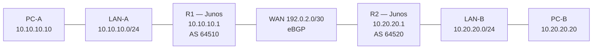
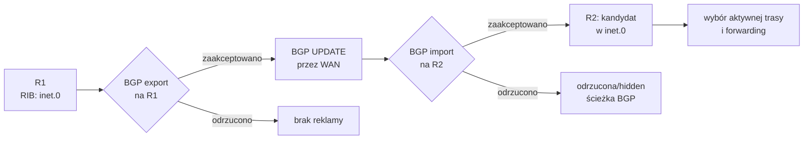

# Rozdział 8. Routing Policy and Firewall Filters — kto decyduje o trasie, a kto zatrzymuje pakiet?

**JUNOS Enterprise Routing & Switching | JNCIA-Junos → JNCIS-ENT → JNCIP-ENT**  
**Zakres:** 8.1–8.14 z [Unified Blueprint](../JUNOS_JNCIA_JNCIS_JNCIP_unified_blueprint.md)  
**Wersja:** 2.0, 19 listopada 2026 — rozdział napisany od nowa jako prowadzona lekcja.  
**Status:** GENERATED / SOURCE-REVIEWED / NOT RUNTIME VALIDATED. Wszystkie wyniki urządzeń w tym rozdziale są *symulowane*, a konfiguracje to projekty ćwiczeń, nie raporty z działającego laboratorium.  
**Punkt odniesienia:** klasyczny Junos na routerach i switchach oraz vSRX w EVE-NG. Odmienności platform i wersji sygnalizujemy w miejscu, w którym rzeczywiście wpływają na wniosek.

> Przez najbliższe lekcje nie będziemy uczyć się „trzech rodzajów ACL”. Będziemy rozwiązywać jeden problem sieciowy, który początkowo wygląda jak usterka BGP, później jak awaria routingu, a na końcu okaże się także problemem filtrowania pakietów. Tak najłatwiej zobaczyć, dlaczego Junos potrzebuje kilku różnych mechanizmów i dlaczego ich nazwy bywają myląco podobne.

## Przed rozpoczęciem: firma, dwa budynki i telefon z NOC

Jest poniedziałek, 8:15. Firma otworzyła niewielki oddział. W oddziale stoi router **R1**, w centrali router **R2**. Oba działają na Junos i zestawiają eBGP przez połączenie WAN. W oddziale jest sieć użytkowników **10.10.10.0/24**, w centrali — **10.20.20.0/24**. Administrator testuje dostęp do serwera ERP. Sesja BGP jest `Established`, ale połączenie nie działa.

Pierwsza reakcja jest znajoma każdemu inżynierowi Cisco: sprawdzić sąsiada, routing table i ACL. Tyle że tutaj „ACL” może oznaczać trzy bardzo różne rzeczy. Ktoś mógł zabronić **ogłoszenia trasy** z R1 do R2. Ktoś mógł zabronić **przyjęcia trasy** na R2. Albo ścieżka jest prawidłowa, lecz zatrzymywany jest dopiero **pakiet** z komputera użytkownika. Jeśli pracujemy na SRX, dojdzie jeszcze kontrola stanu sesji między strefami bezpieczeństwa.

Nie rozwiązujmy wszystkich tych problemów od razu. Najpierw zobaczmy, jak wygląda sieć, zanim cokolwiek skonfigurujemy.

*Rysunek 8.1. Topologia, którą będziemy rozbudowywać. Tekst alternatywny: dwa routery R1 i R2 połączone WAN i eBGP, po jednym LAN oraz komputerze po każdej stronie. Diagram autorski.* WAN: R1 = 192.0.2.1/30, R2 = 192.0.2.2/30. Adresy 192.0.2.0/24 i 198.51.100.0/24 są używane wyłącznie jako przestrzenie dokumentacyjne w izolowanym labie.

Zadaj sobie proste pytanie: **co właściwie musi być prawdą, by PC-A nawiązał połączenie z PC-B?** R1 musi wiedzieć, dokąd wysłać pakiet. R2 musi znać drogę powrotną do PC-A. Oba urządzenia muszą dopuścić ruch na swojej ścieżce forwarding. A komputery muszą mieć właściwe bramy, adresy i lokalne polityki bezpieczeństwa.

Zauważ, jak wiele warunków mieści się za zielonym statusem jednego sąsiedztwa BGP.

---

## 8.1. Default routing policies — co zrobi router, jeśli mu niczego nie nakażesz? [A]

Zacznijmy od sytuacji sprzed pierwszej zmiany. Interfejs LAN R1 jest skonfigurowany, więc w lokalnym RIB — zwykle `inet.0` — pojawia się trasa **direct 10.10.10.0/24**. Router ma także trasę lokalną do własnego adresu interfejsu. R1 może bez żadnego BGP odpowiadać hostowi PC-A z tej podsieci; oczywiście filtrowanie pakietów lub polityka bezpieczeństwa nadal mogą ograniczać konkretne testy.

Konfigurujemy eBGP między R1 i R2. Czy R1 automatycznie zacznie reklamować swoją sieć LAN? Wiele osób odruchowo odpowie „tak, przecież trasa istnieje”. W Junos to błędna intuicja. **Samo posiadanie trasy w RIB nie jest zleceniem rozgłoszenia jej przez dowolny protokół.**

Wyobraź sobie dyspozytora firmy kurierskiej. Na jego wewnętrznej mapie są wszystkie drogi, magazyny, boczne wjazdy i wejścia serwisowe. Nie oznacza to, że cały ten plan trafi do zewnętrznego przewoźnika. Wewnętrzna mapa mówi, gdzie firma *potrafi* dojechać. Zasady publikowania mapy mówią, czego *wolno* dowiedzieć się partnerowi.

W Junos każdy protokół ma własne domyślne zasady importu i eksportu. Dla typowego BGP na klasycznych urządzeniach Junos domyślny eksport dotyczy kwalifikowanych aktywnych tras BGP, z uwzględnieniem zasad BGP. Nie oznacza automatycznej redystrybucji `direct` czy `static`. Aby udostępnić R2 trasę LAN-A pochodzącą z `direct`, będziemy potrzebowali jawnej export policy.

Z OSPF jest inaczej: jeśli włączysz OSPF na interfejsie, protokół rozgłasza własną topologię poprzez LSA. Fakt, że domyślna *export policy* OSPF nie redystrybuuje obcych tras, **nie zatrzymuje tego naturalnego mechanizmu link-state**. W IS-IS obowiązuje podobne rozróżnienie między własną bazą link-state i importowaniem tras z innego źródła. To ważne, ponieważ słowo „export” nie ma identycznych konsekwencji w każdym protokole.

Nie traktuj też default policy jak jednej globalnej zasady `permit any` lub `deny any`. To reguły protokołowe, zależne od kierunku. Wyjątki istnieją również pomiędzy rodzinami urządzeń — dokumentacja Juniper wymienia m.in. odmienne domyślne zachowania BGP na PTX. Na egzaminie najpierw rozpoznaj protokół i kontekst; w produkcji dopisz do analizy model oraz release.

**R1-vSRX — Operational Mode, obserwacja przed wprowadzeniem policy**

~~~junos
show route 10.10.10.0/24 exact
show bgp summary
show route advertising-protocol bgp 192.0.2.2
show configuration protocols bgp | display set
~~~

W wynikach z naszego hipotetycznego oddziału znajdziesz aktywną trasę direct w pierwszym poleceniu, sąsiada `Established` w drugim, a brak LAN-A na liście ogłaszanych prefiksów w trzecim. To **nie jest sprzeczność**: każde polecenie odpowiada na inne pytanie. Pierwsze mówi „czy R1 zna tę sieć?”, drugie „czy rozmawia z R2?”, trzecie „czy opowiada R2 o tej sieci?”.

Jeśli znasz Cisco IOS XE, myśl o tym jak o różnicy między posiadaniem trasy w `show ip route` a celowym `redistribute connected route-map ...`. Analogia dotyczy zamiaru, nie składni ani wszystkich reguł kwalifikacji BGP.

**Przewidź:** gdy R1 nie reklamuje LAN-A, czy PC-A straci ping do 10.10.10.1? Nie z powodu braku eksportu. To problem informacji przekazywanej R2, nie lokalnego połączenia LAN. Gdybyś natomiast odrzucił *trasę potrzebną R1* przez import policy, mógłbyś pośrednio wpłynąć na forwarding. Właśnie na tym polega kolejna lekcja.

*Źródło zachowania: [Juniper — Default Routing Policies](https://www.juniper.net/documentation/us/en/software/junos/routing-policy/topics/concept/policy-routing-policies-actions-defaults.html).*

---

## 8.2. Import i export — dwie strony tej samej rozmowy [A]

Teraz operator pyta: „Skoro mówimy o export, to czy import jest ruchem wchodzącym do interfejsu?”. Nie. To bardzo częsta pułapka. Słowa **import** i **export** w `policy-options` opisują ruch *informacji o trasach* między protokołem a tablicą routingu, a nie kierunek pakietów użytkowników na porcie.

Prześledźmy jedną trasę. R1 wysyła wiadomość BGP UPDATE z prefiksem 10.10.10.0/24. R2 ją odbiera i może zastosować BGP **import policy**. Policy sprawdza, co przyszło, i decyduje, czy informacja może stać się kandydatem w tablicy routingu oraz czy należy zmienić atrybuty trasy. Jeżeli import zaakceptuje kandydaturę, R2 porównuje ją z innymi możliwymi drogami. Tylko odpowiednio wybrana i rozwiązana trasa będzie użyteczna dla forwarding.

W drugą stronę R1 patrzy na trasy kwalifikowane do ogłoszenia i stosuje **export policy**: które wolno wysłać R2 i z jakimi atrybutami? To nie jest kopiowanie całej tablicy `inet.0`; obowiązują reguły protokołu, aktywność trasy, rodzina adresów i inne warunki kwalifikacji.

*Rysunek 8.2. Podróż jednej informacji routingu. Tekst alternatywny: route wychodzi z RIB przez export na R1, BGP przekazuje ją do import na R2; akceptacja daje kandydata w RIB, odrzucenie nie daje aktywnej ścieżki. Diagram autorski. Uproszczenie: BGP może trzymać wiele alternatywnych ścieżek; kolejność szczegółowych etapów zależy od implementacji.*

Przy Cisco użyłbyś podobnej intuicji do `neighbor ... route-map ... in` i `out`. Ale jest różnica, którą warto wykorzystać przy diagnostyce. **Odrzucona przez BGP import trasa może pozostać w Junos jako hidden**. Wtedy użytkownicy jej nie wykorzystają, lecz administrator może zobaczyć, co peer wysłał. Nie myl `hidden` z `inactive`: nieaktywna trasa może po prostu przegrać wybór z lepszą trasą, podczas gdy hidden ma problem z kwalifikacją, polityką lub innym warunkiem użycia. Dokładne powody odczytuj z outputu `extensive`, nie zgaduj.

**R2-vSRX — Operational Mode, sprawdzanie odbioru na R2**

~~~junos
show bgp neighbor 192.0.2.1
show route receive-protocol bgp 192.0.2.1
show route receive-protocol bgp 192.0.2.1 hidden
show route 10.10.10.0/24 exact extensive
show route protocol bgp
~~~

Co tu jest najważniejsze? `show bgp neighbor` dowodzi stanu protokołu, `receive-protocol` pozwala oglądać informacje od konkretnego peera, wariant `hidden` pomaga znaleźć odrzuconych kandydatów, a `show route ... exact extensive` pokazuje stan konkretnego prefiksu w RIB. Ani jedna z tych komend samodzielnie nie dowodzi, że pakiet PC-B wróci do PC-A.

**R1-vSRX — Operational Mode, sprawdzanie reklamy na R1**

~~~junos
show route 10.10.10.0/24 exact extensive
show route advertising-protocol bgp 192.0.2.2
~~~

Teraz możesz prowadzić rozmowę z NOC precyzyjnie: „Trasa jest aktywna na R1, ale nie widzę jej w ogłoszeniach R1” albo „R1 ją reklamuje, R2 widzi ją jako hidden — sprawdzamy import i powód ukrycia”. To dwie różne usterki i dwa różne miejsca naprawy.

Jedno ostrzeżenie na przyszłość: Junos potrafi zachowywać wiele odrzuconych ścieżek BGP. Służy to diagnostyce, ale zużywa pamięć; konfiguracja `keep none` wpływa na retencję. Nie zmieniaj jej „dla porządku” bez zrozumienia konsekwencji ponownej ewaluacji tras po zmianie polityki.

**Most z Cisco:** `show ip bgp neighbors ... received-routes` i route-map inbound/outbound to dobry punkt startowy w myśleniu. Nie zakładaj jednak identycznej dostępności wszystkich widoków, zasad retencji i nazw pól wyjściowych.

*Źródła: [Understanding Routing Policies](https://www.juniper.net/documentation/us/en/software/junos/routing-policy/topics/concept/policy-routing-policies-overview.html), [Basic BGP Routing Policies](https://www.juniper.net/documentation/us/en/software/junos/bgp/topics/topic-map/basic-routing-policies.html), [show route receive-protocol](https://www.juniper.net/documentation/us/en/software/junos/cli-reference/topics/ref/command/show-route-receive-protocol.html).*

