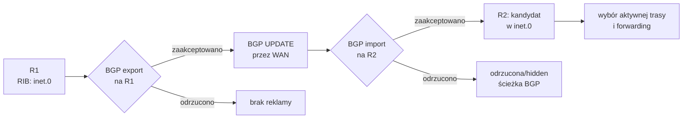
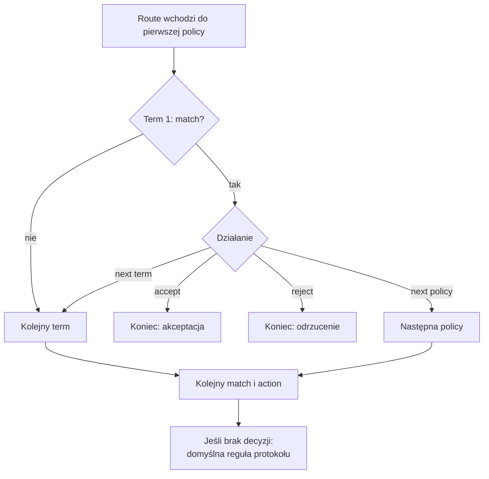
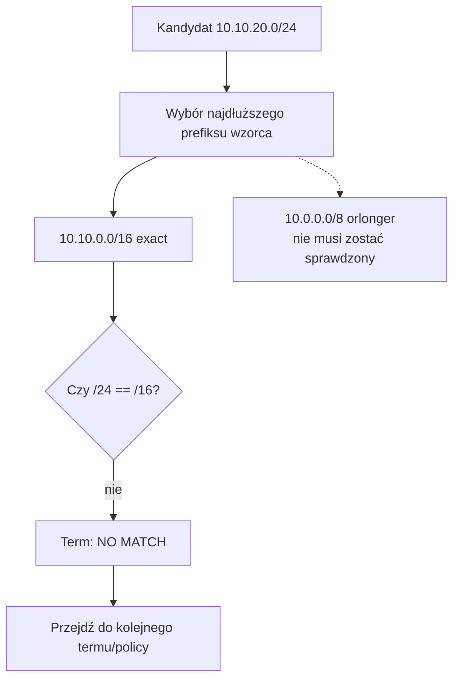
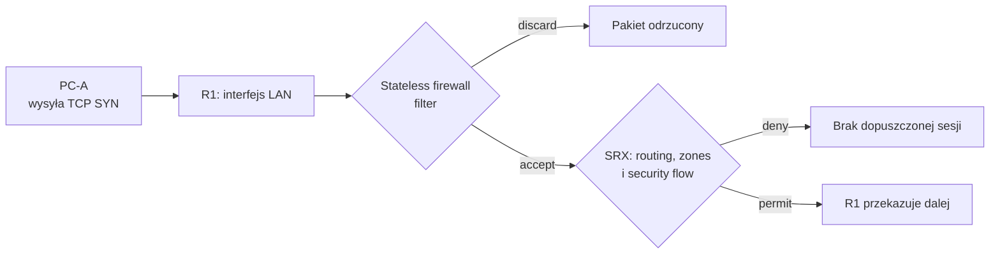
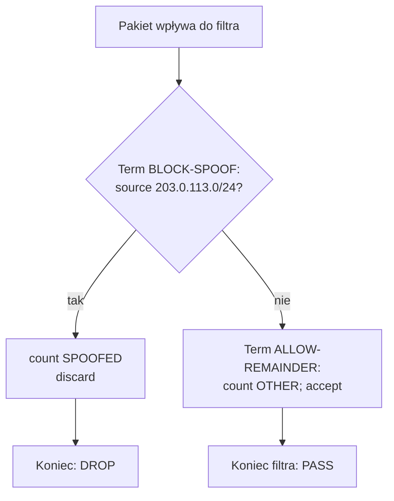
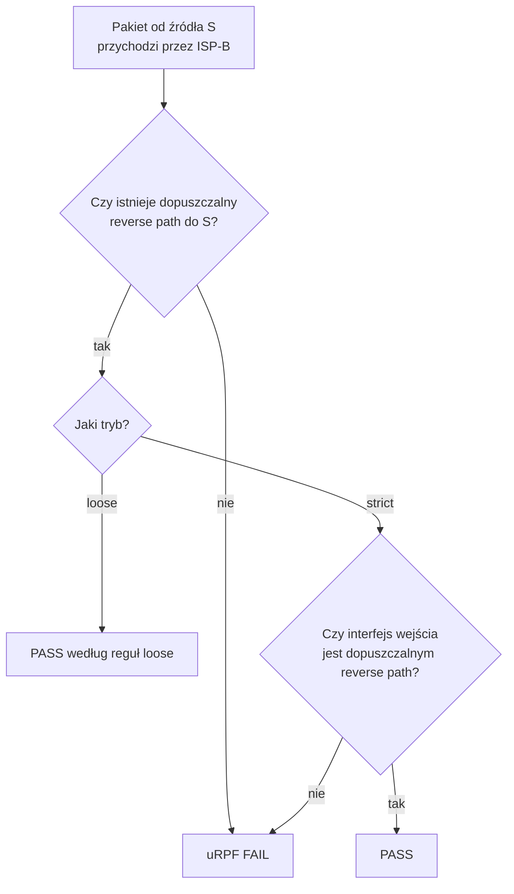
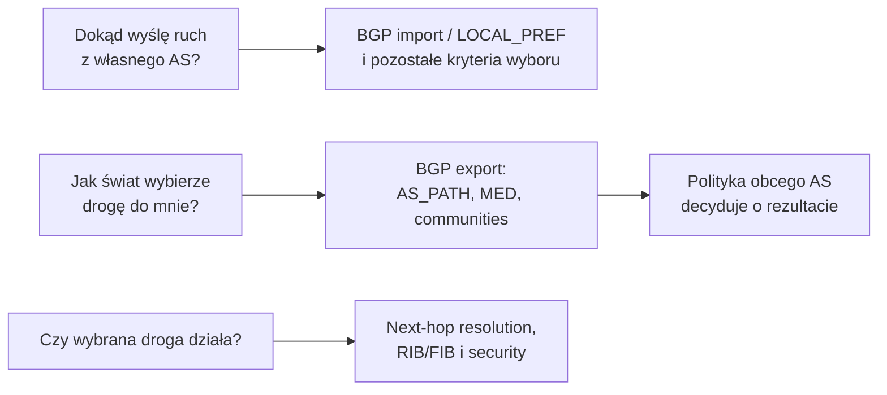
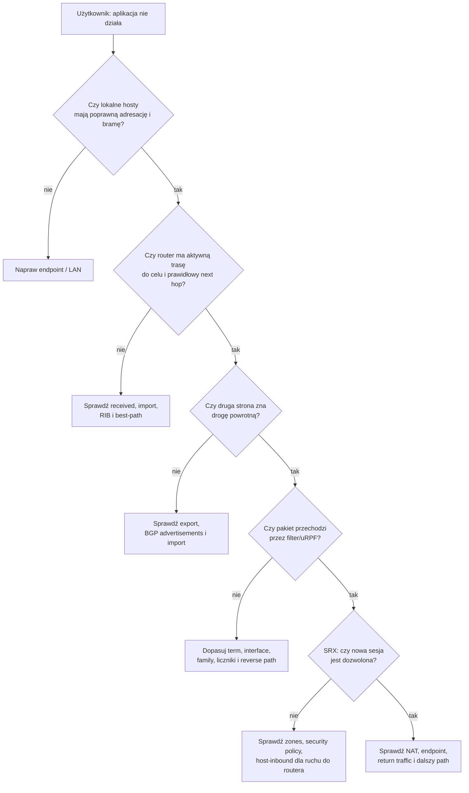

# Rozdział 8. Routing Policy and Firewall Filters — kto decyduje o trasie, a kto zatrzymuje pakiet?

**JUNOS Enterprise Routing & Switching | JNCIA-Junos → JNCIS-ENT → JNCIP-ENT**  
**Zakres:** 8.1–8.14 z [Unified Blueprint](../JUNOS_JNCIA_JNCIS_JNCIP_unified_blueprint.md)  
**Wersja:** 2.0, 19 listopada 2026 — rozdział napisany od nowa jako prowadzona lekcja.  
**Status:** GENERATED / SOURCE-REVIEWED / NOT RUNTIME VALIDATED. Wszystkie wyniki urządzeń w tym rozdziale są *symulowane*, a konfiguracje to projekty ćwiczeń, nie raporty z działającego laboratorium.  
**Punkt odniesienia:** klasyczny Junos na routerach i switchach oraz vSRX w EVE-NG. Odmienności platform i wersji sygnalizujemy w miejscu, w którym rzeczywiście wpływają na wniosek.

> Przez najbliższe lekcje nie będziemy uczyć się „trzech rodzajów ACL”. Będziemy rozwiązywać jeden problem sieciowy, który początkowo wygląda jak usterka BGP, później jak awaria routingu, a na końcu okaże się także problemem filtrowania pakietów. Tak najłatwiej zobaczyć, dlaczego Junos potrzebuje kilku różnych mechanizmów i dlaczego ich nazwy bywają myląco podobne.

## Przed rozpoczęciem: dwa LAN-y, cztery routery i jeden pozornie zdrowy BGP

Firma łączy LAN-A z LAN-B przez **naszą referencyjną topologię DIAMOND**. PC-A `192.0.2.10/24` ma gateway R1 `192.0.2.1`. PC-B `198.51.100.10/24` jest za R4, gateway `198.51.100.1`. R1–R4 można połączyć drogą górną przez **R2** albo dolną przez **R3**. R2 nie jest bramą PC-B: jest urządzeniem tranzytowym.

~~~mermaid
flowchart LR
  PCA["PC-A / VPC1 VPCS Gateway: 192.0.2.1"]
  R1["R1-vSRX lo0.0: 10.255.255.1/32"]
  R2["R2-vSRX lo0.0: 10.255.255.2/32"]
  R3["R3-vSRX lo0.0: 10.255.255.3/32"]
  R4["R4-vSRX lo0.0: 10.255.255.4/32"]
  PCB["PC-B / VPC2 VPCS Gateway: 198.51.100.1"]

  PCA ---|"LAN-A · 192.0.2.0/24 PC-A eth0: 192.0.2.10/24 R1 ge-0/0/2.0: 192.0.2.1/24"| R1
  R1 ---|"P2P-12 · 10.12.0.0/30 R1 ge-0/0/0.0: 10.12.0.1/30 R2 ge-0/0/0.0: 10.12.0.2/30"| R2
  R1 ---|"P2P-13 · 10.13.0.0/30 R1 ge-0/0/1.0: 10.13.0.1/30 R3 ge-0/0/0.0: 10.13.0.2/30"| R3
  R2 ---|"P2P-24 · 10.24.0.0/30 R2 ge-0/0/1.0: 10.24.0.1/30 R4 ge-0/0/0.0: 10.24.0.2/30"| R4
  R3 ---|"P2P-34 · 10.34.0.0/30 R3 ge-0/0/1.0: 10.34.0.1/30 R4 ge-0/0/1.0: 10.34.0.2/30"| R4
  R4 ---|"LAN-B · 198.51.100.0/24 R4 ge-0/0/2.0: 198.51.100.1/24 PC-B eth0: 198.51.100.10/24"| PCB

  classDef vsrx fill:#e6f1fc,stroke:#1565a6,stroke-width:2px,color:#13344f;
  classDef vpcs fill:#e8f5e9,stroke:#2f7d4a,stroke-width:1.5px,color:#17422a;
  class R1,R2,R3,R4 vsrx;
  class PCA,PCB vpcs;
~~~

*Rysunek 8.1. Kanoniczny DIAMOND — 4×vSRX i 2×VPCS. [Pełne źródło diagramu Mermaid](../../labs/reference-diamond-4vsrx-2vpcs/DIAMOND_TOPOLOGY.md) i [tabela adresacji](../../labs/reference-diamond-4vsrx-2vpcs/README.md).*

Dla części wykładu zestawimy **eBGP na istniejących połączeniach**, bez dokładania nowych linków: R1 (AS 64510) ↔ R2 (AS 64520) po `10.12.0.0/30`, R2 ↔ R4 (AS 64540) po `10.24.0.0/30` oraz analogicznie R1 ↔ R3 (AS 64530) po `10.13.0.0/30` i R3 ↔ R4 po `10.34.0.0/30`. To **wariant protokołowy**; domyślny statyczny baseline CH06 musi zostać odłączony w osobnej kopii, inaczej static/5 może wygrać z BGP/170.

W poniedziałek o 8:15 operator z NOC mówi: „BGP Established, a użytkownik PC-A nie widzi PC-B”. Możliwe przyczyny są zupełnie różne: R1 nie ogłasza `192.0.2.0/24`, R2 nie przyjmuje tego prefiksu, R4 nie otrzymuje go przez R2, albo pakiet jest zatrzymywany przez firewall filter/security policy. Nie rozwiązujemy tego globalnym permit ani dopisaniem kolejnego default w ciemno.

Dodatkowe prefiksy pokazywane później przy `route-filter exact/longer/orlonger`, summary oraz uRPF są **syntetycznymi przykładami polityki i tablic routingu**, a nie nowymi podsieciami fizycznego EVE. Jeśli rysunek pokazuje proces import/export lub kolejność filtrowania, jest **diagramem mechanizmu**, a nie inną topologią sprzętową.

---
**Stała reguła adresacji dla wszystkich poniższych przykładów:** R1 LAN-A to `192.0.2.0/24` na `ge-0/0/2.0`, PC-A `192.0.2.10`; R1–R2 to `10.12.0.0/30` (R1 `10.12.0.1`, R2 `10.12.0.2`); R4 LAN-B to `198.51.100.0/24` na `ge-0/0/2.0`, PC-B `198.51.100.10`. Gdy sprawdzamy politykę eksportu R1→R2, dowodzimy tylko pierwszego sąsiedztwa BGP: aby PC-B odpowiedział, **R4 również musi poznać LAN-A**. Pozostałe linki i loopbacki są na diagramie referencyjnym; R2 **nie ma** własnego LAN-B.

## 8.1. Default routing policies — co zrobi router, jeśli mu niczego nie nakażesz? [A]

Zacznijmy od sytuacji sprzed pierwszej zmiany. Interfejs LAN R1 jest skonfigurowany, więc w lokalnym RIB — zwykle `inet.0` — pojawia się trasa **direct 192.0.2.0/24**. Router ma także trasę lokalną do własnego adresu interfejsu. R1 może bez żadnego BGP odpowiadać hostowi PC-A z tej podsieci; oczywiście filtrowanie pakietów lub polityka bezpieczeństwa nadal mogą ograniczać konkretne testy.

Konfigurujemy eBGP między R1 i R2. Czy R1 automatycznie zacznie reklamować swoją sieć LAN? Wiele osób odruchowo odpowie „tak, przecież trasa istnieje”. W Junos to błędna intuicja. **Samo posiadanie trasy w RIB nie jest zleceniem rozgłoszenia jej przez dowolny protokół.**

Wyobraź sobie dyspozytora firmy kurierskiej. Na jego wewnętrznej mapie są wszystkie drogi, magazyny, boczne wjazdy i wejścia serwisowe. Nie oznacza to, że cały ten plan trafi do zewnętrznego przewoźnika. Wewnętrzna mapa mówi, gdzie firma *potrafi* dojechać. Zasady publikowania mapy mówią, czego *wolno* dowiedzieć się partnerowi.

W Junos każdy protokół ma własne domyślne zasady importu i eksportu. Dla typowego BGP na klasycznych urządzeniach Junos domyślny eksport dotyczy kwalifikowanych aktywnych tras BGP, z uwzględnieniem zasad BGP. Nie oznacza automatycznej redystrybucji `direct` czy `static`. Aby udostępnić R2 trasę LAN-A pochodzącą z `direct`, będziemy potrzebowali jawnej export policy.

Z OSPF jest inaczej: jeśli włączysz OSPF na interfejsie, protokół rozgłasza własną topologię poprzez LSA. Fakt, że domyślna *export policy* OSPF nie redystrybuuje obcych tras, **nie zatrzymuje tego naturalnego mechanizmu link-state**. W IS-IS obowiązuje podobne rozróżnienie między własną bazą link-state i importowaniem tras z innego źródła. To ważne, ponieważ słowo „export” nie ma identycznych konsekwencji w każdym protokole.

Nie traktuj też default policy jak jednej globalnej zasady `permit any` lub `deny any`. To reguły protokołowe, zależne od kierunku. Wyjątki istnieją również pomiędzy rodzinami urządzeń — dokumentacja Juniper wymienia m.in. odmienne domyślne zachowania BGP na PTX. Na egzaminie najpierw rozpoznaj protokół i kontekst; w produkcji dopisz do analizy model oraz release.

**R1-vSRX — Operational Mode, obserwacja przed wprowadzeniem policy**

~~~junos
show route 192.0.2.0/24 exact
show bgp summary
show route advertising-protocol bgp 10.12.0.2
show configuration protocols bgp | display set
~~~

W wynikach z naszego hipotetycznego oddziału znajdziesz aktywną trasę direct w pierwszym poleceniu, sąsiada `Established` w drugim, a brak LAN-A na liście ogłaszanych prefiksów w trzecim. To **nie jest sprzeczność**: każde polecenie odpowiada na inne pytanie. Pierwsze mówi „czy R1 zna tę sieć?”, drugie „czy rozmawia z R2?”, trzecie „czy opowiada R2 o tej sieci?”.

Jeśli znasz Cisco IOS XE, myśl o tym jak o różnicy między posiadaniem trasy w `show ip route` a celowym `redistribute connected route-map ...`. Analogia dotyczy zamiaru, nie składni ani wszystkich reguł kwalifikacji BGP.

**Przewidź:** gdy R1 nie reklamuje LAN-A, czy PC-A straci ping do 192.0.2.1? Nie z powodu braku eksportu. To problem informacji przekazywanej R2, nie lokalnego połączenia LAN. Gdybyś natomiast odrzucił *trasę potrzebną R1* przez import policy, mógłbyś pośrednio wpłynąć na forwarding. Właśnie na tym polega kolejna lekcja.

*Źródło zachowania: [Juniper — Default Routing Policies](https://www.juniper.net/documentation/us/en/software/junos/routing-policy/topics/concept/policy-routing-policies-actions-defaults.html).*

---

## 8.2. Import i export — dwie strony tej samej rozmowy [A]

Teraz operator pyta: „Skoro mówimy o export, to czy import jest ruchem wchodzącym do interfejsu?”. Nie. To bardzo częsta pułapka. Słowa **import** i **export** w `policy-options` opisują ruch *informacji o trasach* między protokołem a tablicą routingu, a nie kierunek pakietów użytkowników na porcie.

Prześledźmy jedną trasę. R1 wysyła wiadomość BGP UPDATE z prefiksem 192.0.2.0/24. R2 ją odbiera i może zastosować BGP **import policy**. Policy sprawdza, co przyszło, i decyduje, czy informacja może stać się kandydatem w tablicy routingu oraz czy należy zmienić atrybuty trasy. Jeżeli import zaakceptuje kandydaturę, R2 porównuje ją z innymi możliwymi drogami. Tylko odpowiednio wybrana i rozwiązana trasa będzie użyteczna dla forwarding.

W drugą stronę R1 patrzy na trasy kwalifikowane do ogłoszenia i stosuje **export policy**: które wolno wysłać R2 i z jakimi atrybutami? To nie jest kopiowanie całej tablicy `inet.0`; obowiązują reguły protokołu, aktywność trasy, rodzina adresów i inne warunki kwalifikacji.

*Rysunek 8.2. Podróż jednej informacji routingu. Tekst alternatywny: route wychodzi z RIB przez export na R1, BGP przekazuje ją do import na R2; akceptacja daje kandydata w RIB, odrzucenie nie daje aktywnej ścieżki. Diagram autorski. Uproszczenie: BGP może trzymać wiele alternatywnych ścieżek; kolejność szczegółowych etapów zależy od implementacji.*

Przy Cisco użyłbyś podobnej intuicji do `neighbor ... route-map ... in` i `out`. Ale jest różnica, którą warto wykorzystać przy diagnostyce. **Odrzucona przez BGP import trasa może pozostać w Junos jako hidden**. Wtedy użytkownicy jej nie wykorzystają, lecz administrator może zobaczyć, co peer wysłał. Nie myl `hidden` z `inactive`: nieaktywna trasa może po prostu przegrać wybór z lepszą trasą, podczas gdy hidden ma problem z kwalifikacją, polityką lub innym warunkiem użycia. Dokładne powody odczytuj z outputu `extensive`, nie zgaduj.

**R2-vSRX — Operational Mode, sprawdzanie odbioru na R2**

~~~junos
show bgp neighbor 10.12.0.1
show route receive-protocol bgp 10.12.0.1
show route receive-protocol bgp 10.12.0.1 hidden
show route 192.0.2.0/24 exact extensive
show route protocol bgp
~~~

Co tu jest najważniejsze? `show bgp neighbor` dowodzi stanu protokołu, `receive-protocol` pozwala oglądać informacje od konkretnego peera, wariant `hidden` pomaga znaleźć odrzuconych kandydatów, a `show route ... exact extensive` pokazuje stan konkretnego prefiksu w RIB. Ani jedna z tych komend samodzielnie nie dowodzi, że pakiet PC-B wróci do PC-A.

**R1-vSRX — Operational Mode, sprawdzanie reklamy na R1**

~~~junos
show route 192.0.2.0/24 exact extensive
show route advertising-protocol bgp 10.12.0.2
~~~

Teraz możesz prowadzić rozmowę z NOC precyzyjnie: „Trasa jest aktywna na R1, ale nie widzę jej w ogłoszeniach R1” albo „R1 ją reklamuje, R2 widzi ją jako hidden — sprawdzamy import i powód ukrycia”. To dwie różne usterki i dwa różne miejsca naprawy.

Jedno ostrzeżenie na przyszłość: Junos potrafi zachowywać wiele odrzuconych ścieżek BGP. Służy to diagnostyce, ale zużywa pamięć; konfiguracja `keep none` wpływa na retencję. Nie zmieniaj jej „dla porządku” bez zrozumienia konsekwencji ponownej ewaluacji tras po zmianie polityki.

**Most z Cisco:** `show ip bgp neighbors ... received-routes` i route-map inbound/outbound to dobry punkt startowy w myśleniu. Nie zakładaj jednak identycznej dostępności wszystkich widoków, zasad retencji i nazw pól wyjściowych.

*Źródła: [Understanding Routing Policies](https://www.juniper.net/documentation/us/en/software/junos/routing-policy/topics/concept/policy-routing-policies-overview.html), [Basic BGP Routing Policies](https://www.juniper.net/documentation/us/en/software/junos/bgp/topics/topic-map/basic-routing-policies.html), [show route receive-protocol](https://www.juniper.net/documentation/us/en/software/junos/cli-reference/topics/ref/command/show-route-receive-protocol.html).*

---

## 8.3. Jak Junos czyta politykę — po co są termy i dlaczego ich kolejność potrafi zepsuć noc? [A]

Wiemy już, gdzie polityka jest stosowana. Teraz popatrzmy, jak pracuje. Mamy konkretne zamówienie z działu bezpieczeństwa: **R1 może reklamować do R2 wyłącznie podsieć użytkowników LAN-A. Nie może ujawniać sieci laboratoryjnych, zarządzających ani tranzytowych.**

Najprostsza myśl brzmi: „stworzę listę dozwolonych podsieci”. Ale Junos nie dostaje jedynie listy. Dostaje **program podejmowania decyzji**. Ten program nazywa się `policy-statement`. Wewnątrz mamy uporządkowane kroki — `term`. Każdy krok może zapytać o właściwości trasy w `from` i wykonać działanie w `then`.

Przyjrzyj się pierwszej polityce, zanim ją wpiszemy. Chcemy sprawdzać prefiks **i** pochodzenie. Jeżeli route do 192.0.2.0/24 jest trasą direct, wolno ją ogłosić. Jeżeli ktoś jutro wprowadzi przypadkiem static z tym adresem, nie chcemy, by sama zgodność numerów automatycznie dała mu przepustkę. Pozostałe prefiksy odrzucamy jawnie.

**R1-vSRX — Configuration Mode, projekt polityki eksportu**

~~~junos
set policy-options policy-statement EXPORT-TO-R2 term USERS from protocol direct
set policy-options policy-statement EXPORT-TO-R2 term USERS from route-filter 192.0.2.0/24 exact
set policy-options policy-statement EXPORT-TO-R2 term USERS then accept
set policy-options policy-statement EXPORT-TO-R2 term DENY-EVERYTHING-ELSE then reject
set protocols bgp group TO-R2 export EXPORT-TO-R2
~~~

Czytasz tę konfigurację jak krótką opowieść:

1. „Jeżeli kandydat jest trasą direct, **i** jego prefix to dokładnie 192.0.2.0/24…”.
2. „…zaakceptuj go do dalszego procesu reklamowania BGP i zakończ ocenę polityki”.
3. „W przeciwnym razie dojdź do ostatniego termu, który odrzuca wszystko inne”.

Warunki różnych rodzajów w `from` współpracują logicznie jak **AND**. Wewnątrz niektórych grup dopasowań istnieją reguły alternatyw, a dla `route-filter` również zasada wybierania najlepszego wzorca. Za chwilę zobaczymy, dlaczego nie należy sprowadzać całego silnika policy do zdania „pierwszy pasujący wiersz ACL”.

Zanim wykonasz commit, sprawdź obiekt i miejsce jego użycia. Samo zdefiniowanie `EXPORT-TO-R2` pod `policy-options` **nie podłącza go do BGP**. Równie dobrze możesz trzymać pięćdziesiąt gotowych polityk, których nie używa żaden protokół.

**R1-vSRX — Configuration Mode, bezpieczna inspekcja zmiany**

~~~junos
show policy-options policy-statement EXPORT-TO-R2
show protocols bgp group TO-R2
show | compare
commit check
~~~

To, że `commit check` przeszedł, oznacza sprawdzenie konfiguracji przez Junos, nie dowód skutecznego eksportu. W odizolowanym laboratorium użyj później `commit confirmed 5`, wykonaj post-check i dopiero po pozytywnej ocenie potwierdź zwykłym `commit`. Uważaj: dodatkowy `commit check` po uruchomieniu `commit confirmed` może potwierdzić oczekującą zmianę; nie rób go mechanicznie w trakcie odliczania.

### Co naprawdę robią accept, reject, next term i next policy?

Wyobraź sobie, że recepcja w biurowcu ma trzy stanowiska. Pierwsze sprawdza identyfikator, drugie może przybić pieczątkę, trzecie podejmuje ostateczną decyzję o wejściu. Nie każda pieczątka kończy wizytę, ale ostateczne „wpuszczam” lub „nie wpuszczam” już tak.

W routing policy `accept` i `reject` są działaniami **kończącymi ocenę łańcucha** w zwykłym scenariuszu. `next term` każe przejść do kolejnego termu *tej samej* polityki. `next policy` pomija resztę bieżącej polityki i przechodzi do *następnej* polityki na liście. Jeśli lista się skończy bez decyzji terminalnej, w grę wchodzi **default policy protokołu**.

To ostatnie zdanie jest szczególnie ważne. „Nic nie dopasowałem” nie musi oznaczać ani akceptacji, ani odrzucenia — liczy się protokół, kierunek i kontekst.

Załóżmy, że chcemy rozdzielić dwa zadania: najpierw oznaczyć trasę community BGP, a następnie sprawdzić, czy należy do whitelisty. Moglibyśmy użyć jednej policy, ale lepiej pokaże to działanie łańcucha.

**R1-vSRX — Configuration Mode, samodzielny przykład rozszerzenia polityki BGP**

~~~junos
set policy-options community BRANCH-ROUTE members 64510:100
set policy-options policy-statement MARK-ROUTE term USERS from route-filter 192.0.2.0/24 exact
set policy-options policy-statement MARK-ROUTE term USERS then community add BRANCH-ROUTE
set policy-options policy-statement MARK-ROUTE term USERS then next policy
set policy-options policy-statement FINAL-CHECK term USERS from protocol direct
set policy-options policy-statement FINAL-CHECK term USERS from route-filter 192.0.2.0/24 exact
set policy-options policy-statement FINAL-CHECK term USERS then accept
set policy-options policy-statement FINAL-CHECK term REST then reject
set protocols bgp group TO-R2 export [ MARK-ROUTE FINAL-CHECK ]
~~~

**Uwaga:** ten przykład **zastępuje**, a nie dodaje do wcześniejszego `EXPORT-TO-R2`, miejsce eksportu BGP. W laboratorium nie wprowadzaj kilku wzajemnie sprzecznych wariantów naraz. `community add` samo w sobie nie przyznaje zgody na reklamę. Dopiero `FINAL-CHECK` mówi ostatecznie „tak”. Gdyby w pierwszej polityce zamiast `next policy` było `accept`, druga policy nie miałaby okazji już niczego sprawdzić.

Można użyć również `next term`, kiedy po dodaniu atrybutu chcemy ocenić kolejny term w **tej samej** polityce. W zależności od akcji i miejsca w hierarchii Junos kontroluje dozwolone kombinacje; na Junos Evolved `next term` nie może być ostatnią akcją termu bez następnego termu, co opisuje dokumentacja producenta.

*Rysunek 8.3. Sterowanie przebiegiem oceny policy. Tekst alternatywny: dopasowanie termu prowadzi do terminalnych accept/reject lub do kontynuacji next term/next policy; gdy nie ma decyzji, działa protokółowa polityka domyślna. Diagram dydaktyczny, nie pełna specyfikacja silnika.*

Sprawdź swoją intuicję. Masz term `MARK` z `then community add`, pod nim term `REST then reject`. Czy sama modyfikacja community oznacza, że trasa została zaakceptowana? Nie. Ocena musi dojść do decyzji. To jedna z podstawowych różnic między **akcją modyfikującą atrybut** a **akcją sterującą przepływem**.

*Źródła: [How a Routing Policy Is Evaluated](https://www.juniper.net/documentation/us/en/software/junos/routing-policy/topics/concept/policy-routing-policies-evaluation-method.html), [Policy Chain Evaluation](https://www.juniper.net/documentation/us/en/software/junos/routing-policy/topics/concept/policy-routing-policies-chain-evaluation-method.html), [Summary of Routing Policy Actions](https://www.juniper.net/documentation/us/en/software/junos/routing-policy/topics/concept/policy-default-actions-default-policies.html).*

---

## 8.4. Polityka może zmienić routing — ale nie zawsze tak, jak się spodziewasz [A]

Wróćmy do oddziału. R1 zaczął reklamować LAN-A. R2 odbiera trasę, lecz w centrali działa dodatkowy router R3, który podaje inną drogę do tego samego prefiksu. Na R2 masz teraz więcej niż jednego kandydata. Administrator mówi: „Przecież moja import policy zaakceptowała prefiks, więc na pewno to on jest w FIB”. Nie musi tak być.

W Junos przechodzimy przez kilka różnych etapów: **otrzymanie informacji → ocena przez import policy → obecność kandydata w RIB → wybór aktywnej ścieżki → rozwiązanie next hop → instalacja odpowiedniego forwardingu**. Akceptacja polityki nie jest tym samym co zwycięstwo w wyborze trasy. Decydują m.in. route preference, zasady protokołu i poprawne rozwiązanie next hop. Nawet prawidłowa aktywna trasa nie daje jeszcze gwarancji, że stateless firewall filter albo SRX security policy przepuszczą pakiet.

Wyobraź sobie dwóch kierowców oferujących przewiezienie paczki. Ochrona recepcji zaakceptowała obie przepustki. Ale dyspozytor nadal musi zdecydować, którego kierowcę wysłać. A magazyn może mieć zamkniętą bramę wyjazdową. Właśnie dlatego *accept* w policy nie jest synonimem *packet delivered*.

**R2-vSRX — Operational Mode, trzy kolejne pytania o trasę**

~~~junos
show route 192.0.2.0/24 exact extensive
show route protocol bgp
show route forwarding-table destination 192.0.2.10
~~~

Pierwsze pokazuje stan prefiksu i możliwe konkurujące drogi, drugie pozwala rozpoznać BGP jako źródło kandydatów, a trzecie daje perspektywę forwardingu do konkretnego adresu. RIB i FIB nie muszą prezentować identycznej liczby rekordów ani identycznego poziomu szczegółowości. W prawdziwym incydencie sprawdzisz także tablicę `inet6.0` lub odpowiednią routing instance, jeżeli pracujesz poza podstawowym IPv4 `inet.0`.

### Pozornie paradoksalny przypadek OSPF

Na tej samej zmianie ktoś próbuje użyć import policy OSPF do odrzucenia wewnętrznego prefiksu area. Po zmianie prefiks nadal jest widoczny. „Junos zignorował policy!”, słyszysz.

To niekoniecznie awaria. OSPF jest protokołem link-state: routery muszą zachować spójność obrazu topologii. Junos ogranicza użyteczność import policy OSPF do określonych przypadków, przede wszystkim tras **external**; odrzucenie trasy wewnętrznej zwykłą import policy nie jest uniwersalnym sposobem filtrowania jej z LSDB/RIB. Dokumentacja wprost wyjaśnia, że `reject` zastosowane do nonexternal OSPF route bywa ignorowane. Pełne wyjaśnienie area, LSA i ABR zostawimy do rozdziału 9. Teraz zapamiętaj praktyczny sens: **polityka nie jest obietnicą, że każdy protokół pozwoli ingerować w każdy etap swojej pracy**.

**R-OSPF-EDGE — Operational Mode, rozpoznanie rodzaju trasy**

~~~junos
show ospf neighbor
show ospf database
show route protocol ospf detail
show configuration protocols ospf | display set
~~~

Jeśli widzisz wewnętrzną trasę OSPF, nie próbuj na ślepo „naprawiać” problemu przez kolejne import reject. Ustal, czy problem dotyczy redystrybucji, topologii area, agregacji, czy używania trasy do forwardingu.

*Źródła: [Actions in Routing Policy Terms](https://www.juniper.net/documentation/us/en/software/junos/routing-policy/topics/concept/policy-configuring-actions-in-routing-policy-terms.html), [Protocol Support for Import and Export Policies](https://www.juniper.net/documentation/us/en/software/junos/routing-policy/topics/concept/policy-protocol-support-import-export-policies.html).*

---

## 8.5. Policy statement i term — jak budować reguły, których nie trzeba się bać [A]

W laboratorium dwie linie `from` i jedno `then accept` wyglądają niewinnie. Ale wyobraź sobie wielką sieć z trzydziestoma oddziałami, dwiema trasami wyjścia do Internetu, osobną siecią zarządzającą i setkami prefiksów BGP. Nikt nie będzie weryfikował bezpieczeństwa takiej sieci, przeglądając po kolei setki przypadkowych `set`.

Potrzebujemy czytelnej polityki. Nie po to, aby nauczyć się składni, lecz po to, żeby podczas awarii móc w kilka sekund odpowiedzieć: **która reguła jest odpowiedzialna za dany prefix?**

W Junos mamy hierarchię, którą można czytać od zewnątrz do środka:

- `policy-options` jest miejscem, gdzie definiujemy obiekty wielokrotnego użytku;
- `policy-statement` jest nazwanym zestawem zasad;
- `term` jest kolejnym krokiem tej polityki;
- `from` opisuje to, co ma pasować do kandydata;
- `then` mówi, co zrobić z dopasowaną trasą.

Ta struktura ma swoją cenę: bardzo łatwo napisać poprawny składniowo, lecz zbyt szeroki term. Rozważ różnicę między dwiema historiami.

W pierwszej administrator pisze: „Zawsze zezwalaj na reklamy tras direct”. W drugiej: „Zezwalaj wyłącznie na dokładnie zidentyfikowaną sieć użytkowników, a pozostałe odrzucaj”. Pierwsza polityka będzie krótsza. Druga znacznie lepiej zniesie rozbudowę sieci.

**R1-vSRX — Configuration Mode, przykład ryzykownie szerokiej polityki (NIE WDRAŻAJ)**

~~~junos
set policy-options policy-statement TOO-BROAD term DIRECT from protocol direct
set policy-options policy-statement TOO-BROAD term DIRECT then accept
~~~

Co stanie się za pół roku, jeśli R1 dostanie bezpośrednio podłączony segment zarządzający 10.99.99.0/24? Ten sam term może pozwolić BGP ogłosić go na zewnątrz, o ile trasa spełni pozostałe warunki protokołu. Żaden alarm nie musi się pojawić. Z punktu widzenia Junos polityka wykonała poprawnie to, o co ją poproszono.

Właśnie dlatego w produkcyjnych export policies zazwyczaj zaczynam od **świadomej whitelisty**. Nazwa termu powinna mówić, czemu służy: `ALLOW-USER-LAN`, `BLOCK-MGMT`, `DENY-REMAINDER`. To nie poprawia samego algorytmu, ale radykalnie poprawia jakość review i troubleshootingu.

Spójrz jeszcze na dwa przykłady, które pozornie wyglądają podobnie:

**R1-vSRX — Configuration Mode, ilustracja różnicy „brak from”**

~~~junos
set policy-options policy-statement CHECK-A term ALL then accept
set policy-options policy-statement CHECK-B term ALL then reject
~~~

W obu politykach term nie zawiera `from`. To nie znaczy „term nigdy się nie uruchomi”. Taki term **dopasowuje każdą trasę**, która do niego dotrze. W pierwszej polityce otwiera przejście wszystkim kandydatom; w drugiej zamyka je wszystkim. I dlatego końcowe `then reject` jest tak skutecznym mechanizmem domknięcia whitelisty.

W samym Junos możesz łatwo sprawdzić konfigurację w dwóch formatach. `display set` dobrze nadaje się do porównania zmian i wklejenia fragmentów, a hierarchiczny `show` pozwala dostrzec, **co jest wewnątrz czego**. Dobrze jest swobodnie używać obu perspektyw.

**R1-vSRX — Operational Mode, dwie perspektywy tej samej policy**

~~~junos
show configuration policy-options policy-statement EXPORT-TO-R2
show configuration policy-options policy-statement EXPORT-TO-R2 | display set
show configuration protocols bgp | display set
~~~

Najbardziej użyteczne pytanie przy review brzmi nie „czy syntax jest poprawny?”, ale „**jaki dodatkowy prefix mógłby nieoczekiwanie przejść przez ten term?**”. Pomyśl o sieci zarządzającej, interfejsie tranzytowym, loopbacku, default route lub statycznym blackhole.

---

## 8.6. Jak dobrać trasę: exact, longer, orlonger i pułapka najbardziej szczegółowej reguły [A]

Przychodzi nowe polecenie: oddział ma otrzymać nie tylko 192.0.2.0/24, ale również 10.10.11.0/24. Administrator proponuje prostszy filtr „zaakceptuj 10.10.0.0/16”. Brzmi sensownie. Tyle że wtedy musimy zadać pytanie, którego nie da się uniknąć: **czy chodzi o sam prefiks /16, czy o wszystkie sieci znajdujące się w tej przestrzeni?**

To nie jest różnica kosmetyczna. BGP reklamuje *prefiksy* — pary adres/maska. Router nie może zgadnąć, czy `10.10.0.0/16` jest oczekiwanym sumarycznym ogłoszeniem, czy wygodnym zapisem zbioru /24. Jeżeli w RIB są dwie trasy /24, polityka `route-filter 10.10.0.0/16 exact` **nie dopasuje** żadnej z nich.

### Ta sama sieć, kilka zupełnie różnych pytań

Na przykładzie bazy 10.10.0.0/16, zapamiętaj znaczenie operatorów, a nie ich mechaniczne definicje:

| Zapis | Co naprawdę przepuści jako warunek dopasowania? | Kiedy potrzebujesz |
|---|---|---|
| `exact` | Dokładnie 10.10.0.0/16, nie /24 | Gdy reklamujesz konkretny summary |
| `longer` | Prefiksy bardziej szczegółowe niż /16, bez samego /16 | Gdy interesują Cię wyłącznie podsieci |
| `orlonger` | Sam /16 **i** wszystkie bardziej szczegółowe w jego zakresie | Gdy świadomie dopuszczasz deagregację |
| `upto /24` | /16, /17 … aż do /24, lecz nie /25 | Gdy chcesz ograniczyć nadmierną szczegółowość |
| `prefix-length-range /24-/28` | Tylko podsieci /24–/28 wewnątrz /16 | Gdy wymagany jest przedział długości |

Każda z tych reguł mówi o **długości prefiksu wpisu routingu**, a nie o źródłowym adresie pakietu. Jeśli host 192.0.2.50 otwiera HTTPS, jego źródłowe IP nie jest osobnym prefiksem /32 wysyłanym do BGP tylko dlatego, że w nagłówku ma ten adres.

A teraz wykonajmy ćwiczenie bez urządzeń. Mamy w RIB trzy aktywne trasy: 10.10.0.0/16, 192.0.2.0/24 i 192.0.2.128/25. Filtr `10.10.0.0/16 upto /24` będzie mógł dopasować dwie pierwsze. Trzecia, mimo że mieści się adresowo wewnątrz /16, ma długość **/25**, więc zostanie pominięta. **Routing prefix match nie jest zwykłym sprawdzaniem, czy dany adres IP należy do sieci.**

**R1-vSRX — Configuration Mode, tylko dwa konkretne segmenty LAN**

~~~junos
set policy-options policy-statement EXPORT-LANS term USERS from protocol direct
set policy-options policy-statement EXPORT-LANS term USERS from route-filter 192.0.2.0/24 exact
set policy-options policy-statement EXPORT-LANS term USERS from route-filter 10.10.11.0/24 exact
set policy-options policy-statement EXPORT-LANS term USERS then accept
set policy-options policy-statement EXPORT-LANS term REST then reject
~~~

Dwa `route-filter` w jednym termie reprezentują alternatywne wzorce prefiksów, a `from protocol direct` ogranicza typ źródła. Gdyby trzeba było przechowywać dłuższą, wielokrotnie używaną listę, sięgnęlibyśmy po nazwany obiekt `prefix-list` i dopasowanie `from prefix-list`. Zwykłe `prefix-list` dopasowuje wymienione prefiksy dokładnie; `prefix-list-filter ... orlonger` daje inną semantykę długości. Nie traktuj obu poleceń jak synonimów.

**R1-vSRX — Configuration Mode, wariant z nazwanym zbiorem prefiksów**

~~~junos
set policy-options prefix-list BRANCH-LANS 192.0.2.0/24
set policy-options prefix-list BRANCH-LANS 10.10.11.0/24
set policy-options policy-statement EXPORT-LIST term APPROVED from protocol direct
set policy-options policy-statement EXPORT-LIST term APPROVED from prefix-list BRANCH-LANS
set policy-options policy-statement EXPORT-LIST term APPROVED then accept
set policy-options policy-statement EXPORT-LIST term REST then reject
~~~

Te dwa warianty realizują podobną intencję biznesową. Nie wdrażaj ich obu równocześnie bez świadomie zaprojektowanej listy polityk; są alternatywnymi sposobami napisania tej samej lekcji.

### Bardzo ważny niuans: policy też używa longest match, ale to nie jest LPM w FIB

Znasz regułę LPM z Cisco CEF i z rozdziału 6. Pakiet do 192.0.2.130 trafi do najbardziej szczegółowej dostępnej trasy w FIB. W routing policy Junos również potrafi szukać najlepszego prefiksowego dopasowania, lecz **szuka wzorca route-filter**, a dopiero potem ocenia przypisany do niego typ dopasowania.

Załóżmy, że w **jednym termie** są dwa warunki:

- 10.0.0.0/8 `orlonger`;
- 10.10.0.0/16 `exact`.

Przychodzi kandydat **10.10.20.0/24**. Odruchowo chciałoby się powiedzieć: „Reguła /8 orlonger pasuje, więc term pasuje”. W domyślnym zachowaniu Junos najbardziej szczegółowym wzorcem jest jednak /16. Gdy sprawdzi przy nim `exact`, okaże się, że kandydat /24 nie jest /16. Cały term może uzyskać **no match**, mimo że szerszy wzorzec wyglądał na pasujący. To nie jest błędne LPM forwarding — to inny etap i inna semantyka.

*Rysunek 8.4. Tekst alternatywny: route-filter najpierw wybiera najbardziej szczegółowy wzorzec /16; dopasowanie exact dla kandydata /24 nie udaje się, więc term może nie dopasować. Diagram autorski, ilustruje domyślną semantykę bez funkcji walkup.*

Jeśli chcesz dopuścić także szersze reguły, możesz rozdzielić je na osobne termy lub rozważyć `walkup`, gdzie funkcja jest dostępna i rozumiesz jej wpływ na politykę. Nie włączaj globalnego `walkup` wyłącznie po to, żeby „naprawić jeden prefix” w działającym środowisku — może zmienić wynik także dla innych polityk.

To jeden z tych niuansów Junos, które pokazują różnicę między nauką komend a rozumieniem narzędzia. Wiesz już, **co testować**: trasy /16, /24 i /25 pod konkretnymi zestawami `route-filter`, a nie tylko jedną wygodną trasę pokazową.

### Sprawdź dopasowanie, zanim dotkniesz sąsiada BGP

Junos ma polecenie `test policy`. Nie udaje ono całego eBGP, ale jest pomocne przy analizie samej policy. Dokumentacja producenta ostrzega, że test używa domyślnego **accept**, więc polityka bez jawnego końcowego `reject` może dać wynik zaskakująco szeroki. Z drugiej strony nawet pomyślny `test policy` nie gwarantuje reklamy: BGP może nie zakwalifikować trasy z powodów niezwiązanych z samym termem.

**R1-vSRX — Operational Mode, test lokalnej policy; składnię potwierdź na swoim release**

~~~junos
test policy EXPORT-LANS 192.0.2.0/24
test policy EXPORT-LANS 10.10.11.0/24
show route advertising-protocol bgp 10.12.0.2
~~~

Czytaj wynik jako dwa różne dowody: pierwszy i drugi testują logikę dopasowania tras w aktualnej tabeli, trzeci dotyczy faktycznego eksportu BGP do peera. Dopiero ich zestawienie może potwierdzić twoją hipotezę.

*Źródła: [Routing Policy Match Conditions](https://www.juniper.net/documentation/us/en/software/junos/routing-policy/topics/concept/policy-configuring-match-conditions-in-routing-policy-terms.html), [Walkup for Route Filters](https://www.juniper.net/documentation/us/en/software/junos/routing-policy/topics/concept/walkup-route-filter-policy-option-overview.html), [Understanding Routing Policy Tests](https://www.juniper.net/documentation/us/en/software/junos/routing-policy/topics/concept/policy-testing-routing-policies.html).*

---

## 8.7. Teraz pakiet naprawdę rusza — skąd nagle firewall filter? [A]

Wyobraź sobie, że naprawiliśmy ogłoszenia BGP. R1 i R2 widzą swoje LAN-y, return path istnieje, a oba routery wybierają aktywne trasy. PC-A nadal nie łączy się z serwerem ERP w centrali. Kolega z drugiej zmiany proponuje: „Zmień export policy, może trzeba dopisać port TCP 443”.

Właśnie w tym miejscu rozdział 8 staje się przydatny w prawdziwej pracy. **Port TCP 443 nie należy do decyzji BGP o reklamowaniu prefiksu.** Jeśli routing jest prawidłowy, a konkretne pakiety są odrzucane, musimy zejść z poziomu informacji routingu na poziom ruchu użytkownika.

Routing policy czyta obiekt typu „sieć 198.51.100.0/24 poznana przez BGP, z takimi atrybutami”. **Firewall filter** czyta konkretne pakiety: źródło 192.0.2.10, cel 198.51.100.10, TCP, port 443, ewentualnie inne pola nagłówków i metadane właściwe rodzinie oraz platformie. To dwa odmienne pytania skierowane do dwóch mechanizmów.

Jeśli pracujesz od lat z Catalystami, odruchowo pomyślisz o IPv4 ACL przypisanej na `in` lub `out`. To dobra intuicja na start. Junos firewall filter jest zwykle **stateless**: ocenia dopasowanie bez konieczności pamiętania, czy dany przepływ został wcześniej zainicjowany. Może jednak pełnić więcej funkcji niż zwykły `permit/deny`: liczyć, logować w odpowiednio wspieranym zakresie, klasyfikować CoS, zastosować policer, chronić Routing Engine, a w specjalnym przypadku skierować ruch do innej instancji routingu (filter-based forwarding, który poznaliśmy w rozdziale 7).

### Jedno słowo „firewall” i dwa różne światy

Na routerze MX, switchu EX/QFX albo klasycznym Junos `firewall family inet filter` to konstrukcja stateless. Na SRX istnieją **dodatkowo** stateful `security policies` powiązane ze strefami i mechanizmem flow. Wygląda to jak zmiana tematu, ale dla kogoś ćwiczącego na vSRX jest absolutnie kluczowe.

Załóżmy, że stateless filter na wejściu R1 przepuszcza SYN z PC-A. Czy to automatycznie dowodzi, że SRX pozwoli mu utworzyć sesję do serwera? Nie. SRX może nadal nie mieć odpowiedniej polityki `from-zone LAN to-zone WAN`. Z drugiej strony dopuszczająca `security policy` nie naprawi pakietu odrzuconego przez skuteczny, wcześniej zastosowany stateless filter. Dokładne etapy przetwarzania zależą od platformy i trybu pracy; przy diagnozie nie wyciągamy wniosku o całej ścieżce na podstawie jednego licznika.

*Rysunek 8.5. Tekst alternatywny: pakiet z hosta może zostać odrzucony przez stateless filter albo przez stateful security policy SRX. Schemat jest logiczną mapą diagnostyczną, nie uniwersalnym porządkiem wykonania w każdym PFE i trybie SRX. Diagram autorski.*

Szczególnie ważna jest jeszcze jedna różnica. Pakiet **do własnego adresu routera** nie jest tym samym co pakiet **tranzytowy przez router**. Na SRX routing protocol, SSH i ping do samego urządzenia mogą wymagać właściwego `host-inbound-traffic`, podczas gdy sesja użytkownika przechodząca między strefami wymaga odpowiedniej polityki bezpieczeństwa. Dlatego ping R1 do R2 po WAN nie dowodzi, że PC-A potrafi rozmawiać z PC-B.

*Źródła: [Comparison of Routing Policies and Firewall Filters](https://www.juniper.net/documentation/us/en/software/junos/routing-policy/topics/concept/policy-routing-policies-firewall-filters-comparison.html), [SRX Security Policies](https://www.juniper.net/documentation/us/en/software/junos/security-policies/topics/concept/policy-overview.html), [SRX Security Zones](https://www.juniper.net/documentation/us/en/software/junos/security-policies/topics/topic-map/security-zone-configuration.html).*

---

## 8.8. Pierwszy stateless filter — jak zatrzymać podszywający się komputer i nie zablokować całego LAN-u [A]

Spróbujmy zbudować filtr z konkretnym zadaniem, zamiast poznawać od razu listę wszystkich match conditions.

Do interfejsu LAN R1 jest podłączona wyłącznie sieć 192.0.2.0/24. Zespół bezpieczeństwa zauważył, że jeden z testowych komputerów potrafi wysyłać pakiety z nieprawidłowym adresem źródłowym 203.0.113.10. Jeśli taki pakiet pojawi się na wejściu LAN, chcemy go zablokować i policzyć. **Zwykły ruch z LAN-A nadal ma działać.**

Nie zaczynamy od składni. Najpierw ustalamy warunek: jeśli źródło pakietu znajduje się w 203.0.113.0/24, uruchom `discard` i zwiększ licznik `SPOOFED`. Jeśli pakiet nie pasuje, pozwól mu przejść przez filtr, aby dalsze etapy — routing i ewentualna security policy — podjęły swoje decyzje. Ten drugi warunek musi być jawny, bo **domyślny koniec zwykłego stateless firewall filter odrzuca pakiety bez dopasowania**.

**R1-vSRX — Configuration Mode, filtr na interfejsie LAN po potwierdzeniu mapowania NIC**

~~~junos
set firewall family inet filter LAN-IN term BLOCK-SPOOF from source-address 203.0.113.0/24
set firewall family inet filter LAN-IN term BLOCK-SPOOF then count SPOOFED
set firewall family inet filter LAN-IN term BLOCK-SPOOF then discard
set firewall family inet filter LAN-IN term ALLOW-REMAINDER then count OTHER-PACKETS
set firewall family inet filter LAN-IN term ALLOW-REMAINDER then accept
set interfaces ge-0/0/2 unit 0 family inet filter input LAN-IN
~~~

Zauważ różnicę w porównaniu z routing policy. Miejsce definicji to `firewall family inet`, a nie `policy-options`. Dopasowanie to **source-address pakietu**, a nie `route-filter` prefiksu z RIB. I wreszcie filter podpinamy do konkretnego **punktu przepływu**, czyli tutaj `input` na logicznym interfejsie `ge-0/0/2.0`.

Dla EX/QFX/MX konkretne punkty przyłożenia i możliwości sprzętowe zależą od rodziny, ASIC, kierunku oraz `family`. W przykładzie zakładamy vSRX i *zweryfikowane* mapowanie EVE-NG; nie kopiuj nazwy `ge-0/0/2` do swojego labu, jeśli interfejs LAN ma inny numer. Także na vSRX pozostałe zasady security flow nadal obowiązują.

### Dlaczego ostatni term jest tak ważny?

Przewidź, co stałoby się z normalnym pakietem od PC-A, gdybyśmy usunęli `ALLOW-REMAINDER`. Nie pasuje on do `BLOCK-SPOOF`, więc filtr sprawdza następny term. Następnego termu jednak nie ma. Na końcu zwykłego firewall filter jest **implicit discard**. Rezultat: normalny ruch również może zostać utracony.

A teraz druga, mniej intuicyjna sytuacja. Administrator mówi: „Zostawię `then count` w pierwszym termie, żeby tylko zliczać pakiety, a pod spodem dodam `then discard`”. Brzmi rozsądnie, ale **nie jest to bezpieczny sposób tworzenia łańcucha reguł**. W standardowym stateless firewall filter term z `then count`, lecz bez jawnej akcji terminalnej, domyślnie kończy się **accept** dla pasujących pakietów. Taki term może „zasłonić” następny, który nigdy nie zobaczy ruchu.

**R1-vSRX — Configuration Mode, BŁĘDNY przykład wyłącznie do analizy, nie stosować na interfejsie**

~~~junos
set firewall family inet filter BAD-ORDER term COUNT-ALL then count ALL-PACKETS
set firewall family inet filter BAD-ORDER term DENY-BLOCKED from source-address 203.0.113.0/24
set firewall family inet filter BAD-ORDER term DENY-BLOCKED then discard
~~~

Pierwszy term nie ma `from`, więc dopasowuje wszystko. Ma `count`, ale nie ma jawnego `discard`. W typowej semantyce filtra Junos pasujące pakiety zostaną zliczone i przyjęte. Ostatni term nigdy ich nie zatrzyma. Zdziwiony administrator patrzy na rosnący counter `ALL-PACKETS`, uznaje filtr za aktywny i nie zauważa, że stworzył niezamierzone zezwolenie.

Jeśli naprawdę potrzebujesz liczenia i dalszej oceny termów, użyj świadomie wspieranej konstrukcji `next term` dla odpowiedniej rodziny i platformy, zamiast zakładać, że każdy `count` automatycznie oznacza „continue”. Na Junos Evolved obowiązują dodatkowe ograniczenia dotyczące pozycji `next term`.

*Rysunek 8.6. Tekst alternatywny: odrzucone źródło trafia do licznika SPOOFED i discard, inne pakiety do licznika OTHER i accept. Diagram autorski.*

### Stateless to nie „pozwól na odpowiedź”

Filter nie pamięta połączenia TCP. Jeżeli dopuścisz SYN w jednym kierunku, samo to nie utworzy automatycznej reguły przepuszczającej SYN/ACK w drugim. Na klasycznym routerze albo switchu projektujesz warunki dla odpowiednich kierunków i miejsc filtra. Na SRX stan odpowiedzi może kontrolować oddzielny mechanizm sesji. Nie przenoś więc intuicji z Cisco FTD na `firewall family inet`, ani odwrotnie.

Jest też ważne zagrożenie praktyczne: filtr na `lo0` może chronić Routing Engine, ale błędny term odcinający BGP, OSPF, SSH lub NTP może pogorszyć awarię, zamiast ją naprawić. Nie wprowadzaj takiego filtra zdalnie bez przetestowanego OOB/console i planu rollback. Wersja `family inet` nie rozwiązuje automatycznie filtrowania IPv6; do tego potrzebujesz odpowiedniej `family inet6` i jej punktu zastosowania.

*Źródła: [Stateless Firewall Filter Components](https://www.juniper.net/documentation/us/en/software/junos/routing-policy/topics/concept/firewall-filter-components.html), [Firewall Filter Evaluation for EX](https://www.juniper.net/documentation/us/en/software/junos/routing-policy/topics/concept/firewall-filter-ex-series-evaluation-understanding.html), [Guidelines for Configuring Firewall Filters](https://www.juniper.net/documentation/us/en/software/junos/routing-policy/topics/concept/firewall-filter-stateless-guidelines-for-configuring.html).*

---

## 8.9. Jak znaleźć miejsce, w którym znika pakiet [A]

W naszym oddziale testowy host wysyła nieprawidłowo zaadresowany pakiet. Router R1 ma już filtr `LAN-IN`. Nie chcemy zgadywać, czy działa. Chcemy zobaczyć dowód, że pakiet dotarł do właściwego interfejsu, trafił do oczekiwanego termu, a następnie został odrzucony.

**R1-vSRX — Operational Mode, odczyt konfiguracji i liczników**

~~~junos
show configuration interfaces ge-0/0/2 | display set
show configuration firewall family inet filter LAN-IN
show firewall filter LAN-IN
show interfaces ge-0/0/2 extensive
~~~

Pierwsze polecenie potwierdza, czy filter jest faktycznie podpięty do logicznego interfejsu i we właściwym kierunku. Drugie pokazuje kolejność termów. Trzecie — o ile dana implementacja wystawia liczniki w tym widoku — pozwala obserwować `SPOOFED` i `OTHER-PACKETS`. Czwarte daje statystyki interfejsu, ale bez wyciągania pochopnych wniosków: licznik błędów L1 nie jest dowodem odrzucenia przez firewall filter.

A teraz próba kontrolna. Najpierw wysyłamy ruch **dozwolony** z PC-A. Licznik `OTHER-PACKETS` powinien rosnąć, a `SPOOFED` nie. Potem, wyłącznie w odizolowanym labie, testujemy źródło 203.0.113.10 i obserwujemy wzrost `SPOOFED`. Nie musimy przy tym doprowadzić do skutecznego połączenia z serwerem: chcemy wykazać lokalne odrzucenie przez filtr.

Dla EX/QFX przy większych filtrach trzeba uwzględnić **zasoby TCAM/PFE**. Nie wszystkie match conditions i action modifiers są jednakowo wspierane na wszystkich modelach; sam fakt, że przykład istnieje w CLI Reference, nie jest gwarancją jego instalacji na każdym układzie forwarding. Jeśli counter nie rośnie, najpierw sprawdź family, interfejs, kierunek i fizyczną ścieżkę pakietu; dopiero później szukaj problemu z samym termem.

### Krótki przypadek: BGP działa, routing działa, lecz użytkownik nadal nie

Wyobraź sobie teraz trzy wyniki:

- `show route 198.51.100.0/24 exact` na R1 pokazuje aktywne BGP;
- `show route forwarding-table destination 198.51.100.10` wskazuje właściwy WAN next hop;
- `show firewall filter LAN-IN` ujawnia rosnący licznik dropów podczas prób PC-A.

Wniosek nie brzmi: „BGP jest zepsuty”. Wniosek brzmi: **mamy dowód, że przynajmniej część pakietów jest odrzucana przed zakończeniem forwarding na R1**. Teraz trzeba potwierdzić, że licznik dotyczy dokładnie testowanego strumienia, a nie równoległego ruchu. W razie potrzeby zbieramy pre/post delta na cichym labie zamiast opierać się na historycznej wartości licznika.

Na vSRX przechodzimy jeszcze jeden poziom. Jeśli filtr dopuszcza pakiet, weryfikujemy `security policies` i stan sesji. Jeśli sesja istnieje i licznik filtrów nie rośnie, sprawdzamy return path, endpoint firewall, NAT oraz przetwarzanie dalszego urządzenia. **Nigdy nie naprawiaj jednego etapu, dopóki nie wiesz, że właśnie w nim występuje usterka.**

**R1-vSRX — Operational Mode, spojrzenie na stateful forwarding**

~~~junos
show security policies from-zone LAN to-zone WAN
show security flow session source-prefix 192.0.2.10
show security flow session summary
show route 198.51.100.0/24 exact
~~~

Działająca security policy to nie uniwersalne „permit” dla wszystkiego: liczą się źródło, cel, strefy, kierunek inicjacji, application i realnie dopasowana reguła. Zwróć też uwagę, że sesje w SRX mogą zachowywać się inaczej niż nowo inicjowany ruch po zmianie konfiguracji. Testuj **nowe połączenie** i aktualną politykę.

### Przenosimy tę lekcję do świata Cisco

Na Catalyście zrobiłbyś `show access-lists`, sprawdził ACL na interfejsie i routing w CEF. Na Junos analogiczne pytania realizujesz przez `show firewall filter`, `show configuration interfaces` i `show route forwarding-table`. Dobrze przenosi się **metodologia**, nie nazwy poleceń. A kiedy pracujesz na SRX, dopisz do tej metodologii osobno `security policies`, `security flow session` i `host-inbound-traffic`.

*Źródła: [Firewall Filters Overview](https://www.juniper.net/documentation/us/en/software/junos/routing-policy/topics/concept/firewall-filter-overview.html), [Firewall Filter Installation Status](https://www.juniper.net/documentation/us/en/software/junos/routing-policy/topics/concept/display_firewall_filter_installation_status.html), [Security Policies Overview](https://www.juniper.net/documentation/us/en/software/junos/security-policies/topics/concept/policy-overview.html).*

---

## 8.10. uRPF — kiedy router sprawdza nie dokąd, lecz skąd pakiet przyszedł [A]

Dotąd rozmawialiśmy głównie o adresie docelowym. Router patrzy na destination IP i szuka drogi do następnego hopa. Tymczasem pewnego dnia monitoring pokazuje pakiety przychodzące od operatora z adresem źródłowym należącym do naszej własnej sieci LAN. To wygląda podejrzanie: dlaczego ktoś z Internetu podaje się za komputer z oddziału?

Tu pojawia się **Unicast Reverse Path Forwarding (uRPF)**. Nie jest protokołem routingu ani kolejną BGP policy. To sposób sprawdzenia wiarygodności **źródła pakietu** na podstawie informacji o drodze powrotnej. Router niejako pyta: „Gdybym chciał wysłać coś do tego adresu źródłowego, którędy powinienem to zrobić?”.

W bardzo prostej sieci odpowiedź często zdradza oszustwo. Jeśli pakiet od źródła 192.0.2.50 przyszedł na WAN, ale droga do sieci 192.0.2.0/24 prowadzi przez lokalny LAN, źródło nie pasuje do oczekiwanej strony sieci.

### Strict — „przyszedłeś właściwymi drzwiami?”

W trybie **strict** uRPF sprawdzenie nie kończy się na samym istnieniu route. W klasycznym modelu interfejs, na którym pakiet się pojawił, musi być zgodny z dopuszczalną drogą zwrotną do jego źródła. To mocna ochrona na łączach, gdzie topologia jest symetryczna i dobrze znana.

### Loose — „czy w ogóle wiem, gdzie jest twoja sieć?”

W trybie **loose** nie wymagamy zgodności interfejsu wejściowego z najlepszą drogą powrotną. Wystarcza właściwa osiągalność źródła według zasad danej implementacji. Jest to mniej restrykcyjna kontrola, przydatna zwłaszcza tam, gdzie pakiety mogą przychodzić inną ścieżką niż droga wybierana przez router w przeciwnym kierunku. Zachowanie trasy domyślnej, routing instances oraz kwalifikacja ścieżek mogą zależeć od platformy i ustawień — nie zakładaj jednego uniwersalnego algorytmu na MX, EX, PTX i vSRX.

Teraz ważny scenariusz z sieci Enterprise. Oddział ma dwóch operatorów: **ISP-A** i **ISP-B**. Z polityk BGP wynika, że najlepsza droga *do źródła* konkretnego pakietu prowadzi przez ISP-A. Sam pakiet jednak przyszedł przez ISP-B. Nie musi to oznaczać ataku; czasem jest to wynik asymetrycznego routingu u operatorów albo świadomej polityki traffic engineering.

Jeśli na ISP-B włączysz strict uRPF bez analizy, możesz zacząć odrzucać zupełnie legalny ruch. Administrator widzi wtedy zdrowe BGP i poprawną trasę do destination, a aplikacje nie działają. Często próbuje naprawić to przez zmianę BGP export, choć problem występuje przy **walidacji źródła otrzymanego pakietu**.

*Rysunek 8.7. Tekst alternatywny: pakiet przychodzi z ISP-B; router sprawdza route powrotną do źródła. Loose dopuszcza istnienie odpowiedniej ścieżki, strict dodatkowo porównuje dopuszczalny interfejs powrotu z ingress. Schemat autorski, celowo pomija platformowe warianty ECMP/feasible paths.*

### Konfiguracja: najpierw sprawdź model, potem składnię

Nie będziemy udawać, że vSRX zawsze zachowa się tak jak MX z konkretnym Trio PFE. W Junos istnieją warianty konfiguracji `rpf-check`, m.in. przy interfejsie logicznym w rodzinie `inet`. Dostępność trybów, akcji na błędzie, współpraca z filter-based forwarding i obsługa ECMP wymagają potwierdzenia w dokumentacji konkretnego modelu i release.

**MX-EDGE-LAB — Configuration Mode, schemat strict uRPF na wspieranym urządzeniu**

~~~junos
set interfaces ge-0/0/0 unit 0 family inet rpf-check
~~~

**MX-EDGE-LAB — Configuration Mode, alternatywny wariant loose, nie stosuj równocześnie z poprzednim**

~~~junos
set interfaces ge-0/0/0 unit 0 family inet rpf-check mode loose
~~~

**MX-EDGE-LAB — Operational Mode, weryfikacja przy problemie z ruchem z 10.30.30.10**

~~~junos
show configuration interfaces ge-0/0/0 | display set
show route 10.30.30.10
show route forwarding-table destination 10.30.30.10
show interfaces ge-0/0/0 extensive
~~~

Po pierwszej komendzie potwierdź, na którym interfejsie włączono ochronę. Po dwóch kolejnych — jak wygląda route do **źródła**, nie tylko do destination. Czwarta pomaga ocenić interfejs i dostępne statystyki. Jeżeli platforma wystawia dedykowane liczniki uRPF, odczytaj je według CLI Reference dla tego urządzenia. Nie oczekuj, że wszędzie ta sama nazwa licznika i to samo wyświetlanie będą dostępne.

Junos ma również warianty korzystające z **active-paths** i **feasible-paths**, dzięki którym ocena dozwolonej drogi powrotnej może uwzględniać inne ścieżki niż pojedyncza aktywna. Nie włączaj ich przez zgadywanie: to decyzja projektowa zależna od topologii i modelu zagrożeń. W niektórych implementacjach interakcja uRPF z FBF i routing instances sprawia, że nawet zaawansowany inżynier musi sprawdzić szczegółowy dokument platformy.

**Most z Cisco:** intuicja `ip verify unicast source reachable-via rx` odpowiada strict, a `reachable-via any` luźniejszej kontroli. Nie są to jednak gwarantowane odpowiedniki jeden do jednego przy ECMP, default route, VRF i szczegółach hardware.

*Źródła: [Understanding Unicast RPF (Routers)](https://www.juniper.net/documentation/us/en/software/junos/security-services/topics/topic-map/interfaces-configuring-unicast-rpf.html), [rpf-check CLI Reference](https://www.juniper.net/documentation/us/en/software/junos/cli-reference/topics/ref/statement/rpf-check-edit-interfaces.html), [unicast-reverse-path](https://www.juniper.net/documentation/us/en/software/junos/cli-reference/topics/ref/statement/unicast-reverse-path-edit-routing-options.html).*

---

## 8.11. Od pomysłu do bezpiecznej zmiany — cały dzień pracy z policy i filtrami [A]

Nauka Junos nie kończy się wtedy, gdy potrafisz wpisać komendę. Kończy się wtedy, gdy potrafisz wprowadzić zmianę, udowodnić, że zadziałała, i bezpiecznie wrócić do stanu poprzedniego, jeżeli coś pójdzie nie tak.

Wyobraźmy sobie, że dostałeś ServiceNow Change. Wymaganie jest proste: „Do partnera WAN ma być reklamowany tylko LAN-A, a komputery w LAN-A nie mogą wysyłać ruchu ze źródła spoza firmowej adresacji”. Mamy dwa cele. Chcemy kontrolować **informacje o trasach BGP** i **pakiety wchodzące z LAN**. Gdy połączysz je w jedno ogólne zadanie „skonfigurować filtering”, łatwo zapomnisz o osobnych testach.

### Krok pierwszy: zanim dotkniesz konfiguracji

Najpierw pytasz: co dziś działa? Sprawdzasz istniejące BGP, aktywne trasy i reklamy, definicje oraz miejsca przyłożenia filtrów, security zones i policy na SRX. Zapytaj siebie: **które urządzenie ma podjąć decyzję?** Dla export odpowiada R1; dla import odpowiada R2; dla pakietu wchodzącego na LAN R1 — filtr przypięty do odpowiedniego ingress.

**R1-vSRX — Operational Mode, pre-check do zmiany**

~~~junos
show version
show interfaces terse
show bgp summary
show route 192.0.2.0/24 exact extensive
show route advertising-protocol bgp 10.12.0.2
show configuration protocols bgp | display set
show configuration policy-options | display set
show configuration firewall | display set
show configuration interfaces ge-0/0/2 | display set
show security zones
show security policies
~~~

Zanim napiszesz nową policy, obejrzyj też wszystkie **istniejące punkty odniesienia** do obiektów. Nazwa wspólnego `policy-statement` może być używana przez więcej niż jednego peera lub proces. Zmiana tego obiektu „tylko dla R2” może nieoczekiwanie zmodyfikować zachowanie kilku sąsiadów naraz. Dla bezpiecznej zmiany często lepiej stworzyć nową, jasno nazwaną politykę i podpiąć ją tylko tam, gdzie trzeba.

### Krok drugi: przewiduj wynik przed commit

Jeżeli dodasz na końcu policy `then reject`, spodziewasz się konkretnej rzeczy: żadna niezaakceptowana wcześniej kwalifikowana trasa nie będzie wyeksportowana. Jeżeli dodasz filtr `LAN-IN` z `BLOCK-SPOOF`, spodziewasz się wzrostu licznika po celowo nieprawidłowym pakiecie, ale nie po zwykłym ping z PC-A.

Zapisz takie przewidywania w MOP *przed zmianą*. To nie biurokracja: po wdrożeniu będziesz miał jasne kryterium sukcesu i od razu wykryjesz, że testowałeś nie ten kierunek albo nie ten prefix.

### Krok trzeci: wykorzystaj candidate config i bezpieczny rollback

Junos daje nam ogromną przewagę operacyjną: konfigurację kandydacką, porównywanie diff i commit z możliwością automatycznego cofnięcia. Nie traktuj tych narzędzi jak obowiązkowego rytuału, lecz jak części planu diagnostycznego. Na odizolowanym labie, z kontrolą konsoli, zmianę konfiguracji możesz aktywować warunkowo.

**R1-vSRX — Operational Mode, wejście do konfiguracji**

~~~junos
configure private
~~~

**R1-vSRX — Configuration Mode, po wprowadzeniu zaplanowanych zmian**

~~~junos
show | compare
commit check
commit confirmed 5
~~~

Tu zatrzymaj się i wykonaj zaplanowane **post-checki**. Nie uruchamiaj automatycznie kolejnego `commit check`, gdy `commit confirmed` już oczekuje: w Junos taka czynność może potwierdzić oczekującą zmianę. W tym czasie powinny dziać się **testy operacyjne**, nie mechaniczne ponawianie walidacji składni.

**R1-vSRX — Operational Mode, po warunkowym wdrożeniu**

~~~junos
show bgp summary
show route advertising-protocol bgp 10.12.0.2
show route 192.0.2.0/24 exact
show firewall filter LAN-IN
show security flow session summary
~~~

Jeżeli wyniki są zgodne z przewidywaniem i wykonano test ruchu, potwierdź zmianę. Jeśli nie — pozostaw mechanizm cofania lub wróć do znanej konfiguracji zgodnie z procedurą i dostępnością sesji. Nigdy nie opieraj rollbacku zmian w zarządzaniu na SSH, które sam możesz właśnie odciąć.

**R1-vSRX — Configuration Mode, tylko po pomyślnym post-check**

~~~junos
commit
~~~

### Krok czwarty: dowód dodatni i dowód ujemny

NOC często sprawdza wyłącznie, że po zmianie działa ping. To za mało dla whitelisty. Potrzebujemy dwóch rodzajów dowodu:

**Dodatni:** oczekiwany prefiks LAN-A jest reklamowany, R2 go przyjął, właściwa trasa jest aktywna, a ruch zgodny z wymaganiem przechodzi.

**Ujemny:** nieautoryzowany prefiks **nie** jest reklamowany, a spoofed packet powoduje wzrost właściwego licznika odrzucenia. Bez tego druga połowa wymagań biznesowych pozostaje nieprzetestowana.

Należy również rozróżnić „brak w `advertising-protocol`” od „R2 nie odebrał”. Gdy brak na wysyłającym R1, szukasz problemu eksportu albo kwalifikacji trasy. Gdy R1 reklamuje, a R2 nie ma aktywnej trasy, badanie przechodzi na odbiór, import, hidden status i wybór ścieżki. Brak aplikacji mimo poprawnego BGP kieruje nas do dataplane, filtrów, security sessions i return path.

### Krok piąty: pokaż wynik tak, by kolejny dyżurny nie zgadywał

Dobry work note po zmianie nie brzmi „BGP checked, looks fine”. Brzmi: „R1 direct 192.0.2.0/24 active; R1 advertising-protocol to 10.12.0.2 includes /24 and excludes 198.51.100.0/24; R2 route /24 active; PC-A ↔ PC-B traffic passed; spoof source caused LAN-IN SPOOFED counter increase; commit confirmed finalized”. To jest zestaw dowodów, a nie ocena nastroju administratora.

W następnym rozdziale OSPF i późniejszym BGP użyjemy tej samej dyscypliny. Zmieni się protokół, nie metoda myślenia.

*Źródła: [Junos CLI Configuration Workflow](https://www.juniper.net/documentation/us/en/software/junos/cli/topics/topic-map/junos-cli-configuration.html), [Routing Policies and Firewall Filters Guide](https://www.juniper.net/documentation/us/en/software/junos/routing-policy/topics/concept/policy-routing-policies-firewall-filters-comparison.html).*

---

## 8.12. Ta sama policy, trzy różne protokoły: OSPF, IS-IS i BGP [S]

Do tej pory można było odnieść wrażenie, że polityki routingu dotyczą wyłącznie BGP. To dlatego, że BGP bardzo czytelnie pokazuje granicę między informacją przychodzącą a wychodzącą. W Enterprise równie ważne będą jednak OSPF i IS-IS, szczególnie na brzegu pomiędzy siecią kampusową, centrum danych i WAN.

Wyobraź sobie teraz nowy etap naszego projektu. Oddział ma router **R1**, a wewnątrz firmy działa domena OSPF. Zarząd chce, aby zewnętrzny router partnera dowiedział się o sieci aplikacyjnej 10.70.70.0/24, lecz nie otrzymał wszystkich tras statycznych i zarządzających. Pojawia się naturalne pytanie: **który element sieci jest właścicielem tej informacji i kto ma prawo wprowadzić ją do OSPF?**

### OSPF: nie pomyl rozgłaszania topologii z redystrybucją

Najpierw najprostsza sytuacja. R1 ma aktywny interfejs w OSPF area 0. Sąsiad OSPF może dowiedzieć się o stanie tego łącza przez normalne mechanizmy OSPF. Nie potrzebujesz do tego export policy typu „redistribute direct”, aby OSPF zaczął budować własną LSDB.

Teraz zmieniamy scenariusz. R1 ma **trasę statyczną**, której OSPF nie wywodzi ze swojej topologii. Chcemy ją świadomie wprowadzić jako external route. Tu właśnie przydaje się export policy.

**R-OSPF-EDGE — Configuration Mode, odrębny lab z działającym sąsiedztwem OSPF**

~~~junos
set routing-options static route 10.70.70.0/24 discard
set policy-options policy-statement REDISTRIBUTE-APP term APPLICATION from protocol static
set policy-options policy-statement REDISTRIBUTE-APP term APPLICATION from route-filter 10.70.70.0/24 exact
set policy-options policy-statement REDISTRIBUTE-APP term APPLICATION then metric 50
set policy-options policy-statement REDISTRIBUTE-APP term APPLICATION then accept
set policy-options policy-statement REDISTRIBUTE-APP term REST then reject
set protocols ospf export REDISTRIBUTE-APP
~~~

Zatrzymajmy się przy jednej pozornie niewinnej linijce. `static route ... discard` tworzy w tym przykładzie **kontrolowany prefix testowy**, który router może posiadać w RIB bez rzeczywistej sieci za nim. To wygodne w izolowanym labie, ale bardzo zły pomysł, jeśli nie rozumiesz konsekwencji: pakiety kierowane do tego prefixu zostaną odrzucone, jeżeli nie ma bardziej szczegółowej trasy. W produkcji wprowadzasz *rzeczywistą, działającą* drogę do aplikacji, a nie sztuczną trasę blackhole tylko po to, żeby OSPF wygenerował LSA.

Co zrobić po konfiguracji? Nie sprawdzaj jedynie, czy polecenie `export` istnieje. Zobacz najpierw aktywny static route, potem sąsiadów OSPF i dopiero wówczas ogłoszone external LSAs.

**R-OSPF-EDGE — Operational Mode, weryfikacja redystrybucji**

~~~junos
show route 10.70.70.0/24 exact
show ospf neighbor
show ospf database external
show configuration protocols ospf | display set
~~~

Jeżeli external LSA nie pojawia się, hipotezy dotyczą aktywności static route, poprawności dopasowania policy, procesu OSPF i kontekstu area. Jeżeli sąsiad w ogóle nie istnieje, nie ma sensu zaczynać diagnostyki od zmiany metric w polityce.

#### Dlaczego niektóre import reject w OSPF „nie działają”?

Teraz drugi telefon od administratora: „Chcę usunąć z RIB prefix wewnętrzny OSPF, więc napisałem import policy z `then reject`, ale router ciągle go posiada”.

W normalnym modelu OSPF nie możesz potraktować takiej polityki jak uniwersalnego ACL na dowolną trasę link-state. Junos pozwala wykorzystać OSPF import do pewnych celów, zwłaszcza obsługi **external routes** i priorytetu aktualizacji wybranych prefiksów, ale **reject dla trasy nonexternal może zostać zignorowany**. Producent opisuje to wprost. W ten sposób protokół zachowuje spójność niezbędną dla obliczeń SPF; odmienne decyzje o topologii w różnych routerach mogłyby prowadzić do blackhole.

W tym momencie zaczynasz rozumieć, po co istnieją specjalne mechanizmy między obszarami, agregacja, area types i kontrola external redistribution. Zamiast łamać LSDB import policy, projektujesz właściwy punkt redystrybucji i granice propagacji informacji. Szczegółowa anatomia LSAs i ABR pojawi się w rozdziale 9.

**Most z Cisco:** podobnie jak w Cisco OSPF, redystrybucja `redistribute static` nie jest tym samym co naturalna reklama łączy OSPF. Junos realizuje redystrybucję przez `protocols ospf export POLICY`. Jednak nie zakładaj, że Cisco `distribute-list` ma jeden prosty odpowiednik w dowolnym punkcie OSPF Junos.

*Źródło: [Configuring OSPF Routing Policy](https://www.juniper.net/documentation/us/en/software/junos/ospf/topics/topic-map/configuring-ospf-routing-policy.html).*

### IS-IS: inny protokół link-state, podobny problem z granicami informacji

Przenieśmy się do kampusu, w którym działa IS-IS Level 1/Level 2. Chcemy wprowadzić do domeny IS-IS tylko wybraną statyczną sieć aplikacyjną. Mechanizm jest znajomy: przygotowujemy nazwany `policy-statement`, a pod `protocols isis` przypinamy go jako export.

**R-ISIS-CORE — Configuration Mode, odrębny przykład na działającym IS-IS**

~~~junos
set policy-options policy-statement ISIS-APPS term APP from protocol static
set policy-options policy-statement ISIS-APPS term APP from route-filter 10.80.80.0/24 exact
set policy-options policy-statement ISIS-APPS term APP then accept
set policy-options policy-statement ISIS-APPS term REST then reject
set protocols isis export ISIS-APPS
~~~

Zwróć uwagę, że tu **nie dodajemy** trasy static ani bazowej konfiguracji IS-IS. Zakładamy, że laboratorium z rozdziału 10 ma aktywny prefix 10.80.80.0/24 i poprawne level, NET, rodziny adresowe oraz interfejsy. Policy nie wytworzy trasy, której nie ma, i nie zestawi za nas adjacency.

**R-ISIS-CORE — Operational Mode, gdzie szukać rezultatu**

~~~junos
show isis adjacency
show isis database extensive
show route 10.80.80.0/24 exact
show configuration protocols isis | display set
~~~

Jeśli jesteś zaskoczony obecnością `import` pod IS-IS, to dobrze — w dokumentacji można spotkać starsze opisy, które upraszczały lub negowały praktyczne zastosowania import policy w link-state. **W nowszym Junos istnieje `protocols isis import` (wprowadzony w Junos OS 17.1), z zastosowaniami obejmującymi m.in. kontrolę importu oraz priorytety tras**. Nie oznacza to jednak prawa do dowolnego usuwania tras wewnętrznych z widoku link-state. Producent wprost wskazuje, że `reject` dla non-external IS-IS route może zostać zignorowany. Potwierdź model i wersję zanim użyjesz tej funkcji w produkcji.

To ciekawa różnica między nauką do egzaminu a pracą inżyniera. W pamięci można mieć hasło „IS-IS import/export”. W prawdziwym troubleshooting trzeba wiedzieć **co podlega filtrowaniu, czy instalacja w RIB i spójność LSDB są tym samym oraz jakie ograniczenia ma dane wydanie**.

**Most z Cisco:** podejście z redystrybucją static do IS-IS pozostaje użyteczną analogią; szczegóły Level 1/2, metriki i przechodzenia informacji między poziomami zostawiamy do rozdziału 10.

*Źródła: [import (Protocols IS-IS)](https://www.juniper.net/documentation/us/en/software/junos/cli-reference/topics/ref/statement/import-edit-protocols-isis.html), [Prioritizing IS-IS Routes](https://www.juniper.net/documentation/us/en/software/junos/is-is/topics/example/example-configuring-routing-policy-to-prioritize-isis-routes.html), [Redistributing OSPF Routes into IS-IS](https://www.juniper.net/documentation/us/en/software/junos/is-is/ospf/topics/example/isis-redistributing-ospf-routes.html).*

### BGP: tu granica import/export staje się narzędziem codziennej pracy

W BGP historia wraca do początku rozdziału. R1 ma aktywną LAN-A, a R2 jest sąsiadem eBGP. Na R1 definiujemy **export whitelist**. Na R2 niezależnie od tego możemy stosować **import whitelist**, która pozwoli przyjmować tylko uzgodnione prefiksy. Dlaczego obie strony mogą chcieć własnych reguł? Bo bezpieczeństwo między systemami autonomicznymi nie powinno polegać na założeniu, że partner nigdy się nie pomyli.

**R1-vSRX — Configuration Mode, eksport z oddziału do centrali**

~~~junos
set policy-options policy-statement WAN-OUT term LAN-A from protocol direct
set policy-options policy-statement WAN-OUT term LAN-A from route-filter 192.0.2.0/24 exact
set policy-options policy-statement WAN-OUT term LAN-A then accept
set policy-options policy-statement WAN-OUT term REST then reject
set protocols bgp group TO-R2 export WAN-OUT
~~~

**R2-vSRX — Configuration Mode, odbiór tylko konkretnego prefiksu z oddziału**

~~~junos
set policy-options policy-statement FROM-R1 term LAN-A from route-filter 192.0.2.0/24 exact
set policy-options policy-statement FROM-R1 term LAN-A then accept
set policy-options policy-statement FROM-R1 term REST then reject
set protocols bgp group TO-R1 import FROM-R1
~~~

Zauważ dwie ważne rzeczy. Po pierwsze, te polityki są **niezależne**, choć opisują ten sam prefix. Po drugie, BGP może przyjmować policy na różnych poziomach konfiguracji (global, group, neighbor). Trzeba sprawdzić faktycznie obowiązujący kontekst dla konkretnego peera, a nie zakładać, że każdy sąsiad dziedziczy i łączy reguły według dowolnej intuicji.

**R1-vSRX — Operational Mode, dowód wyjścia**

~~~junos
show bgp summary
show route advertising-protocol bgp 10.12.0.2
~~~

**R2-vSRX — Operational Mode, dowód odbioru i użycia**

~~~junos
show route receive-protocol bgp 10.12.0.1
show route receive-protocol bgp 10.12.0.1 hidden
show route 192.0.2.0/24 exact extensive
~~~

Mamy więc trzy ważne wnioski z tej lekcji. **OSPF** potrafi stosować import/export, ale nie jest to dowolny filtr wewnętrznej LSDB. **IS-IS** ma zbliżone ograniczenia wynikające z charakteru link-state, z różnicami wsparcia zależnymi od wersji. **BGP** szczególnie naturalnie wykorzystuje polityki na granicach wymiany prefiksów i atrybutów. W każdej sytuacji punktem wyjścia powinno być pytanie: *jaki obiekt trasy oceniamy i na którym etapie protokołu?*

*Źródła: [Protocol Support for Import/Export](https://www.juniper.net/documentation/us/en/software/junos/routing-policy/topics/concept/policy-protocol-support-import-export-policies.html), [Basic BGP Routing Policies](https://www.juniper.net/documentation/us/en/software/junos/bgp/topics/topic-map/basic-routing-policies.html).*

---

## 8.13. Gdy dwie drogi działają — polityka staje się narzędziem inżyniera JNCIP [P]

Do tej pory walczyliśmy głównie o jedną rzecz: aby dobra trasa została zaakceptowana, a niepożądana odrzucona. To ważne, lecz prawdziwe życie w Enterprise nie kończy się na czarno-białej decyzji. Duża firma ma dwa łącza WAN, kilka centrów danych, migrację między operatorami i okresy, gdy backup powinien pozostać backupem — nawet jeśli jego BGP jest cały czas `Established`.

Wyobraź sobie, że uruchamiamy w oddziale drugi router operatorski. **ISP-A** jest łączem podstawowym, **ISP-B** zapasowym. Oba przekazują trasę do tej samej sieci usługowej 10.80.0.0/16. Chcemy, aby ruch z naszej firmy zwykle korzystał z ISP-A. Jednocześnie nie chcemy, żeby świat zewnętrzny traktował ISP-B jako główną drogę *do nas*.

Na pierwszy rzut oka brzmi to jak jedno wymaganie „primary/backup”. Ale to **dwie niezależne decyzje**. Nasz router wybiera, którym łączem **wysyłać** pakiety. Inne autonomiczne systemy wybierają, którym łączem **wysyłać do nas**. Możemy wpływać na obie strony, lecz nie sterujemy nimi jednakowo.

### Najpierw ruch wychodzący: LOCAL_PREF

Gdy dwie konkurujące ścieżki BGP są poprawne i dostępne, chcemy preferować jedną. W granicach własnego AS przydatnym atrybutem jest **LOCAL_PREF**. Wyższa wartość jest preferowana w porównaniu BGP, z zastrzeżeniem pełnego procesu wyboru ścieżki i warunków kwalifikacji. LOCAL_PREF jest wykorzystywany wewnątrz AS, a nie prostym rozkazem wysyłanym do zewnętrznego operatora.

Zróbmy mentalny eksperyment. R-WAN-DUAL otrzymuje dokładnie ten sam 10.80.0.0/16 od dwóch eBGP peerów. W pierwszym scenariuszu oba path mają LOCAL_PREF 100 i wygrywa dalszy tie-breaker. W drugim polityka import na ISP-A ustawia LOCAL_PREF 200, a na ISP-B pozostawiamy 100. Jeśli pozostałe warunki nie unieważniają ścieżki, BGP ma teraz powód, żeby wybrać A.

**R-WAN-DUAL — Configuration Mode, przykład koncepcyjny z dwoma działającymi grupami BGP**

~~~junos
set policy-options policy-statement FROM-PRIMARY term SERVICE from route-filter 10.80.0.0/16 exact
set policy-options policy-statement FROM-PRIMARY term SERVICE then local-preference 200
set policy-options policy-statement FROM-PRIMARY term SERVICE then accept
set policy-options policy-statement FROM-PRIMARY term REST then reject
set policy-options policy-statement FROM-BACKUP term SERVICE from route-filter 10.80.0.0/16 exact
set policy-options policy-statement FROM-BACKUP term SERVICE then local-preference 100
set policy-options policy-statement FROM-BACKUP term SERVICE then accept
set policy-options policy-statement FROM-BACKUP term REST then reject
set protocols bgp group ISP-A import FROM-PRIMARY
set protocols bgp group ISP-B import FROM-BACKUP
~~~

To nie jest kompletna konfiguracja obu sąsiadów: zakładamy wcześniej skonfigurowane BGP groups i działające next hops. Import ma tu **jawne whitelisty**, dlatego inne prefiksy zostaną odrzucone. W produkcji nie narzucaj takiego wzorca operatorowi z full table; polityka musi wynikać z umowy i zamierzonego zakresu tras.

**R-WAN-DUAL — Operational Mode, patrzymy, która ścieżka wygrała**

~~~junos
show bgp summary
show route 10.80.0.0/16 exact extensive
show route forwarding-table destination 10.80.1.10
show configuration protocols bgp | display set
~~~

Wynik `show route ... extensive` powinien pomóc zobaczyć konkurujące ścieżki i ich atrybuty. Wybór aktywnej trasy a wybór najlepszego BGP path to związane, ale nie zawsze identyczne pytania: w RIB mogą znajdować się również route z innych protokołów, z inną Junos route preference. Dlatego forwarding sprawdzamy osobno.

#### LOCAL_PREF to nie Junos route preference

Tutaj wielu inżynierów — również z Cisco — wpada w pułapkę podobnych nazw. `local-preference` to **atrybut BGP**, ważny przy wyborze najlepszej drogi BGP w ramach AS. `preference` w Junos to **preferencja źródła trasy w RIB**, bliska koncepcyjnie administrative distance w Cisco. Ta druga pomaga decydować, czy wybrać np. trasę BGP, OSPF czy static do tego samego prefiksu. Nie naprawiaj wyboru BGP w ciemno przez zmianę route preference, jeżeli problem naprawdę dotyczy LOCAL_PREF.

### Ruch przychodzący: chcemy zasugerować, nie możemy rozkazać

Załóżmy teraz, że zewnętrzna firma wybiera, jak dotrzeć do naszego 192.0.2.0/24. Chcielibyśmy, żeby korzystała z ISP-A. Tutaj sytuacja jest trudniejsza, ponieważ to *obce* routery wykonują BGP best-path selection.

Możemy ogłaszać trasę przez obu operatorów, ale do ISP-B dodać **AS-PATH prepend**, aby backup wyglądał na dłuższą drogę. Możemy użyć uzgodnionych **BGP communities**, które operator interpretuje zgodnie z własną polityką. W niektórych scenariuszach dwustronnego połączenia do tego samego AS pomocny jest **MED**, o ile sąsiad go bierze pod uwagę.

Żaden z tych mechanizmów nie jest gwarancją, że cały Internet wybierze ISP-A. Zewnętrzne AS mogą preferować swoje LOCAL_PREF, ignorować MED, filtrować communities, albo mieć inne polityki niż nasza. **Inżynier JNCIP rozumie, na jaki element decyzji ma wpływ, a na jaki nie.**

**R-WAN-DUAL — Configuration Mode, koncepcyjny eksport przez łącze zapasowe**

~~~junos
set policy-options policy-statement BACKUP-OUT term LAN from route-filter 192.0.2.0/24 exact
set policy-options policy-statement BACKUP-OUT term LAN then as-path-prepend "64510 64510"
set policy-options policy-statement BACKUP-OUT term LAN then accept
set policy-options policy-statement BACKUP-OUT term REST then reject
set protocols bgp group ISP-B export BACKUP-OUT
~~~

Ten przykład zakłada odrębną, poprawną konfigurację BGP do operatora oraz zgodność z wymaganiami AS-path. Junos sam dodaje local AS w procesie eBGP; `as-path-prepend` manipuluje dodatkowymi wpisami zgodnie z zasadami protokołu i implementacji. Przed użyciem produkcyjnym zweryfikuj cały ogłaszany AS_PATH, żeby nie doprowadzić do pętli ani nieprawidłowej polityki u operatora.

**R-WAN-DUAL — Operational Mode, obserwacja rzeczywistego ogłoszenia**

~~~junos
show route advertising-protocol bgp 10.13.0.2 detail
show bgp neighbor 10.13.0.2
~~~

Tutaj 10.13.0.2 jest rzeczywistym interfejsem **R3 na dolnej gałęzi DIAMOND**, a 10.12.0.2 interfejsem **R2 na górnej gałęzi**. Oba peery mogą być zestawione w odrębnym wariancie eBGP całego diamentu. Nie ma sensu kopiować tej komendy bez zmiany adresacji i pełnej konfiguracji ISP-B. W prawdziwej sieci o wyborze trasy przychodzącej ostatecznie świadczy obserwacja po stronie operatora lub zewnętrznego punktu widzenia.

### Community: znacznik, którego znaczenie nadaje polityka

W pewnym momencie operator prosi: „Oznaczajcie oddziałowe prefiksy BGP community 64510:100, a nasz system zajmie się resztą”. To świetny moment, aby zobaczyć, jak policy może nie tylko przyjmować albo odrzucać trasy, ale też **dodawać im metadane**.

BGP community działa jak etykieta przyklejona do informacji routingu. Sama etykieta nie jest ACL ani magicznym przełącznikiem. Znaczenie nadaje jej konfiguracja innego routera — naszego, operatora lub kolejnego sąsiada — oraz uzgodniona konwencja. Dwie firmy mogą zresztą interpretować ten sam numer inaczej, jeśli nie ustalą jego semantyki.

Wyobraź sobie, że R1 ma dwie warstwy polityki: pierwsza dodaje etykietę, druga naprawdę decyduje o eksporcie. Chcemy **uniknąć** sytuacji, w której samo oznaczenie trasy przypadkowo kończy ocenę i omija whitelistę.

**R1-vSRX — Configuration Mode, wariant łańcucha BGP zamiast wcześniejszego eksportu**

~~~junos
set policy-options community SITE-BRANCH members 64510:100
set policy-options policy-statement MARK-BRANCH term LAN from route-filter 192.0.2.0/24 exact
set policy-options policy-statement MARK-BRANCH term LAN then community add SITE-BRANCH
set policy-options policy-statement MARK-BRANCH term LAN then next policy
set policy-options policy-statement CHECK-EXPORT term LAN from protocol direct
set policy-options policy-statement CHECK-EXPORT term LAN from route-filter 192.0.2.0/24 exact
set policy-options policy-statement CHECK-EXPORT term LAN then accept
set policy-options policy-statement CHECK-EXPORT term REST then reject
set protocols bgp group TO-R2 export [ MARK-BRANCH CHECK-EXPORT ]
~~~

Patrzymy na tę konfigurację jak na zdarzenie. Prefix przechodzi przez `MARK-BRANCH`, otrzymuje community, a dzięki `next policy` trafia jeszcze do `CHECK-EXPORT`. Tylko dopasowanie `direct 192.0.2.0/24` kończy się akceptacją. Zmiana `next policy` na `accept` w pierwszej polityce pozwoliłaby ominąć ostateczny filtr — to nie kosmetyka.

Na R2 moglibyśmy dopasowywać nazwane community w `from community` i na tej podstawie ustawiać LOCAL_PREF albo decydować o dalszej redystrybucji. **Nie traktuj jednak otrzymanej community jako uwierzytelnienia prefiksu.** Sąsiad, który jest w stanie wysyłać NLRI, może również wysłać atrybut community. Dobra import policy łączy właściwy kontekst peera, prefix whitelistę, sensowną kontrolę atrybutów i wymagania dotyczące liczby tras.

**R2-vSRX — Configuration Mode, odrębny przykład oznaczania z dodatkowym sprawdzeniem prefiksu**

~~~junos
set policy-options community SITE-BRANCH members 64510:100
set policy-options policy-statement FROM-BRANCH term APPROVED from community SITE-BRANCH
set policy-options policy-statement FROM-BRANCH term APPROVED from route-filter 192.0.2.0/24 exact
set policy-options policy-statement FROM-BRANCH term APPROVED then local-preference 180
set policy-options policy-statement FROM-BRANCH term APPROVED then accept
set policy-options policy-statement FROM-BRANCH term REST then reject
~~~

Sam obiekt jeszcze nigdzie nie działa — trzeba go podpiąć do właściwego BGP import. W tym scenariuszu celowo zostawiamy go jako przykład budowy termu, bo wcześniejsze `FROM-R1` realizuje już podstawową whitelistę i bez świadomego planu nie powinieneś mieszać ich w trakcie labu.

### MED, AS_PATH, origin, next-hop — nie mieszaj różnych „pokręteł”

Wyobraź sobie pulpit w samochodzie. Masz przyciski odpowiadające za temperaturę, oświetlenie i prędkość. Wszystkie wyglądają jak regulatory, ale tylko jeden wpływa na prędkość. Podobnie jest z atrybutami routingu.

W BGP `local-preference` wpływa na wybór ścieżki w obrębie naszego AS; wyższy zwykle jest preferowany. `as-path-prepend` może uczynić reklamowaną trasę mniej atrakcyjną z zewnątrz, lecz nie przebije wszystkich polityk odbiorców. `metric` jako akcja BGP oznacza **MED**, lecz jako akcja w innej polityce protokołowej może mieć inne znaczenie. `next-hop` wpływa na wskazywaną drogę do celu, ale jej użyteczność zależy od możliwości **rozwiązania next hop**. `preference` to jeszcze inny regulator — lokalna preferencja trasy w RIB.

Możesz więc technicznie poprawnie wpisać polecenie, które nie rozwiązuje właściwego problemu. Na przykład ustawienie MED przy problemie z wewnętrznym LOCAL_PREF może nie zmienić wyniku. Zmiana `then preference` przy próbie wpłynięcia na decyzję obcego AS nie sprawi, że ten AS zacznie korzystać z preferowanego łącza. A BGP route z poprawną community może być **hidden**, jeśli next hop pozostaje nierozwiązywalny.

*Rysunek 8.8. Tekst alternatywny: wpływ na ruch wychodzący odbywa się głównie przez wybór własnej ścieżki BGP; wpływ na ruch przychodzący przez eksportowane atrybuty pozostaje zależny od innych AS; forwarding wymaga poprawnego next hop. Diagram autorski.*

### Zaawansowany przypadek: OSPF i BGP spotykają się na jednym routerze

W dużej organizacji edge router może uczyć się adresacji wewnętrznej przez OSPF, a wysyłać wybrane prefiksy do BGP partnera. Początkujący administrator pisze `from protocol direct` i dziwi się, że nie reklamuje prefiksu poznanego przez OSPF. Polityka działa, tylko pyta o niewłaściwe źródło trasy.

Rozwiązanie nie brzmi „dodaj `then accept` na samym końcu i wyślij wszystko”. Najpierw ustal, czy konkretny prefiks jest **active OSPF route** w RIB, czy ma być eksportowany do eBGP jako indywidualny prefix, czy lepiej zaprojektować stabilny summary. Potem zbuduj warunek `from protocol ospf` razem z konkretnym `route-filter`. Sprawdź działanie na sąsiedzie i odporność na zniknięcie pojedynczej trasy wewnętrznej.

**R-WAN-EDGE — Configuration Mode, odrębny przykład selektywnego eksportu tras OSPF do BGP**

~~~junos
set policy-options policy-statement OSPF-TO-BGP term APP from protocol ospf
set policy-options policy-statement OSPF-TO-BGP term APP from route-filter 10.70.70.0/24 exact
set policy-options policy-statement OSPF-TO-BGP term APP then accept
set policy-options policy-statement OSPF-TO-BGP term REST then reject
set protocols bgp group TO-PARTNER export OSPF-TO-BGP
~~~

Jeżeli route w RIB faktycznie pochodzi z `static`, a nie z `ospf`, pierwszy term nie dopasuje i reklama nie nastąpi. To bardzo pożyteczny błąd laboratoryjny, ponieważ uczy rozdzielać **prefiks** i **źródło trasy**. Stosuj też ostrożność przy obustronnej redystrybucji OSPF↔BGP: bez przemyślanego tagowania, filtrowania i kontroli topologii możesz stworzyć sprzężenie zwrotne albo niezamierzone szerokie ogłoszenia.

### O czym będziesz pamiętać podczas incydentu JNCIP?

Gdy trafia się prefiks ze złym next hop, community i lokalnym priorytetem, nie zaczynaj od zmiany wszystkiego naraz. Odpowiedz kolejno: Czy route została odebrana? Czy import ją dopuścił? Czy jest hidden lub inactive — i dlaczego? Czy BGP wybrał ją według odpowiednich atrybutów? Czy wygrała jako aktywna trasa w Junos RIB? Czy next hop rozwiązuje się do właściwego interfejsu? Czy export do dalszego peera pozwala ją ogłosić? Dopiero na końcu pytaj, czy konkretne pakiety przechodzą przez filtry i stateful security.

To jest sedno bardziej zaawansowanego routingu: **umiejętność lokalizacji decyzji**, nie pamięciowe posiadanie dziesięciu parametrów `then`.

*Źródła: [Actions in Routing Policy Terms](https://www.juniper.net/documentation/us/en/software/junos/routing-policy/topics/concept/policy-configuring-actions-in-routing-policy-terms.html), [Route Preferences Overview](https://www.juniper.net/documentation/us/en/software/junos/routing-overview/topics/concept/routing-protocols-route-preferences-overview.html), [BGP Routing Policies](https://www.juniper.net/documentation/us/en/software/junos/bgp/topics/topic-map/basic-routing-policies.html), [AS-Path Prepending](https://www.juniper.net/documentation/us/en/software/junos/bgp/topics/topic-map/autonomous-systems.html).*

---

## 8.14. LAB — eBGP i Routing Policy na stałym DIAMOND: cztery kontrolowane awarie [LAB]

Nasz problem nie zmienił się: PC-A `192.0.2.10/24` chce połączyć się z PC-B `198.51.100.10/24`. W CH06 prowadziliśmy pakiet przez R1–R2–R4 trasami statycznymi. Teraz na **tych samych sześciu segmentach** zestawimy cztery sąsiedztwa eBGP i sprawdzimy, co psuje export, import, stateless firewall filter i SRX security policy. R1 i R4 są bramami hostów; R2 i R3 są tranzytowe — **R2 nie posiada LAN-B jako connected**.

**Status PLANNED / NOT RUNTIME VALIDATED.** Nie uruchamialiśmy tych konfiguracji na faktycznym obrazie vSRX. Przed wykonaniem zweryfikuj release, mapowanie interfejsów, wersję EVE, niezależną konsolę i pełną konfigurację security; nie dotykaj produkcji ani istniejących Cisco labs.

~~~mermaid
flowchart LR
  PCA["PC-A / VPC1 VPCS Gateway: 192.0.2.1"]
  R1["R1-vSRX lo0.0: 10.255.255.1/32"]
  R2["R2-vSRX lo0.0: 10.255.255.2/32"]
  R3["R3-vSRX lo0.0: 10.255.255.3/32"]
  R4["R4-vSRX lo0.0: 10.255.255.4/32"]
  PCB["PC-B / VPC2 VPCS Gateway: 198.51.100.1"]

  PCA ---|"LAN-A · 192.0.2.0/24 PC-A eth0: 192.0.2.10/24 R1 ge-0/0/2.0: 192.0.2.1/24"| R1
  R1 ---|"P2P-12 · 10.12.0.0/30 R1 ge-0/0/0.0: 10.12.0.1/30 R2 ge-0/0/0.0: 10.12.0.2/30"| R2
  R1 ---|"P2P-13 · 10.13.0.0/30 R1 ge-0/0/1.0: 10.13.0.1/30 R3 ge-0/0/0.0: 10.13.0.2/30"| R3
  R2 ---|"P2P-24 · 10.24.0.0/30 R2 ge-0/0/1.0: 10.24.0.1/30 R4 ge-0/0/0.0: 10.24.0.2/30"| R4
  R3 ---|"P2P-34 · 10.34.0.0/30 R3 ge-0/0/1.0: 10.34.0.1/30 R4 ge-0/0/1.0: 10.34.0.2/30"| R4
  R4 ---|"LAN-B · 198.51.100.0/24 R4 ge-0/0/2.0: 198.51.100.1/24 PC-B eth0: 198.51.100.10/24"| PCB

  classDef vsrx fill:#e6f1fc,stroke:#1565a6,stroke-width:2px,color:#13344f;
  classDef vpcs fill:#e8f5e9,stroke:#2f7d4a,stroke-width:1.5px,color:#17422a;
  class R1,R2,R3,R4 vsrx;
  class PCA,PCB vpcs;
~~~

| Rola | Urządzenie / AS | IPv4 segmenty | Router ID |
|---|---|---|---|
| LAN-A | R1-vSRX / 64510 | `192.0.2.1/24`; `10.12.0.1/30`; `10.13.0.1/30` | `10.255.255.1` |
| Górny transit | R2-vSRX / 64520 | `10.12.0.2/30`; `10.24.0.1/30` | `10.255.255.2` |
| Dolny transit | R3-vSRX / 64530 | `10.13.0.2/30`; `10.34.0.1/30` | `10.255.255.3` |
| LAN-B | R4-vSRX / 64540 | `10.24.0.2/30`; `10.34.0.2/30`; `198.51.100.1/24` | `10.255.255.4` |

### Faza 0. Preflight i izolacja wariantu BGP

**R1-vSRX, R2-vSRX, R3-vSRX i R4-vSRX — każdy osobno, Operational Mode**

~~~junos
show version
show interfaces terse
show configuration routing-options | display set
show configuration protocols bgp | display set
show configuration security zones | display set
show configuration security policies | display set
show configuration security nat | display set
show system commit
~~~

Pracujemy na **kopii DIAMOND**, nie niszczymy bazowych plików CH02/CH06. Router ID odpowiada każdemu `lo0.0/32`; BGP peerings są *po fizycznych interfejsach tranzytowych*, nie między loopbackami.

### Faza 1. Rozwiąż konflikt static/5 i BGP/170

Nawet gdy eBGP jest Established, trasa static/5 może pokonać BGP/170 w `inet.0`. Aby w tym wariancie uczyć się prawdziwego wyboru BGP, na klonie świadomie usuwamy tylko statyczne trasy do obcych LAN-ów: R1/R2/R3 do LAN-B i R2/R3/R4 do LAN-A. Connected portów, loopbacków, management i security nie usuwamy.

**R1-vSRX — Configuration Mode [edit private], tylko świeży wariant BGP**

~~~junos
delete routing-options static route 198.51.100.0/24
show | compare
commit check
~~~

**R2-vSRX — Configuration Mode [edit private], tylko świeży wariant BGP**

~~~junos
delete routing-options static route 192.0.2.0/24
delete routing-options static route 198.51.100.0/24
show | compare
commit check
~~~

**R3-vSRX — Configuration Mode [edit private], tylko świeży wariant BGP**

~~~junos
delete routing-options static route 192.0.2.0/24
delete routing-options static route 198.51.100.0/24
show | compare
commit check
~~~

**R4-vSRX — Configuration Mode [edit private], tylko świeży wariant BGP**

~~~junos
delete routing-options static route 192.0.2.0/24
show | compare
commit check
~~~

### Faza 2. Zaplanuj security SRX przed BGP

`host-inbound-traffic protocols bgp` na portach peeringów dopuszcza **pakiety do RE**, a security policy LAB→LAB dla ICMP odpowiada za **ruch tranzytowy**. To inne mechanizmy. Każdy vSRX musi mieć przetestowane przypisanie `ge-0/0/x` i niezależną konsolę. Jeśli strefy już istnieją, nie twórz konfliktów i nie wykonuj globalnego `delete security`.

**R1-vSRX — Configuration Mode [edit private], po weryfikacji stref**

~~~junos
set security zones security-zone LAB interfaces ge-0/0/0.0 host-inbound-traffic protocols bgp
set security zones security-zone LAB interfaces ge-0/0/1.0 host-inbound-traffic protocols bgp
set security zones security-zone LAB interfaces ge-0/0/0.0 host-inbound-traffic system-services ping
set security zones security-zone LAB interfaces ge-0/0/1.0 host-inbound-traffic system-services ping
set security zones security-zone LAB interfaces ge-0/0/2.0 host-inbound-traffic system-services ping
set security policies from-zone LAB to-zone LAB policy ALLOW-LAB match source-address any
set security policies from-zone LAB to-zone LAB policy ALLOW-LAB match destination-address any
set security policies from-zone LAB to-zone LAB policy ALLOW-LAB match application junos-ping
set security policies from-zone LAB to-zone LAB policy ALLOW-LAB then permit
show | compare
commit check
~~~

**R2-vSRX — Configuration Mode [edit private], po weryfikacji stref**

~~~junos
set security zones security-zone LAB interfaces ge-0/0/0.0 host-inbound-traffic protocols bgp
set security zones security-zone LAB interfaces ge-0/0/1.0 host-inbound-traffic protocols bgp
set security zones security-zone LAB interfaces ge-0/0/0.0 host-inbound-traffic system-services ping
set security zones security-zone LAB interfaces ge-0/0/1.0 host-inbound-traffic system-services ping
set security policies from-zone LAB to-zone LAB policy ALLOW-LAB match source-address any
set security policies from-zone LAB to-zone LAB policy ALLOW-LAB match destination-address any
set security policies from-zone LAB to-zone LAB policy ALLOW-LAB match application junos-ping
set security policies from-zone LAB to-zone LAB policy ALLOW-LAB then permit
show | compare
commit check
~~~

**R3-vSRX — Configuration Mode [edit private], po weryfikacji stref**

~~~junos
set security zones security-zone LAB interfaces ge-0/0/0.0 host-inbound-traffic protocols bgp
set security zones security-zone LAB interfaces ge-0/0/1.0 host-inbound-traffic protocols bgp
set security zones security-zone LAB interfaces ge-0/0/0.0 host-inbound-traffic system-services ping
set security zones security-zone LAB interfaces ge-0/0/1.0 host-inbound-traffic system-services ping
set security policies from-zone LAB to-zone LAB policy ALLOW-LAB match source-address any
set security policies from-zone LAB to-zone LAB policy ALLOW-LAB match destination-address any
set security policies from-zone LAB to-zone LAB policy ALLOW-LAB match application junos-ping
set security policies from-zone LAB to-zone LAB policy ALLOW-LAB then permit
show | compare
commit check
~~~

**R4-vSRX — Configuration Mode [edit private], po weryfikacji stref**

~~~junos
set security zones security-zone LAB interfaces ge-0/0/0.0 host-inbound-traffic protocols bgp
set security zones security-zone LAB interfaces ge-0/0/1.0 host-inbound-traffic protocols bgp
set security zones security-zone LAB interfaces ge-0/0/0.0 host-inbound-traffic system-services ping
set security zones security-zone LAB interfaces ge-0/0/1.0 host-inbound-traffic system-services ping
set security zones security-zone LAB interfaces ge-0/0/2.0 host-inbound-traffic system-services ping
set security policies from-zone LAB to-zone LAB policy ALLOW-LAB match source-address any
set security policies from-zone LAB to-zone LAB policy ALLOW-LAB match destination-address any
set security policies from-zone LAB to-zone LAB policy ALLOW-LAB match application junos-ping
set security policies from-zone LAB to-zone LAB policy ALLOW-LAB then permit
show | compare
commit check
~~~

### Faza 3. Cztery eBGP peerings na czterech oryginalnych linkach

R1/64510↔R2/64520 (P2P-12), R1/64510↔R3/64530 (P2P-13), R2/64520↔R4/64540 (P2P-24), R3/64530↔R4/64540 (P2P-34). Nie ma kabli R1–R4 ani R2–R3. BGP Router ID pochodzi z `10.255.255.X`. Przed wpisaniem peeringów sprawdź `ping` do konkretnego adjacent IP z własnym `source`.

**R1-vSRX — Configuration Mode [edit private]**

~~~junos
set routing-options autonomous-system 64510
set routing-options router-id 10.255.255.1
set protocols bgp group TO-R2 type external
set protocols bgp group TO-R2 peer-as 64520
set protocols bgp group TO-R2 family inet unicast
set protocols bgp group TO-R2 neighbor 10.12.0.2
set protocols bgp group TO-R3 type external
set protocols bgp group TO-R3 peer-as 64530
set protocols bgp group TO-R3 family inet unicast
set protocols bgp group TO-R3 neighbor 10.13.0.2
show | compare
commit check
~~~

**R2-vSRX — Configuration Mode [edit private]**

~~~junos
set routing-options autonomous-system 64520
set routing-options router-id 10.255.255.2
set protocols bgp group TO-R1 type external
set protocols bgp group TO-R1 peer-as 64510
set protocols bgp group TO-R1 family inet unicast
set protocols bgp group TO-R1 neighbor 10.12.0.1
set protocols bgp group TO-R4 type external
set protocols bgp group TO-R4 peer-as 64540
set protocols bgp group TO-R4 family inet unicast
set protocols bgp group TO-R4 neighbor 10.24.0.2
show | compare
commit check
~~~

**R3-vSRX — Configuration Mode [edit private]**

~~~junos
set routing-options autonomous-system 64530
set routing-options router-id 10.255.255.3
set protocols bgp group TO-R1 type external
set protocols bgp group TO-R1 peer-as 64510
set protocols bgp group TO-R1 family inet unicast
set protocols bgp group TO-R1 neighbor 10.13.0.1
set protocols bgp group TO-R4 type external
set protocols bgp group TO-R4 peer-as 64540
set protocols bgp group TO-R4 family inet unicast
set protocols bgp group TO-R4 neighbor 10.34.0.2
show | compare
commit check
~~~

**R4-vSRX — Configuration Mode [edit private]**

~~~junos
set routing-options autonomous-system 64540
set routing-options router-id 10.255.255.4
set protocols bgp group TO-R2 type external
set protocols bgp group TO-R2 peer-as 64520
set protocols bgp group TO-R2 family inet unicast
set protocols bgp group TO-R2 neighbor 10.24.0.1
set protocols bgp group TO-R3 type external
set protocols bgp group TO-R3 peer-as 64530
set protocols bgp group TO-R3 family inet unicast
set protocols bgp group TO-R3 neighbor 10.34.0.1
show | compare
commit check
~~~

Po obejrzeniu diff i `commit check` aktywuj na każdym z czterech routerów `commit confirmed 10`, sprawdź `show bgp summary` i potwierdź `commit` tylko po realnej stabilności. **Nie uruchamiaj nowego commit check podczas pending commit confirmed**. `Established` samo w sobie nie oznacza jeszcze, że zdalne LAN-y są reklamowane.

### Faza 4. Export: LAN-A należy do R1, LAN-B do R4

R1 posiada bezpośrednio podłączoną sieć `192.0.2.0/24`, a R4 `198.51.100.0/24`. To **jedynie te dwa routery** rozgłaszają swoje LAN-y z `protocol direct`. Na R2 i R3 zezwalamy na tranzyt **nauczonych BGP routes** do obu LAN-ów, bez wycieku wszystkich connected i loopbacków.

**R1-vSRX — Configuration Mode [edit private], BGP export policy**

~~~junos
set policy-options policy-statement EXPORT-LANA term LAN-A from protocol direct
set policy-options policy-statement EXPORT-LANA term LAN-A from route-filter 192.0.2.0/24 exact
set policy-options policy-statement EXPORT-LANA term LAN-A then accept
set policy-options policy-statement EXPORT-LANA term REST then reject
set protocols bgp group TO-R2 export EXPORT-LANA
set protocols bgp group TO-R3 export EXPORT-LANA
show | compare
commit check
~~~

**R4-vSRX — Configuration Mode [edit private], BGP export policy**

~~~junos
set policy-options policy-statement EXPORT-LANB term LAN-B from protocol direct
set policy-options policy-statement EXPORT-LANB term LAN-B from route-filter 198.51.100.0/24 exact
set policy-options policy-statement EXPORT-LANB term LAN-B then accept
set policy-options policy-statement EXPORT-LANB term REST then reject
set protocols bgp group TO-R2 export EXPORT-LANB
set protocols bgp group TO-R3 export EXPORT-LANB
show | compare
commit check
~~~

**R2-vSRX — Configuration Mode [edit private], kontrolowany BGP export**

~~~junos
set policy-options policy-statement TRANSIT-EXPORT term LAN-A from protocol bgp
set policy-options policy-statement TRANSIT-EXPORT term LAN-A from route-filter 192.0.2.0/24 exact
set policy-options policy-statement TRANSIT-EXPORT term LAN-A then accept
set policy-options policy-statement TRANSIT-EXPORT term LAN-B from protocol bgp
set policy-options policy-statement TRANSIT-EXPORT term LAN-B from route-filter 198.51.100.0/24 exact
set policy-options policy-statement TRANSIT-EXPORT term LAN-B then accept
set policy-options policy-statement TRANSIT-EXPORT term REST then reject
set protocols bgp group TO-R1 export TRANSIT-EXPORT
set protocols bgp group TO-R4 export TRANSIT-EXPORT
show | compare
commit check
~~~

**R3-vSRX — Configuration Mode [edit private], kontrolowany BGP export**

~~~junos
set policy-options policy-statement TRANSIT-EXPORT term LAN-A from protocol bgp
set policy-options policy-statement TRANSIT-EXPORT term LAN-A from route-filter 192.0.2.0/24 exact
set policy-options policy-statement TRANSIT-EXPORT term LAN-A then accept
set policy-options policy-statement TRANSIT-EXPORT term LAN-B from protocol bgp
set policy-options policy-statement TRANSIT-EXPORT term LAN-B from route-filter 198.51.100.0/24 exact
set policy-options policy-statement TRANSIT-EXPORT term LAN-B then accept
set policy-options policy-statement TRANSIT-EXPORT term REST then reject
set protocols bgp group TO-R1 export TRANSIT-EXPORT
set protocols bgp group TO-R4 export TRANSIT-EXPORT
show | compare
commit check
~~~

**R1-vSRX — Operational Mode**

~~~junos
show bgp summary
show route advertising-protocol bgp 10.12.0.2
show route advertising-protocol bgp 10.13.0.2
show route 198.51.100.0/24 exact extensive
~~~

**R4-vSRX — Operational Mode**

~~~junos
show route advertising-protocol bgp 10.24.0.1
show route advertising-protocol bgp 10.34.0.1
show route 192.0.2.0/24 exact extensive
~~~

Ogłoszenie R1→R2 nie dowodzi jeszcze, że R4 zobaczy LAN-A. R2 musi mieć aktywny route BGP i przekazać go dalej zgodnie z export policy; R4 musi go zaimportować i rozwiązać next-hop. Analogicznie dla LAN-B w odwrotnym kierunku.

### Faza 5. Import policy wybiera górną drogę R2

Przy dwóch możliwych trasach do LAN-B z R2 i R3 wybór nie zawsze jest deterministyczny. Ustawmy BGP `local-preference 200` na R1 dla LAN-B otrzymanego od R2, i na R4 dla LAN-A otrzymanego od R2. To **BGP Local Preference**, a nie globalna `route preference`. Dolna droga R3 pozostaje alternatywą.

**R1-vSRX — Configuration Mode [edit private], preferowana górna droga**

~~~junos
set policy-options policy-statement PREF-UPPER term LAN-B from route-filter 198.51.100.0/24 exact
set policy-options policy-statement PREF-UPPER term LAN-B then local-preference 200
set policy-options policy-statement PREF-UPPER term LAN-B then accept
set policy-options policy-statement PREF-UPPER term REST then accept
set protocols bgp group TO-R2 import PREF-UPPER
show | compare
commit check
~~~

**R4-vSRX — Configuration Mode [edit private], preferowany powrót przez R2**

~~~junos
set policy-options policy-statement PREF-UPPER term LAN-A from route-filter 192.0.2.0/24 exact
set policy-options policy-statement PREF-UPPER term LAN-A then local-preference 200
set policy-options policy-statement PREF-UPPER term LAN-A then accept
set policy-options policy-statement PREF-UPPER term REST then accept
set protocols bgp group TO-R2 import PREF-UPPER
show | compare
commit check
~~~

**R1-vSRX — Operational Mode**

~~~junos
show route 198.51.100.0/24 exact extensive
show route forwarding-table destination 198.51.100.10
~~~

**R4-vSRX — Operational Mode**

~~~junos
show route 192.0.2.0/24 exact extensive
show route forwarding-table destination 192.0.2.10
~~~

### Faza 6. Najpierw musi działać ruch klientów

**PC-A — VPCS console**

~~~text
ip 192.0.2.10/24 192.0.2.1
ping 192.0.2.1
ping 198.51.100.10
trace 198.51.100.10
~~~

**PC-B — VPCS console**

~~~text
ip 198.51.100.10/24 198.51.100.1
ping 198.51.100.1
ping 192.0.2.10
trace 192.0.2.10
~~~

Przed jakąkolwiek awarią zanotuj oba kierunki, aktywne BGP /24, wynik traceroute, policy hits i SRX sessions. Gwiazdka w traceroute nie jest jednoznacznym dowodem problemu routingu — może wynikać z odpowiedzi ICMP i host-inbound na SRX.

### Faza 7. Fault A — błędny export exact na R1

Zmieniamy whitelistę z prawdziwego `192.0.2.0/24 exact` na niepasujące `192.0.2.0/25 exact`. Bez zmiany LAN-IP i bez zrywania BGP adjacency R1 może przestać reklamować LAN-A do **obu** tranzytów. R4 powinien stracić zdalną drogę do PC-A, jeśli nie ma innego źródła; ping end-to-end może się zatrzymać na **drodze zwrotnej**.

**R1-vSRX — Configuration Mode [edit private], tylko kontrolowany klon**

~~~junos
delete policy-options policy-statement EXPORT-LANA term LAN-A from route-filter 192.0.2.0/24 exact
set policy-options policy-statement EXPORT-LANA term LAN-A from route-filter 192.0.2.0/25 exact
show | compare
commit check
commit confirmed 2
~~~

**R1-vSRX — Operational Mode**

~~~junos
show route 192.0.2.0/24 exact
show bgp summary
show route advertising-protocol bgp 10.12.0.2
show route advertising-protocol bgp 10.13.0.2
~~~

**R4-vSRX — Operational Mode**

~~~junos
show route 192.0.2.0/24 exact extensive
show route forwarding-table destination 192.0.2.10
~~~

Nie potwierdzaj błędnego commit. Po auto-rollback sprawdź poprawną reklamę LAN-A na obu peeringach, a nie jedynie zielone `Established`.

### Faza 8. Fault B — R2 odrzuca import, ale dolny R3 może działać

Na R2 zastosuj inbound reject dla LAN-A otrzymywanego od R1. **R3 nadal może reklamować LAN-A do R4**, więc utrata route przez R2 nie musi oznaczać awarii całego host-to-host. Właśnie dlatego topologia diamond uczy więcej niż pojedynczy link BGP.

**R2-vSRX — Configuration Mode [edit private], klon**

~~~junos
set policy-options policy-statement BLOCK-LANA term DENY from route-filter 192.0.2.0/24 exact
set policy-options policy-statement BLOCK-LANA term DENY then reject
set policy-options policy-statement BLOCK-LANA term REST then accept
set protocols bgp group TO-R1 import BLOCK-LANA
show | compare
commit check
commit confirmed 2
~~~

**R2-vSRX — Operational Mode**

~~~junos
show bgp summary
show route receive-protocol bgp 10.12.0.1
show route receive-protocol bgp 10.12.0.1 hidden
show route 192.0.2.0/24 exact extensive
~~~

**R4-vSRX — Operational Mode**

~~~junos
show route 192.0.2.0/24 exact extensive
show route forwarding-table destination 192.0.2.10
~~~

Jeśli PC-A↔PC-B nadal działa, nie oznacza to, że inbound reject był nieskuteczny. Redundancja przez R3 może maskować usterkę użytkownikowi, ale nie administratorowi badającemu RIB na R2. Pozwól na rollback.

### Faza 9. Fault C — stateless filter blokuje realny PC-A

Nie mamy dodatkowego PC-C ani dwóch klientów w LAN-A. Dlatego **bez spoofingu** blokujemy w kontrolowanym ćwiczeniu rzeczywisty adres źródłowy PC-A `192.0.2.10/32` na R1 ingress `ge-0/0/2.0`. Pokażemy, że **BGP i trasy pozostają poprawne, lecz pakiet jest odrzucany przed forwardingiem**.

**R1-vSRX — Configuration Mode [edit private], klon**

~~~junos
set firewall family inet filter LAN-IN term DROP-PC-A from source-address 192.0.2.10/32
set firewall family inet filter LAN-IN term DROP-PC-A then count CH08-DROP-PC-A
set firewall family inet filter LAN-IN term DROP-PC-A then discard
set firewall family inet filter LAN-IN term REST then accept
set interfaces ge-0/0/2 unit 0 family inet filter input LAN-IN
show | compare
commit check
commit confirmed 2
~~~

**PC-A — VPCS console**

~~~text
ping 198.51.100.10
~~~

**R1-vSRX — Operational Mode**

~~~junos
show firewall filter LAN-IN
show route 198.51.100.0/24 exact
show configuration interfaces ge-0/0/2 | display set
~~~

Jeśli licznik filtra nie rośnie, sprawdź mapping interfejsu i realną drogę pakietu. Nie naprawiaj tego przez zmianę BGP import/export. Po auto-rollback odtwórz poprawne testy PC-A.

### Faza 10. Fault D — firewall filter accept, ale SRX security deny

Na R1 przywróć poprawny filter stateless albo pozwól na rollback poprzedniego fault. Następnie zmień tylko security policy `LAB→LAB ALLOW-LAB` na deny. `commit check` może przejść poprawnie, a nowe sesje PC-A→PC-B zostaną zablokowane przez SRX flow-mode. Istniejące sesje mogą przeżyć zmianę przez pewien czas, dlatego weryfikacja musi rozróżniać **nowy flow** i istniejący session state.

**R1-vSRX — Configuration Mode [edit private], klon**

~~~junos
delete security policies from-zone LAB to-zone LAB policy ALLOW-LAB then permit
set security policies from-zone LAB to-zone LAB policy ALLOW-LAB then deny
show | compare
commit check
commit confirmed 2
~~~

**R1-vSRX — Operational Mode**

~~~junos
show security policies
show security flow session
show route 198.51.100.0/24 exact
show system commit
~~~

**PC-A — VPCS console**

~~~text
ping 198.51.100.10
~~~

Nie wykonuj globalnego `clear security flow session all`. Pozwól na auto-rollback; potwierdź rzeczywisty powrót permit i działanie nowej sesji ICMP.

### Faza 11. Dalsza nauka na tych samych adresach

Wariant JNCIP może dodać AS-path prepending, communities, MED, per-neighbor import/export, reject aggregate czy routing policy z match protocol BGP vs Direct. **Nie zmieniaj w tym celu adresów LAN i transit**. Jeśli używasz dodatkowego syntetycznego prefiksu z innego przykładu książki, oznacz go jako wpis RIB, nie podłączoną siódmą sieć.

### Faza 12. Cleanup, evidence i wynik końcowy

Po każdej awarii zapisuj różnicę **configuration / RIB / advertisement / FIB / security filter / session**, potem przywracaj bazę labu BGP albo statyczną CH06 zależnie od ćwiczenia. Nie zostawiaj `BLOCK-LANA`, `DROP-PC-A` ani deny policy na współdzielonym węźle. Status końcowy na podstawie wykonanych testów: PASS, FAIL lub NOT TESTED. Rzeczywista walidacja wymaga dowodów z EVE-NG, nie wyłącznie poprawnego Mermaid.

**R1-vSRX, R2-vSRX, R3-vSRX i R4-vSRX — na każdym oddzielnie, Operational Mode**

~~~junos
show system commit
show interfaces terse
show bgp summary
show route
show security policies
show security flow session
~~~

**PC-A — VPCS console**

~~~text
ping 198.51.100.10
~~~

**PC-B — VPCS console**

~~~text
ping 192.0.2.10
~~~

Zapisz w `VERIFY.md` obraz vSRX, mapowanie portów, cztery peerings, RIB/FIB do obu LAN-ów, route preferences, sesje, wyniki fault→symptom→repair oraz końcowy status runtime. Tylko taki dowód pozwala powiedzieć, że diament działa zgodnie z wykładem.

## Finał. Incydent, którego teraz nie powinieneś już diagnozować na ślepo

Jest 16:40. NOC wraca do ciebie z niemal tym samym zgłoszeniem, od którego zaczęliśmy. „Oddział nie łączy się z ERP. BGP jest zielony. W czym problem?”

Dawniej być może otworzyłbyś `show configuration protocols bgp` i zaczął szukać nieprawidłowej linijki. Teraz masz inną metodę.

Pytasz: **czy problem dotyczy informacji o trasie czy konkretnego pakietu?** Jeżeli R1 w ogóle nie zna celu, analizujesz jego tablice i protokół przyjmujący trasy. Jeśli R1 zna cel, ale R2 nie zna drogi do oddziału, patrzysz na export na R1 i import na R2. Jeśli obie strony mają poprawne trasy, przechodzisz do RIB/FIB, reverse path, stateless filters i — na SRX — security zones oraz sessions. Nie zakładasz, że ping routera do routera oznacza sukces host-to-host.

Można to narysować jako jedną drogę rozumowania:

*Rysunek 8.10. Tekst alternatywny: drzewo diagnostyczne prowadzi od adresacji hosta przez RIB/next-hop, trasę powrotną, import/export, stateless filter/uRPF i politykę SRX do dalszych przyczyn. Diagram jest mapą pytań, nie ścisłą, sprzętową kolejnością wykonywania operacji.*

### Kilka krótkich pytań, które powinny przychodzić ci do głowy automatycznie

**R1 ma aktywne 192.0.2.0/24, ale nie reklamuje go do R2. Czy BGP `Established` potwierdza prawidłową export policy?** Nie. Stan sesji potwierdza relację protokołu, a lista `advertising-protocol` odpowiada na pytanie o konkretną reklamę.

**R2 pokazuje trasę w `receive-protocol ... hidden`. Czy można założyć, że znalazła się w FIB?** Nie. Hidden oznacza, że nie jest normalną aktywną trasą do forwardingu. Ustal przyczynę, a nie tylko sam fakt ukrycia.

**Polityka ma pierwszy term `then accept`, a dalej drugi z `then reject`. Czy drugi może odebrać decyzję pierwszemu dla tej samej trasy?** Nie w zwykłym łańcuchu: `accept` kończy ocenę. Gdy chcesz kontynuować, potrzebujesz świadomie wybranego `next term` lub `next policy`.

**W filtrze firewall pierwszy term ma tylko `then count`. Czy pakiet przejdzie automatycznie do drugiego?** Nie zakładaj tego. W zwykłym stateless filter pasujący term z samym `count` może zakończyć się implicit accept. Zawsze sprawdzaj semantykę action i zamierzony przepływ.

**OSPF import `then reject` nie usuwa trasy wewnętrznej. Czy oznacza to błąd systemu?** Niekoniecznie. Junos ogranicza filtrowanie nonexternal OSPF routes w import policy, a zachowanie wynika z zasad link-state. Podobne ograniczenia trzeba znać także w nowoczesnym IS-IS.

**Dwa ISP, strict uRPF i asymetryczny routing. Czy drop na ISP-B zawsze oznacza spoofing?** Nie. Reverse path może wskazywać ISP-A mimo legalnego przyjścia przez ISP-B. Wymaga to analizy topologii, a nie bezwarunkowego wyłączenia ochrony.

**R1 ma poprawną route i filtr `LAN-IN` przepuszcza źródło użytkownika, ale TCP nadal nie działa przez vSRX. Czy export policy pomoże?** Nie wtedy, gdy problem jest w security policy SRX, nowej sesji, NAT, host firewall lub return traffic. Zacznij od dowodu miejsca odrzucenia.

### Gdzie kończy się rozdział 8, a zaczynają następne?

W rozdziale 9 wykorzystamy tę wiedzę do OSPF: zobaczymy, dlaczego LSU/LSA i LSDB narzucają pewne ograniczenia politykom. W rozdziale 10 rozbudujemy scenariusz IS-IS o Level 1/2 i redystrybucję. W rozdziale 11 powrócimy do BGP — best-path, attributes, communities, next-hop, multipath i scenariuszy wielooperatorskich — z dużo większą liczbą ruchomych elementów. W rozdziale 16 poznamy osobne mechanizmy bezpieczeństwa Layer 2, a w 20 zobaczymy, jak firewall filters wspierają CoS.

Ważne jest jednak to, czego nie zamierzamy już robić: **uczyć się każdej nowej funkcji bez pytania, co dokładnie przetwarza i na którym etapie**. Gdy wiesz, czy router ocenia trasę, pakiet czy stan sesji, połowa kłopotów diagnostycznych staje się po prostu logicznym zadaniem.

---

## Źródła i granice weryfikacji

Dokument powstał na podstawie pierwotnego rozdziału 8 i zunifikowanego blueprintu w tym repozytorium, ale jego narracja, kolejność wyjaśnień, przykłady i diagramy zostały przebudowane. Wersja poprzednia pozostaje w pliku `JUNOS_Rozdzial_08_Routing_Policy_and_Firewall_Filters_Agent.md`, aby można było porównać oba sposoby prowadzenia lekcji. Nie pochodzą stamtąd wyniki urządzeń — **nie wykonano testów runtime**.

Najistotniejsze źródła Juniper użyte podczas redakcji (odsyłacze do dokumentacji producenta, a nie bank pytań egzaminacyjnych):

1. [Understanding Routing Policies](https://www.juniper.net/documentation/us/en/software/junos/routing-policy/topics/concept/policy-routing-policies-overview.html) oraz [Default Routing Policies](https://www.juniper.net/documentation/us/en/software/junos/routing-policy/topics/concept/policy-routing-policies-actions-defaults.html) — protokół i kierunek decydują o zachowaniu domyślnym.
2. [How a Routing Policy Is Evaluated](https://www.juniper.net/documentation/us/en/software/junos/routing-policy/topics/concept/policy-routing-policies-evaluation-method.html) i [Routing Policy Chain](https://www.juniper.net/documentation/us/en/software/junos/routing-policy/topics/concept/policy-routing-policies-chain-evaluation-method.html) — termy, kontynuacja, terminalne actions.
3. [Route Filter / Walkup](https://www.juniper.net/documentation/us/en/software/junos/routing-policy/topics/concept/walkup-route-filter-policy-option-overview.html) — najbardziej szczegółowy wzorzec w jednym termie i opcjonalne walkup.
4. [Firewall Filter Components](https://www.juniper.net/documentation/us/en/software/junos/routing-policy/topics/concept/firewall-filter-components.html) — implicit discard na końcu filtra, implicit accept w dopasowanym termie bez akcji terminalnej.
5. [Understanding Unicast RPF](https://www.juniper.net/documentation/us/en/software/junos/security-services/topics/topic-map/interfaces-configuring-unicast-rpf.html) — strict/loose, platformowe warianty i konsekwencje asymetrii.
6. [OSPF Routing Policy](https://www.juniper.net/documentation/us/en/software/junos/ospf/topics/topic-map/configuring-ospf-routing-policy.html) — ograniczenia import dla nonexternal routes.
7. [IS-IS import CLI Reference](https://www.juniper.net/documentation/us/en/software/junos/cli-reference/topics/ref/statement/import-edit-protocols-isis.html) i [IS-IS route prioritization](https://www.juniper.net/documentation/us/en/software/junos/is-is/topics/example/example-configuring-routing-policy-to-prioritize-isis-routes.html) — wsparcie import i niuanse tras wewnętrznych.
8. [Basic BGP Routing Policies](https://www.juniper.net/documentation/us/en/software/junos/bgp/topics/topic-map/basic-routing-policies.html) — BGP import/export i hidden routes.
9. [Understanding Routing Policy Tests](https://www.juniper.net/documentation/us/en/software/junos/routing-policy/topics/concept/policy-testing-routing-policies.html) — `test policy` nie zastępuje rzeczywistej reklamy BGP.
10. [SRX Security Policies](https://www.juniper.net/documentation/us/en/software/junos/security-policies/topics/concept/policy-overview.html) i [Security Zones](https://www.juniper.net/documentation/us/en/software/junos/security-policies/topics/topic-map/security-zone-configuration.html) — stateful flow, strefy, ruch do samego urządzenia.

Nie kopiowano cudzych ilustracji; wszystkie diagramy Mermaid w tym rozdziale są autorskie. Warianty CLI wymagają sprawdzenia na konkretnej wersji i modelu. Gdy czytasz ten rozdział jako materiał do certyfikacji, odróżniaj **mechanizm potwierdzony dokumentacją** od **scenariusza laboratoryjnego, którego wynik jest dopiero przewidywany**.

**Pokrycie rozdziału 8 blueprintu:** 8.1 default policies; 8.2 import/export; 8.3 routing policy flow; 8.4 wpływ na RIB; 8.5 policy statements i terms; 8.6 match criteria/actions; 8.7 koncepcja firewall filters; 8.8 ich budowa; 8.9 przetwarzanie pakietów; 8.10 uRPF; 8.11 konfiguracja/monitoring/change; 8.12 policy w OSPF/IS-IS/BGP; 8.13 zaawansowane IGP/BGP; 8.14 [LAB] BGP i filtrowanie. Struktura służy nauczeniu pełnej sekwencji, nie tylko odhaczeniu tematów.

*Ostatnia myśl:* kiedy następnym razem usłyszysz „BGP jest zielony, ale aplikacja nie działa”, nie pytaj od razu, jaką komendę wpisać. Zapytaj, **czy mamy problem z opowieścią o drodze, z samą drogą, czy z przesyłką, która próbuje nią przejść**. Potem dobierz narzędzie do odpowiedzi.
