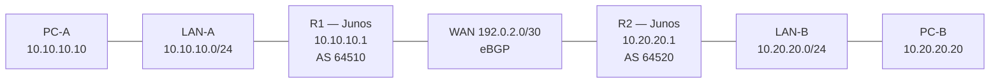
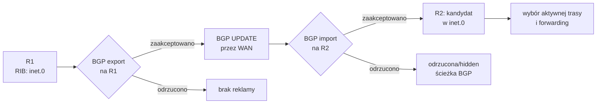
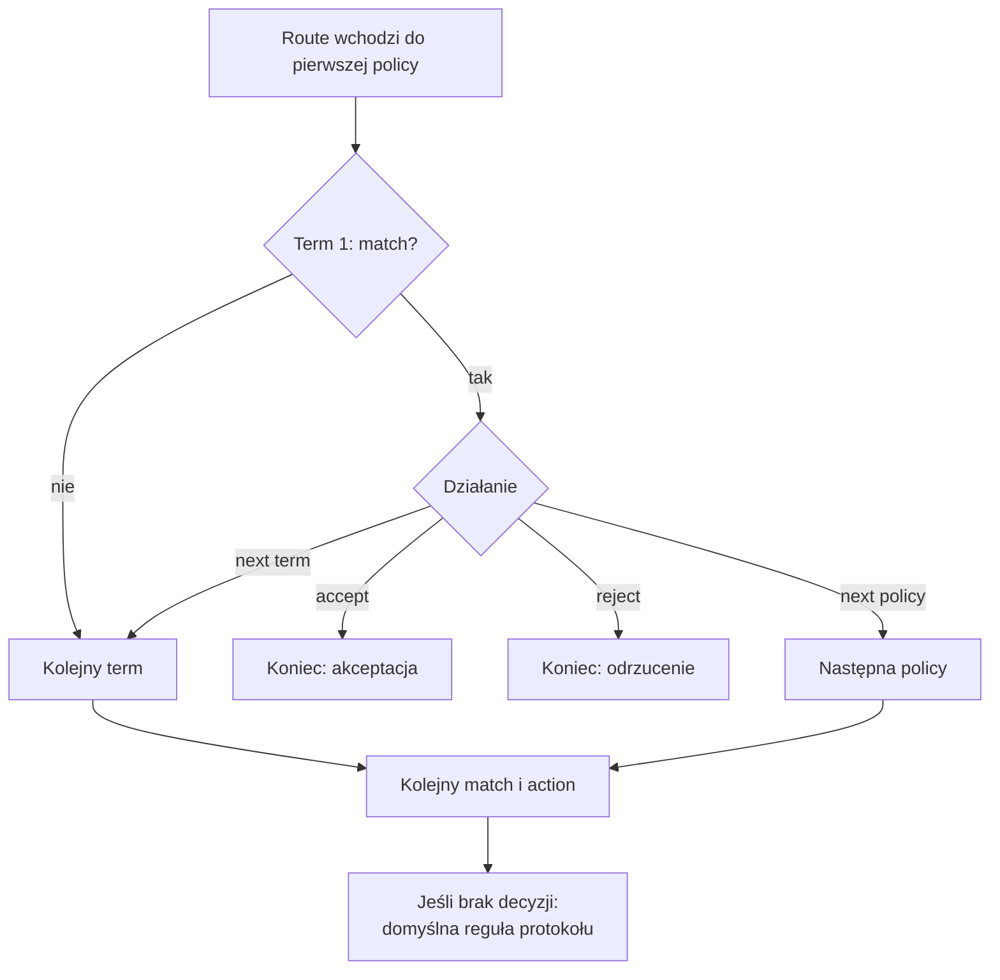
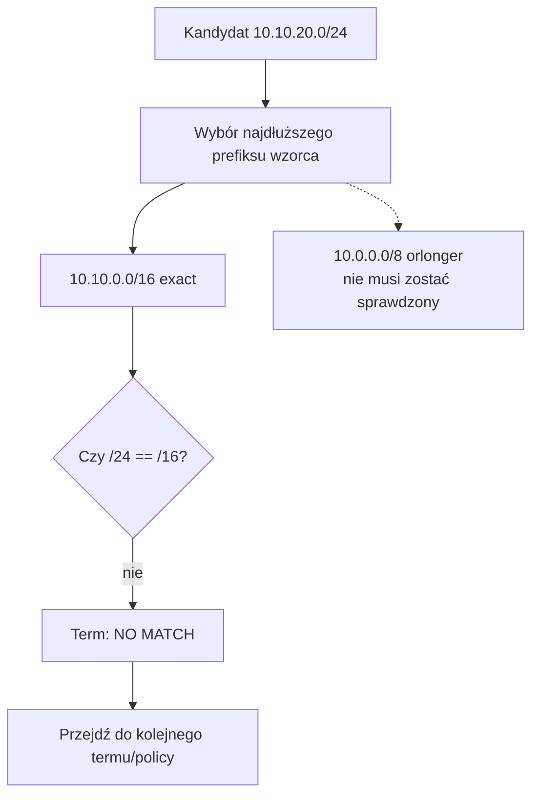

# Rozdział 8. Routing Policy and Firewall Filters — kto decyduje o trasie, a kto zatrzymuje pakiet?

**JUNOS Enterprise Routing & Switching | JNCIA-Junos → JNCIS-ENT → JNCIP-ENT**  
**Zakres:** 8.1–8.14 z [Unified Blueprint](../JUNOS_JNCIA_JNCIS_JNCIP_unified_blueprint.md)  
**Wersja:** 2.0, 19 listopada 2026 — rozdział napisany od nowa jako prowadzona lekcja.  
**Status:** GENERATED / SOURCE-REVIEWED / NOT RUNTIME VALIDATED. Wszystkie wyniki urządzeń w tym rozdziale są *symulowane*, a konfiguracje to projekty ćwiczeń, nie raporty z działającego laboratorium.  
**Punkt odniesienia:** klasyczny Junos na routerach i switchach oraz vSRX w EVE-NG. Odmienności platform i wersji sygnalizujemy w miejscu, w którym rzeczywiście wpływają na wniosek.

> Przez najbliższe lekcje nie będziemy uczyć się „trzech rodzajów ACL”. Będziemy rozwiązywać jeden problem sieciowy, który początkowo wygląda jak usterka BGP, później jak awaria routingu, a na końcu okaże się także problemem filtrowania pakietów. Tak najłatwiej zobaczyć, dlaczego Junos potrzebuje kilku różnych mechanizmów i dlaczego ich nazwy bywają myląco podobne.

## Przed rozpoczęciem: firma, dwa budynki i telefon z NOC

Jest poniedziałek, 8:15. Firma otworzyła niewielki oddział. W oddziale stoi router **R1**, w centrali router **R2**. Oba działają na Junos i zestawiają eBGP przez połączenie WAN. W oddziale jest sieć użytkowników **10.10.10.0/24**, w centrali — **10.20.20.0/24**. Administrator testuje dostęp do serwera ERP. Sesja BGP jest `Established`, ale połączenie nie działa.

Pierwsza reakcja jest znajoma każdemu inżynierowi Cisco: sprawdzić sąsiada, routing table i ACL. Tyle że tutaj „ACL” może oznaczać trzy bardzo różne rzeczy. Ktoś mógł zabronić **ogłoszenia trasy** z R1 do R2. Ktoś mógł zabronić **przyjęcia trasy** na R2. Albo ścieżka jest prawidłowa, lecz zatrzymywany jest dopiero **pakiet** z komputera użytkownika. Jeśli pracujemy na SRX, dojdzie jeszcze kontrola stanu sesji między strefami bezpieczeństwa.

Nie rozwiązujmy wszystkich tych problemów od razu. Najpierw zobaczmy, jak wygląda sieć, zanim cokolwiek skonfigurujemy.

*Rysunek 8.1. Topologia, którą będziemy rozbudowywać. Tekst alternatywny: dwa routery R1 i R2 połączone WAN i eBGP, po jednym LAN oraz komputerze po każdej stronie. Diagram autorski.* WAN: R1 = 192.0.2.1/30, R2 = 192.0.2.2/30. Adresy 192.0.2.0/24 i 198.51.100.0/24 są używane wyłącznie jako przestrzenie dokumentacyjne w izolowanym labie.

Zadaj sobie proste pytanie: **co właściwie musi być prawdą, by PC-A nawiązał połączenie z PC-B?** R1 musi wiedzieć, dokąd wysłać pakiet. R2 musi znać drogę powrotną do PC-A. Oba urządzenia muszą dopuścić ruch na swojej ścieżce forwarding. A komputery muszą mieć właściwe bramy, adresy i lokalne polityki bezpieczeństwa.

Zauważ, jak wiele warunków mieści się za zielonym statusem jednego sąsiedztwa BGP.

---

## 8.1. Default routing policies — co zrobi router, jeśli mu niczego nie nakażesz? [A]

Zacznijmy od sytuacji sprzed pierwszej zmiany. Interfejs LAN R1 jest skonfigurowany, więc w lokalnym RIB — zwykle `inet.0` — pojawia się trasa **direct 10.10.10.0/24**. Router ma także trasę lokalną do własnego adresu interfejsu. R1 może bez żadnego BGP odpowiadać hostowi PC-A z tej podsieci; oczywiście filtrowanie pakietów lub polityka bezpieczeństwa nadal mogą ograniczać konkretne testy.

Konfigurujemy eBGP między R1 i R2. Czy R1 automatycznie zacznie reklamować swoją sieć LAN? Wiele osób odruchowo odpowie „tak, przecież trasa istnieje”. W Junos to błędna intuicja. **Samo posiadanie trasy w RIB nie jest zleceniem rozgłoszenia jej przez dowolny protokół.**

Wyobraź sobie dyspozytora firmy kurierskiej. Na jego wewnętrznej mapie są wszystkie drogi, magazyny, boczne wjazdy i wejścia serwisowe. Nie oznacza to, że cały ten plan trafi do zewnętrznego przewoźnika. Wewnętrzna mapa mówi, gdzie firma *potrafi* dojechać. Zasady publikowania mapy mówią, czego *wolno* dowiedzieć się partnerowi.

W Junos każdy protokół ma własne domyślne zasady importu i eksportu. Dla typowego BGP na klasycznych urządzeniach Junos domyślny eksport dotyczy kwalifikowanych aktywnych tras BGP, z uwzględnieniem zasad BGP. Nie oznacza automatycznej redystrybucji `direct` czy `static`. Aby udostępnić R2 trasę LAN-A pochodzącą z `direct`, będziemy potrzebowali jawnej export policy.

Z OSPF jest inaczej: jeśli włączysz OSPF na interfejsie, protokół rozgłasza własną topologię poprzez LSA. Fakt, że domyślna *export policy* OSPF nie redystrybuuje obcych tras, **nie zatrzymuje tego naturalnego mechanizmu link-state**. W IS-IS obowiązuje podobne rozróżnienie między własną bazą link-state i importowaniem tras z innego źródła. To ważne, ponieważ słowo „export” nie ma identycznych konsekwencji w każdym protokole.

Nie traktuj też default policy jak jednej globalnej zasady `permit any` lub `deny any`. To reguły protokołowe, zależne od kierunku. Wyjątki istnieją również pomiędzy rodzinami urządzeń — dokumentacja Juniper wymienia m.in. odmienne domyślne zachowania BGP na PTX. Na egzaminie najpierw rozpoznaj protokół i kontekst; w produkcji dopisz do analizy model oraz release.

**R1-vSRX — Operational Mode, obserwacja przed wprowadzeniem policy**

~~~junos
show route 10.10.10.0/24 exact
show bgp summary
show route advertising-protocol bgp 192.0.2.2
show configuration protocols bgp | display set
~~~

W wynikach z naszego hipotetycznego oddziału znajdziesz aktywną trasę direct w pierwszym poleceniu, sąsiada `Established` w drugim, a brak LAN-A na liście ogłaszanych prefiksów w trzecim. To **nie jest sprzeczność**: każde polecenie odpowiada na inne pytanie. Pierwsze mówi „czy R1 zna tę sieć?”, drugie „czy rozmawia z R2?”, trzecie „czy opowiada R2 o tej sieci?”.

Jeśli znasz Cisco IOS XE, myśl o tym jak o różnicy między posiadaniem trasy w `show ip route` a celowym `redistribute connected route-map ...`. Analogia dotyczy zamiaru, nie składni ani wszystkich reguł kwalifikacji BGP.

**Przewidź:** gdy R1 nie reklamuje LAN-A, czy PC-A straci ping do 10.10.10.1? Nie z powodu braku eksportu. To problem informacji przekazywanej R2, nie lokalnego połączenia LAN. Gdybyś natomiast odrzucił *trasę potrzebną R1* przez import policy, mógłbyś pośrednio wpłynąć na forwarding. Właśnie na tym polega kolejna lekcja.

*Źródło zachowania: [Juniper — Default Routing Policies](https://www.juniper.net/documentation/us/en/software/junos/routing-policy/topics/concept/policy-routing-policies-actions-defaults.html).*

---

## 8.2. Import i export — dwie strony tej samej rozmowy [A]

Teraz operator pyta: „Skoro mówimy o export, to czy import jest ruchem wchodzącym do interfejsu?”. Nie. To bardzo częsta pułapka. Słowa **import** i **export** w `policy-options` opisują ruch *informacji o trasach* między protokołem a tablicą routingu, a nie kierunek pakietów użytkowników na porcie.

Prześledźmy jedną trasę. R1 wysyła wiadomość BGP UPDATE z prefiksem 10.10.10.0/24. R2 ją odbiera i może zastosować BGP **import policy**. Policy sprawdza, co przyszło, i decyduje, czy informacja może stać się kandydatem w tablicy routingu oraz czy należy zmienić atrybuty trasy. Jeżeli import zaakceptuje kandydaturę, R2 porównuje ją z innymi możliwymi drogami. Tylko odpowiednio wybrana i rozwiązana trasa będzie użyteczna dla forwarding.

W drugą stronę R1 patrzy na trasy kwalifikowane do ogłoszenia i stosuje **export policy**: które wolno wysłać R2 i z jakimi atrybutami? To nie jest kopiowanie całej tablicy `inet.0`; obowiązują reguły protokołu, aktywność trasy, rodzina adresów i inne warunki kwalifikacji.

*Rysunek 8.2. Podróż jednej informacji routingu. Tekst alternatywny: route wychodzi z RIB przez export na R1, BGP przekazuje ją do import na R2; akceptacja daje kandydata w RIB, odrzucenie nie daje aktywnej ścieżki. Diagram autorski. Uproszczenie: BGP może trzymać wiele alternatywnych ścieżek; kolejność szczegółowych etapów zależy od implementacji.*

Przy Cisco użyłbyś podobnej intuicji do `neighbor ... route-map ... in` i `out`. Ale jest różnica, którą warto wykorzystać przy diagnostyce. **Odrzucona przez BGP import trasa może pozostać w Junos jako hidden**. Wtedy użytkownicy jej nie wykorzystają, lecz administrator może zobaczyć, co peer wysłał. Nie myl `hidden` z `inactive`: nieaktywna trasa może po prostu przegrać wybór z lepszą trasą, podczas gdy hidden ma problem z kwalifikacją, polityką lub innym warunkiem użycia. Dokładne powody odczytuj z outputu `extensive`, nie zgaduj.

**R2-vSRX — Operational Mode, sprawdzanie odbioru na R2**

~~~junos
show bgp neighbor 192.0.2.1
show route receive-protocol bgp 192.0.2.1
show route receive-protocol bgp 192.0.2.1 hidden
show route 10.10.10.0/24 exact extensive
show route protocol bgp
~~~

Co tu jest najważniejsze? `show bgp neighbor` dowodzi stanu protokołu, `receive-protocol` pozwala oglądać informacje od konkretnego peera, wariant `hidden` pomaga znaleźć odrzuconych kandydatów, a `show route ... exact extensive` pokazuje stan konkretnego prefiksu w RIB. Ani jedna z tych komend samodzielnie nie dowodzi, że pakiet PC-B wróci do PC-A.

**R1-vSRX — Operational Mode, sprawdzanie reklamy na R1**

~~~junos
show route 10.10.10.0/24 exact extensive
show route advertising-protocol bgp 192.0.2.2
~~~

Teraz możesz prowadzić rozmowę z NOC precyzyjnie: „Trasa jest aktywna na R1, ale nie widzę jej w ogłoszeniach R1” albo „R1 ją reklamuje, R2 widzi ją jako hidden — sprawdzamy import i powód ukrycia”. To dwie różne usterki i dwa różne miejsca naprawy.

Jedno ostrzeżenie na przyszłość: Junos potrafi zachowywać wiele odrzuconych ścieżek BGP. Służy to diagnostyce, ale zużywa pamięć; konfiguracja `keep none` wpływa na retencję. Nie zmieniaj jej „dla porządku” bez zrozumienia konsekwencji ponownej ewaluacji tras po zmianie polityki.

**Most z Cisco:** `show ip bgp neighbors ... received-routes` i route-map inbound/outbound to dobry punkt startowy w myśleniu. Nie zakładaj jednak identycznej dostępności wszystkich widoków, zasad retencji i nazw pól wyjściowych.

*Źródła: [Understanding Routing Policies](https://www.juniper.net/documentation/us/en/software/junos/routing-policy/topics/concept/policy-routing-policies-overview.html), [Basic BGP Routing Policies](https://www.juniper.net/documentation/us/en/software/junos/bgp/topics/topic-map/basic-routing-policies.html), [show route receive-protocol](https://www.juniper.net/documentation/us/en/software/junos/cli-reference/topics/ref/command/show-route-receive-protocol.html).*

---

## 8.3. Jak Junos czyta politykę — po co są termy i dlaczego ich kolejność potrafi zepsuć noc? [A]

Wiemy już, gdzie polityka jest stosowana. Teraz popatrzmy, jak pracuje. Mamy konkretne zamówienie z działu bezpieczeństwa: **R1 może reklamować do R2 wyłącznie podsieć użytkowników LAN-A. Nie może ujawniać sieci laboratoryjnych, zarządzających ani tranzytowych.**

Najprostsza myśl brzmi: „stworzę listę dozwolonych podsieci”. Ale Junos nie dostaje jedynie listy. Dostaje **program podejmowania decyzji**. Ten program nazywa się `policy-statement`. Wewnątrz mamy uporządkowane kroki — `term`. Każdy krok może zapytać o właściwości trasy w `from` i wykonać działanie w `then`.

Przyjrzyj się pierwszej polityce, zanim ją wpiszemy. Chcemy sprawdzać prefiks **i** pochodzenie. Jeżeli route do 10.10.10.0/24 jest trasą direct, wolno ją ogłosić. Jeżeli ktoś jutro wprowadzi przypadkiem static z tym adresem, nie chcemy, by sama zgodność numerów automatycznie dała mu przepustkę. Pozostałe prefiksy odrzucamy jawnie.

**R1-vSRX — Configuration Mode, projekt polityki eksportu**

~~~junos
set policy-options policy-statement EXPORT-TO-R2 term USERS from protocol direct
set policy-options policy-statement EXPORT-TO-R2 term USERS from route-filter 10.10.10.0/24 exact
set policy-options policy-statement EXPORT-TO-R2 term USERS then accept
set policy-options policy-statement EXPORT-TO-R2 term DENY-EVERYTHING-ELSE then reject
set protocols bgp group TO-R2 export EXPORT-TO-R2
~~~

Czytasz tę konfigurację jak krótką opowieść:

1. „Jeżeli kandydat jest trasą direct, **i** jego prefix to dokładnie 10.10.10.0/24…”.
2. „…zaakceptuj go do dalszego procesu reklamowania BGP i zakończ ocenę polityki”.
3. „W przeciwnym razie dojdź do ostatniego termu, który odrzuca wszystko inne”.

Warunki różnych rodzajów w `from` współpracują logicznie jak **AND**. Wewnątrz niektórych grup dopasowań istnieją reguły alternatyw, a dla `route-filter` również zasada wybierania najlepszego wzorca. Za chwilę zobaczymy, dlaczego nie należy sprowadzać całego silnika policy do zdania „pierwszy pasujący wiersz ACL”.

Zanim wykonasz commit, sprawdź obiekt i miejsce jego użycia. Samo zdefiniowanie `EXPORT-TO-R2` pod `policy-options` **nie podłącza go do BGP**. Równie dobrze możesz trzymać pięćdziesiąt gotowych polityk, których nie używa żaden protokół.

**R1-vSRX — Configuration Mode, bezpieczna inspekcja zmiany**

~~~junos
show policy-options policy-statement EXPORT-TO-R2
show protocols bgp group TO-R2
show | compare
commit check
~~~

To, że `commit check` przeszedł, oznacza sprawdzenie konfiguracji przez Junos, nie dowód skutecznego eksportu. W odizolowanym laboratorium użyj później `commit confirmed 5`, wykonaj post-check i dopiero po pozytywnej ocenie potwierdź zwykłym `commit`. Uważaj: dodatkowy `commit check` po uruchomieniu `commit confirmed` może potwierdzić oczekującą zmianę; nie rób go mechanicznie w trakcie odliczania.

### Co naprawdę robią accept, reject, next term i next policy?

Wyobraź sobie, że recepcja w biurowcu ma trzy stanowiska. Pierwsze sprawdza identyfikator, drugie może przybić pieczątkę, trzecie podejmuje ostateczną decyzję o wejściu. Nie każda pieczątka kończy wizytę, ale ostateczne „wpuszczam” lub „nie wpuszczam” już tak.

W routing policy `accept` i `reject` są działaniami **kończącymi ocenę łańcucha** w zwykłym scenariuszu. `next term` każe przejść do kolejnego termu *tej samej* polityki. `next policy` pomija resztę bieżącej polityki i przechodzi do *następnej* polityki na liście. Jeśli lista się skończy bez decyzji terminalnej, w grę wchodzi **default policy protokołu**.

To ostatnie zdanie jest szczególnie ważne. „Nic nie dopasowałem” nie musi oznaczać ani akceptacji, ani odrzucenia — liczy się protokół, kierunek i kontekst.

Załóżmy, że chcemy rozdzielić dwa zadania: najpierw oznaczyć trasę community BGP, a następnie sprawdzić, czy należy do whitelisty. Moglibyśmy użyć jednej policy, ale lepiej pokaże to działanie łańcucha.

**R1-vSRX — Configuration Mode, samodzielny przykład rozszerzenia polityki BGP**

~~~junos
set policy-options community BRANCH-ROUTE members 64510:100
set policy-options policy-statement MARK-ROUTE term USERS from route-filter 10.10.10.0/24 exact
set policy-options policy-statement MARK-ROUTE term USERS then community add BRANCH-ROUTE
set policy-options policy-statement MARK-ROUTE term USERS then next policy
set policy-options policy-statement FINAL-CHECK term USERS from protocol direct
set policy-options policy-statement FINAL-CHECK term USERS from route-filter 10.10.10.0/24 exact
set policy-options policy-statement FINAL-CHECK term USERS then accept
set policy-options policy-statement FINAL-CHECK term REST then reject
set protocols bgp group TO-R2 export [ MARK-ROUTE FINAL-CHECK ]
~~~

**Uwaga:** ten przykład **zastępuje**, a nie dodaje do wcześniejszego `EXPORT-TO-R2`, miejsce eksportu BGP. W laboratorium nie wprowadzaj kilku wzajemnie sprzecznych wariantów naraz. `community add` samo w sobie nie przyznaje zgody na reklamę. Dopiero `FINAL-CHECK` mówi ostatecznie „tak”. Gdyby w pierwszej polityce zamiast `next policy` było `accept`, druga policy nie miałaby okazji już niczego sprawdzić.

Można użyć również `next term`, kiedy po dodaniu atrybutu chcemy ocenić kolejny term w **tej samej** polityce. W zależności od akcji i miejsca w hierarchii Junos kontroluje dozwolone kombinacje; na Junos Evolved `next term` nie może być ostatnią akcją termu bez następnego termu, co opisuje dokumentacja producenta.

*Rysunek 8.3. Sterowanie przebiegiem oceny policy. Tekst alternatywny: dopasowanie termu prowadzi do terminalnych accept/reject lub do kontynuacji next term/next policy; gdy nie ma decyzji, działa protokółowa polityka domyślna. Diagram dydaktyczny, nie pełna specyfikacja silnika.*

Sprawdź swoją intuicję. Masz term `MARK` z `then community add`, pod nim term `REST then reject`. Czy sama modyfikacja community oznacza, że trasa została zaakceptowana? Nie. Ocena musi dojść do decyzji. To jedna z podstawowych różnic między **akcją modyfikującą atrybut** a **akcją sterującą przepływem**.

*Źródła: [How a Routing Policy Is Evaluated](https://www.juniper.net/documentation/us/en/software/junos/routing-policy/topics/concept/policy-routing-policies-evaluation-method.html), [Policy Chain Evaluation](https://www.juniper.net/documentation/us/en/software/junos/routing-policy/topics/concept/policy-routing-policies-chain-evaluation-method.html), [Summary of Routing Policy Actions](https://www.juniper.net/documentation/us/en/software/junos/routing-policy/topics/concept/policy-default-actions-default-policies.html).*

---

## 8.4. Polityka może zmienić routing — ale nie zawsze tak, jak się spodziewasz [A]

Wróćmy do oddziału. R1 zaczął reklamować LAN-A. R2 odbiera trasę, lecz w centrali działa dodatkowy router R3, który podaje inną drogę do tego samego prefiksu. Na R2 masz teraz więcej niż jednego kandydata. Administrator mówi: „Przecież moja import policy zaakceptowała prefiks, więc na pewno to on jest w FIB”. Nie musi tak być.

W Junos przechodzimy przez kilka różnych etapów: **otrzymanie informacji → ocena przez import policy → obecność kandydata w RIB → wybór aktywnej ścieżki → rozwiązanie next hop → instalacja odpowiedniego forwardingu**. Akceptacja polityki nie jest tym samym co zwycięstwo w wyborze trasy. Decydują m.in. route preference, zasady protokołu i poprawne rozwiązanie next hop. Nawet prawidłowa aktywna trasa nie daje jeszcze gwarancji, że stateless firewall filter albo SRX security policy przepuszczą pakiet.

Wyobraź sobie dwóch kierowców oferujących przewiezienie paczki. Ochrona recepcji zaakceptowała obie przepustki. Ale dyspozytor nadal musi zdecydować, którego kierowcę wysłać. A magazyn może mieć zamkniętą bramę wyjazdową. Właśnie dlatego *accept* w policy nie jest synonimem *packet delivered*.

**R2-vSRX — Operational Mode, trzy kolejne pytania o trasę**

~~~junos
show route 10.10.10.0/24 exact extensive
show route protocol bgp
show route forwarding-table destination 10.10.10.10
~~~

Pierwsze pokazuje stan prefiksu i możliwe konkurujące drogi, drugie pozwala rozpoznać BGP jako źródło kandydatów, a trzecie daje perspektywę forwardingu do konkretnego adresu. RIB i FIB nie muszą prezentować identycznej liczby rekordów ani identycznego poziomu szczegółowości. W prawdziwym incydencie sprawdzisz także tablicę `inet6.0` lub odpowiednią routing instance, jeżeli pracujesz poza podstawowym IPv4 `inet.0`.

### Pozornie paradoksalny przypadek OSPF

Na tej samej zmianie ktoś próbuje użyć import policy OSPF do odrzucenia wewnętrznego prefiksu area. Po zmianie prefiks nadal jest widoczny. „Junos zignorował policy!”, słyszysz.

To niekoniecznie awaria. OSPF jest protokołem link-state: routery muszą zachować spójność obrazu topologii. Junos ogranicza użyteczność import policy OSPF do określonych przypadków, przede wszystkim tras **external**; odrzucenie trasy wewnętrznej zwykłą import policy nie jest uniwersalnym sposobem filtrowania jej z LSDB/RIB. Dokumentacja wprost wyjaśnia, że `reject` zastosowane do nonexternal OSPF route bywa ignorowane. Pełne wyjaśnienie area, LSA i ABR zostawimy do rozdziału 9. Teraz zapamiętaj praktyczny sens: **polityka nie jest obietnicą, że każdy protokół pozwoli ingerować w każdy etap swojej pracy**.

**R-OSPF-EDGE — Operational Mode, rozpoznanie rodzaju trasy**

~~~junos
show ospf neighbor
show ospf database
show route protocol ospf detail
show configuration protocols ospf | display set
~~~

Jeśli widzisz wewnętrzną trasę OSPF, nie próbuj na ślepo „naprawiać” problemu przez kolejne import reject. Ustal, czy problem dotyczy redystrybucji, topologii area, agregacji, czy używania trasy do forwardingu.

*Źródła: [Actions in Routing Policy Terms](https://www.juniper.net/documentation/us/en/software/junos/routing-policy/topics/concept/policy-configuring-actions-in-routing-policy-terms.html), [Protocol Support for Import and Export Policies](https://www.juniper.net/documentation/us/en/software/junos/routing-policy/topics/concept/policy-protocol-support-import-export-policies.html).*

---

## 8.5. Policy statement i term — jak budować reguły, których nie trzeba się bać [A]

W laboratorium dwie linie `from` i jedno `then accept` wyglądają niewinnie. Ale wyobraź sobie wielką sieć z trzydziestoma oddziałami, dwiema trasami wyjścia do Internetu, osobną siecią zarządzającą i setkami prefiksów BGP. Nikt nie będzie weryfikował bezpieczeństwa takiej sieci, przeglądając po kolei setki przypadkowych `set`.

Potrzebujemy czytelnej polityki. Nie po to, aby nauczyć się składni, lecz po to, żeby podczas awarii móc w kilka sekund odpowiedzieć: **która reguła jest odpowiedzialna za dany prefix?**

W Junos mamy hierarchię, którą można czytać od zewnątrz do środka:

- `policy-options` jest miejscem, gdzie definiujemy obiekty wielokrotnego użytku;
- `policy-statement` jest nazwanym zestawem zasad;
- `term` jest kolejnym krokiem tej polityki;
- `from` opisuje to, co ma pasować do kandydata;
- `then` mówi, co zrobić z dopasowaną trasą.

Ta struktura ma swoją cenę: bardzo łatwo napisać poprawny składniowo, lecz zbyt szeroki term. Rozważ różnicę między dwiema historiami.

W pierwszej administrator pisze: „Zawsze zezwalaj na reklamy tras direct”. W drugiej: „Zezwalaj wyłącznie na dokładnie zidentyfikowaną sieć użytkowników, a pozostałe odrzucaj”. Pierwsza polityka będzie krótsza. Druga znacznie lepiej zniesie rozbudowę sieci.

**R1-vSRX — Configuration Mode, przykład ryzykownie szerokiej polityki (NIE WDRAŻAJ)**

~~~junos
set policy-options policy-statement TOO-BROAD term DIRECT from protocol direct
set policy-options policy-statement TOO-BROAD term DIRECT then accept
~~~

Co stanie się za pół roku, jeśli R1 dostanie bezpośrednio podłączony segment zarządzający 10.99.99.0/24? Ten sam term może pozwolić BGP ogłosić go na zewnątrz, o ile trasa spełni pozostałe warunki protokołu. Żaden alarm nie musi się pojawić. Z punktu widzenia Junos polityka wykonała poprawnie to, o co ją poproszono.

Właśnie dlatego w produkcyjnych export policies zazwyczaj zaczynam od **świadomej whitelisty**. Nazwa termu powinna mówić, czemu służy: `ALLOW-USER-LAN`, `BLOCK-MGMT`, `DENY-REMAINDER`. To nie poprawia samego algorytmu, ale radykalnie poprawia jakość review i troubleshootingu.

Spójrz jeszcze na dwa przykłady, które pozornie wyglądają podobnie:

**R1-vSRX — Configuration Mode, ilustracja różnicy „brak from”**

~~~junos
set policy-options policy-statement CHECK-A term ALL then accept
set policy-options policy-statement CHECK-B term ALL then reject
~~~

W obu politykach term nie zawiera `from`. To nie znaczy „term nigdy się nie uruchomi”. Taki term **dopasowuje każdą trasę**, która do niego dotrze. W pierwszej polityce otwiera przejście wszystkim kandydatom; w drugiej zamyka je wszystkim. I dlatego końcowe `then reject` jest tak skutecznym mechanizmem domknięcia whitelisty.

W samym Junos możesz łatwo sprawdzić konfigurację w dwóch formatach. `display set` dobrze nadaje się do porównania zmian i wklejenia fragmentów, a hierarchiczny `show` pozwala dostrzec, **co jest wewnątrz czego**. Dobrze jest swobodnie używać obu perspektyw.

**R1-vSRX — Operational Mode, dwie perspektywy tej samej policy**

~~~junos
show configuration policy-options policy-statement EXPORT-TO-R2
show configuration policy-options policy-statement EXPORT-TO-R2 | display set
show configuration protocols bgp | display set
~~~

Najbardziej użyteczne pytanie przy review brzmi nie „czy syntax jest poprawny?”, ale „**jaki dodatkowy prefix mógłby nieoczekiwanie przejść przez ten term?**”. Pomyśl o sieci zarządzającej, interfejsie tranzytowym, loopbacku, default route lub statycznym blackhole.

---

## 8.6. Jak dobrać trasę: exact, longer, orlonger i pułapka najbardziej szczegółowej reguły [A]

Przychodzi nowe polecenie: oddział ma otrzymać nie tylko 10.10.10.0/24, ale również 10.10.11.0/24. Administrator proponuje prostszy filtr „zaakceptuj 10.10.0.0/16”. Brzmi sensownie. Tyle że wtedy musimy zadać pytanie, którego nie da się uniknąć: **czy chodzi o sam prefiks /16, czy o wszystkie sieci znajdujące się w tej przestrzeni?**

To nie jest różnica kosmetyczna. BGP reklamuje *prefiksy* — pary adres/maska. Router nie może zgadnąć, czy `10.10.0.0/16` jest oczekiwanym sumarycznym ogłoszeniem, czy wygodnym zapisem zbioru /24. Jeżeli w RIB są dwie trasy /24, polityka `route-filter 10.10.0.0/16 exact` **nie dopasuje** żadnej z nich.

### Ta sama sieć, kilka zupełnie różnych pytań

Na przykładzie bazy 10.10.0.0/16, zapamiętaj znaczenie operatorów, a nie ich mechaniczne definicje:

| Zapis | Co naprawdę przepuści jako warunek dopasowania? | Kiedy potrzebujesz |
|---|---|---|
| `exact` | Dokładnie 10.10.0.0/16, nie /24 | Gdy reklamujesz konkretny summary |
| `longer` | Prefiksy bardziej szczegółowe niż /16, bez samego /16 | Gdy interesują Cię wyłącznie podsieci |
| `orlonger` | Sam /16 **i** wszystkie bardziej szczegółowe w jego zakresie | Gdy świadomie dopuszczasz deagregację |
| `upto /24` | /16, /17 … aż do /24, lecz nie /25 | Gdy chcesz ograniczyć nadmierną szczegółowość |
| `prefix-length-range /24-/28` | Tylko podsieci /24–/28 wewnątrz /16 | Gdy wymagany jest przedział długości |

Każda z tych reguł mówi o **długości prefiksu wpisu routingu**, a nie o źródłowym adresie pakietu. Jeśli host 10.10.10.50 otwiera HTTPS, jego źródłowe IP nie jest osobnym prefiksem /32 wysyłanym do BGP tylko dlatego, że w nagłówku ma ten adres.

A teraz wykonajmy ćwiczenie bez urządzeń. Mamy w RIB trzy aktywne trasy: 10.10.0.0/16, 10.10.10.0/24 i 10.10.10.128/25. Filtr `10.10.0.0/16 upto /24` będzie mógł dopasować dwie pierwsze. Trzecia, mimo że mieści się adresowo wewnątrz /16, ma długość **/25**, więc zostanie pominięta. **Routing prefix match nie jest zwykłym sprawdzaniem, czy dany adres IP należy do sieci.**

**R1-vSRX — Configuration Mode, tylko dwa konkretne segmenty LAN**

~~~junos
set policy-options policy-statement EXPORT-LANS term USERS from protocol direct
set policy-options policy-statement EXPORT-LANS term USERS from route-filter 10.10.10.0/24 exact
set policy-options policy-statement EXPORT-LANS term USERS from route-filter 10.10.11.0/24 exact
set policy-options policy-statement EXPORT-LANS term USERS then accept
set policy-options policy-statement EXPORT-LANS term REST then reject
~~~

Dwa `route-filter` w jednym termie reprezentują alternatywne wzorce prefiksów, a `from protocol direct` ogranicza typ źródła. Gdyby trzeba było przechowywać dłuższą, wielokrotnie używaną listę, sięgnęlibyśmy po nazwany obiekt `prefix-list` i dopasowanie `from prefix-list`. Zwykłe `prefix-list` dopasowuje wymienione prefiksy dokładnie; `prefix-list-filter ... orlonger` daje inną semantykę długości. Nie traktuj obu poleceń jak synonimów.

**R1-vSRX — Configuration Mode, wariant z nazwanym zbiorem prefiksów**

~~~junos
set policy-options prefix-list BRANCH-LANS 10.10.10.0/24
set policy-options prefix-list BRANCH-LANS 10.10.11.0/24
set policy-options policy-statement EXPORT-LIST term APPROVED from protocol direct
set policy-options policy-statement EXPORT-LIST term APPROVED from prefix-list BRANCH-LANS
set policy-options policy-statement EXPORT-LIST term APPROVED then accept
set policy-options policy-statement EXPORT-LIST term REST then reject
~~~

Te dwa warianty realizują podobną intencję biznesową. Nie wdrażaj ich obu równocześnie bez świadomie zaprojektowanej listy polityk; są alternatywnymi sposobami napisania tej samej lekcji.

### Bardzo ważny niuans: policy też używa longest match, ale to nie jest LPM w FIB

Znasz regułę LPM z Cisco CEF i z rozdziału 6. Pakiet do 10.10.10.130 trafi do najbardziej szczegółowej dostępnej trasy w FIB. W routing policy Junos również potrafi szukać najlepszego prefiksowego dopasowania, lecz **szuka wzorca route-filter**, a dopiero potem ocenia przypisany do niego typ dopasowania.

Załóżmy, że w **jednym termie** są dwa warunki:

- 10.0.0.0/8 `orlonger`;
- 10.10.0.0/16 `exact`.

Przychodzi kandydat **10.10.20.0/24**. Odruchowo chciałoby się powiedzieć: „Reguła /8 orlonger pasuje, więc term pasuje”. W domyślnym zachowaniu Junos najbardziej szczegółowym wzorcem jest jednak /16. Gdy sprawdzi przy nim `exact`, okaże się, że kandydat /24 nie jest /16. Cały term może uzyskać **no match**, mimo że szerszy wzorzec wyglądał na pasujący. To nie jest błędne LPM forwarding — to inny etap i inna semantyka.

*Rysunek 8.4. Tekst alternatywny: route-filter najpierw wybiera najbardziej szczegółowy wzorzec /16; dopasowanie exact dla kandydata /24 nie udaje się, więc term może nie dopasować. Diagram autorski, ilustruje domyślną semantykę bez funkcji walkup.*

Jeśli chcesz dopuścić także szersze reguły, możesz rozdzielić je na osobne termy lub rozważyć `walkup`, gdzie funkcja jest dostępna i rozumiesz jej wpływ na politykę. Nie włączaj globalnego `walkup` wyłącznie po to, żeby „naprawić jeden prefix” w działającym środowisku — może zmienić wynik także dla innych polityk.

To jeden z tych niuansów Junos, które pokazują różnicę między nauką komend a rozumieniem narzędzia. Wiesz już, **co testować**: trasy /16, /24 i /25 pod konkretnymi zestawami `route-filter`, a nie tylko jedną wygodną trasę pokazową.

### Sprawdź dopasowanie, zanim dotkniesz sąsiada BGP

Junos ma polecenie `test policy`. Nie udaje ono całego eBGP, ale jest pomocne przy analizie samej policy. Dokumentacja producenta ostrzega, że test używa domyślnego **accept**, więc polityka bez jawnego końcowego `reject` może dać wynik zaskakująco szeroki. Z drugiej strony nawet pomyślny `test policy` nie gwarantuje reklamy: BGP może nie zakwalifikować trasy z powodów niezwiązanych z samym termem.

**R1-vSRX — Operational Mode, test lokalnej policy; składnię potwierdź na swoim release**

~~~junos
test policy EXPORT-LANS 10.10.10.0/24
test policy EXPORT-LANS 10.10.11.0/24
show route advertising-protocol bgp 192.0.2.2
~~~

Czytaj wynik jako dwa różne dowody: pierwszy i drugi testują logikę dopasowania tras w aktualnej tabeli, trzeci dotyczy faktycznego eksportu BGP do peera. Dopiero ich zestawienie może potwierdzić twoją hipotezę.

*Źródła: [Routing Policy Match Conditions](https://www.juniper.net/documentation/us/en/software/junos/routing-policy/topics/concept/policy-configuring-match-conditions-in-routing-policy-terms.html), [Walkup for Route Filters](https://www.juniper.net/documentation/us/en/software/junos/routing-policy/topics/concept/walkup-route-filter-policy-option-overview.html), [Understanding Routing Policy Tests](https://www.juniper.net/documentation/us/en/software/junos/routing-policy/topics/concept/policy-testing-routing-policies.html).*
