# JNCIP-ENT — DIAMOND: referencyjny diagram Mermaid

**4 × Juniper vSRX (R1–R4) + 2 × VPCS (PC-A/PC-B) · 6 izolowanych segmentów IPv4**

> **Źródło prawdy dla adresacji i mapowania portów:** [README.md](README.md). Ten diagram przedstawia projekt szkoleniowy, nie dowód wdrożenia w EVE-NG. Nazwy interfejsów vSRX muszą zostać potwierdzone na używanym obrazie.

```mermaid
flowchart LR
  PCA["PC-A / VPC1<br/>VPCS<br/>Gateway: 192.0.2.1"]
  R1["R1-vSRX<br/>lo0.0: 10.255.255.1/32"]
  R2["R2-vSRX<br/>lo0.0: 10.255.255.2/32"]
  R3["R3-vSRX<br/>lo0.0: 10.255.255.3/32"]
  R4["R4-vSRX<br/>lo0.0: 10.255.255.4/32"]
  PCB["PC-B / VPC2<br/>VPCS<br/>Gateway: 198.51.100.1"]

  PCA ---|"LAN-A · 192.0.2.0/24<br/>PC-A eth0: 192.0.2.10/24<br/>R1 ge-0/0/2.0: 192.0.2.1/24"| R1
  R1 ---|"P2P-12 · 10.12.0.0/30<br/>R1 ge-0/0/0.0: 10.12.0.1/30<br/>R2 ge-0/0/0.0: 10.12.0.2/30"| R2
  R1 ---|"P2P-13 · 10.13.0.0/30<br/>R1 ge-0/0/1.0: 10.13.0.1/30<br/>R3 ge-0/0/0.0: 10.13.0.2/30"| R3
  R2 ---|"P2P-24 · 10.24.0.0/30<br/>R2 ge-0/0/1.0: 10.24.0.1/30<br/>R4 ge-0/0/0.0: 10.24.0.2/30"| R4
  R3 ---|"P2P-34 · 10.34.0.0/30<br/>R3 ge-0/0/1.0: 10.34.0.1/30<br/>R4 ge-0/0/1.0: 10.34.0.2/30"| R4
  R4 ---|"LAN-B · 198.51.100.0/24<br/>R4 ge-0/0/2.0: 198.51.100.1/24<br/>PC-B eth0: 198.51.100.10/24"| PCB

  classDef vsrx fill:#e6f1fc,stroke:#1565a6,stroke-width:2px,color:#13344f;
  classDef vpcs fill:#e8f5e9,stroke:#2f7d4a,stroke-width:1.5px,color:#17422a;
  class R1,R2,R3,R4 vsrx;
  class PCA,PCB vpcs;
```

**Jak czytać diagram:** Każda etykieta łącza podaje nazwę segmentu, jego prefiks CIDR i adres IPv4/CIDR **obu** interfejsów końcowych. W węzłach vSRX podano loopback `lo0.0/32`. Router ID OSPF/BGP odpowiada adresowi loopback danego routera. Hosty VPCS są podpisane jako PC-A/VPC1 i PC-B/VPC2.

**Ścieżka górna:** PC-A → R1 → R2 → R4 → PC-B. **Ścieżka dolna:** PC-A → R1 → R3 → R4 → PC-B. Brak połączeń R2–R3 i R1–R4. W wersji statycznej awaria *jednego* łącza górnego nie daje gwarancji symetrycznego failoveru w obie strony.

**Do podręcznika:** Osadzaj blok Mermaid lub podlinkuj tę stronę w lekcjach routingu statycznego, OSPF, BGP, routing policy, ECMP i troubleshootingu. Zmieniaj wyłącznie konfigurację/protokół omawiany w danym ćwiczeniu; nie zmieniaj bazowych segmentów, CIDR, nazw routerów ani loopbacków bez stworzenia jawnego wariantu topologii.
