# JUNOS — referencyjna topologia DIAMOND (4 × vSRX + 2 × VPCS)

**Status: PLANNED (specyfikacja), NIE wdrożono ani nie potwierdzono działania runtime.**

To jest **kanoniczna topologia i adresacja** wspólnych laboratoriów w repozytorium. Rozdziały JNCIA-Junos, JNCIS-ENT i JNCIP-ENT mogą stosować inne konfiguracje protokołów, ale nie zmieniają numeracji urządzeń, interfejsów logicznych ani podsieci bez jawnie opisanej wersji labu.

Ważne: wcześniejszy lab [CH02](../ch02-four-vsrx/README.md) używał już tych sześciu prefiksów. Niniejszy dokument **zachowuje je**, jedynie formalizuje cztery nowe loopbacki. To topologia edukacyjna, nie opis wdrożonej instalacji EVE-NG.

## 1. Diagram Mermaid — pełna adresacja interfejsów i loopbacków

**Osobny, gotowy do cytowania diagram:** [DIAMOND_TOPOLOGY.md](DIAMOND_TOPOLOGY.md). Poniższa wersja Mermaid jest jego kopią do szybkiego podglądu na GitHub.

```mermaid
flowchart LR
  PCA["PC-A / VPC1<br/>VPCS<br/>Gateway: 192.0.2.1"]
  R1["R1-vSRX<br/>lo0.0: 10.255.255.1/32"]
  R2["R2-vSRX<br/>lo0.0: 10.255.255.2/32"]
  R3["R3-vSRX<br/>lo0.0: 10.255.255.3/32"]
  R4["R4-vSRX<br/>lo0.0: 10.255.255.4/32"]
  PCB["PC-B / VPC2<br/>VPCS<br/>Gateway: 198.51.100.1"]

  PCA ---|"LAN-A · 192.0.2.0/24<br/>PC-A eth0: 192.0.2.10/24<br/>R1 ge-0/0/2.0: 192.0.2.1/24"| R1
  R1 ---|"P2P-12 · 10.12.0.0/30<br/>R1 ge-0/0/0.0: 10.12.0.1/30<br/>R2 ge-0/0/0.0: 10.12.0.2/30"| R2
  R1 ---|"P2P-13 · 10.13.0.0/30<br/>R1 ge-0/0/1.0: 10.13.0.1/30<br/>R3 ge-0/0/0.0: 10.13.0.2/30"| R3
  R2 ---|"P2P-24 · 10.24.0.0/30<br/>R2 ge-0/0/1.0: 10.24.0.1/30<br/>R4 ge-0/0/0.0: 10.24.0.2/30"| R4
  R3 ---|"P2P-34 · 10.34.0.0/30<br/>R3 ge-0/0/1.0: 10.34.0.1/30<br/>R4 ge-0/0/1.0: 10.34.0.2/30"| R4
  R4 ---|"LAN-B · 198.51.100.0/24<br/>R4 ge-0/0/2.0: 198.51.100.1/24<br/>PC-B eth0: 198.51.100.10/24"| PCB

  classDef vsrx fill:#e6f1fc,stroke:#1565a6,stroke-width:2px,color:#13344f;
  classDef vpcs fill:#e8f5e9,stroke:#2f7d4a,stroke-width:1.5px,color:#17422a;
  class R1,R2,R3,R4 vsrx;
  class PCA,PCB vpcs;
```

**Legenda:** Każde łącze podaje prefix segmentu i adresy IP/CIDR obu końców wraz z nazwami interfejsów; w prostokątach routerów znajdują się adresy `lo0.0/32`. Ścieżka preferowana w bazowym labie statycznym przechodzi przez R2, alternatywna przez R3. **Nie ma** połączeń R2–R3 i R1–R4. Wszystkie sześć segmentów jest izolowanych w EVE-NG.

## 2. Kanoniczna adresacja IPv4 / CIDR i mapowanie portów

| Segment | Węzeł A / interfejs / adres | Węzeł B / interfejs / adres | Sieć |
|---|---|---|---|
| LAN-A | PC-A / eth0 / **192.0.2.10/24** | R1-vSRX / ge-0/0/2.0 / **192.0.2.1/24** | **192.0.2.0/24** |
| P2P-12 | R1-vSRX / ge-0/0/0.0 / **10.12.0.1/30** | R2-vSRX / ge-0/0/0.0 / **10.12.0.2/30** | **10.12.0.0/30** |
| P2P-13 | R1-vSRX / ge-0/0/1.0 / **10.13.0.1/30** | R3-vSRX / ge-0/0/0.0 / **10.13.0.2/30** | **10.13.0.0/30** |
| P2P-24 | R2-vSRX / ge-0/0/1.0 / **10.24.0.1/30** | R4-vSRX / ge-0/0/0.0 / **10.24.0.2/30** | **10.24.0.0/30** |
| P2P-34 | R3-vSRX / ge-0/0/1.0 / **10.34.0.1/30** | R4-vSRX / ge-0/0/1.0 / **10.34.0.2/30** | **10.34.0.0/30** |
| LAN-B | R4-vSRX / ge-0/0/2.0 / **198.51.100.1/24** | PC-B / eth0 / **198.51.100.10/24** | **198.51.100.0/24** |

**WAŻNE:** porty `ge-0/0/x` to **zamierzone mapowanie logiczne**, nie potwierdzenie faktycznej kolejności kart NIC w konkretnej wersji vSRX/EVE. Sprawdź `show interfaces terse` i przyporządkowanie interfejsów EVE/QEMU przed zastosowaniem konfiguracji. `fxp0` (jeśli występuje) to odrębny interfejs zarządzający; nie używaj go jako zamiennika portu tranzytowego. Nie podłączaj segmentów data-plane do żadnego GCP VPC ani do management cloud.

## 3. Loopbacki (nowy wspólny standard)

| Router | Junos interface | Adres loopback / CIDR | Proponowany OSPF/BGP Router ID |
|---|---|---|---|
| R1-vSRX | `lo0.0` | **10.255.255.1/32** | **10.255.255.1** |
| R2-vSRX | `lo0.0` | **10.255.255.2/32** | **10.255.255.2** |
| R3-vSRX | `lo0.0` | **10.255.255.3/32** | **10.255.255.3** |
| R4-vSRX | `lo0.0` | **10.255.255.4/32** | **10.255.255.4** |

Rezerwacja koncepcyjna: **10.255.255.0/24** na loopbacki dydaktyczne (nie jest to sieć wspólnego L2). Każde `lo0.0` to osobna trasa direct /32. Statyczny lab CH02 **nie zapewnia automatycznej osiągalności wszystkich zdalnych loopbacków**. Zdalne /32 muszą być świadomie rozgłoszone przez OSPF/BGP albo objęte odpowiednimi trasami statycznymi — dopiero wtedy test ping R1→lo0 R4 powinien być PASS.

Przykładowa składnia loopback i Router ID, do weryfikacji na posiadanym obrazie:

**R1-vSRX — configuration mode**

~~~junos
set interfaces lo0 unit 0 family inet address 10.255.255.1/32
set routing-options router-id 10.255.255.1
~~~

**R2-vSRX — configuration mode**

~~~junos
set interfaces lo0 unit 0 family inet address 10.255.255.2/32
set routing-options router-id 10.255.255.2
~~~

**R3-vSRX — configuration mode**

~~~junos
set interfaces lo0 unit 0 family inet address 10.255.255.3/32
set routing-options router-id 10.255.255.3
~~~

**R4-vSRX — configuration mode**

~~~junos
set interfaces lo0 unit 0 family inet address 10.255.255.4/32
set routing-options router-id 10.255.255.4
~~~

## 4. VPCS i bramy

| Host | IP/CIDR | Brama domyślna | Test odległy |
|---|---|---|---|
| PC-A (= VPC1) | 192.0.2.10/24 | 192.0.2.1 | PC-B: 198.51.100.10 |
| PC-B (= VPC2) | 198.51.100.10/24 | 198.51.100.1 | PC-A: 192.0.2.10 |

**PC-A — VPCS console**

~~~text
ip 192.0.2.10/24 192.0.2.1
save
ping 198.51.100.10
trace 198.51.100.10
~~~

**PC-B — VPCS console**

~~~text
ip 198.51.100.10/24 198.51.100.1
save
ping 192.0.2.10
trace 192.0.2.10
~~~

Prefiksy `192.0.2.0/24` i `198.51.100.0/24` to **TEST-NET-1/TEST-NET-2** przeznaczone do dokumentacji (RFC 5737), nie do połączenia z publicznym Internetem. Cały lab jest odizolowany.

## 5. Routing bazowy i zachowanie po awarii

**Baseline CH02: statyczny routing, bez OSPF/BGP.** Wspólny cel: działające PC-A ↔ PC-B przy włączonych potrzebnych security policies na vSRX; domyślnie ścieżka górna R1–R2–R4. Podstawowe kierunki tras:

| Router | Prefiks docelowy | Next-hop podstawowy | Zapasowy |
|---|---|---|---|
| R1 | 198.51.100.0/24 | 10.12.0.2 | 10.13.0.2 |
| R2 | 192.0.2.0/24 | 10.12.0.1 | — |
| R2 | 198.51.100.0/24 | 10.24.0.2 | — |
| R3 | 192.0.2.0/24 | 10.13.0.1 | — |
| R3 | 198.51.100.0/24 | 10.34.0.2 | — |
| R4 | 192.0.2.0/24 | 10.24.0.1 | 10.34.0.1 |

Na R1/R4 preferuj górną trasę przez R2, a drugą przez R3 jako floating static (np. `qualified-next-hop` z większą wartością preference dla backupu; **składnia i wynik podlegają weryfikacji**). Niższa wartość preference jest lepsza.

**Krytyczna pułapka: pojedyncza awaria R1–R2 NIE gwarantuje działającego end-to-end failover.** R1 lokalnie może przełączyć swój ruch na R3, ale R4 nadal widzi aktywny interfejs do R2 i może kierować odpowiedzi przez R2. To może powodować blackhole albo niespójną ścieżkę zwrotną; dochodzi stan sesji flow-mode na vSRX. Nie oznaczaj takiego testu jako oczekiwane PASS.

Dwa różne ćwiczenia:
1. **Pełna awaria górnego korytarza**: kontrolowane wyłączenie segmentów R1–R2 **i** R2–R4 (lub równoważna obustronnie spójna rekonfiguracja tras), by obie strony wybrały R3. Po odtworzeniu i wygaszeniu/odświeżeniu sesji testuj komunikację i powrót do ścieżki preferowanej.
2. **Pojedyncza awaria R1–R2**: obserwuj, co zawodzi i dlaczego; potem odtwórz na OSPF/BGP lub zastosuj świadomie zaprojektowaną detekcję reachability. Sam backup next-hop na R1/R4 to nie pełna konwergencja całej topologii.

**SRX ≠ neutralny router**: w flow-mode jawnie zapewnij security zones, odpowiednią policy dla transit i wymagany host-inbound ping dla trafienia w RE; nie wyłączaj mechanizmów bezpieczeństwa globalnie tylko po to, aby „ping przeszedł”.

## 6. Zestaw testów akceptacyjnych

1. Sprawdź `show interfaces terse`, adresy, ARP sąsiadów, stan wszystkich sześciu segmentów.
2. Sprawdź na każdym routerze lokalny route `10.255.255.X/32` i jawny router ID; nie wymagaj jeszcze zdalnego ping loopback.
3. Sprawdź `show route` oraz `show route forwarding-table` (wspierane komendy zależne od obrazu).
4. W baseline: ping PC-A→PC-B i odwrotnie; traceroute powinien wskazywać R2 przy dopuszczonym ICMP i właściwych ustawieniach SRX.
5. Sprawdź security policy / session na routerach i odróżnij ping do routera od tranzytu przez router.
6. Przetestuj pełny failover korytarza R2 (oba łącza wyłączone), następnie powrót.
7. Przetestuj pojedyncze uszkodzenie R1–R2 jako case diagnostyczny, **nie wymuszaj PASS bez realnej konwergencji**.
8. Po testach odtwórz pełną bazową topologię i zachowaj dowody (wersja obrazu, interfejsy, testy, wynik, data).

Statusy: **PLANNED → GENERATED → STATIC VALIDATED → RUNTIME VALIDATED**. Nie deklaruj RUNTIME VALIDATED bez rzeczywistych testów w EVE-NG.

## 7. Zastosowania w kursie i ograniczenia

Ten sam szkielet nadaje się do: L3 addressing, next-hop resolution, static route / qualified-next-hop, routing policy, OSPF, BGP, ECMP, failover, route preference, RE/RIB/FIB, SRX session troubleshooting. W laboratoriach OSPF/BGP traktuj loopbacki jako trwałą tożsamość routerów i jawnie planuj ich rozgłaszanie.

Nie używaj tego samego labu jako dowodu działania STP/LACP/EVPN switchy EX/QFX — vSRX nie zastępuje ich możliwości. Nie dodawaj ukrytego łącza R2–R3 bez wersjonowania topologii.

## 8. Lokalizacja plików i dalszy krok

- [Istniejący LAB CH02](../ch02-four-vsrx/README.md) — zadania instruktorskie.
- [Prompt dla Codexa: EVE-NG na GCP](CODEX_GCP_EVE_NG_PROMPT.md) — procedura ostrożnego zbudowania i zweryfikowania laba.
- Oczekiwany wynik pracy Codexa: dedykowany, odizolowany `.unl`, konfiguracje `.set`, pliki VPCS, weryfikacja i raport; **te pliki nie są obecnie wygenerowane**.

Referencje: [Juniper — qualified next hop](https://www.juniper.net/documentation/us/en/software/junos/static-routing/topics/topic-map/static-route-prefer-qualified-next-hop.html), [Juniper — flow sessions](https://www.juniper.net/documentation/us/en/software/junos/flow-packet-processing/topics/topic-map/security-flow-based-session-for-srx-series-devices.html), [RFC 5737](https://www.rfc-editor.org/rfc/rfc5737).
